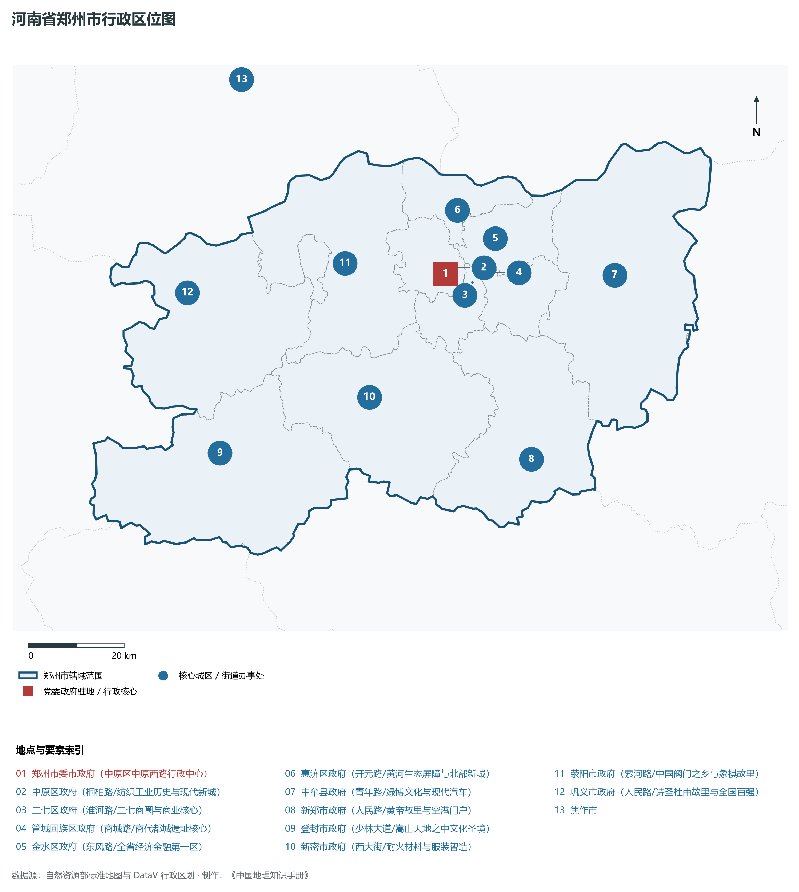
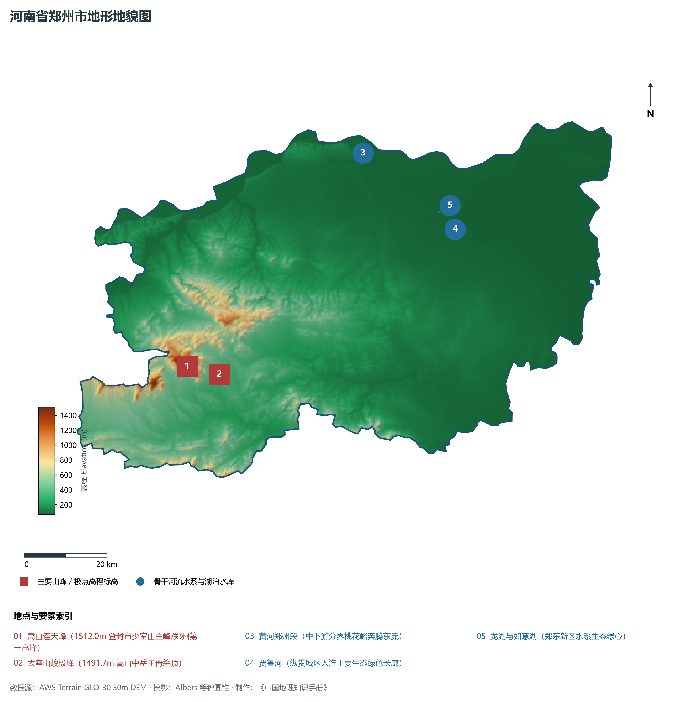
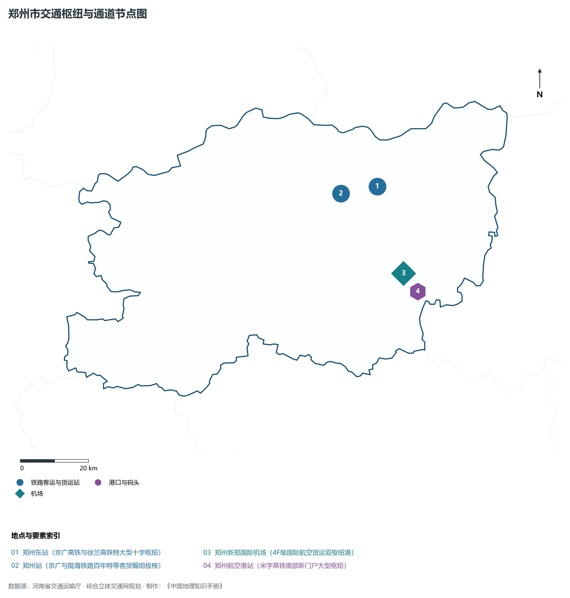
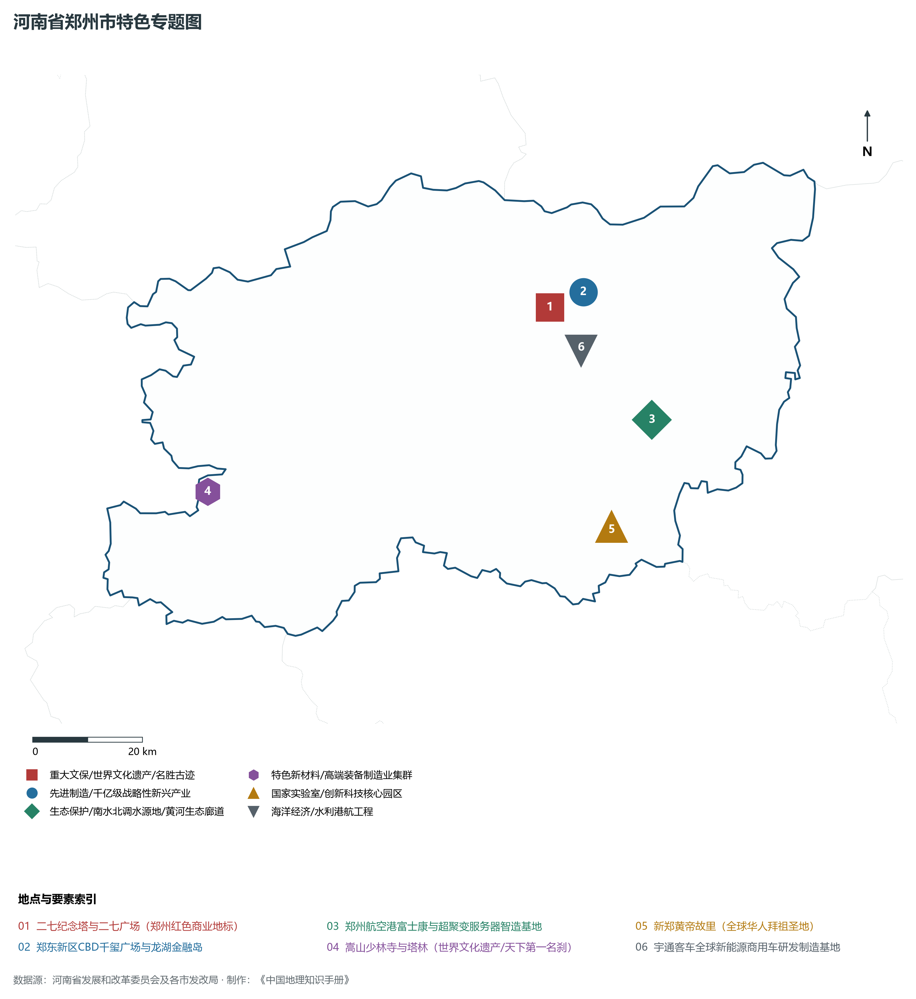
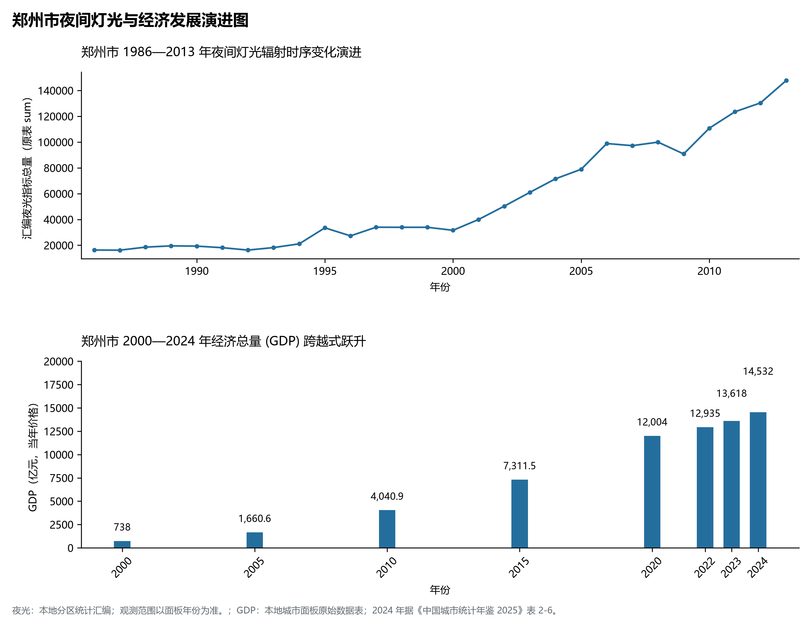

# 15.1 郑州市

郑州市，地处河南省核心战略功能区与中原经济区关键节点，其城市综合战略定位与发展愿景概括为：**河南省省会·国家中心城市·中原城市群核心引擎·特大城市·国际综合交通枢纽·郑州航空港区**。2024 年常住人口 **1,309 万人**，常住人口城镇化率 **81%**，地区生产总值 **14,532 亿元**（当年价格），人均地区生产总值 **111,382 元**，三次产业构成为 **1.32 : 37.73 : 60.95**。

---

## 一、自然地理底盘与山川水系机理

区域骨干控制性山峰、高程标高极点与主要地貌控制节点包括：

- **嵩山连天峰 (1512.0m 登封市少室山主峰/郑州第一高峰)**（空间坐标约东经 113.030°、北纬 34.505°，海拔标高约 1512.0 m）；
- **太室山峻极峰 (1491.7m 嵩山中岳主脊绝顶)**（空间坐标约东经 113.080°、北纬 34.485°，海拔标高约 1491.7 m）；

本节列示的主要河湖与水系节点：

- **黄河郑州段 (中下游分界桃花峪奔腾东流)**（水系坐标约东经 113.550°、北纬 34.930°）；
- **贾鲁河 (纵贯城区入淮重要生态绿色长廊)**（水系坐标约东经 113.780°、北纬 34.750°）；
- **龙湖与如意湖 (郑东新区水系生态绿心)**（水系坐标约东经 113.740°、北纬 34.790°）；

---

## 二、行政区划沿革与城镇空间体系

郑州市建置沿革源远流长，文脉绵延数千年，自古即为华夏聚居、三代都邑、百家争鸣或商贾重镇。夏商周立国分封、汉唐置郡设州、宋元设路设府、明清建州设县，历经千百载风云变迁，积淀下极为厚重的政区地名文化遗产。新中国成立后特别是改革开放以来，伴随撤地设市、行政区划合理调整、城区组团式向外延展与以人为核心的新型城镇化深入推进，构建了中心极核强引领、县域板块协同支撑、重点中心镇特色鲜明、产城人文深度融合的现代化多极城镇空间体系：

- **郑州市委市政府 (中原区中原西路行政中心)**（驻地坐标：113.585°E, 34.750°N）；
- **中原区政府 (桐柏路/纺织工业历史与现代新城)**（驻地坐标：113.605°E, 34.760°N）；
- **二七区政府 (淮河路/二七商圈与商业核心)**（驻地坐标：113.645°E, 34.730°N）；
- **管城回族区政府 (商城路/商代都城遗址核心)**（驻地坐标：113.685°E, 34.745°N）；
- **金水区政府 (东风路/全省经济金融第一区)**（驻地坐标：113.675°E, 34.795°N）；
- **惠济区政府 (开元路/黄河生态屏障与北部新城)**（驻地坐标：113.625°E, 34.865°N）；
- **中牟县政府 (青年路/绿博文化与现代汽车)**（驻地坐标：113.975°E, 34.720°N）；
- **新郑市政府 (人民路/黄帝故里与空港门户)**（驻地坐标：113.745°E, 34.395°N）；
- **登封市政府 (少林大道/嵩山天地之中文化圣境)**（驻地坐标：113.030°E, 34.455°N）；
- **新密市政府 (西大街/耐火材料与服装智造)**（驻地坐标：113.385°E, 34.535°N）；
- **荥阳市政府 (索河路/中国阀门之乡与象棋故里)**（驻地坐标：113.355°E, 34.785°N）；
- **巩义市政府 (人民路/诗圣杜甫故里与全国百强)**（驻地坐标：112.985°E, 34.755°N）；

在国土空间总体规划指引下，郑州市坚决严守耕地保护红线、生态保护红线与城镇开发边界“三条控制线”，优化“生产、生活、生态”空间协同布局，全面提升城市韧性与基础设施能级，持续缩小城乡基本公共服务差距，打造宜居、韧性、智慧、绿色的现代化和美家园。

---

## 三、综合立体交通网络与现代枢纽通道

本节列示的主要交通节点与通道：

**核心综合客货运交通枢纽节点与交通干线走廊：**

- **郑州东站 (京广高铁与徐兰高铁特大型十字枢纽)**（空间坐标：113.780°E, 34.760°N）；
- **郑州站 (京广与陇海铁路百年特等客货编组极核)**（空间坐标：113.660°E, 34.750°N）；
- **郑州新郑国际机场 (4F级国际航空货运双枢纽港)**（空间坐标：113.840°E, 34.530°N）；
- **郑州航空港站 (米字高铁南部新门户大型枢纽)**（空间坐标：113.880°E, 34.480°N）；

---

## 四、现代产业体系与新质生产力布局

郑州市坚定不移实施工业立市、制造业强市战略，对标河南省“7+28+N”产业链群布局要求，推动传统优势产业高端化、智能化、绿色化转型，做强战略性新兴产业，前瞻培育未来产业，构筑起实体经济厚重挺拔、创新动能蓬勃涌动的现代产业高地：

**标志性先进制造业集群、特色产业园区、国家重点实验室与产业地标：**

- **二七纪念塔与二七广场 (郑州红色商业地标)**（空间坐标：113.665°E, 34.755°N）；
- **郑东新区CBD千玺广场与龙湖金融岛**（空间坐标：113.735°E, 34.775°N）；
- **郑州航空港富士康与超聚变服务器智造基地**（空间坐标：113.850°E, 34.560°N）；
- **嵩山少林寺与塔林 (世界文化遗产/天下第一名刹)**（空间坐标：112.945°E, 34.505°N）；
- **新郑黄帝故里 (全球华人拜祖圣地)**（空间坐标：113.750°E, 34.395°N）；
- **宇通客车全球新能源商用车研发制造基地**（空间坐标：113.720°E, 34.680°N）；

通过深入实施工业产业链“链长制”与领航企业培育计划，郑州市聚力推动创新链、产业链、资金链、人才链深度融合，梯次培育单项冠军企业、高新技术企业与专精特新“小巨人”企业集群，积极抢占新材料、先进装备、新能源、高端电子信息、绿色食品与现代生物医药等细分赛道制高点，夯实现代化经济强市的实体支撑。

---

## 五、历史文化名胜、人文底蕴与全域文旅地理

郑州市的文化旅游与相关地标：

- **二七纪念塔与二七广场 (郑州红色商业地标)**；
- **郑东新区CBD千玺广场与龙湖金融岛**；
- **郑州航空港富士康与超聚变服务器智造基地**；
- **嵩山少林寺与塔林 (世界文化遗产/天下第一名刹)**；
- **新郑黄帝故里 (全球华人拜祖圣地)**；
- **宇通客车全球新能源商用车研发制造基地**；

立足“行走河南·读懂中国”文旅超级品牌，郑州市大力实施文旅文创融合战略，推动考古遗址公园、历史文化街区、沉浸式演艺与生态休闲度假深度跨界赋能，以数字科技再现千年华夏古韵，打造享誉海内外的中华文化寻根研学旅行胜地。

---

## 六、夜间灯光辐射与跨世纪经济变化时序演进

本节夜光图的观测年份为 1986—2013 年，指标为行政区汇总值（原表 sum）。

| 年份 | 地区生产总值（亿元，当年价格） |
|:---|---:|
| 2000 年 | 738 |
| 2005 年 | 1,660.6 |
| 2010 年 | 4,040.9 |
| 2015 年 | 7,311.5 |
| 2020 年 | 12,004 |
| 2022 年 | 12,935 |
| 2023 年 | 13,618 |
| 2024 年 | 14,532 |

2024 年统计来源：《中国城市统计年鉴 2025》表 2-1、2-6、2-7（2024 年，全市）。其他年份 GDP 据本地城市面板“原始数据”表，单位为亿元、当年价格。
