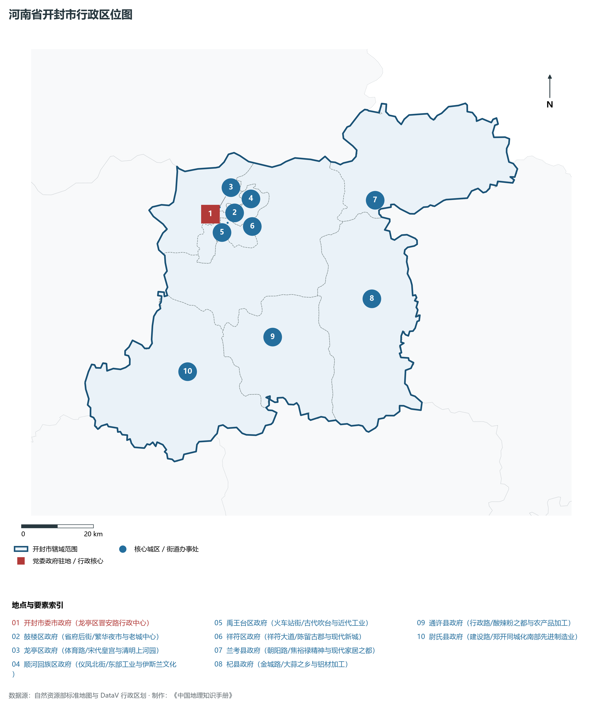
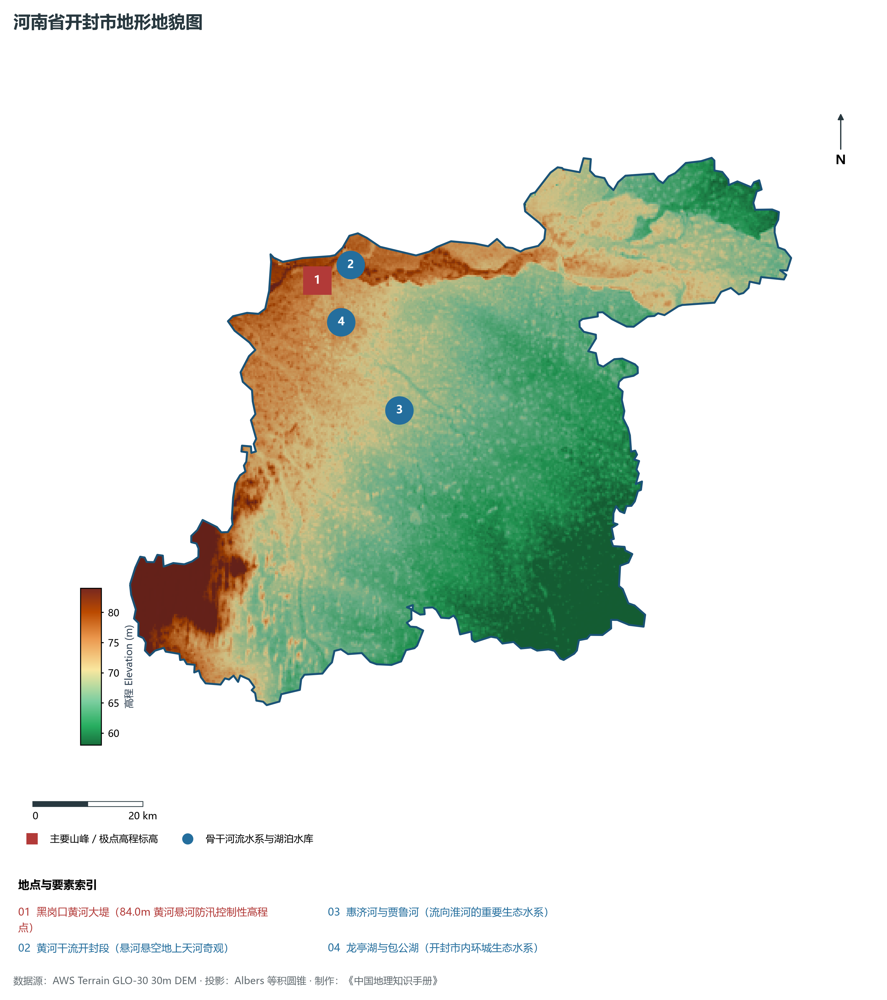
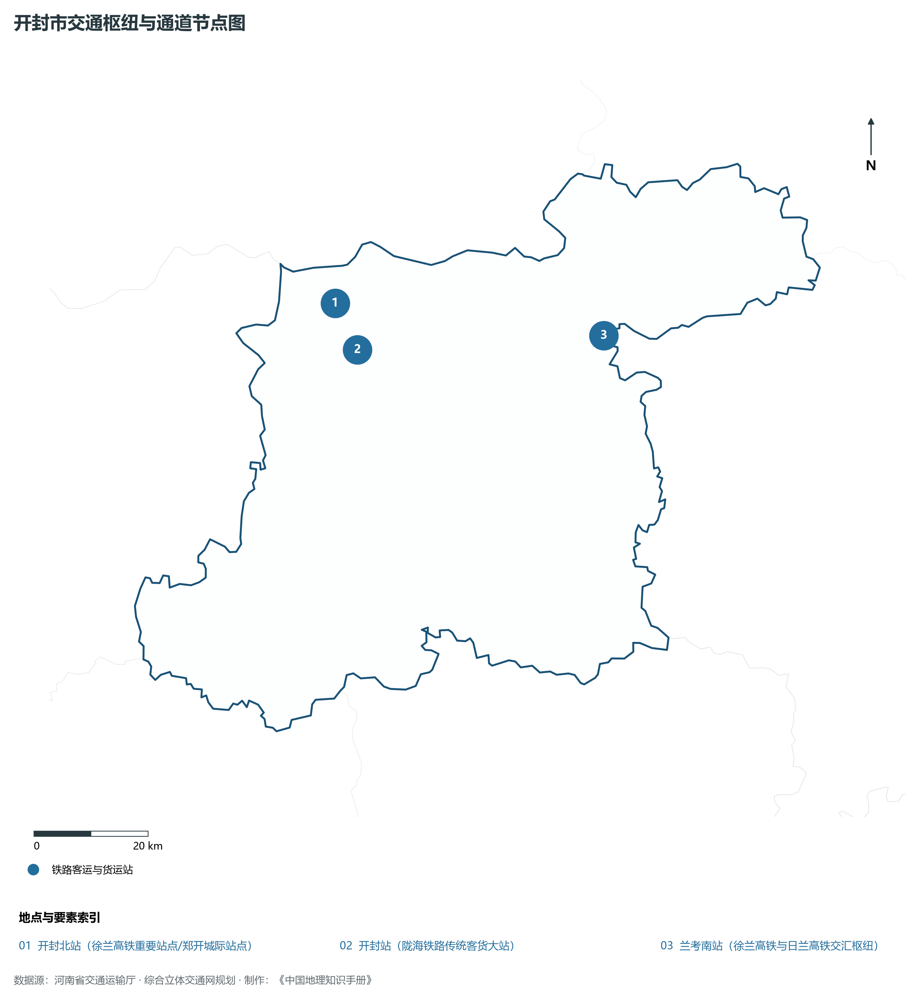
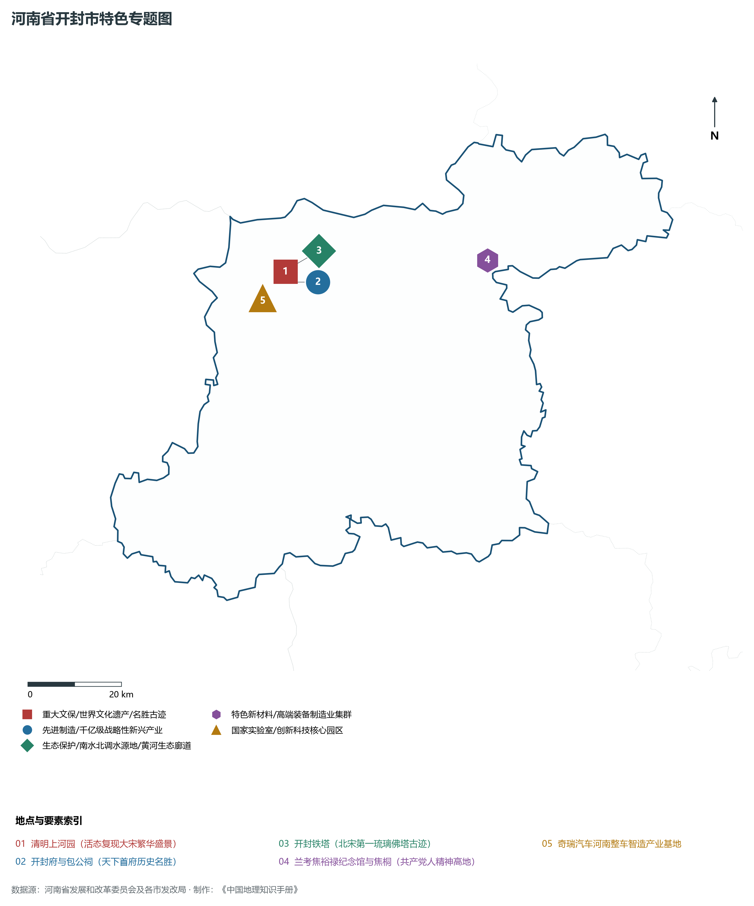
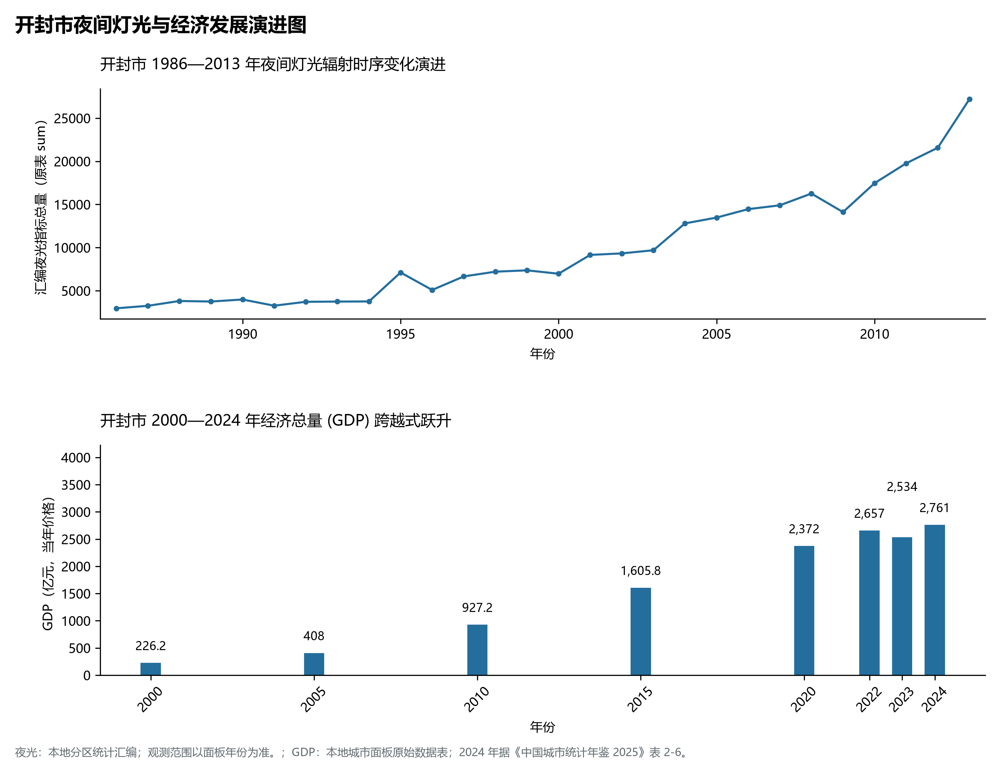

# 15.2 开封市

开封市，地处河南省核心战略功能区与中原经济区关键节点，其城市综合战略定位与发展愿景概括为：**国家历史文化名城·八朝古都·郑开同城化重要极核·清明上河园宋文化名城·焦裕禄精神发祥地**。2024 年常住人口 **470 万人**，常住人口城镇化率 **55.73%**，地区生产总值 **2,761 亿元**（当年价格），人均地区生产总值 **58,672 元**，三次产业构成为 **13.15 : 35.11 : 51.74**。

---

## 一、自然地理底盘与山川水系机理

区域骨干控制性山峰、高程标高极点与主要地貌控制节点包括：

- **黑岗口黄河大堤 (84.0m 黄河悬河防汛控制性高程点)**（空间坐标约东经 114.310°、北纬 34.870°，海拔标高约 84.0 m）；

本节列示的主要河湖与水系节点：

- **黄河干流开封段 (悬河悬空地上天河奇观)**（水系坐标约东经 114.380°、北纬 34.890°）；
- **惠济河与贾鲁河 (流向淮河的重要生态水系)**（水系坐标约东经 114.450°、北纬 34.650°）；
- **龙亭湖与包公湖 (开封市内环城生态水系)**（水系坐标约东经 114.350°、北纬 34.800°）；

---

## 二、行政区划沿革与城镇空间体系

开封市建置沿革源远流长，文脉绵延数千年，自古即为华夏聚居、三代都邑、百家争鸣或商贾重镇。夏商周立国分封、汉唐置郡设州、宋元设路设府、明清建州设县，历经千百载风云变迁，积淀下极为厚重的政区地名文化遗产。新中国成立后特别是改革开放以来，伴随撤地设市、行政区划合理调整、城区组团式向外延展与以人为核心的新型城镇化深入推进，构建了中心极核强引领、县域板块协同支撑、重点中心镇特色鲜明、产城人文深度融合的现代化多极城镇空间体系：

- **开封市委市政府 (龙亭区晋安路行政中心)**（驻地坐标：114.310°E, 34.795°N）；
- **鼓楼区政府 (省府后街/繁华夜市与老城中心)**（驻地坐标：114.350°E, 34.795°N）；
- **龙亭区政府 (体育路/宋代皇宫与清明上河园)**（驻地坐标：114.340°E, 34.810°N）；
- **顺河回族区政府 (仪凤北街/东部工业与伊斯兰文化)**（驻地坐标：114.375°E, 34.800°N）；
- **禹王台区政府 (火车站街/古代吹台与近代工业)**（驻地坐标：114.360°E, 34.770°N）；
- **祥符区政府 (祥符大道/陈留古郡与现代新城)**（驻地坐标：114.435°E, 34.755°N）；
- **兰考县政府 (朝阳路/焦裕禄精神与现代家居之都)**（驻地坐标：114.820°E, 34.790°N）；
- **杞县政府 (金城路/大蒜之乡与铝材加工)**（驻地坐标：114.780°E, 34.550°N）；
- **通许县政府 (行政路/酸辣粉之都与农产品加工)**（驻地坐标：114.465°E, 34.480°N）；
- **尉氏县政府 (建设路/郑开同城化南部先进制造业)**（驻地坐标：114.195°E, 34.415°N）；

在国土空间总体规划指引下，开封市坚决严守耕地保护红线、生态保护红线与城镇开发边界“三条控制线”，优化“生产、生活、生态”空间协同布局，全面提升城市韧性与基础设施能级，持续缩小城乡基本公共服务差距，打造宜居、韧性、智慧、绿色的现代化和美家园。

---

## 三、综合立体交通网络与现代枢纽通道

本节列示的主要交通节点与通道：

**核心综合客货运交通枢纽节点与交通干线走廊：**

- **开封北站 (徐兰高铁重要站点/郑开城际站点)**（空间坐标：114.320°E, 34.850°N）；
- **开封站 (陇海铁路传统客货大站)**（空间坐标：114.355°E, 34.775°N）；
- **兰考南站 (徐兰高铁与日兰高铁交汇枢纽)**（空间坐标：114.835°E, 34.760°N）；

---

## 四、现代产业体系与新质生产力布局

开封市坚定不移实施工业立市、制造业强市战略，对标河南省“7+28+N”产业链群布局要求，推动传统优势产业高端化、智能化、绿色化转型，做强战略性新兴产业，前瞻培育未来产业，构筑起实体经济厚重挺拔、创新动能蓬勃涌动的现代产业高地：

**标志性先进制造业集群、特色产业园区、国家重点实验室与产业地标：**

- **清明上河园 (活态复现大宋繁华盛景)**（空间坐标：114.340°E, 34.805°N）；
- **开封府与包公祠 (天下首府历史名胜)**（空间坐标：114.345°E, 34.785°N）；
- **开封铁塔 (北宋第一琉璃佛塔古迹)**（空间坐标：114.360°E, 34.815°N）；
- **兰考焦裕禄纪念馆与焦桐 (共产党人精神高地)**（空间坐标：114.820°E, 34.790°N）；
- **奇瑞汽车河南整车智造产业基地**（空间坐标：114.280°E, 34.760°N）；

通过深入实施工业产业链“链长制”与领航企业培育计划，开封市聚力推动创新链、产业链、资金链、人才链深度融合，梯次培育单项冠军企业、高新技术企业与专精特新“小巨人”企业集群，积极抢占新材料、先进装备、新能源、高端电子信息、绿色食品与现代生物医药等细分赛道制高点，夯实现代化经济强市的实体支撑。

---

## 五、历史文化名胜、人文底蕴与全域文旅地理

开封市的文化旅游与相关地标：

- **清明上河园 (活态复现大宋繁华盛景)**；
- **开封府与包公祠 (天下首府历史名胜)**；
- **开封铁塔 (北宋第一琉璃佛塔古迹)**；
- **兰考焦裕禄纪念馆与焦桐 (共产党人精神高地)**；
- **奇瑞汽车河南整车智造产业基地**；

立足“行走河南·读懂中国”文旅超级品牌，开封市大力实施文旅文创融合战略，推动考古遗址公园、历史文化街区、沉浸式演艺与生态休闲度假深度跨界赋能，以数字科技再现千年华夏古韵，打造享誉海内外的中华文化寻根研学旅行胜地。

---

## 六、夜间灯光辐射与跨世纪经济变化时序演进

本节夜光图的观测年份为 1986—2013 年，指标为行政区汇总值（原表 sum）。

| 年份 | 地区生产总值（亿元，当年价格） |
|:---|---:|
| 2000 年 | 226.2 |
| 2005 年 | 408 |
| 2010 年 | 927.2 |
| 2015 年 | 1,605.8 |
| 2020 年 | 2,372 |
| 2022 年 | 2,657 |
| 2023 年 | 2,534 |
| 2024 年 | 2,761 |

2024 年统计来源：《中国城市统计年鉴 2025》表 2-1、2-6、2-7（2024 年，全市）。其他年份 GDP 据本地城市面板“原始数据”表，单位为亿元、当年价格。
