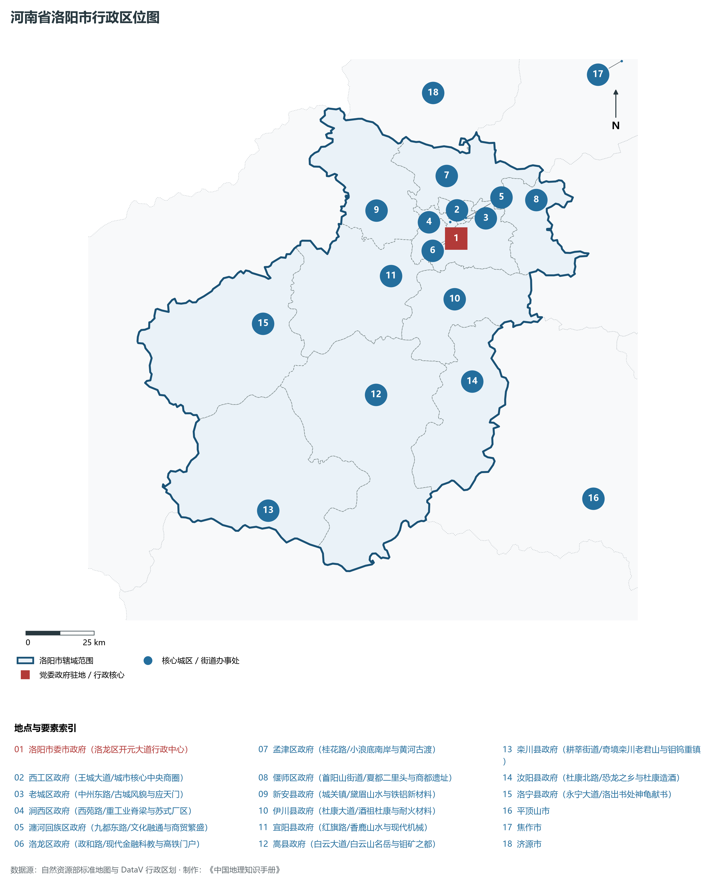
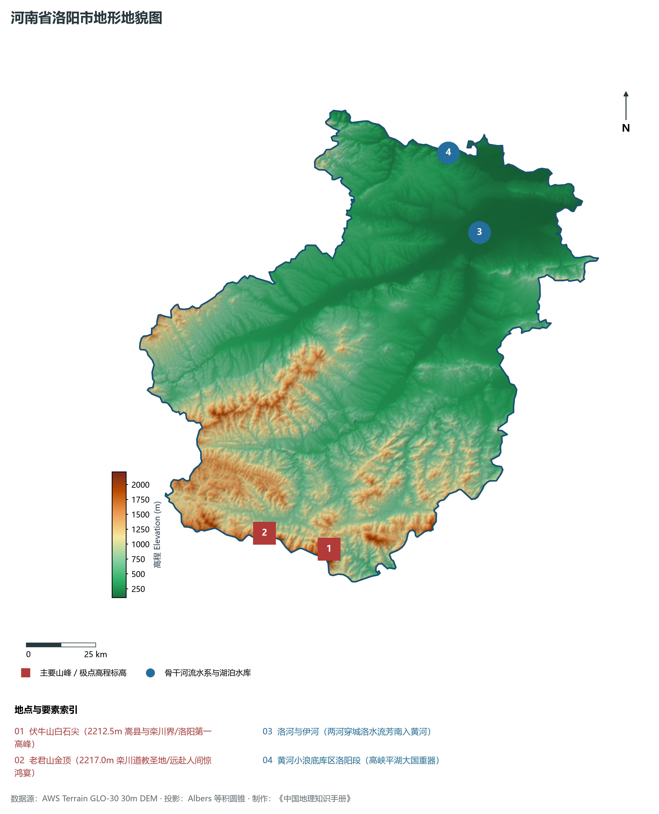
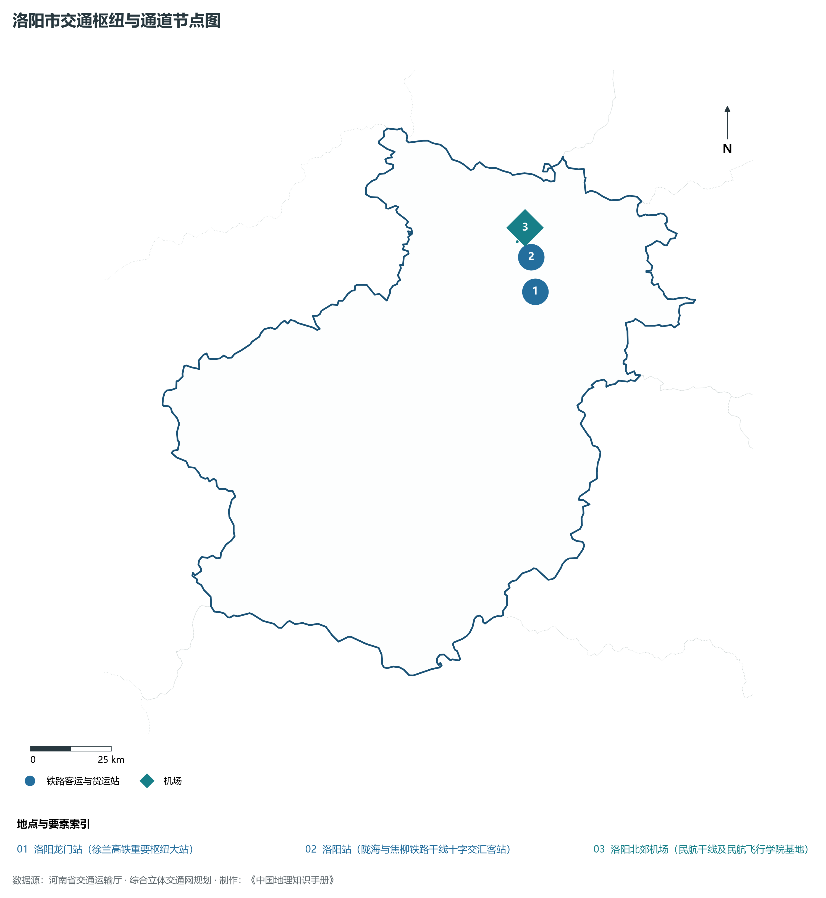
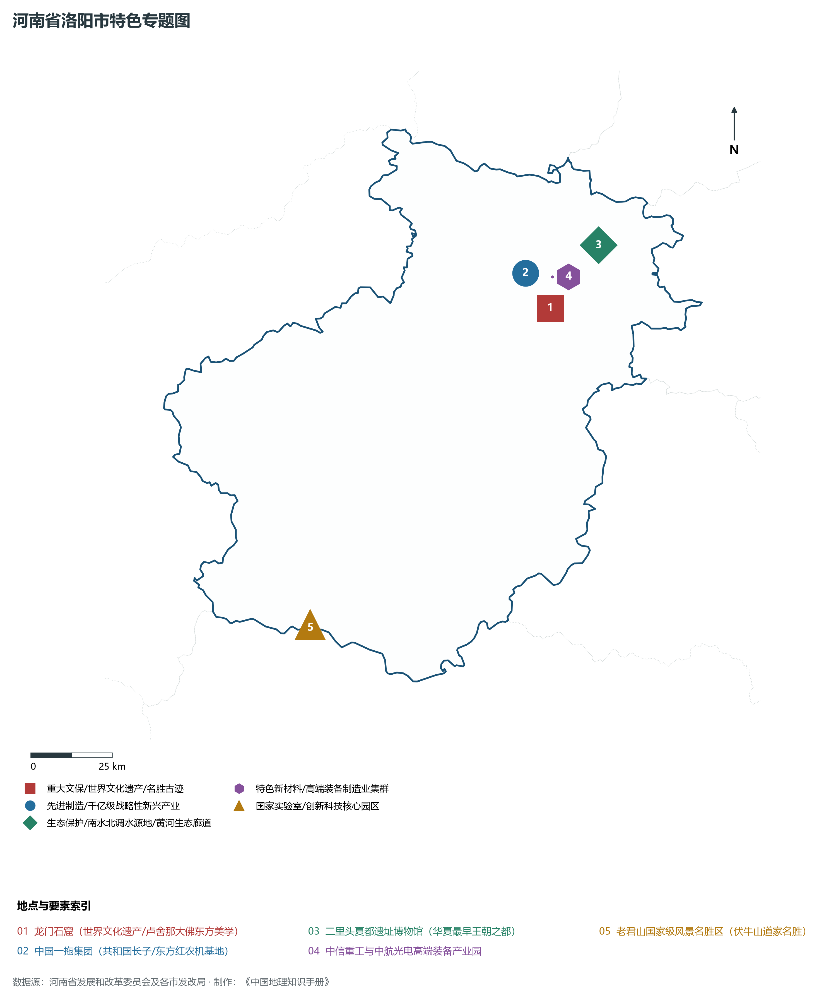
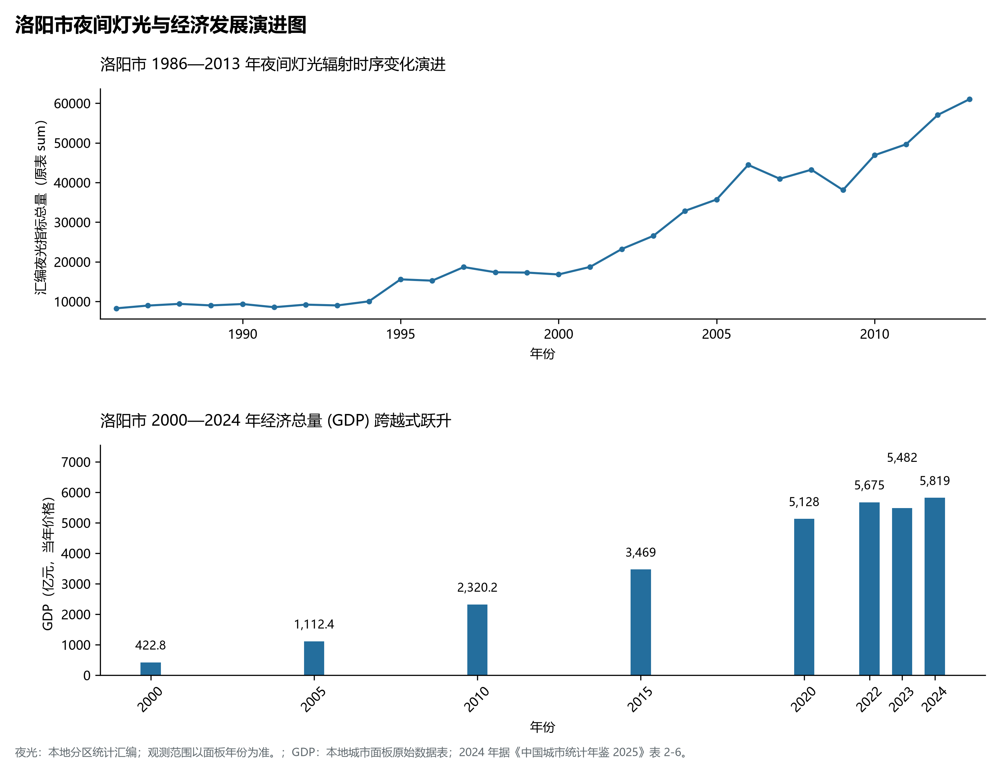

# 15.3 洛阳市

洛阳市，地处河南省核心战略功能区与中原经济区关键节点，其城市综合战略定位与发展愿景概括为：**中原城市群副中心·十三朝古都·世界文化遗产龙门石窟·全国先进装备制造基地·老工业基地转型标杆**。2024 年常住人口 **708 万人**，常住人口城镇化率 **68.39%**，地区生产总值 **5,819 亿元**（当年价格），人均地区生产总值 **82,184 元**，三次产业构成为 **4.07 : 40.61 : 55.33**。

---

## 一、自然地理底盘与山川水系机理

区域骨干控制性山峰、高程标高极点与主要地貌控制节点包括：

- **伏牛山白石尖 (2212.5m 嵩县与栾川界/洛阳第一高峰)**（空间坐标约东经 111.835°、北纬 33.680°，海拔标高约 2212.5 m）；
- **老君山金顶 (2217.0m 栾川道教圣地/远赴人间惊鸿宴)**（空间坐标约东经 111.585°、北纬 33.745°，海拔标高约 2217.0 m）；

本节列示的主要河湖与水系节点：

- **洛河与伊河 (两河穿城洛水流芳南入黄河)**（水系坐标约东经 112.520°、北纬 34.650°）；
- **黄河小浪底库区洛阳段 (高峡平湖大国重器)**（水系坐标约东经 112.420°、北纬 34.910°）；

---

## 二、行政区划沿革与城镇空间体系

洛阳市建置沿革源远流长，文脉绵延数千年，自古即为华夏聚居、三代都邑、百家争鸣或商贾重镇。夏商周立国分封、汉唐置郡设州、宋元设路设府、明清建州设县，历经千百载风云变迁，积淀下极为厚重的政区地名文化遗产。新中国成立后特别是改革开放以来，伴随撤地设市、行政区划合理调整、城区组团式向外延展与以人为核心的新型城镇化深入推进，构建了中心极核强引领、县域板块协同支撑、重点中心镇特色鲜明、产城人文深度融合的现代化多极城镇空间体系：

- **洛阳市委市政府 (洛龙区开元大道行政中心)**（驻地坐标：112.455°E, 34.620°N）；
- **西工区政府 (王城大道/城市核心中央商圈)**（驻地坐标：112.435°E, 34.675°N）；
- **老城区政府 (中州东路/古城风貌与应天门)**（驻地坐标：112.470°E, 34.685°N）；
- **涧西区政府 (西苑路/重工业脊梁与苏式厂区)**（驻地坐标：112.395°E, 34.655°N）；
- **瀍河回族区政府 (九都东路/文化融通与商贸繁盛)**（驻地坐标：112.500°E, 34.685°N）；
- **洛龙区政府 (政和路/现代金融科教与高铁门户)**（驻地坐标：112.455°E, 34.625°N）；
- **孟津区政府 (桂花路/小浪底南岸与黄河古渡)**（驻地坐标：112.435°E, 34.825°N）；
- **偃师区政府 (首阳山街道/夏都二里头与商都遗址)**（驻地坐标：112.790°E, 34.725°N）；
- **新安县政府 (城关镇/黛眉山水与铁铝新材料)**（驻地坐标：112.140°E, 34.730°N）；
- **伊川县政府 (杜康大道/酒祖杜康与耐火材料)**（驻地坐标：112.430°E, 34.425°N）；
- **宜阳县政府 (红旗路/香鹿山水与现代机械)**（驻地坐标：112.180°E, 34.515°N）；
- **嵩县政府 (白云大道/白云山名岳与钼矿之都)**（驻地坐标：112.085°E, 34.135°N）；
- **栾川县政府 (耕莘街道/奇境栾川老君山与钼钨重镇)**（驻地坐标：111.620°E, 33.785°N）；
- **汝阳县政府 (杜康北路/恐龙之乡与杜康造酒)**（驻地坐标：112.475°E, 34.155°N）；
- **洛宁县政府 (永宁大道/洛出书处神龟献书)**（驻地坐标：111.650°E, 34.390°N）；

在国土空间总体规划指引下，洛阳市坚决严守耕地保护红线、生态保护红线与城镇开发边界“三条控制线”，优化“生产、生活、生态”空间协同布局，全面提升城市韧性与基础设施能级，持续缩小城乡基本公共服务差距，打造宜居、韧性、智慧、绿色的现代化和美家园。

---

## 三、综合立体交通网络与现代枢纽通道

本节列示的主要交通节点与通道：

**核心综合客货运交通枢纽节点与交通干线走廊：**

- **洛阳龙门站 (徐兰高铁重要枢纽大站)**（空间坐标：112.440°E, 34.595°N）；
- **洛阳站 (陇海与焦柳铁路干线十字交汇客站)**（空间坐标：112.435°E, 34.690°N）；
- **洛阳北郊机场 (民航干线及民航飞行学院基地)**（空间坐标：112.390°E, 34.735°N）；

---

## 四、现代产业体系与新质生产力布局

洛阳市坚定不移实施工业立市、制造业强市战略，对标河南省“7+28+N”产业链群布局要求，推动传统优势产业高端化、智能化、绿色化转型，做强战略性新兴产业，前瞻培育未来产业，构筑起实体经济厚重挺拔、创新动能蓬勃涌动的现代产业高地：

**标志性先进制造业集群、特色产业园区、国家重点实验室与产业地标：**

- **龙门石窟 (世界文化遗产/卢舍那大佛东方美学)**（空间坐标：112.470°E, 34.555°N）；
- **中国一拖集团 (共和国长子/东方红农机基地)**（空间坐标：112.395°E, 34.655°N）；
- **二里头夏都遗址博物馆 (华夏最早王朝之都)**（空间坐标：112.650°E, 34.715°N）；
- **中信重工与中航光电高端装备产业园**（空间坐标：112.485°E, 34.640°N）；
- **老君山国家级风景名胜区 (伏牛山道家名胜)**（空间坐标：111.585°E, 33.745°N）；

通过深入实施工业产业链“链长制”与领航企业培育计划，洛阳市聚力推动创新链、产业链、资金链、人才链深度融合，梯次培育单项冠军企业、高新技术企业与专精特新“小巨人”企业集群，积极抢占新材料、先进装备、新能源、高端电子信息、绿色食品与现代生物医药等细分赛道制高点，夯实现代化经济强市的实体支撑。

---

## 五、历史文化名胜、人文底蕴与全域文旅地理

洛阳市的文化旅游与相关地标：

- **龙门石窟 (世界文化遗产/卢舍那大佛东方美学)**；
- **中国一拖集团 (共和国长子/东方红农机基地)**；
- **二里头夏都遗址博物馆 (华夏最早王朝之都)**；
- **中信重工与中航光电高端装备产业园**；
- **老君山国家级风景名胜区 (伏牛山道家名胜)**；

立足“行走河南·读懂中国”文旅超级品牌，洛阳市大力实施文旅文创融合战略，推动考古遗址公园、历史文化街区、沉浸式演艺与生态休闲度假深度跨界赋能，以数字科技再现千年华夏古韵，打造享誉海内外的中华文化寻根研学旅行胜地。

---

## 六、夜间灯光辐射与跨世纪经济变化时序演进

本节夜光图的观测年份为 1986—2013 年，指标为行政区汇总值（原表 sum）。

| 年份 | 地区生产总值（亿元，当年价格） |
|:---|---:|
| 2000 年 | 422.8 |
| 2005 年 | 1,112.4 |
| 2010 年 | 2,320.2 |
| 2015 年 | 3,469 |
| 2020 年 | 5,128 |
| 2022 年 | 5,675 |
| 2023 年 | 5,482 |
| 2024 年 | 5,819 |

2024 年统计来源：《中国城市统计年鉴 2025》表 2-1、2-6、2-7（2024 年，全市）。其他年份 GDP 据本地城市面板“原始数据”表，单位为亿元、当年价格。
