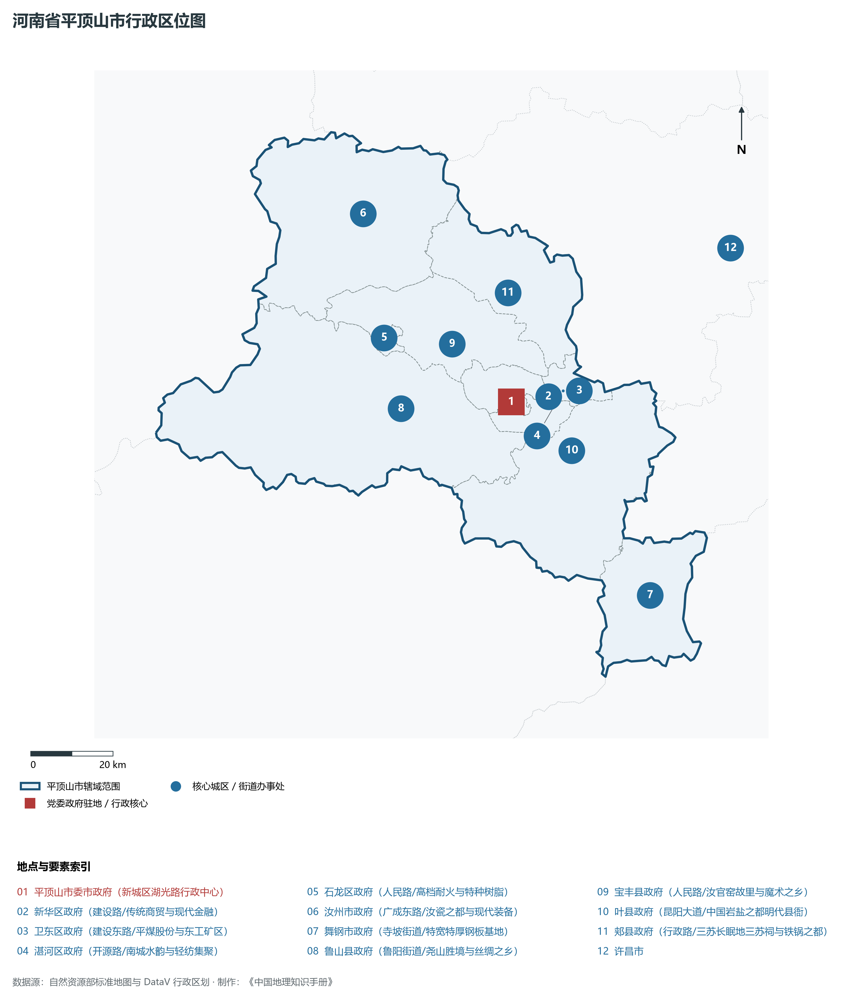
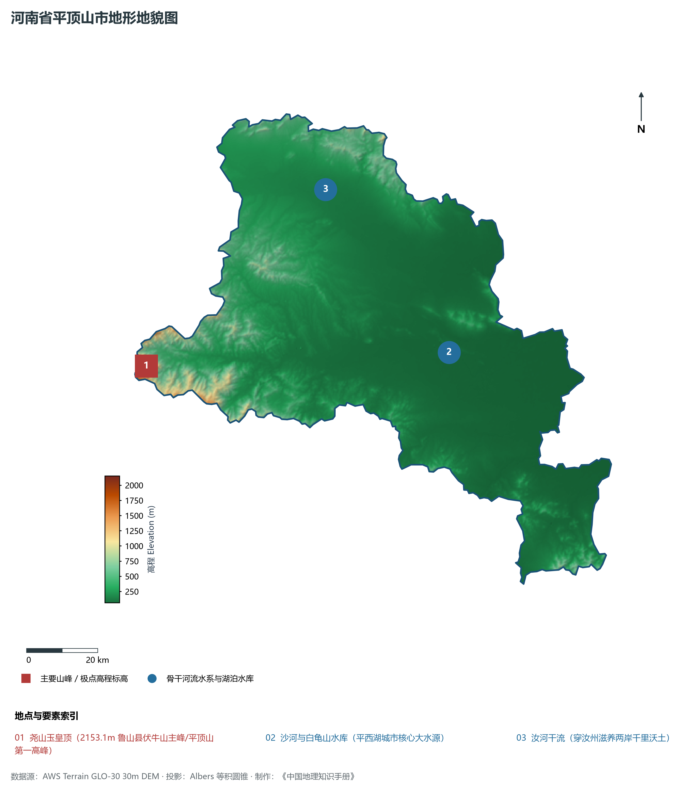
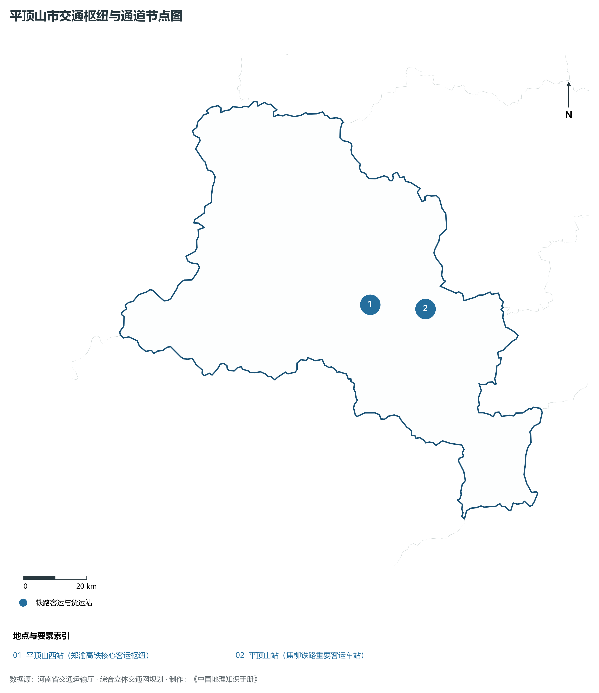
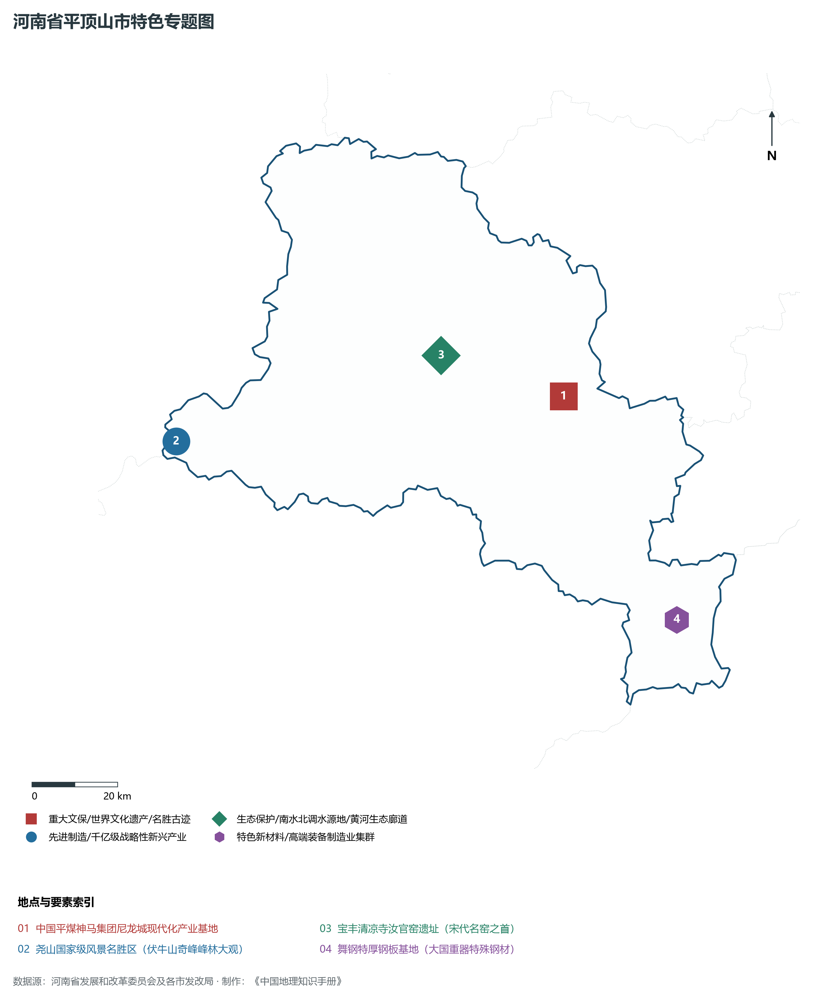
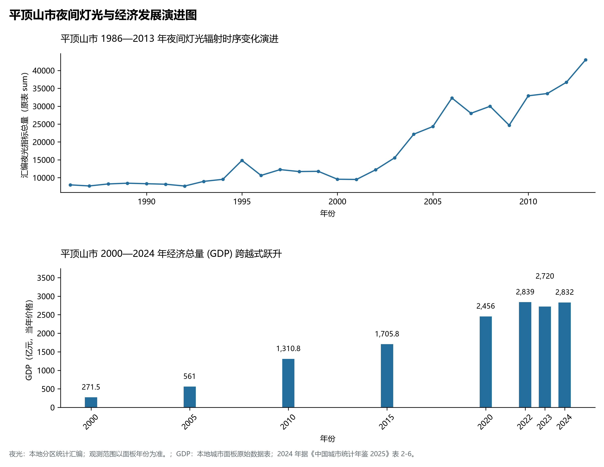

# 15.4 平顶山市

平顶山市，地处河南省核心战略功能区与中原经济区关键节点，其城市综合战略定位与发展愿景概括为：**中原煤仓·中国尼龙城·国家级资源型城市转型示范市·天下汝瓷之都·伏牛仙境尧山**。2024 年常住人口 **488 万人**，常住人口城镇化率 **57.24%**，地区生产总值 **2,832 亿元**（当年价格），人均地区生产总值 **57,819 元**，三次产业构成为 **7.16 : 42.78 : 50.06**。

---

## 一、自然地理底盘与山川水系机理

区域骨干控制性山峰、高程标高极点与主要地貌控制节点包括：

- **尧山玉皇顶 (2153.1m 鲁山县伏牛山主峰/平顶山第一高峰)**（空间坐标约东经 112.285°、北纬 33.745°，海拔标高约 2153.1 m）；

本节列示的主要河湖与水系节点：

- **沙河与白龟山水库 (平西湖城市核心大水源)**（水系坐标约东经 113.220°、北纬 33.720°）；
- **汝河干流 (穿汝州滋养两岸千里沃土)**（水系坐标约东经 112.880°、北纬 34.150°）；

---

## 二、行政区划沿革与城镇空间体系

平顶山市建置沿革源远流长，文脉绵延数千年，自古即为华夏聚居、三代都邑、百家争鸣或商贾重镇。夏商周立国分封、汉唐置郡设州、宋元设路设府、明清建州设县，历经千百载风云变迁，积淀下极为厚重的政区地名文化遗产。新中国成立后特别是改革开放以来，伴随撤地设市、行政区划合理调整、城区组团式向外延展与以人为核心的新型城镇化深入推进，构建了中心极核强引领、县域板块协同支撑、重点中心镇特色鲜明、产城人文深度融合的现代化多极城镇空间体系：

- **平顶山市委市政府 (新城区湖光路行政中心)**（驻地坐标：113.200°E, 33.735°N）；
- **新华区政府 (建设路/传统商贸与现代金融)**（驻地坐标：113.300°E, 33.740°N）；
- **卫东区政府 (建设东路/平煤股份与东工矿区)**（驻地坐标：113.340°E, 33.750°N）；
- **湛河区政府 (开源路/南城水韵与轻纺集聚)**（驻地坐标：113.310°E, 33.715°N）；
- **石龙区政府 (人民路/高档耐火与特种树脂)**（驻地坐标：112.875°E, 33.895°N）；
- **汝州市政府 (广成东路/汝瓷之都与现代装备)**（驻地坐标：112.845°E, 34.165°N）；
- **舞钢市政府 (寺坡街道/特宽特厚钢板基地)**（驻地坐标：113.525°E, 33.295°N）；
- **鲁山县政府 (鲁阳街道/尧山胜境与丝绸之乡)**（驻地坐标：112.905°E, 33.740°N）；
- **宝丰县政府 (人民路/汝官窑故里与魔术之乡)**（驻地坐标：113.055°E, 33.870°N）；
- **叶县政府 (昆阳大道/中国岩盐之都明代县衙)**（驻地坐标：113.350°E, 33.620°N）；
- **郏县政府 (行政路/三苏长眠地三苏祠与铁锅之都)**（驻地坐标：113.215°E, 33.970°N）；

在国土空间总体规划指引下，平顶山市坚决严守耕地保护红线、生态保护红线与城镇开发边界“三条控制线”，优化“生产、生活、生态”空间协同布局，全面提升城市韧性与基础设施能级，持续缩小城乡基本公共服务差距，打造宜居、韧性、智慧、绿色的现代化和美家园。

---

## 三、综合立体交通网络与现代枢纽通道

本节列示的主要交通节点与通道：

**核心综合客货运交通枢纽节点与交通干线走廊：**

- **平顶山西站 (郑渝高铁核心客运枢纽)**（空间坐标：113.125°E, 33.750°N）；
- **平顶山站 (焦柳铁路重要客运车站)**（空间坐标：113.315°E, 33.725°N）；

---

## 四、现代产业体系与新质生产力布局

平顶山市坚定不移实施工业立市、制造业强市战略，对标河南省“7+28+N”产业链群布局要求，推动传统优势产业高端化、智能化、绿色化转型，做强战略性新兴产业，前瞻培育未来产业，构筑起实体经济厚重挺拔、创新动能蓬勃涌动的现代产业高地：

**标志性先进制造业集群、特色产业园区、国家重点实验室与产业地标：**

- **中国平煤神马集团尼龙城现代化产业基地**（空间坐标：113.285°E, 33.775°N）；
- **尧山国家级风景名胜区 (伏牛山奇峰峰林大观)**（空间坐标：112.285°E, 33.745°N）；
- **宝丰清凉寺汝官窑遗址 (宋代名窑之首)**（空间坐标：112.980°E, 33.880°N）；
- **舞钢特厚钢板基地 (大国重器特殊钢材)**（空间坐标：113.525°E, 33.295°N）；

通过深入实施工业产业链“链长制”与领航企业培育计划，平顶山市聚力推动创新链、产业链、资金链、人才链深度融合，梯次培育单项冠军企业、高新技术企业与专精特新“小巨人”企业集群，积极抢占新材料、先进装备、新能源、高端电子信息、绿色食品与现代生物医药等细分赛道制高点，夯实现代化经济强市的实体支撑。

---

## 五、历史文化名胜、人文底蕴与全域文旅地理

平顶山市的文化旅游与相关地标：

- **中国平煤神马集团尼龙城现代化产业基地**；
- **尧山国家级风景名胜区 (伏牛山奇峰峰林大观)**；
- **宝丰清凉寺汝官窑遗址 (宋代名窑之首)**；
- **舞钢特厚钢板基地 (大国重器特殊钢材)**；

立足“行走河南·读懂中国”文旅超级品牌，平顶山市大力实施文旅文创融合战略，推动考古遗址公园、历史文化街区、沉浸式演艺与生态休闲度假深度跨界赋能，以数字科技再现千年华夏古韵，打造享誉海内外的中华文化寻根研学旅行胜地。

---

## 六、夜间灯光辐射与跨世纪经济变化时序演进

本节夜光图的观测年份为 1986—2013 年，指标为行政区汇总值（原表 sum）。

| 年份 | 地区生产总值（亿元，当年价格） |
|:---|---:|
| 2000 年 | 271.5 |
| 2005 年 | 561 |
| 2010 年 | 1,310.8 |
| 2015 年 | 1,705.8 |
| 2020 年 | 2,456 |
| 2022 年 | 2,839 |
| 2023 年 | 2,720 |
| 2024 年 | 2,832 |

2024 年统计来源：《中国城市统计年鉴 2025》表 2-1、2-6、2-7（2024 年，全市）。其他年份 GDP 据本地城市面板“原始数据”表，单位为亿元、当年价格。
