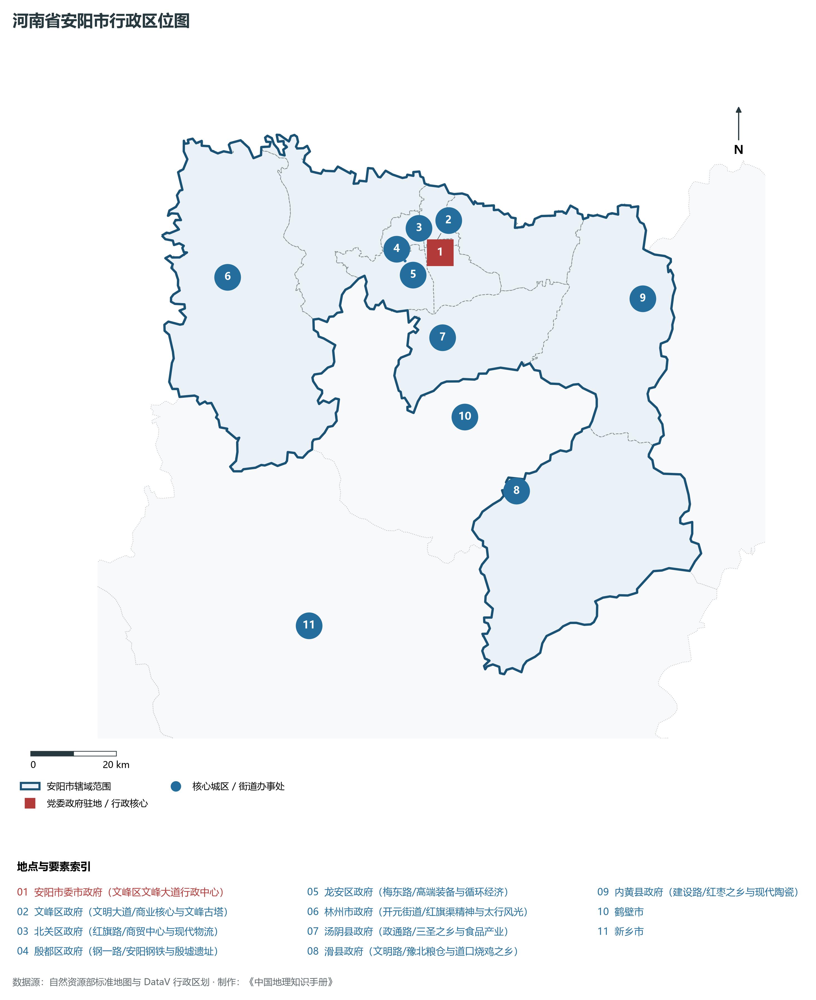
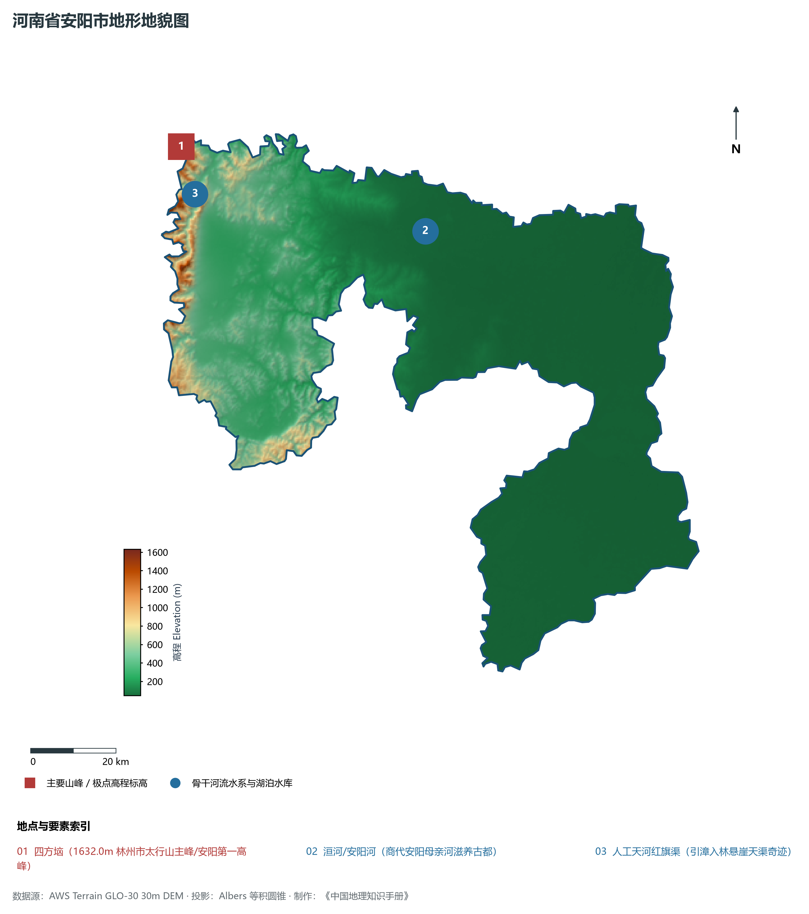
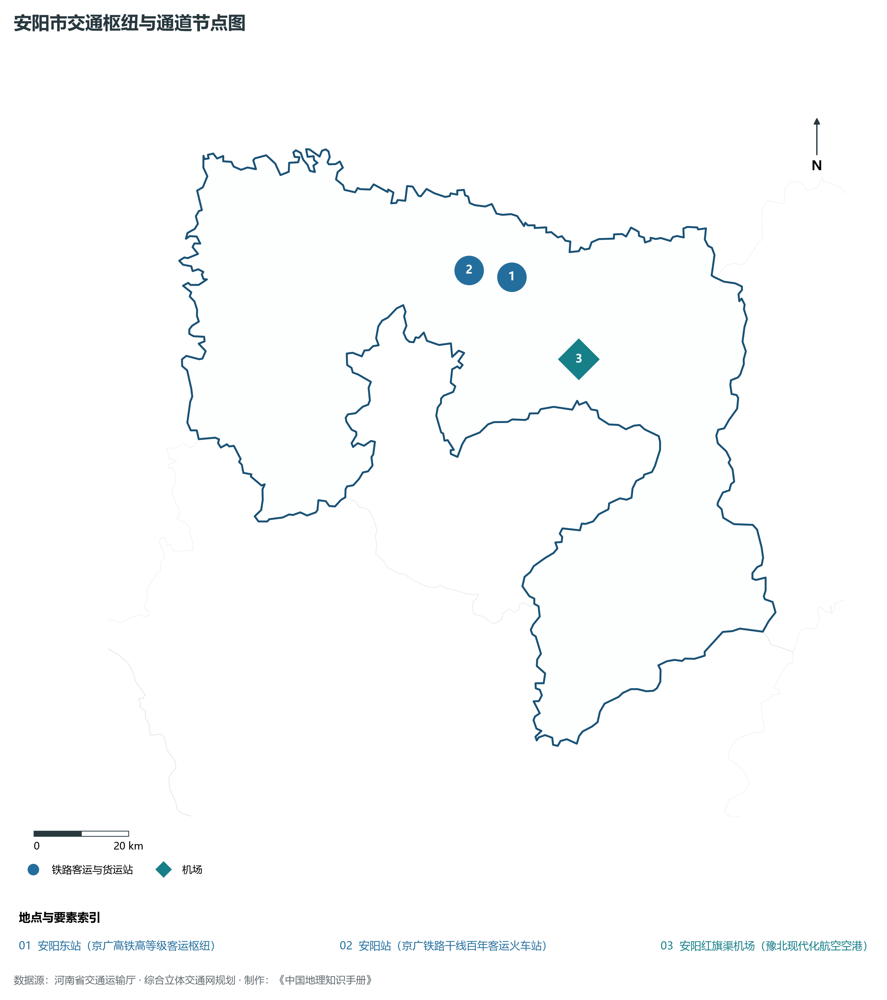
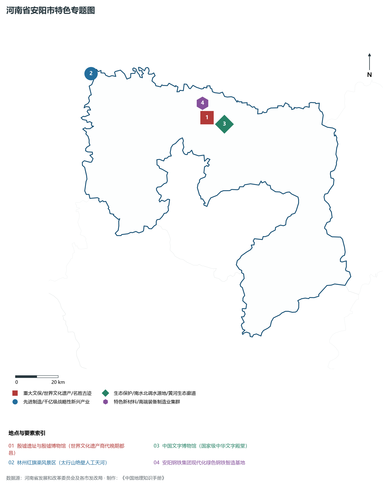
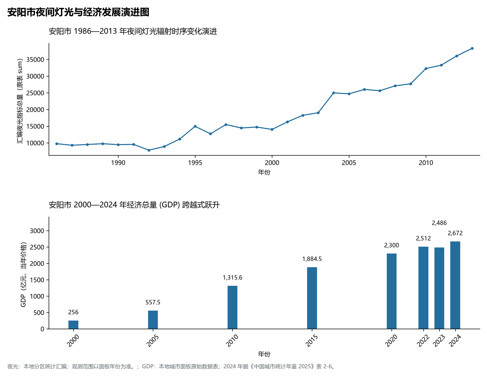

# 15.5 安阳市

安阳市，地处河南省核心战略功能区与中原经济区关键节点，其城市综合战略定位与发展愿景概括为：**国家历史文化名城·七朝古都·世界文化遗产殷墟·文字之都·红旗渠精神发祥地·豫北现代工业中心**。2024 年常住人口 **539 万人**，常住人口城镇化率 **56.86%**，地区生产总值 **2,672 亿元**（当年价格），人均地区生产总值 **49,620 元**，三次产业构成为 **8.18 : 41.22 : 50.6**。

---

## 一、自然地理底盘与山川水系机理

区域骨干控制性山峰、高程标高极点与主要地貌控制节点包括：

- **四方垴 (1632.0m 林州市太行山主峰/安阳第一高峰)**（空间坐标约东经 113.725°、北纬 36.350°，海拔标高约 1632.0 m）；

本节列示的主要河湖与水系节点：

- **洹河/安阳河 (商代安阳母亲河滋养古都)**（水系坐标约东经 114.350°、北纬 36.130°）；
- **人工天河红旗渠 (引漳入林悬崖天渠奇迹)**（水系坐标约东经 113.750°、北纬 36.250°）；

---

## 二、行政区划沿革与城镇空间体系

安阳市建置沿革源远流长，文脉绵延数千年，自古即为华夏聚居、三代都邑、百家争鸣或商贾重镇。夏商周立国分封、汉唐置郡设州、宋元设路设府、明清建州设县，历经千百载风云变迁，积淀下极为厚重的政区地名文化遗产。新中国成立后特别是改革开放以来，伴随撤地设市、行政区划合理调整、城区组团式向外延展与以人为核心的新型城镇化深入推进，构建了中心极核强引领、县域板块协同支撑、重点中心镇特色鲜明、产城人文深度融合的现代化多极城镇空间体系：

- **安阳市委市政府 (文峰区文峰大道行政中心)**（驻地坐标：114.380°E, 36.085°N）；
- **文峰区政府 (文明大道/商业核心与文峰古塔)**（驻地坐标：114.360°E, 36.095°N）；
- **北关区政府 (红旗路/商贸中心与现代物流)**（驻地坐标：114.365°E, 36.120°N）；
- **殷都区政府 (钢一路/安阳钢铁与殷墟遗址)**（驻地坐标：114.305°E, 36.115°N）；
- **龙安区政府 (梅东路/高端装备与循环经济)**（驻地坐标：114.285°E, 36.075°N）；
- **林州市政府 (开元街道/红旗渠精神与太行风光)**（驻地坐标：113.815°E, 36.075°N）；
- **汤阴县政府 (政通路/三圣之乡与食品产业)**（驻地坐标：114.365°E, 35.910°N）；
- **滑县政府 (文明路/豫北粮仓与道口烧鸡之乡)**（驻地坐标：114.520°E, 35.580°N）；
- **内黄县政府 (建设路/红枣之乡与现代陶瓷)**（驻地坐标：114.900°E, 35.950°N）；

在国土空间总体规划指引下，安阳市坚决严守耕地保护红线、生态保护红线与城镇开发边界“三条控制线”，优化“生产、生活、生态”空间协同布局，全面提升城市韧性与基础设施能级，持续缩小城乡基本公共服务差距，打造宜居、韧性、智慧、绿色的现代化和美家园。

---

## 三、综合立体交通网络与现代枢纽通道

本节列示的主要交通节点与通道：

**核心综合客货运交通枢纽节点与交通干线走廊：**

- **安阳东站 (京广高铁高等级客运枢纽)**（空间坐标：114.440°E, 36.085°N）；
- **安阳站 (京广铁路干线百年客运火车站)**（空间坐标：114.340°E, 36.105°N）；
- **安阳红旗渠机场 (豫北现代化航空空港)**（空间坐标：114.580°E, 35.920°N）；

---

## 四、现代产业体系与新质生产力布局

安阳市坚定不移实施工业立市、制造业强市战略，对标河南省“7+28+N”产业链群布局要求，推动传统优势产业高端化、智能化、绿色化转型，做强战略性新兴产业，前瞻培育未来产业，构筑起实体经济厚重挺拔、创新动能蓬勃涌动的现代产业高地：

**标志性先进制造业集群、特色产业园区、国家重点实验室与产业地标：**

- **殷墟遗址与殷墟博物馆 (世界文化遗产商代晚期都邑)**（空间坐标：114.315°E, 36.125°N）；
- **林州红旗渠风景区 (太行山绝壁人工天河)**（空间坐标：113.725°E, 36.350°N）；
- **中国文字博物馆 (国家级中华文字殿堂)**（空间坐标：114.360°E, 36.095°N）；
- **安阳钢铁集团现代化绿色钢铁智造基地**（空间坐标：114.290°E, 36.120°N）；

通过深入实施工业产业链“链长制”与领航企业培育计划，安阳市聚力推动创新链、产业链、资金链、人才链深度融合，梯次培育单项冠军企业、高新技术企业与专精特新“小巨人”企业集群，积极抢占新材料、先进装备、新能源、高端电子信息、绿色食品与现代生物医药等细分赛道制高点，夯实现代化经济强市的实体支撑。

---

## 五、历史文化名胜、人文底蕴与全域文旅地理

安阳市的文化旅游与相关地标：

- **殷墟遗址与殷墟博物馆 (世界文化遗产商代晚期都邑)**；
- **林州红旗渠风景区 (太行山绝壁人工天河)**；
- **中国文字博物馆 (国家级中华文字殿堂)**；
- **安阳钢铁集团现代化绿色钢铁智造基地**；

立足“行走河南·读懂中国”文旅超级品牌，安阳市大力实施文旅文创融合战略，推动考古遗址公园、历史文化街区、沉浸式演艺与生态休闲度假深度跨界赋能，以数字科技再现千年华夏古韵，打造享誉海内外的中华文化寻根研学旅行胜地。

---

## 六、夜间灯光辐射与跨世纪经济变化时序演进

本节夜光图的观测年份为 1986—2013 年，指标为行政区汇总值（原表 sum）。

| 年份 | 地区生产总值（亿元，当年价格） |
|:---|---:|
| 2000 年 | 256 |
| 2005 年 | 557.5 |
| 2010 年 | 1,315.6 |
| 2015 年 | 1,884.5 |
| 2020 年 | 2,300 |
| 2022 年 | 2,512 |
| 2023 年 | 2,486 |
| 2024 年 | 2,672 |

2024 年统计来源：《中国城市统计年鉴 2025》表 2-1、2-6、2-7（2024 年，全市）。其他年份 GDP 据本地城市面板“原始数据”表，单位为亿元、当年价格。
