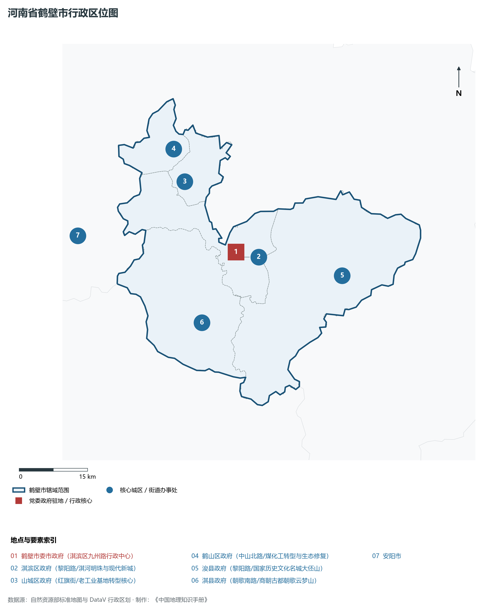
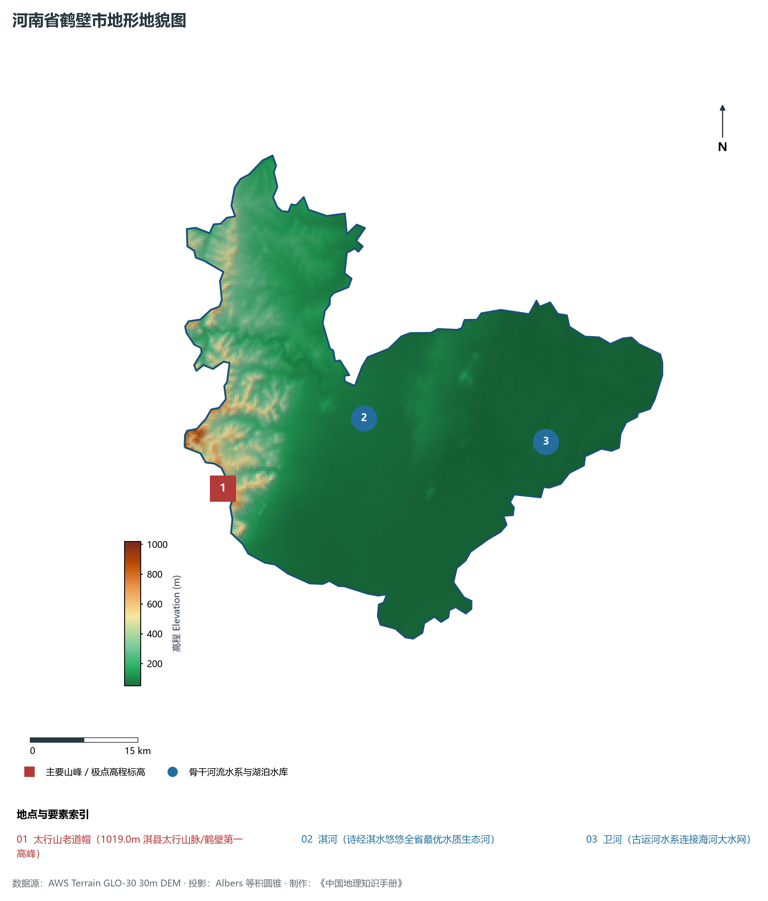
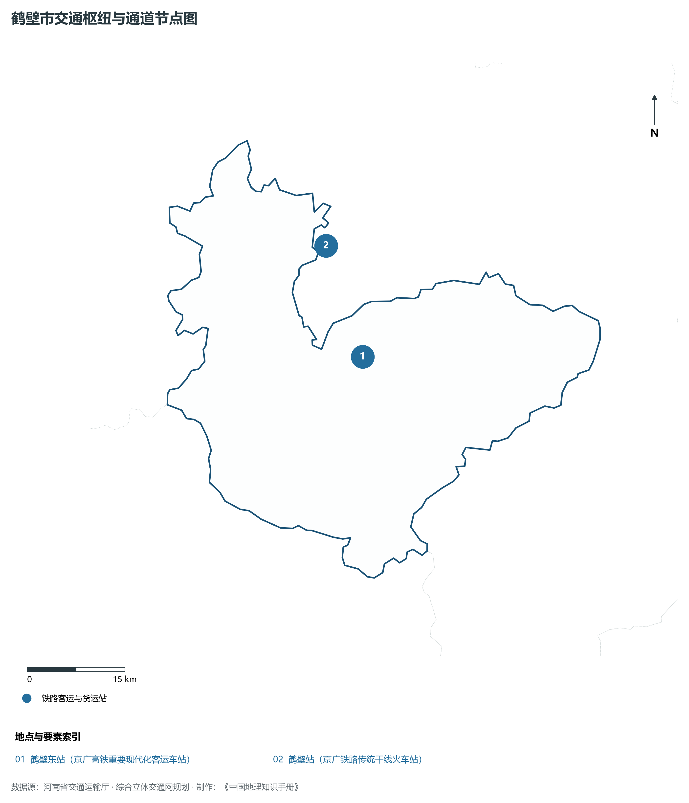
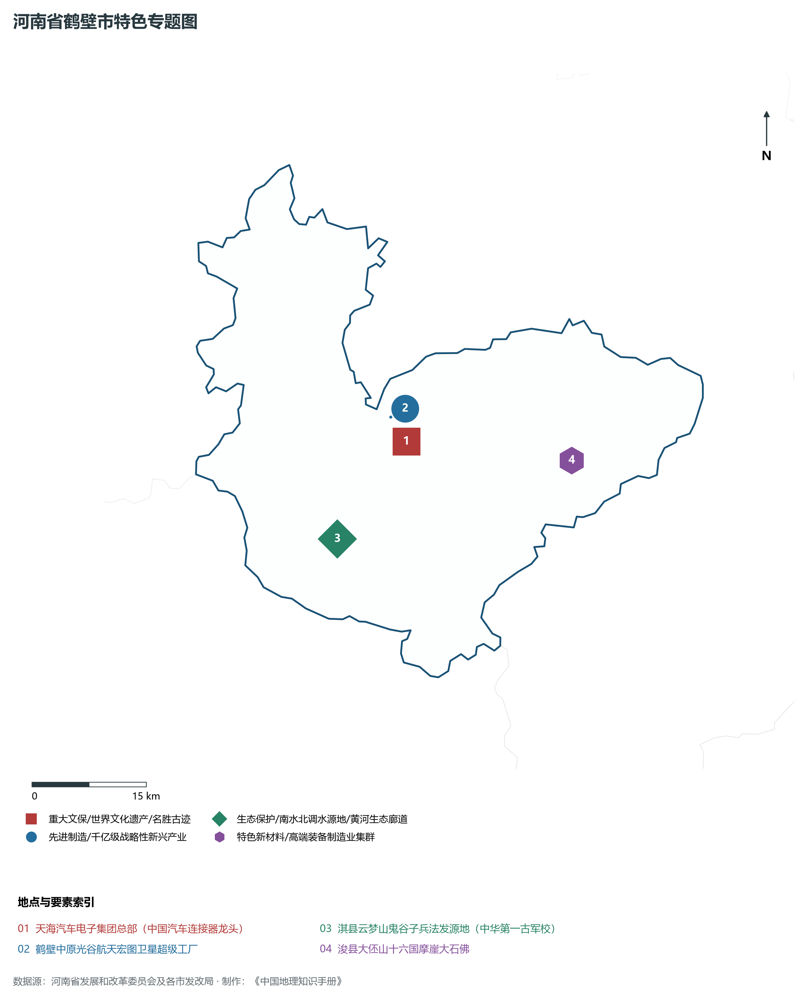
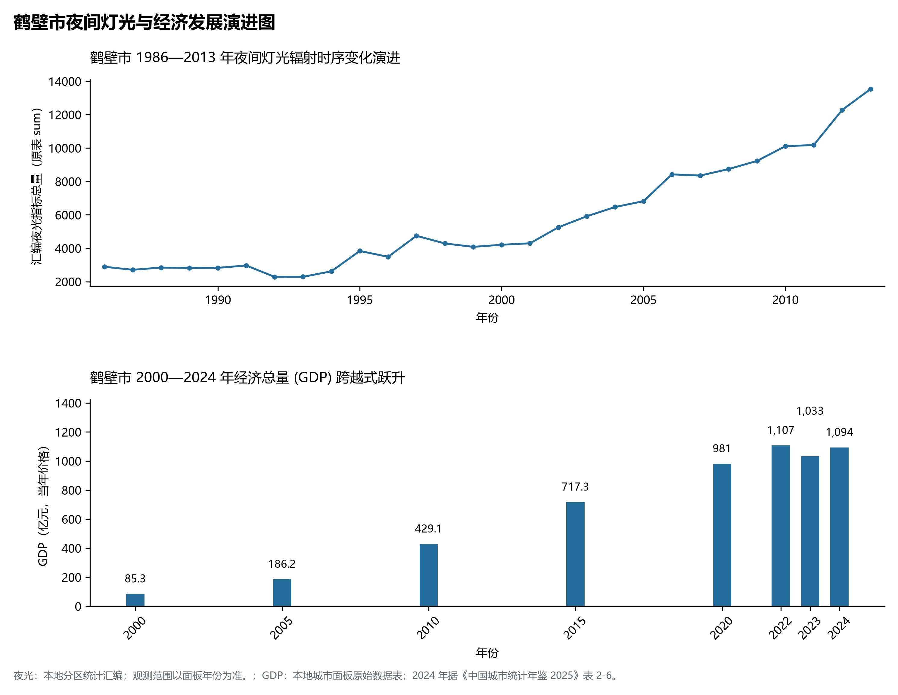

# 15.6 鹤壁市

鹤壁市，地处河南省核心战略功能区与中原经济区关键节点，其城市综合战略定位与发展愿景概括为：**中国诗经文化名城·全国汽车电子电器之都·商业航天卫星产业前沿·淇河生态绿色明珠**。2024 年常住人口 **156 万人**，常住人口城镇化率 **64.34%**，地区生产总值 **1,094 亿元**（当年价格），人均地区生产总值 **69,996 元**，三次产业构成为 **7.03 : 50.66 : 42.31**。

---

## 一、自然地理底盘与山川水系机理

区域骨干控制性山峰、高程标高极点与主要地貌控制节点包括：

- **太行山老道帽 (1019.0m 淇县太行山脉/鹤壁第一高峰)**（空间坐标约东经 114.050°、北纬 35.650°，海拔标高约 1019.0 m）；

本节列示的主要河湖与水系节点：

- **淇河 (诗经淇水悠悠全省最优水质生态河)**（水系坐标约东经 114.280°、北纬 35.720°）；
- **卫河 (古运河水系连接海河大水网)**（水系坐标约东经 114.560°、北纬 35.670°）；

---

## 二、行政区划沿革与城镇空间体系

鹤壁市建置沿革源远流长，文脉绵延数千年，自古即为华夏聚居、三代都邑、百家争鸣或商贾重镇。夏商周立国分封、汉唐置郡设州、宋元设路设府、明清建州设县，历经千百载风云变迁，积淀下极为厚重的政区地名文化遗产。新中国成立后特别是改革开放以来，伴随撤地设市、行政区划合理调整、城区组团式向外延展与以人为核心的新型城镇化深入推进，构建了中心极核强引领、县域板块协同支撑、重点中心镇特色鲜明、产城人文深度融合的现代化多极城镇空间体系：

- **鹤壁市委市政府 (淇滨区九州路行政中心)**（驻地坐标：114.295°E, 35.745°N）；
- **淇滨区政府 (黎阳路/淇河明珠与现代新城)**（驻地坐标：114.300°E, 35.735°N）；
- **山城区政府 (红旗街/老工业基地转型核心)**（驻地坐标：114.185°E, 35.890°N）；
- **鹤山区政府 (中山北路/煤化工转型与生态修复)**（驻地坐标：114.165°E, 35.955°N）；
- **浚县政府 (黎阳路/国家历史文化名城大伾山)**（驻地坐标：114.550°E, 35.680°N）；
- **淇县政府 (朝歌南路/商朝古都朝歌云梦山)**（驻地坐标：114.195°E, 35.615°N）；

在国土空间总体规划指引下，鹤壁市坚决严守耕地保护红线、生态保护红线与城镇开发边界“三条控制线”，优化“生产、生活、生态”空间协同布局，全面提升城市韧性与基础设施能级，持续缩小城乡基本公共服务差距，打造宜居、韧性、智慧、绿色的现代化和美家园。

---

## 三、综合立体交通网络与现代枢纽通道

本节列示的主要交通节点与通道：

**核心综合客货运交通枢纽节点与交通干线走廊：**

- **鹤壁东站 (京广高铁重要现代化客运车站)**（空间坐标：114.340°E, 35.745°N）；
- **鹤壁站 (京广铁路传统干线火车站)**（空间坐标：114.295°E, 35.900°N）；

---

## 四、现代产业体系与新质生产力布局

鹤壁市坚定不移实施工业立市、制造业强市战略，对标河南省“7+28+N”产业链群布局要求，推动传统优势产业高端化、智能化、绿色化转型，做强战略性新兴产业，前瞻培育未来产业，构筑起实体经济厚重挺拔、创新动能蓬勃涌动的现代产业高地：

**标志性先进制造业集群、特色产业园区、国家重点实验室与产业地标：**

- **天海汽车电子集团总部 (中国汽车连接器龙头)**（空间坐标：114.310°E, 35.720°N）；
- **鹤壁中原光谷航天宏图卫星超级工厂**（空间坐标：114.290°E, 35.750°N）；
- **淇县云梦山鬼谷子兵法发源地 (中华第一古军校)**（空间坐标：114.195°E, 35.615°N）；
- **浚县大伾山十六国摩崖大石佛**（空间坐标：114.550°E, 35.680°N）；

通过深入实施工业产业链“链长制”与领航企业培育计划，鹤壁市聚力推动创新链、产业链、资金链、人才链深度融合，梯次培育单项冠军企业、高新技术企业与专精特新“小巨人”企业集群，积极抢占新材料、先进装备、新能源、高端电子信息、绿色食品与现代生物医药等细分赛道制高点，夯实现代化经济强市的实体支撑。

---

## 五、历史文化名胜、人文底蕴与全域文旅地理

鹤壁市的文化旅游与相关地标：

- **天海汽车电子集团总部 (中国汽车连接器龙头)**；
- **鹤壁中原光谷航天宏图卫星超级工厂**；
- **淇县云梦山鬼谷子兵法发源地 (中华第一古军校)**；
- **浚县大伾山十六国摩崖大石佛**；

立足“行走河南·读懂中国”文旅超级品牌，鹤壁市大力实施文旅文创融合战略，推动考古遗址公园、历史文化街区、沉浸式演艺与生态休闲度假深度跨界赋能，以数字科技再现千年华夏古韵，打造享誉海内外的中华文化寻根研学旅行胜地。

---

## 六、夜间灯光辐射与跨世纪经济变化时序演进

本节夜光图的观测年份为 1986—2013 年，指标为行政区汇总值（原表 sum）。

| 年份 | 地区生产总值（亿元，当年价格） |
|:---|---:|
| 2000 年 | 85.3 |
| 2005 年 | 186.2 |
| 2010 年 | 429.1 |
| 2015 年 | 717.3 |
| 2020 年 | 981 |
| 2022 年 | 1,107 |
| 2023 年 | 1,033 |
| 2024 年 | 1,094 |

2024 年统计来源：《中国城市统计年鉴 2025》表 2-1、2-6、2-7（2024 年，全市）。其他年份 GDP 据本地城市面板“原始数据”表，单位为亿元、当年价格。
