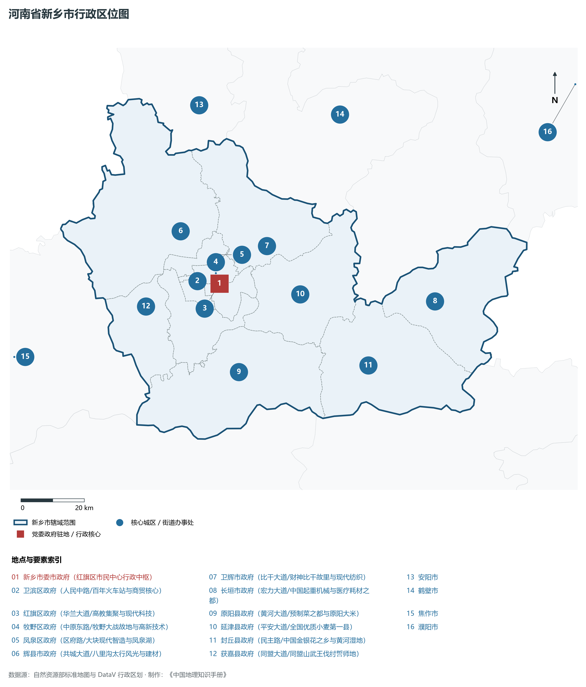
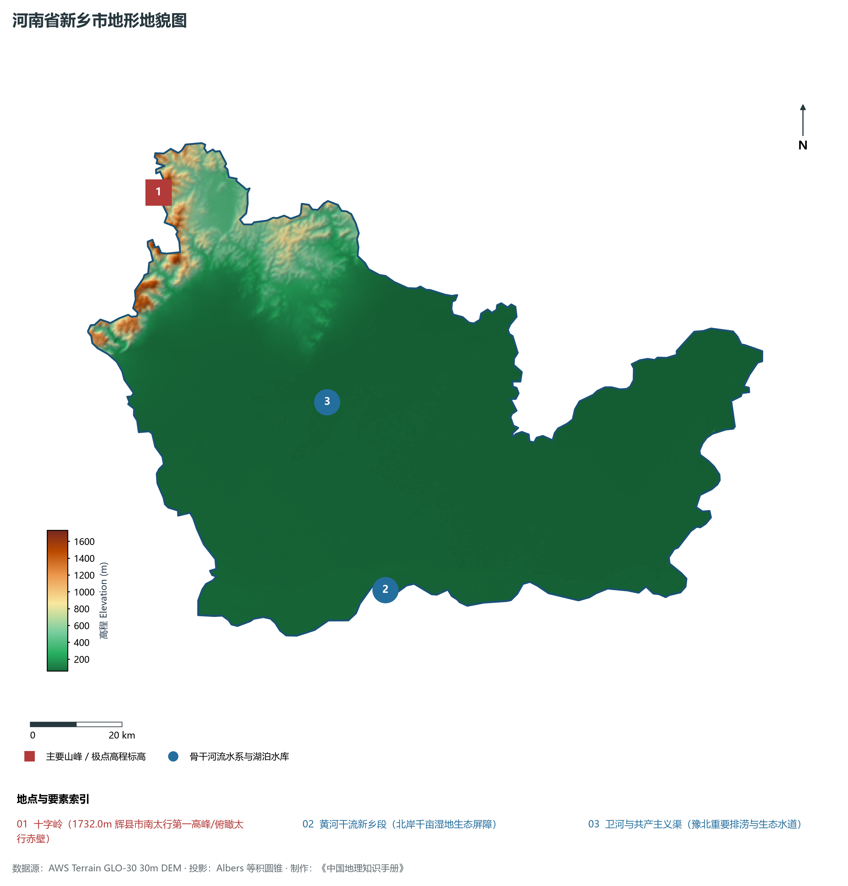
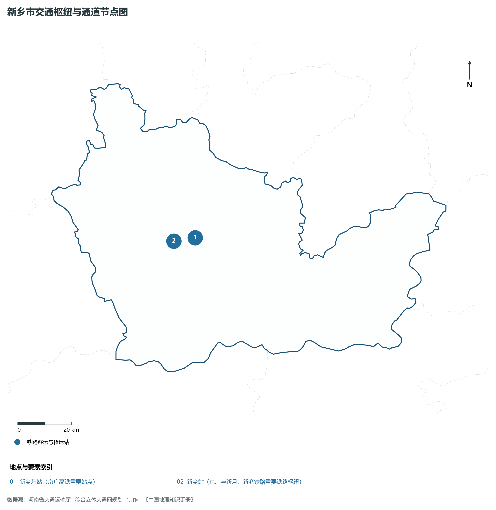
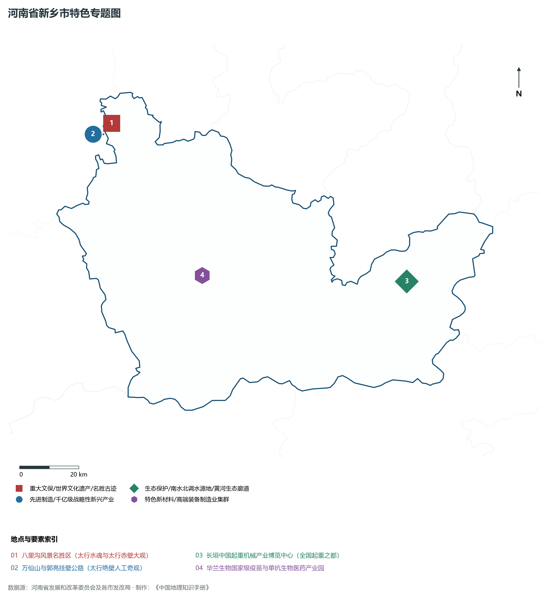
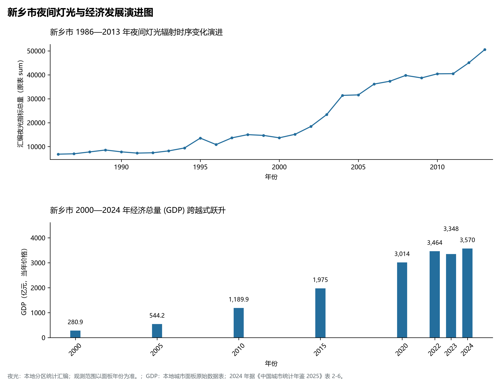

# 15.7 新乡市

新乡市，地处河南省核心战略功能区与中原经济区关键节点，其城市综合战略定位与发展愿景概括为：**豫北经济重镇·郑州都市圈副中心·中国电池工业之都·长垣起重与医耗千亿之城·南太行绝壁画廊**。2024 年常住人口 **611 万人**，常住人口城镇化率 **61.15%**，地区生产总值 **3,570 亿元**（当年价格），人均地区生产总值 **58,338 元**，三次产业构成为 **8.32 : 42.86 : 48.82**。

---

## 一、自然地理底盘与山川水系机理

区域骨干控制性山峰、高程标高极点与主要地貌控制节点包括：

- **十字岭 (1732.0m 辉县市南太行第一高峰/俯瞰太行赤壁)**（空间坐标约东经 113.585°、北纬 35.750°，海拔标高约 1732.0 m）；

本节列示的主要河湖与水系节点：

- **黄河干流新乡段 (北岸千亩湿地生态屏障)**（水系坐标约东经 114.050°、北纬 34.950°）；
- **卫河与共产主义渠 (豫北重要排涝与生态水道)**（水系坐标约东经 113.950°、北纬 35.320°）；

---

## 二、行政区划沿革与城镇空间体系

新乡市建置沿革源远流长，文脉绵延数千年，自古即为华夏聚居、三代都邑、百家争鸣或商贾重镇。夏商周立国分封、汉唐置郡设州、宋元设路设府、明清建州设县，历经千百载风云变迁，积淀下极为厚重的政区地名文化遗产。新中国成立后特别是改革开放以来，伴随撤地设市、行政区划合理调整、城区组团式向外延展与以人为核心的新型城镇化深入推进，构建了中心极核强引领、县域板块协同支撑、重点中心镇特色鲜明、产城人文深度融合的现代化多极城镇空间体系：

- **新乡市委市政府 (红旗区市民中心行政中枢)**（驻地坐标：113.925°E, 35.305°N）；
- **卫滨区政府 (人民中路/百年火车站与商贸核心)**（驻地坐标：113.880°E, 35.300°N）；
- **红旗区政府 (华兰大道/高教集聚与现代科技)**（驻地坐标：113.910°E, 35.290°N）；
- **牧野区政府 (中原东路/牧野大战故地与高新技术)**（驻地坐标：113.915°E, 35.335°N）；
- **凤泉区政府 (区府路/大块现代智造与凤泉湖)**（驻地坐标：113.935°E, 35.385°N）；
- **辉县市政府 (共城大道/八里沟太行风光与建材)**（驻地坐标：113.805°E, 35.460°N）；
- **卫辉市政府 (比干大道/财神比干故里与现代纺织)**（驻地坐标：114.065°E, 35.400°N）；
- **长垣市政府 (宏力大道/中国起重机械与医疗耗材之都)**（驻地坐标：114.675°E, 35.200°N）；
- **原阳县政府 (黄河大道/预制菜之都与原阳大米)**（驻地坐标：113.965°E, 35.055°N）；
- **延津县政府 (平安大道/全国优质小麦第一县)**（驻地坐标：114.205°E, 35.255°N）；
- **封丘县政府 (民主路/中国金银花之乡与黄河湿地)**（驻地坐标：114.420°E, 35.040°N）；
- **获嘉县政府 (同盟大道/同盟山武王伐纣誓师地)**（驻地坐标：113.660°E, 35.260°N）；

在国土空间总体规划指引下，新乡市坚决严守耕地保护红线、生态保护红线与城镇开发边界“三条控制线”，优化“生产、生活、生态”空间协同布局，全面提升城市韧性与基础设施能级，持续缩小城乡基本公共服务差距，打造宜居、韧性、智慧、绿色的现代化和美家园。

---

## 三、综合立体交通网络与现代枢纽通道

本节列示的主要交通节点与通道：

**核心综合客货运交通枢纽节点与交通干线走廊：**

- **新乡东站 (京广高铁重要站点)**（空间坐标：113.965°E, 35.310°N）；
- **新乡站 (京广与新月、新兖铁路重要铁路枢纽)**（空间坐标：113.875°E, 35.305°N）；

---

## 四、现代产业体系与新质生产力布局

新乡市坚定不移实施工业立市、制造业强市战略，对标河南省“7+28+N”产业链群布局要求，推动传统优势产业高端化、智能化、绿色化转型，做强战略性新兴产业，前瞻培育未来产业，构筑起实体经济厚重挺拔、创新动能蓬勃涌动的现代产业高地：

**标志性先进制造业集群、特色产业园区、国家重点实验室与产业地标：**

- **八里沟风景名胜区 (太行水魂与太行赤壁大观)**（空间坐标：113.620°E, 35.750°N）；
- **万仙山与郭亮挂壁公路 (太行绝壁人工奇观)**（空间坐标：113.585°E, 35.720°N）；
- **长垣中国起重机械产业博览中心 (全国起重之都)**（空间坐标：114.675°E, 35.200°N）；
- **华兰生物国家级疫苗与单抗生物医药产业园**（空间坐标：113.910°E, 35.275°N）；

通过深入实施工业产业链“链长制”与领航企业培育计划，新乡市聚力推动创新链、产业链、资金链、人才链深度融合，梯次培育单项冠军企业、高新技术企业与专精特新“小巨人”企业集群，积极抢占新材料、先进装备、新能源、高端电子信息、绿色食品与现代生物医药等细分赛道制高点，夯实现代化经济强市的实体支撑。

---

## 五、历史文化名胜、人文底蕴与全域文旅地理

新乡市的文化旅游与相关地标：

- **八里沟风景名胜区 (太行水魂与太行赤壁大观)**；
- **万仙山与郭亮挂壁公路 (太行绝壁人工奇观)**；
- **长垣中国起重机械产业博览中心 (全国起重之都)**；
- **华兰生物国家级疫苗与单抗生物医药产业园**；

立足“行走河南·读懂中国”文旅超级品牌，新乡市大力实施文旅文创融合战略，推动考古遗址公园、历史文化街区、沉浸式演艺与生态休闲度假深度跨界赋能，以数字科技再现千年华夏古韵，打造享誉海内外的中华文化寻根研学旅行胜地。

---

## 六、夜间灯光辐射与跨世纪经济变化时序演进

本节夜光图的观测年份为 1986—2013 年，指标为行政区汇总值（原表 sum）。

| 年份 | 地区生产总值（亿元，当年价格） |
|:---|---:|
| 2000 年 | 280.9 |
| 2005 年 | 544.2 |
| 2010 年 | 1,189.9 |
| 2015 年 | 1,975 |
| 2020 年 | 3,014 |
| 2022 年 | 3,464 |
| 2023 年 | 3,348 |
| 2024 年 | 3,570 |

2024 年统计来源：《中国城市统计年鉴 2025》表 2-1、2-6、2-7（2024 年，全市）。其他年份 GDP 据本地城市面板“原始数据”表，单位为亿元、当年价格。
