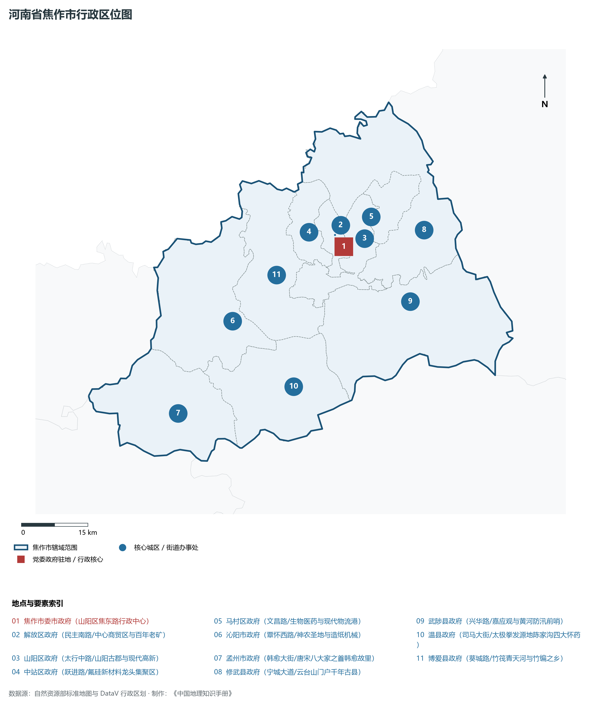
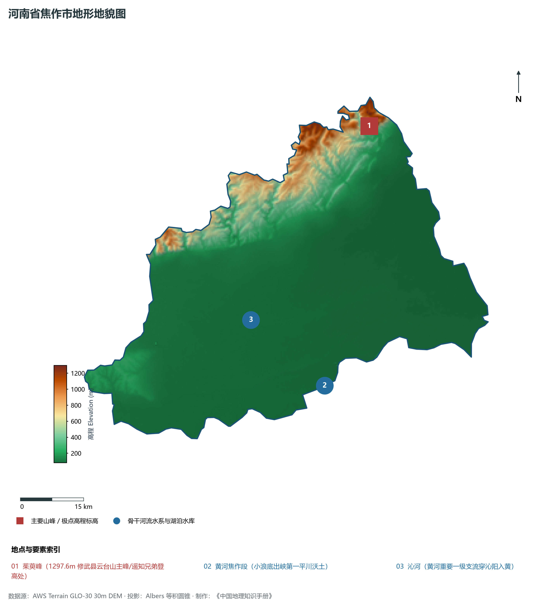
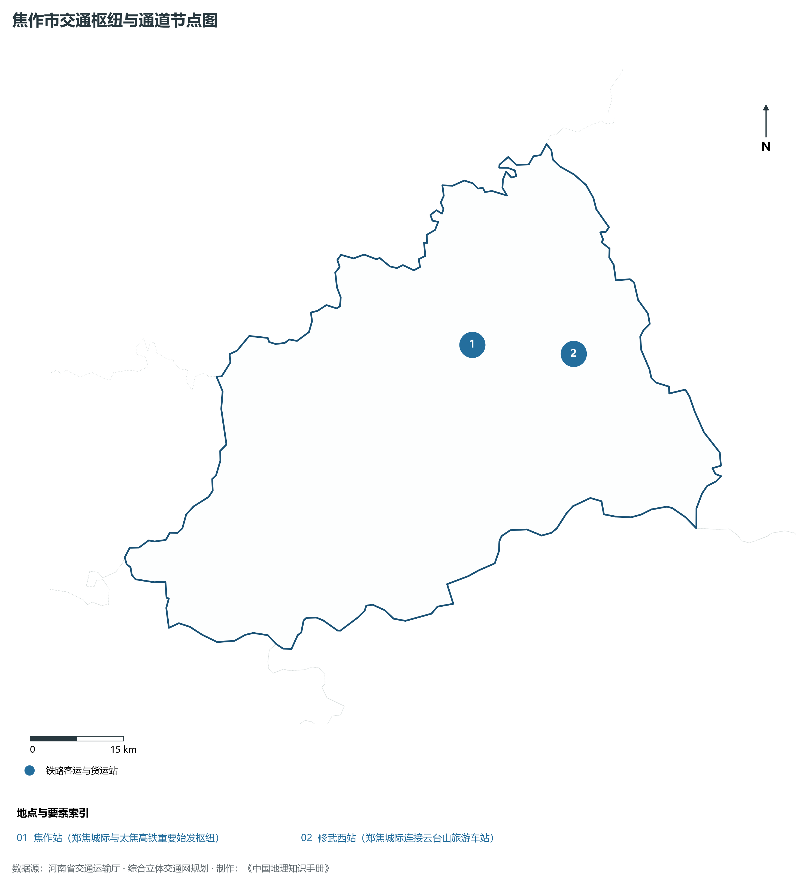
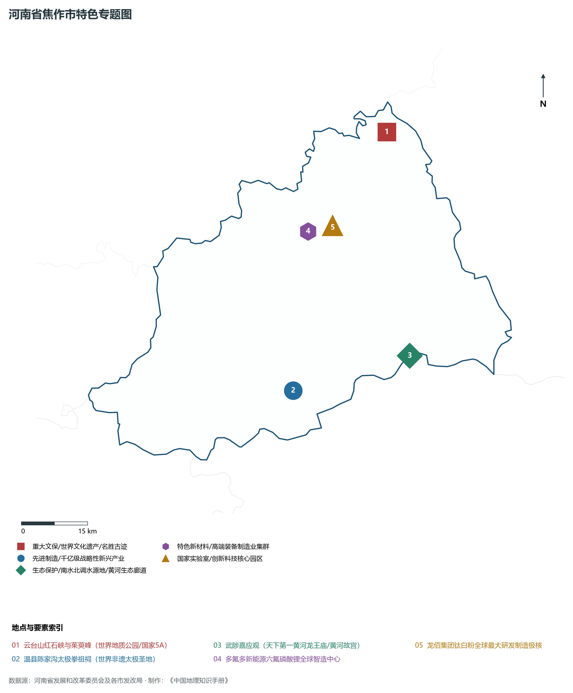
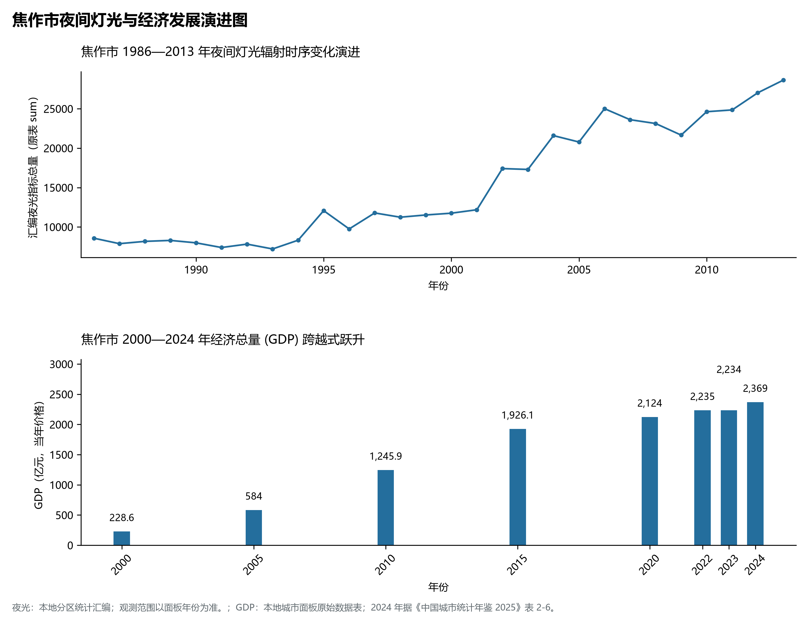

# 15.8 焦作市

焦作市，地处河南省核心战略功能区与中原经济区关键节点，其城市综合战略定位与发展愿景概括为：**太极拳发源地·世界地质公园云台山·全国资源枯竭转型典范·氟硅新材料与全球钛白粉之都**。2024 年常住人口 **350 万人**，常住人口城镇化率 **66.22%**，地区生产总值 **2,369 亿元**（当年价格），人均地区生产总值 **67,538 元**，三次产业构成为 **6.17 : 42.56 : 51.27**。

---

## 一、自然地理底盘与山川水系机理

区域骨干控制性山峰、高程标高极点与主要地貌控制节点包括：

- **茱萸峰 (1297.6m 修武县云台山主峰/遥知兄弟登高处)**（空间坐标约东经 113.375°、北纬 35.435°，海拔标高约 1297.6 m）；

本节列示的主要河湖与水系节点：

- **黄河焦作段 (小浪底出峡第一平川沃土)**（水系坐标约东经 113.200°、北纬 34.900°）；
- **沁河 (黄河重要一级支流穿沁阳入黄)**（水系坐标约东经 113.020°、北纬 35.050°）；

---

## 二、行政区划沿革与城镇空间体系

焦作市建置沿革源远流长，文脉绵延数千年，自古即为华夏聚居、三代都邑、百家争鸣或商贾重镇。夏商周立国分封、汉唐置郡设州、宋元设路设府、明清建州设县，历经千百载风云变迁，积淀下极为厚重的政区地名文化遗产。新中国成立后特别是改革开放以来，伴随撤地设市、行政区划合理调整、城区组团式向外延展与以人为核心的新型城镇化深入推进，构建了中心极核强引领、县域板块协同支撑、重点中心镇特色鲜明、产城人文深度融合的现代化多极城镇空间体系：

- **焦作市委市政府 (山阳区焦东路行政中心)**（驻地坐标：113.240°E, 35.215°N）；
- **解放区政府 (民主南路/中心商贸区与百年老矿)**（驻地坐标：113.220°E, 35.240°N）；
- **山阳区政府 (太行中路/山阳古郡与现代高新)**（驻地坐标：113.265°E, 35.230°N）；
- **中站区政府 (跃进路/氟硅新材料龙头集聚区)**（驻地坐标：113.155°E, 35.250°N）；
- **马村区政府 (文昌路/生物医药与现代物流港)**（驻地坐标：113.315°E, 35.270°N）；
- **沁阳市政府 (覃怀西路/神农圣地与造纸机械)**（驻地坐标：112.945°E, 35.085°N）；
- **孟州市政府 (韩愈大街/唐宋八大家之首韩愈故里)**（驻地坐标：112.790°E, 34.910°N）；
- **修武县政府 (宁城大道/云台山门户千年古县)**（驻地坐标：113.445°E, 35.235°N）；
- **武陟县政府 (兴华路/嘉应观与黄河防汛前哨)**（驻地坐标：113.395°E, 35.095°N）；
- **温县政府 (司马大街/太极拳发源地陈家沟四大怀药)**（驻地坐标：113.085°E, 34.945°N）；
- **博爱县政府 (葵城路/竹筏青天河与竹编之乡)**（驻地坐标：113.065°E, 35.170°N）；

在国土空间总体规划指引下，焦作市坚决严守耕地保护红线、生态保护红线与城镇开发边界“三条控制线”，优化“生产、生活、生态”空间协同布局，全面提升城市韧性与基础设施能级，持续缩小城乡基本公共服务差距，打造宜居、韧性、智慧、绿色的现代化和美家园。

---

## 三、综合立体交通网络与现代枢纽通道

本节列示的主要交通节点与通道：

**核心综合客货运交通枢纽节点与交通干线走廊：**

- **焦作站 (郑焦城际与太焦高铁重要始发枢纽)**（空间坐标：113.220°E, 35.220°N）；
- **修武西站 (郑焦城际连接云台山旅游车站)**（空间坐标：113.400°E, 35.195°N）；

---

## 四、现代产业体系与新质生产力布局

焦作市坚定不移实施工业立市、制造业强市战略，对标河南省“7+28+N”产业链群布局要求，推动传统优势产业高端化、智能化、绿色化转型，做强战略性新兴产业，前瞻培育未来产业，构筑起实体经济厚重挺拔、创新动能蓬勃涌动的现代产业高地：

**标志性先进制造业集群、特色产业园区、国家重点实验室与产业地标：**

- **云台山红石峡与茱萸峰 (世界地质公园/国家5A)**（空间坐标：113.375°E, 35.435°N）；
- **温县陈家沟太极拳祖祠 (世界非遗太极圣地)**（空间坐标：113.085°E, 34.935°N）；
- **武陟嘉应观 (天下第一黄河龙王庙/黄河故宫)**（空间坐标：113.385°E, 34.985°N）；
- **多氟多新能源六氟磷酸锂全球智造中心**（空间坐标：113.155°E, 35.250°N）；
- **龙佰集团钛白粉全球最大研发制造极核**（空间坐标：113.190°E, 35.260°N）；

通过深入实施工业产业链“链长制”与领航企业培育计划，焦作市聚力推动创新链、产业链、资金链、人才链深度融合，梯次培育单项冠军企业、高新技术企业与专精特新“小巨人”企业集群，积极抢占新材料、先进装备、新能源、高端电子信息、绿色食品与现代生物医药等细分赛道制高点，夯实现代化经济强市的实体支撑。

---

## 五、历史文化名胜、人文底蕴与全域文旅地理

焦作市的文化旅游与相关地标：

- **云台山红石峡与茱萸峰 (世界地质公园/国家5A)**；
- **温县陈家沟太极拳祖祠 (世界非遗太极圣地)**；
- **武陟嘉应观 (天下第一黄河龙王庙/黄河故宫)**；
- **多氟多新能源六氟磷酸锂全球智造中心**；
- **龙佰集团钛白粉全球最大研发制造极核**；

立足“行走河南·读懂中国”文旅超级品牌，焦作市大力实施文旅文创融合战略，推动考古遗址公园、历史文化街区、沉浸式演艺与生态休闲度假深度跨界赋能，以数字科技再现千年华夏古韵，打造享誉海内外的中华文化寻根研学旅行胜地。

---

## 六、夜间灯光辐射与跨世纪经济变化时序演进

本节夜光图的观测年份为 1986—2013 年，指标为行政区汇总值（原表 sum）。

| 年份 | 地区生产总值（亿元，当年价格） |
|:---|---:|
| 2000 年 | 228.6 |
| 2005 年 | 584 |
| 2010 年 | 1,245.9 |
| 2015 年 | 1,926.1 |
| 2020 年 | 2,124 |
| 2022 年 | 2,235 |
| 2023 年 | 2,234 |
| 2024 年 | 2,369 |

2024 年统计来源：《中国城市统计年鉴 2025》表 2-1、2-6、2-7（2024 年，全市）。其他年份 GDP 据本地城市面板“原始数据”表，单位为亿元、当年价格。
