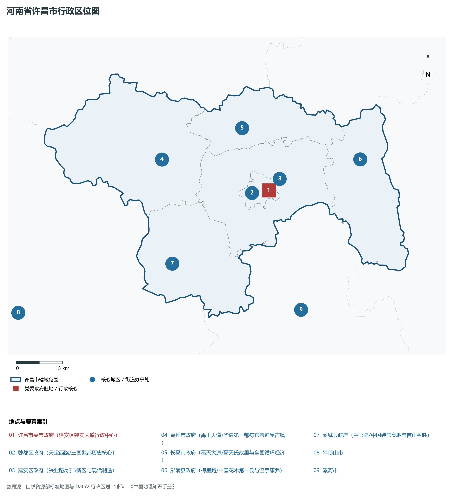
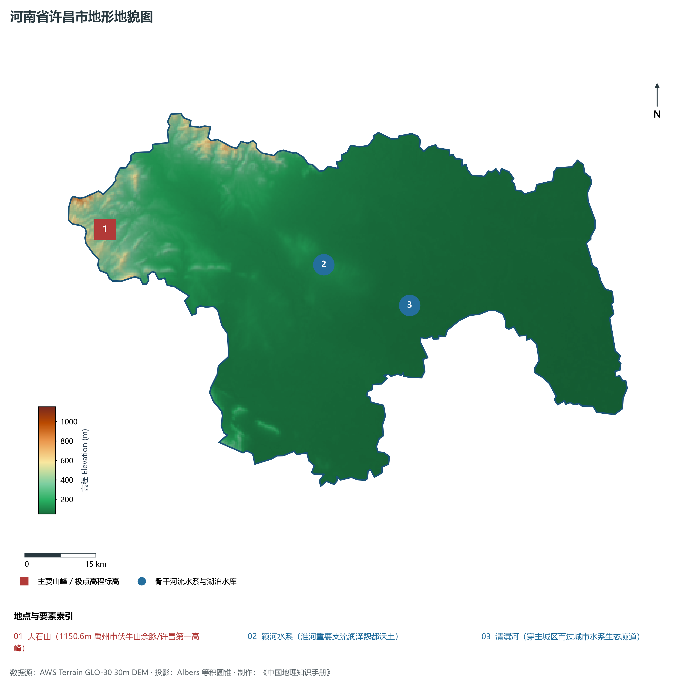
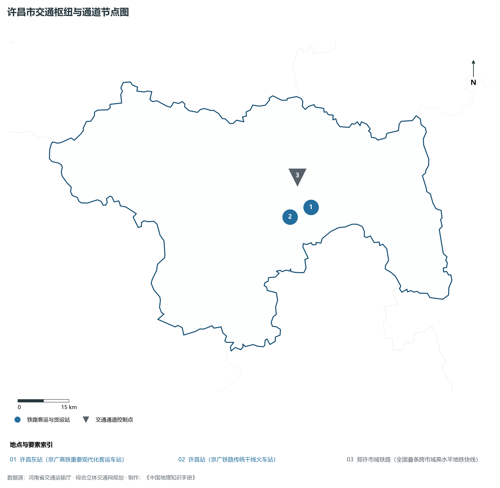
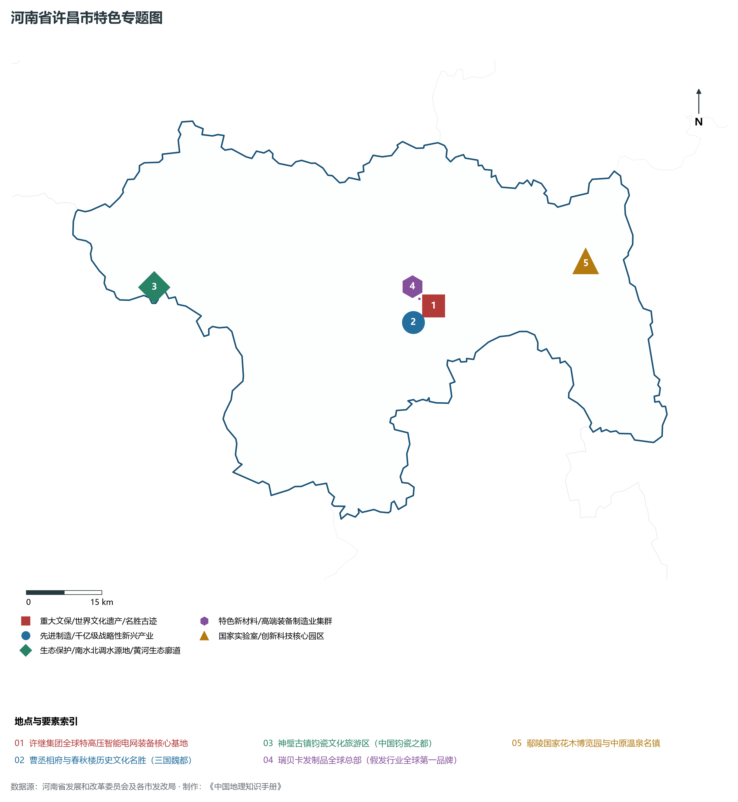
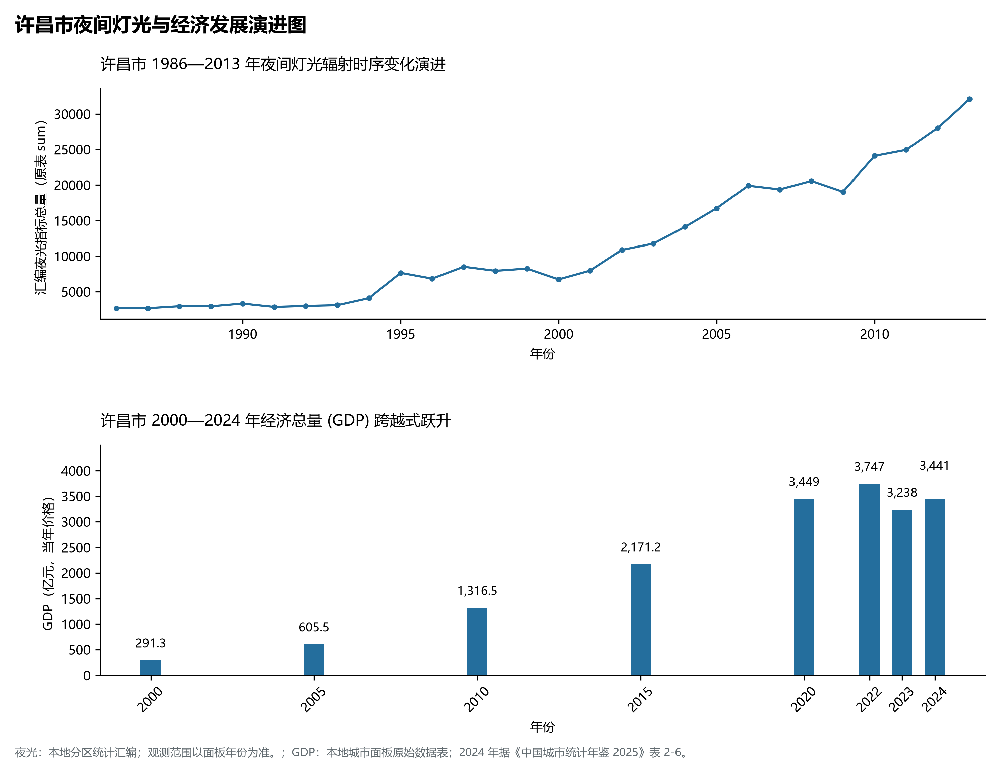

# 15.10 许昌市

许昌市，地处河南省核心战略功能区与中原经济区关键节点，其城市综合战略定位与发展愿景概括为：**曹魏故都·三国文化名城·中国钧瓷之都·特高压电力装备制造基地·全球最大发制品产业基地**。2024 年常住人口 **436 万人**，常住人口城镇化率 **57.26%**，地区生产总值 **3,441 亿元**（当年价格），人均地区生产总值 **78,744 元**，三次产业构成为 **6.36 : 43.82 : 49.81**。

---

## 一、自然地理底盘与山川水系机理

区域骨干控制性山峰、高程标高极点与主要地貌控制节点包括：

- **大石山 (1150.6m 禹州市伏牛山余脉/许昌第一高峰)**（空间坐标约东经 113.150°、北纬 34.200°，海拔标高约 1150.6 m）；

本节列示的主要河湖与水系节点：

- **颍河水系 (淮河重要支流润泽魏都沃土)**（水系坐标约东经 113.650°、北纬 34.100°）；
- **清潩河 (穿主城区而过城市水系生态廊道)**（水系坐标约东经 113.840°、北纬 34.010°）；

---

## 二、行政区划沿革与城镇空间体系

许昌市建置沿革源远流长，文脉绵延数千年，自古即为华夏聚居、三代都邑、百家争鸣或商贾重镇。夏商周立国分封、汉唐置郡设州、宋元设路设府、明清建州设县，历经千百载风云变迁，积淀下极为厚重的政区地名文化遗产。新中国成立后特别是改革开放以来，伴随撤地设市、行政区划合理调整、城区组团式向外延展与以人为核心的新型城镇化深入推进，构建了中心极核强引领、县域板块协同支撑、重点中心镇特色鲜明、产城人文深度融合的现代化多极城镇空间体系：

- **许昌市委市政府 (建安区建安大道行政中心)**（驻地坐标：113.850°E, 34.035°N）；
- **魏都区政府 (天宝西路/三国魏都历史核心)**（驻地坐标：113.820°E, 34.030°N）；
- **建安区政府 (兴业路/城市新区与现代制造)**（驻地坐标：113.865°E, 34.055°N）；
- **禹州市政府 (禹王大道/华夏第一都钧官窑神垕古镇)**（驻地坐标：113.480°E, 34.150°N）；
- **长葛市政府 (葛天大道/葛天氏故里与全国循环经济)**（驻地坐标：113.775°E, 34.220°N）；
- **鄢陵县政府 (梅里路/中国花木第一县与温泉康养)**（驻地坐标：114.185°E, 34.100°N）；
- **襄城县政府 (中心路/中国碳焦高地与首山名胜)**（驻地坐标：113.485°E, 33.850°N）；

在国土空间总体规划指引下，许昌市坚决严守耕地保护红线、生态保护红线与城镇开发边界“三条控制线”，优化“生产、生活、生态”空间协同布局，全面提升城市韧性与基础设施能级，持续缩小城乡基本公共服务差距，打造宜居、韧性、智慧、绿色的现代化和美家园。

---

## 三、综合立体交通网络与现代枢纽通道

本节列示的主要交通节点与通道：

**核心综合客货运交通枢纽节点与交通干线走廊：**

- **许昌东站 (京广高铁重要现代化客运车站)**（空间坐标：113.895°E, 34.040°N）；
- **许昌站 (京广铁路传统干线火车站)**（空间坐标：113.825°E, 34.020°N）；
- **郑许市域铁路 (市域轨道交通)**（空间坐标：113.860°E, 34.120°N）；

---

## 四、现代产业体系与新质生产力布局

许昌市坚定不移实施工业立市、制造业强市战略，对标河南省“7+28+N”产业链群布局要求，推动传统优势产业高端化、智能化、绿色化转型，做强战略性新兴产业，前瞻培育未来产业，构筑起实体经济厚重挺拔、创新动能蓬勃涌动的现代产业高地：

**标志性先进制造业集群、特色产业园区、国家重点实验室与产业地标：**

- **许继集团全球特高压智能电网装备核心基地**（空间坐标：113.840°E, 34.045°N）；
- **曹丞相府与春秋楼历史文化名胜 (三国魏都)**（空间坐标：113.820°E, 34.030°N）；
- **神垕古镇钧瓷文化旅游区 (中国钧瓷之都)**（空间坐标：113.235°E, 34.120°N）；
- **瑞贝卡发制品全球总部 (假发行业全球第一品牌)**（空间坐标：113.810°E, 34.060°N）；
- **鄢陵国家花木博览园与中原温泉名镇**（空间坐标：114.180°E, 34.100°N）；

通过深入实施工业产业链“链长制”与领航企业培育计划，许昌市聚力推动创新链、产业链、资金链、人才链深度融合，梯次培育单项冠军企业、高新技术企业与专精特新“小巨人”企业集群，积极抢占新材料、先进装备、新能源、高端电子信息、绿色食品与现代生物医药等细分赛道制高点，夯实现代化经济强市的实体支撑。

---

## 五、历史文化名胜、人文底蕴与全域文旅地理

许昌市的文化旅游与相关地标：

- **许继集团全球特高压智能电网装备核心基地**；
- **曹丞相府与春秋楼历史文化名胜 (三国魏都)**；
- **神垕古镇钧瓷文化旅游区 (中国钧瓷之都)**；
- **瑞贝卡发制品全球总部 (假发行业全球第一品牌)**；
- **鄢陵国家花木博览园与中原温泉名镇**；

立足“行走河南·读懂中国”文旅超级品牌，许昌市大力实施文旅文创融合战略，推动考古遗址公园、历史文化街区、沉浸式演艺与生态休闲度假深度跨界赋能，以数字科技再现千年华夏古韵，打造享誉海内外的中华文化寻根研学旅行胜地。

---

## 六、夜间灯光辐射与跨世纪经济变化时序演进

本节夜光图的观测年份为 1986—2013 年，指标为行政区汇总值（原表 sum）。

| 年份 | 地区生产总值（亿元，当年价格） |
|:---|---:|
| 2000 年 | 291.3 |
| 2005 年 | 605.5 |
| 2010 年 | 1,316.5 |
| 2015 年 | 2,171.2 |
| 2020 年 | 3,449 |
| 2022 年 | 3,747 |
| 2023 年 | 3,238 |
| 2024 年 | 3,441 |

2024 年统计来源：《中国城市统计年鉴 2025》表 2-1、2-6、2-7（2024 年，全市）。其他年份 GDP 据本地城市面板“原始数据”表，单位为亿元、当年价格。
