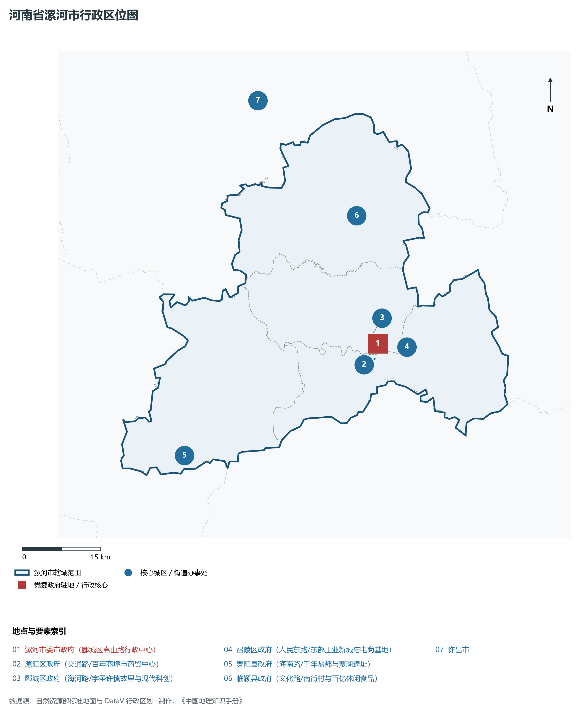
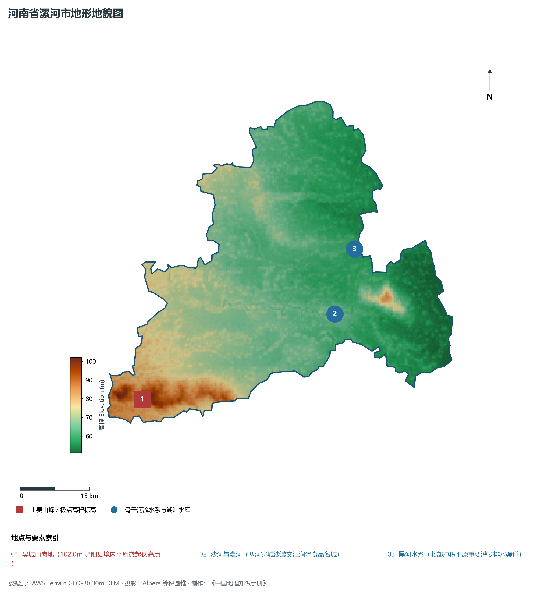
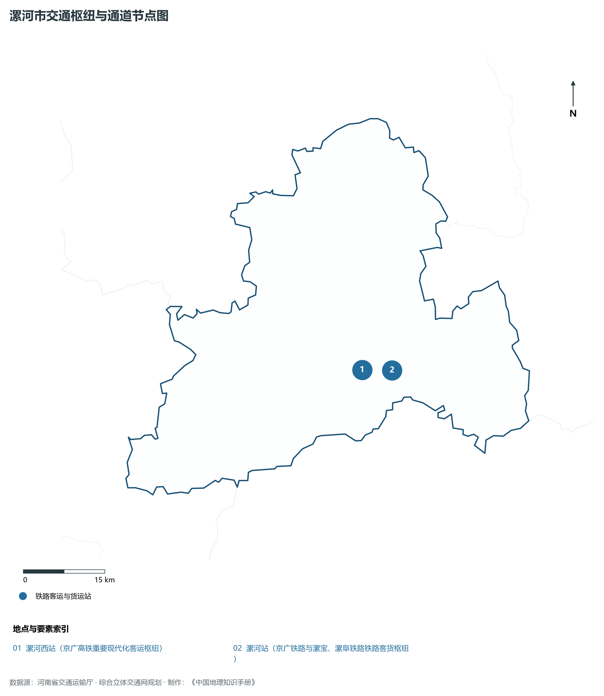
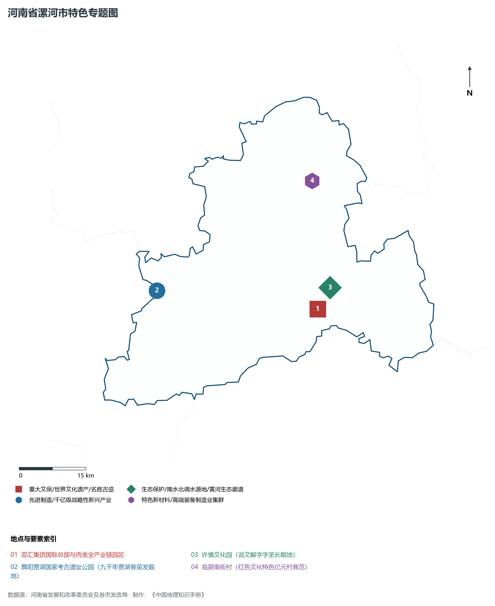
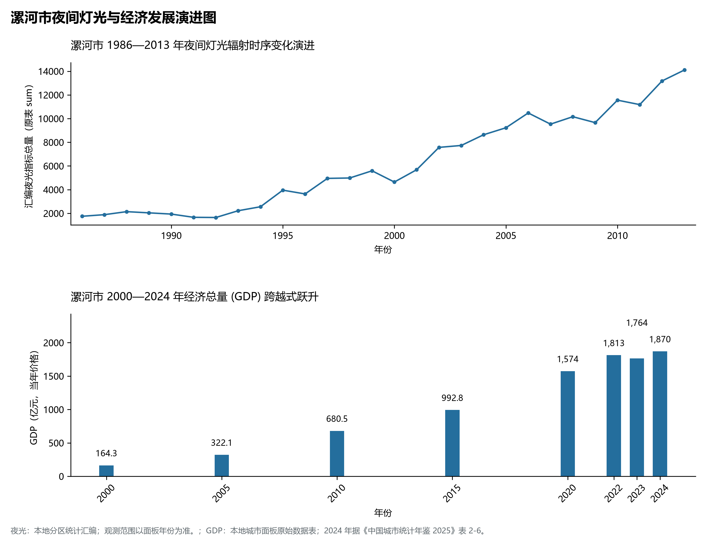

# 15.11 漯河市

漯河市，地处河南省核心战略功能区与中原经济区关键节点，其城市综合战略定位与发展愿景概括为：**中国食品名城·中原现代食品创新高地·中华字圣许慎故里·双汇肉类深加工航母·贾湖契刻源乡**。2024 年常住人口 **234 万人**，常住人口城镇化率 **58.73%**，地区生产总值 **1,870 亿元**（当年价格），人均地区生产总值 **79,383 元**，三次产业构成为 **7.97 : 41.38 : 50.64**。

---

## 一、自然地理底盘与山川水系机理

区域骨干控制性山峰、高程标高极点与主要地貌控制节点包括：

- **吴城山岗地 (102.0m 舞阳县境内平原微起伏高点)**（空间坐标约东经 113.550°、北纬 33.450°，海拔标高约 102.0 m）；

本节列示的主要河湖与水系节点：

- **沙河与澧河 (两河穿城沙澧交汇润泽食品名城)**（水系坐标约东经 114.020°、北纬 33.580°）；
- **黑河水系 (北部冲积平原重要灌溉排水渠道)**（水系坐标约东经 114.080°、北纬 33.700°）；

---

## 二、行政区划沿革与城镇空间体系

漯河市建置沿革源远流长，文脉绵延数千年，自古即为华夏聚居、三代都邑、百家争鸣或商贾重镇。夏商周立国分封、汉唐置郡设州、宋元设路设府、明清建州设县，历经千百载风云变迁，积淀下极为厚重的政区地名文化遗产。新中国成立后特别是改革开放以来，伴随撤地设市、行政区划合理调整、城区组团式向外延展与以人为核心的新型城镇化深入推进，构建了中心极核强引领、县域板块协同支撑、重点中心镇特色鲜明、产城人文深度融合的现代化多极城镇空间体系：

- **漯河市委市政府 (郾城区嵩山路行政中心)**（驻地坐标：114.025°E, 33.595°N）；
- **源汇区政府 (交通路/百年商埠与商贸中心)**（驻地坐标：114.015°E, 33.570°N）；
- **郾城区政府 (海河路/字圣许慎故里与现代科创)**（驻地坐标：114.010°E, 33.605°N）；
- **召陵区政府 (人民东路/东部工业新城与电商基地)**（驻地坐标：114.085°E, 33.585°N）；
- **舞阳县政府 (海南路/千年盐都与贾湖遗址)**（驻地坐标：113.600°E, 33.435°N）；
- **临颍县政府 (文化路/南街村与百亿休闲食品)**（驻地坐标：114.005°E, 33.815°N）；

在国土空间总体规划指引下，漯河市坚决严守耕地保护红线、生态保护红线与城镇开发边界“三条控制线”，优化“生产、生活、生态”空间协同布局，全面提升城市韧性与基础设施能级，持续缩小城乡基本公共服务差距，打造宜居、韧性、智慧、绿色的现代化和美家园。

---

## 三、综合立体交通网络与现代枢纽通道

本节列示的主要交通节点与通道：

**核心综合客货运交通枢纽节点与交通干线走廊：**

- **漯河西站 (京广高铁重要现代化客运枢纽)**（空间坐标：113.960°E, 33.580°N）；
- **漯河站 (京广铁路与漯宝、漯阜铁路铁路客货枢纽)**（空间坐标：114.020°E, 33.575°N）；

---

## 四、现代产业体系与新质生产力布局

漯河市坚定不移实施工业立市、制造业强市战略，对标河南省“7+28+N”产业链群布局要求，推动传统优势产业高端化、智能化、绿色化转型，做强战略性新兴产业，前瞻培育未来产业，构筑起实体经济厚重挺拔、创新动能蓬勃涌动的现代产业高地：

**标志性先进制造业集群、特色产业园区、国家重点实验室与产业地标：**

- **双汇集团国际总部与肉类全产业链园区**（空间坐标：114.010°E, 33.565°N）；
- **舞阳贾湖国家考古遗址公园 (九千年贾湖骨笛发掘地)**（空间坐标：113.620°E, 33.630°N）；
- **许慎文化园 (说文解字字圣长眠地)**（空间坐标：114.045°E, 33.605°N）；
- **临颍南街村 (红色文化特色亿元村典范)**（空间坐标：114.025°E, 33.820°N）；

通过深入实施工业产业链“链长制”与领航企业培育计划，漯河市聚力推动创新链、产业链、资金链、人才链深度融合，梯次培育单项冠军企业、高新技术企业与专精特新“小巨人”企业集群，积极抢占新材料、先进装备、新能源、高端电子信息、绿色食品与现代生物医药等细分赛道制高点，夯实现代化经济强市的实体支撑。

---

## 五、历史文化名胜、人文底蕴与全域文旅地理

漯河市的文化旅游与相关地标：

- **双汇集团国际总部与肉类全产业链园区**；
- **舞阳贾湖国家考古遗址公园 (九千年贾湖骨笛发掘地)**；
- **许慎文化园 (说文解字字圣长眠地)**；
- **临颍南街村 (红色文化特色亿元村典范)**；

立足“行走河南·读懂中国”文旅超级品牌，漯河市大力实施文旅文创融合战略，推动考古遗址公园、历史文化街区、沉浸式演艺与生态休闲度假深度跨界赋能，以数字科技再现千年华夏古韵，打造享誉海内外的中华文化寻根研学旅行胜地。

---

## 六、夜间灯光辐射与跨世纪经济变化时序演进

本节夜光图的观测年份为 1986—2013 年，指标为行政区汇总值（原表 sum）。

| 年份 | 地区生产总值（亿元，当年价格） |
|:---|---:|
| 2000 年 | 164.3 |
| 2005 年 | 322.1 |
| 2010 年 | 680.5 |
| 2015 年 | 992.8 |
| 2020 年 | 1,574 |
| 2022 年 | 1,813 |
| 2023 年 | 1,764 |
| 2024 年 | 1,870 |

2024 年统计来源：《中国城市统计年鉴 2025》表 2-1、2-6、2-7（2024 年，全市）。其他年份 GDP 据本地城市面板“原始数据”表，单位为亿元、当年价格。
