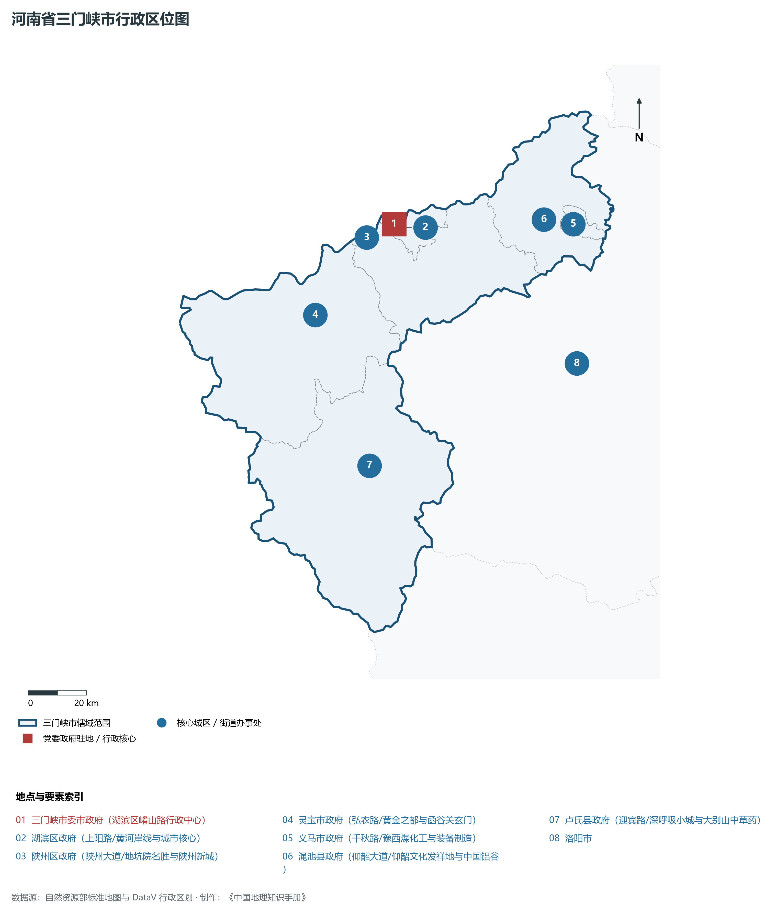
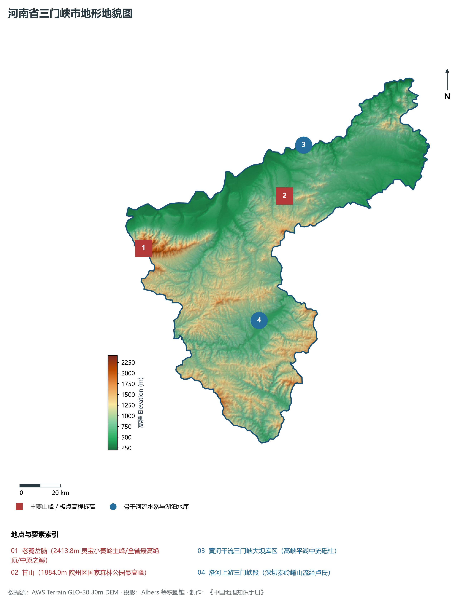
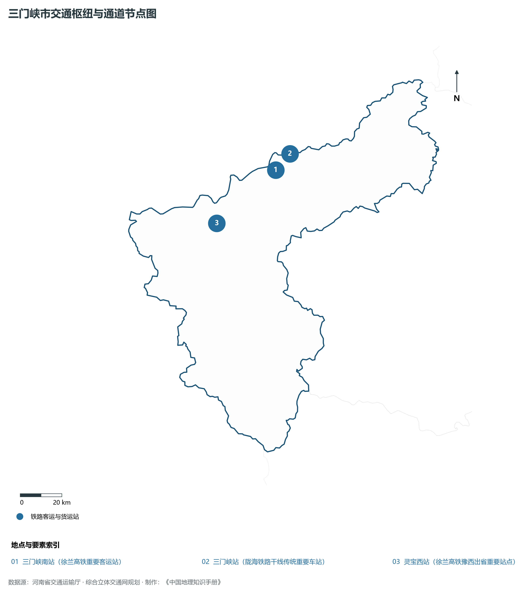
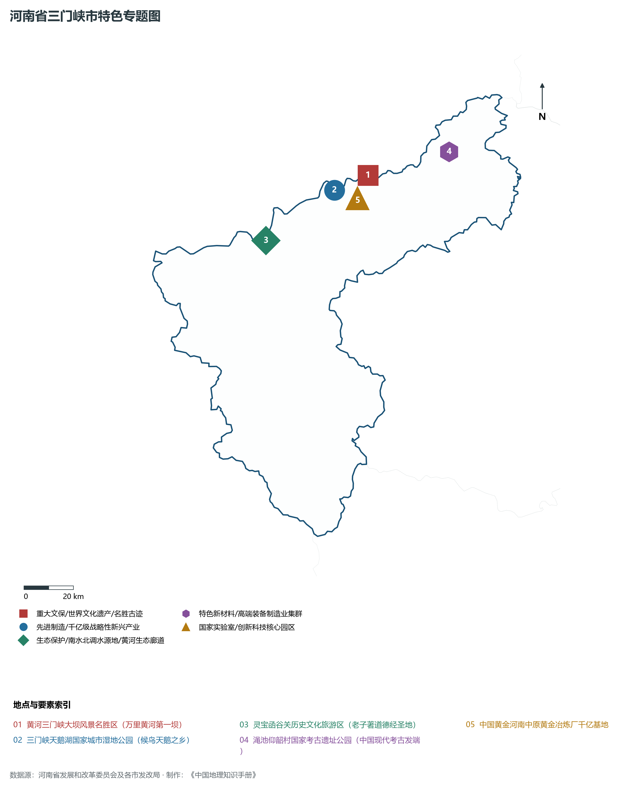
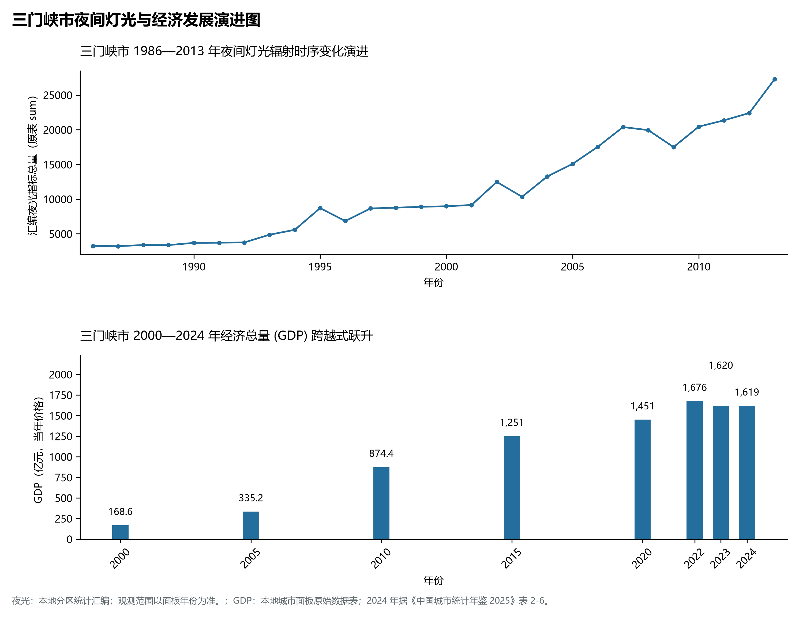

# 15.12 三门峡市

三门峡市，地处河南省核心战略功能区与中原经济区关键节点，其城市综合战略定位与发展愿景概括为：**黄河明珠·天鹅之城·万里黄河第一坝·仰韶文化发祥地·中国黄金之都·中原极顶老鸦岔脑**。2024 年常住人口 **201 万人**，常住人口城镇化率 **60.69%**，地区生产总值 **1,619 亿元**（当年价格），人均地区生产总值 **80,392 元**，三次产业构成为 **11.18 : 41.46 : 47.36**。

---

## 一、自然地理底盘与山川水系机理

区域骨干控制性山峰、高程标高极点与主要地貌控制节点包括：

- **老鸦岔脑 (2413.8m 灵宝小秦岭主峰/全省最高绝顶/中原之巅)**（空间坐标约东经 110.450°、北纬 34.420°，海拔标高约 2413.8 m）；
- **甘山 (1884.0m 陕州区国家森林公园最高峰)**（空间坐标约东经 111.230°、北纬 34.610°，海拔标高约 1884.0 m）；

本节列示的主要河湖与水系节点：

- **黄河干流三门峡大坝库区 (高峡平湖中流砥柱)**（水系坐标约东经 111.350°、北纬 34.825°）；
- **洛河上游三门峡段 (深切秦岭崤山流经卢氏)**（水系坐标约东经 111.050°、北纬 34.080°）；

---

## 二、行政区划沿革与城镇空间体系

三门峡市建置沿革源远流长，文脉绵延数千年，自古即为华夏聚居、三代都邑、百家争鸣或商贾重镇。夏商周立国分封、汉唐置郡设州、宋元设路设府、明清建州设县，历经千百载风云变迁，积淀下极为厚重的政区地名文化遗产。新中国成立后特别是改革开放以来，伴随撤地设市、行政区划合理调整、城区组团式向外延展与以人为核心的新型城镇化深入推进，构建了中心极核强引领、县域板块协同支撑、重点中心镇特色鲜明、产城人文深度融合的现代化多极城镇空间体系：

- **三门峡市委市政府 (湖滨区崤山路行政中心)**（驻地坐标：111.195°E, 34.780°N）；
- **湖滨区政府 (上阳路/黄河岸线与城市核心)**（驻地坐标：111.200°E, 34.770°N）；
- **陕州区政府 (陕州大道/地坑院名胜与陕州新城)**（驻地坐标：111.135°E, 34.720°N）；
- **灵宝市政府 (弘农路/黄金之都与函谷关玄门)**（驻地坐标：110.875°E, 34.520°N）；
- **义马市政府 (千秋路/豫西煤化工与装备制造)**（驻地坐标：111.875°E, 34.745°N）；
- **渑池县政府 (仰韶大道/仰韶文化发祥地与中国铝谷)**（驻地坐标：111.765°E, 34.765°N）；
- **卢氏县政府 (迎宾路/深呼吸小城与大别山中草药)**（驻地坐标：111.045°E, 34.055°N）；

在国土空间总体规划指引下，三门峡市坚决严守耕地保护红线、生态保护红线与城镇开发边界“三条控制线”，优化“生产、生活、生态”空间协同布局，全面提升城市韧性与基础设施能级，持续缩小城乡基本公共服务差距，打造宜居、韧性、智慧、绿色的现代化和美家园。

---

## 三、综合立体交通网络与现代枢纽通道

本节列示的主要交通节点与通道：

**核心综合客货运交通枢纽节点与交通干线走廊：**

- **三门峡南站 (徐兰高铁重要客运站)**（空间坐标：111.160°E, 34.740°N）；
- **三门峡站 (陇海铁路干线传统重要车站)**（空间坐标：111.190°E, 34.785°N）；
- **灵宝西站 (徐兰高铁豫西出省重要站点)**（空间坐标：110.830°E, 34.530°N）；

---

## 四、现代产业体系与新质生产力布局

三门峡市坚定不移实施工业立市、制造业强市战略，对标河南省“7+28+N”产业链群布局要求，推动传统优势产业高端化、智能化、绿色化转型，做强战略性新兴产业，前瞻培育未来产业，构筑起实体经济厚重挺拔、创新动能蓬勃涌动的现代产业高地：

**标志性先进制造业集群、特色产业园区、国家重点实验室与产业地标：**

- **黄河三门峡大坝风景名胜区 (万里黄河第一坝)**（空间坐标：111.350°E, 34.825°N）；
- **三门峡天鹅湖国家城市湿地公园 (候鸟天鹅之乡)**（空间坐标：111.195°E, 34.780°N）；
- **灵宝函谷关历史文化旅游区 (老子著道德经圣地)**（空间坐标：110.875°E, 34.615°N）；
- **渑池仰韶村国家考古遗址公园 (中国现代考古发端)**（空间坐标：111.720°E, 34.890°N）；
- **中国黄金河南中原黄金冶炼厂千亿基地**（空间坐标：111.240°E, 34.750°N）；

通过深入实施工业产业链“链长制”与领航企业培育计划，三门峡市聚力推动创新链、产业链、资金链、人才链深度融合，梯次培育单项冠军企业、高新技术企业与专精特新“小巨人”企业集群，积极抢占新材料、先进装备、新能源、高端电子信息、绿色食品与现代生物医药等细分赛道制高点，夯实现代化经济强市的实体支撑。

---

## 五、历史文化名胜、人文底蕴与全域文旅地理

三门峡市的文化旅游与相关地标：

- **黄河三门峡大坝风景名胜区 (万里黄河第一坝)**；
- **三门峡天鹅湖国家城市湿地公园 (候鸟天鹅之乡)**；
- **灵宝函谷关历史文化旅游区 (老子著道德经圣地)**；
- **渑池仰韶村国家考古遗址公园 (中国现代考古发端)**；
- **中国黄金河南中原黄金冶炼厂千亿基地**；

立足“行走河南·读懂中国”文旅超级品牌，三门峡市大力实施文旅文创融合战略，推动考古遗址公园、历史文化街区、沉浸式演艺与生态休闲度假深度跨界赋能，以数字科技再现千年华夏古韵，打造享誉海内外的中华文化寻根研学旅行胜地。

---

## 六、夜间灯光辐射与跨世纪经济变化时序演进

本节夜光图的观测年份为 1986—2013 年，指标为行政区汇总值（原表 sum）。

| 年份 | 地区生产总值（亿元，当年价格） |
|:---|---:|
| 2000 年 | 168.6 |
| 2005 年 | 335.2 |
| 2010 年 | 874.4 |
| 2015 年 | 1,251 |
| 2020 年 | 1,451 |
| 2022 年 | 1,676 |
| 2023 年 | 1,620 |
| 2024 年 | 1,619 |

2024 年统计来源：《中国城市统计年鉴 2025》表 2-1、2-6、2-7（2024 年，全市）。其他年份 GDP 据本地城市面板“原始数据”表，单位为亿元、当年价格。
