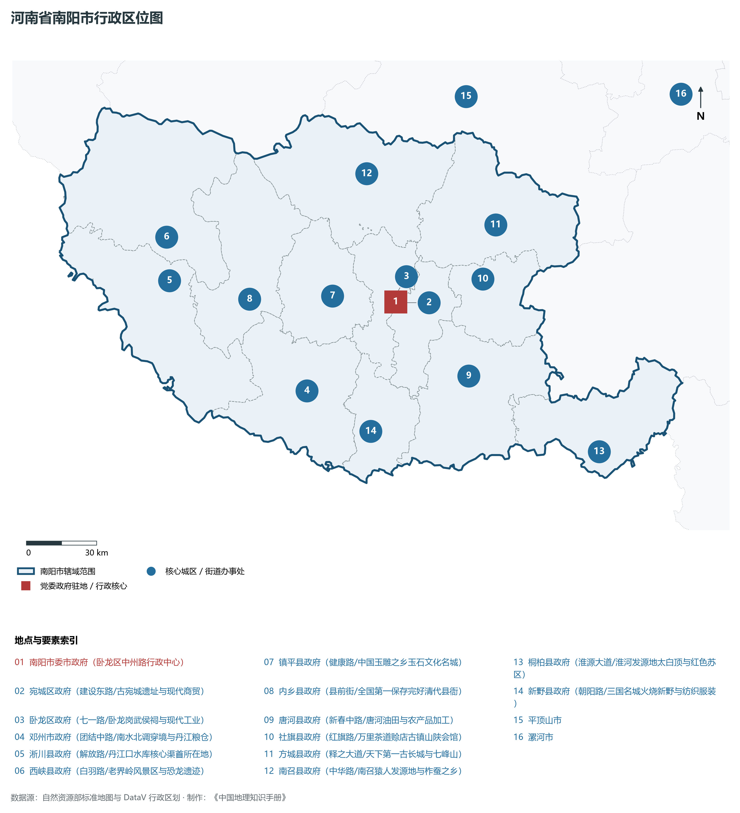
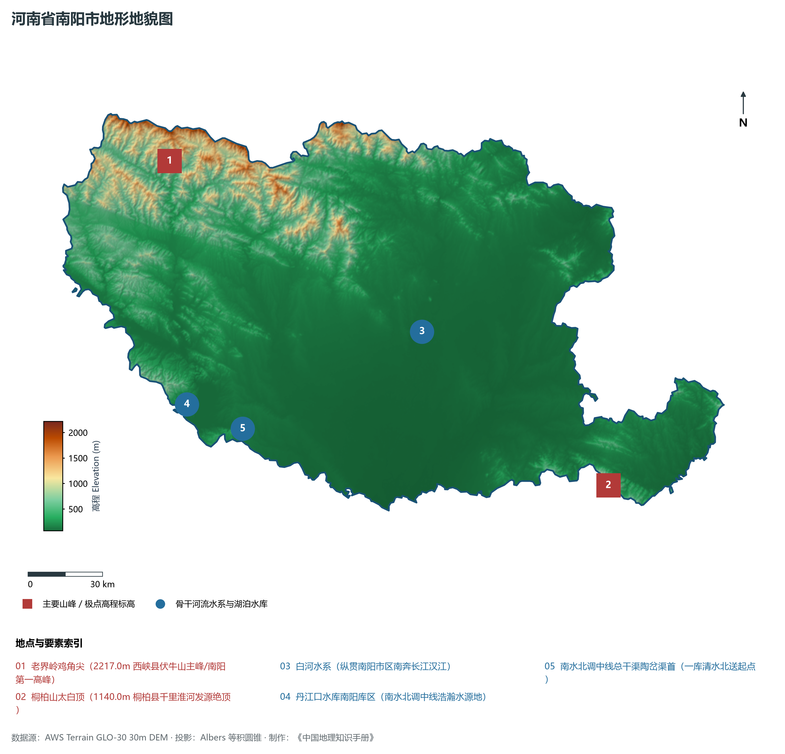
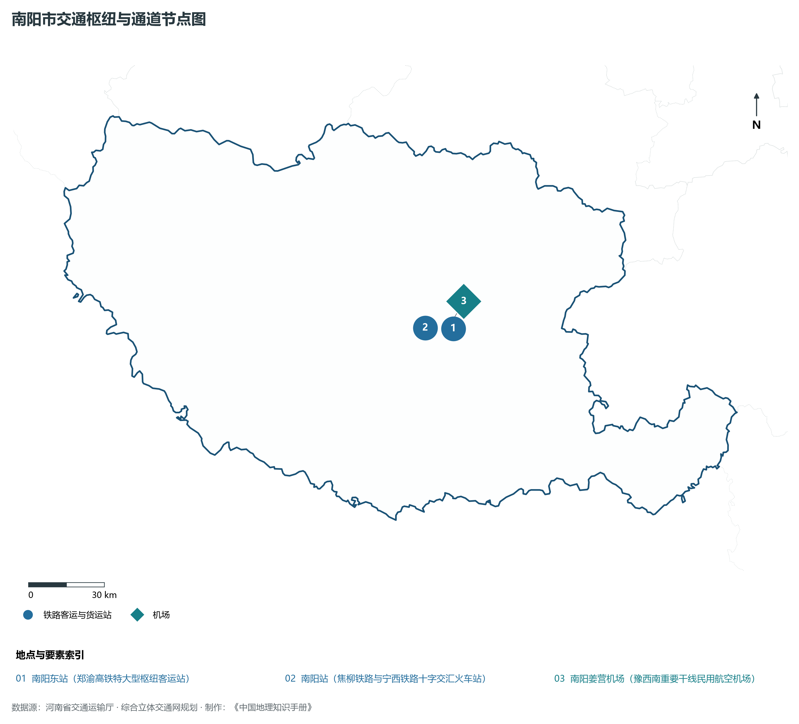
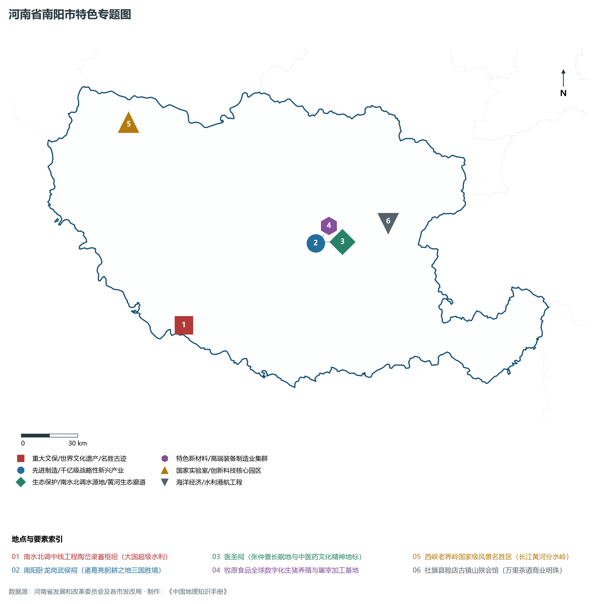
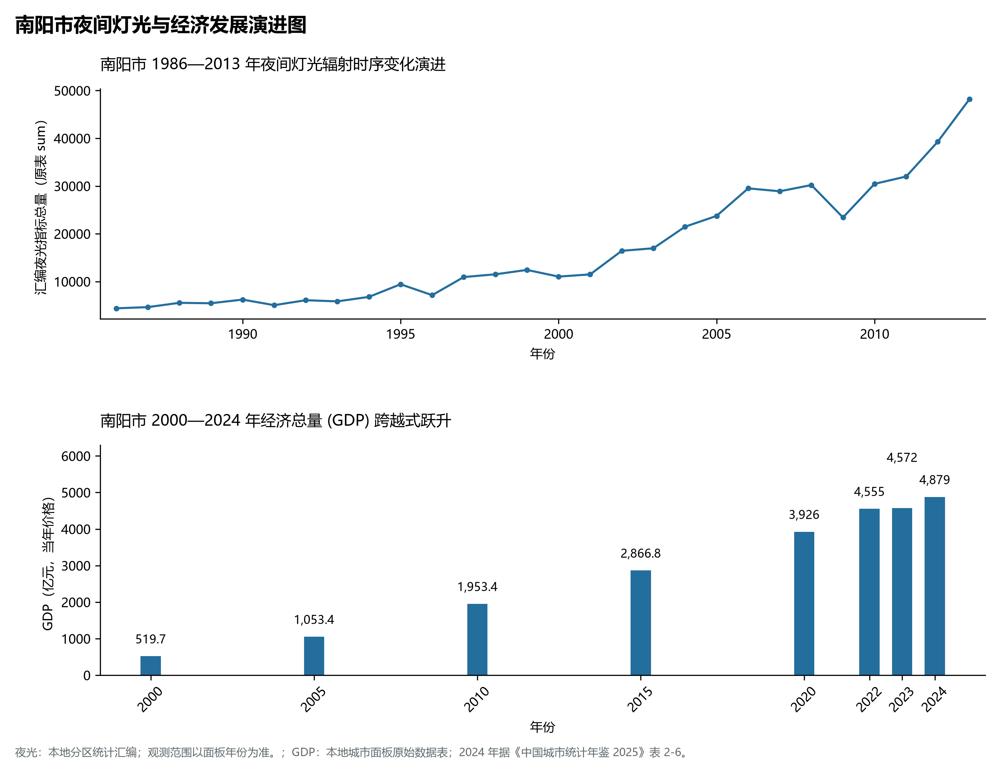

# 15.13 南阳市

南阳市，地处河南省核心战略功能区与中原经济区关键节点，其城市综合战略定位与发展愿景概括为：**河南省域副中心·国家历史文化名城·南水北调中线渠首水源地·医圣张仲景故里·中国玉雕之乡·牧原农牧之都**。2024 年常住人口 **945 万人**，常住人口城镇化率 **54.17%**，地区生产总值 **4,879 亿元**（当年价格），人均地区生产总值 **51,492 元**，三次产业构成为 **15.76 : 32.26 : 51.98**。

---

## 一、自然地理底盘与山川水系机理

区域骨干控制性山峰、高程标高极点与主要地貌控制节点包括：

- **老界岭鸡角尖 (2217.0m 西峡县伏牛山主峰/南阳第一高峰)**（空间坐标约东经 111.480°、北纬 33.620°，海拔标高约 2217.0 m）；
- **桐柏山太白顶 (1140.0m 桐柏县千里淮河发源绝顶)**（空间坐标约东经 113.285°、北纬 32.350°，海拔标高约 1140.0 m）；

本节列示的主要河湖与水系节点：

- **白河水系 (纵贯南阳市区南奔长江汉江)**（水系坐标约东经 112.530°、北纬 32.950°）；
- **丹江口水库南阳库区 (南水北调中线浩瀚水源地)**（水系坐标约东经 111.485°、北纬 32.750°）；
- **南水北调中线总干渠陶岔渠首 (一库清水北送起点)**（水系坐标约东经 111.720°、北纬 32.650°）；

---

## 二、行政区划沿革与城镇空间体系

南阳市建置沿革源远流长，文脉绵延数千年，自古即为华夏聚居、三代都邑、百家争鸣或商贾重镇。夏商周立国分封、汉唐置郡设州、宋元设路设府、明清建州设县，历经千百载风云变迁，积淀下极为厚重的政区地名文化遗产。新中国成立后特别是改革开放以来，伴随撤地设市、行政区划合理调整、城区组团式向外延展与以人为核心的新型城镇化深入推进，构建了中心极核强引领、县域板块协同支撑、重点中心镇特色鲜明、产城人文深度融合的现代化多极城镇空间体系：

- **南阳市委市政府 (卧龙区中州路行政中心)**（驻地坐标：112.525°E, 32.995°N）；
- **宛城区政府 (建设东路/古宛城遗址与现代商贸)**（驻地坐标：112.550°E, 32.990°N）；
- **卧龙区政府 (七一路/卧龙岗武侯祠与现代工业)**（驻地坐标：112.510°E, 33.000°N）；
- **邓州市政府 (团结中路/南水北调穿境与丹江粮仓)**（驻地坐标：112.085°E, 32.685°N）；
- **淅川县政府 (解放路/丹江口水库核心渠首所在地)**（驻地坐标：111.485°E, 33.135°N）；
- **西峡县政府 (白羽路/老界岭风景区与恐龙遗迹)**（驻地坐标：111.485°E, 33.300°N）；
- **镇平县政府 (健康路/中国玉雕之乡玉石文化名城)**（驻地坐标：112.235°E, 33.035°N）；
- **内乡县政府 (县前街/全国第一保存完好清代县衙)**（驻地坐标：111.850°E, 33.045°N）；
- **唐河县政府 (新春中路/唐河油田与农产品加工)**（驻地坐标：112.835°E, 32.695°N）；
- **社旗县政府 (红旗路/万里茶道赊店古镇山陕会馆)**（驻地坐标：112.935°E, 33.055°N）；
- **方城县政府 (释之大道/天下第一古长城与七峰山)**（驻地坐标：113.015°E, 33.255°N）；
- **南召县政府 (中华路/南召猿人发源地与柞蚕之乡)**（驻地坐标：112.435°E, 33.485°N）；
- **桐柏县政府 (淮源大道/淮河发源地太白顶与红色苏区)**（驻地坐标：113.405°E, 32.370°N）；
- **新野县政府 (朝阳路/三国名城火烧新野与纺织服装)**（驻地坐标：112.365°E, 32.515°N）；

在国土空间总体规划指引下，南阳市坚决严守耕地保护红线、生态保护红线与城镇开发边界“三条控制线”，优化“生产、生活、生态”空间协同布局，全面提升城市韧性与基础设施能级，持续缩小城乡基本公共服务差距，打造宜居、韧性、智慧、绿色的现代化和美家园。

---

## 三、综合立体交通网络与现代枢纽通道

本节列示的主要交通节点与通道：

**核心综合客货运交通枢纽节点与交通干线走廊：**

- **南阳东站 (郑渝高铁特大型枢纽客运站)**（空间坐标：112.635°E, 32.975°N）；
- **南阳站 (焦柳铁路与宁西铁路十字交汇火车站)**（空间坐标：112.515°E, 32.985°N）；
- **南阳姜营机场 (豫西南重要干线民用航空机场)**（空间坐标：112.615°E, 32.980°N）；

---

## 四、现代产业体系与新质生产力布局

南阳市坚定不移实施工业立市、制造业强市战略，对标河南省“7+28+N”产业链群布局要求，推动传统优势产业高端化、智能化、绿色化转型，做强战略性新兴产业，前瞻培育未来产业，构筑起实体经济厚重挺拔、创新动能蓬勃涌动的现代产业高地：

**标志性先进制造业集群、特色产业园区、国家重点实验室与产业地标：**

- **南水北调中线工程陶岔渠首枢纽 (大国超级水利)**（空间坐标：111.720°E, 32.650°N）；
- **南阳卧龙岗武侯祠 (诸葛亮躬耕之地三国胜境)**（空间坐标：112.510°E, 32.990°N）；
- **医圣祠 (张仲景长眠地与中医药文化精神地标)**（空间坐标：112.535°E, 32.995°N）；
- **牧原食品全球数字化生猪养殖与屠宰加工基地**（空间坐标：112.520°E, 32.980°N）；
- **西峡老界岭国家级风景名胜区 (长江黄河分水岭)**（空间坐标：111.480°E, 33.620°N）；
- **社旗县赊店古镇山陕会馆 (万里茶道商业明珠)**（空间坐标：112.935°E, 33.055°N）；

通过深入实施工业产业链“链长制”与领航企业培育计划，南阳市聚力推动创新链、产业链、资金链、人才链深度融合，梯次培育单项冠军企业、高新技术企业与专精特新“小巨人”企业集群，积极抢占新材料、先进装备、新能源、高端电子信息、绿色食品与现代生物医药等细分赛道制高点，夯实现代化经济强市的实体支撑。

---

## 五、历史文化名胜、人文底蕴与全域文旅地理

南阳市的文化旅游与相关地标：

- **南水北调中线工程陶岔渠首枢纽 (大国超级水利)**；
- **南阳卧龙岗武侯祠 (诸葛亮躬耕之地三国胜境)**；
- **医圣祠 (张仲景长眠地与中医药文化精神地标)**；
- **牧原食品全球数字化生猪养殖与屠宰加工基地**；
- **西峡老界岭国家级风景名胜区 (长江黄河分水岭)**；
- **社旗县赊店古镇山陕会馆 (万里茶道商业明珠)**；

立足“行走河南·读懂中国”文旅超级品牌，南阳市大力实施文旅文创融合战略，推动考古遗址公园、历史文化街区、沉浸式演艺与生态休闲度假深度跨界赋能，以数字科技再现千年华夏古韵，打造享誉海内外的中华文化寻根研学旅行胜地。

---

## 六、夜间灯光辐射与跨世纪经济变化时序演进

本节夜光图的观测年份为 1986—2013 年，指标为行政区汇总值（原表 sum）。

| 年份 | 地区生产总值（亿元，当年价格） |
|:---|---:|
| 2000 年 | 519.7 |
| 2005 年 | 1,053.4 |
| 2010 年 | 1,953.4 |
| 2015 年 | 2,866.8 |
| 2020 年 | 3,926 |
| 2022 年 | 4,555 |
| 2023 年 | 4,572 |
| 2024 年 | 4,879 |

2024 年统计来源：《中国城市统计年鉴 2025》表 2-1、2-6、2-7（2024 年，全市）。其他年份 GDP 据本地城市面板“原始数据”表，单位为亿元、当年价格。
