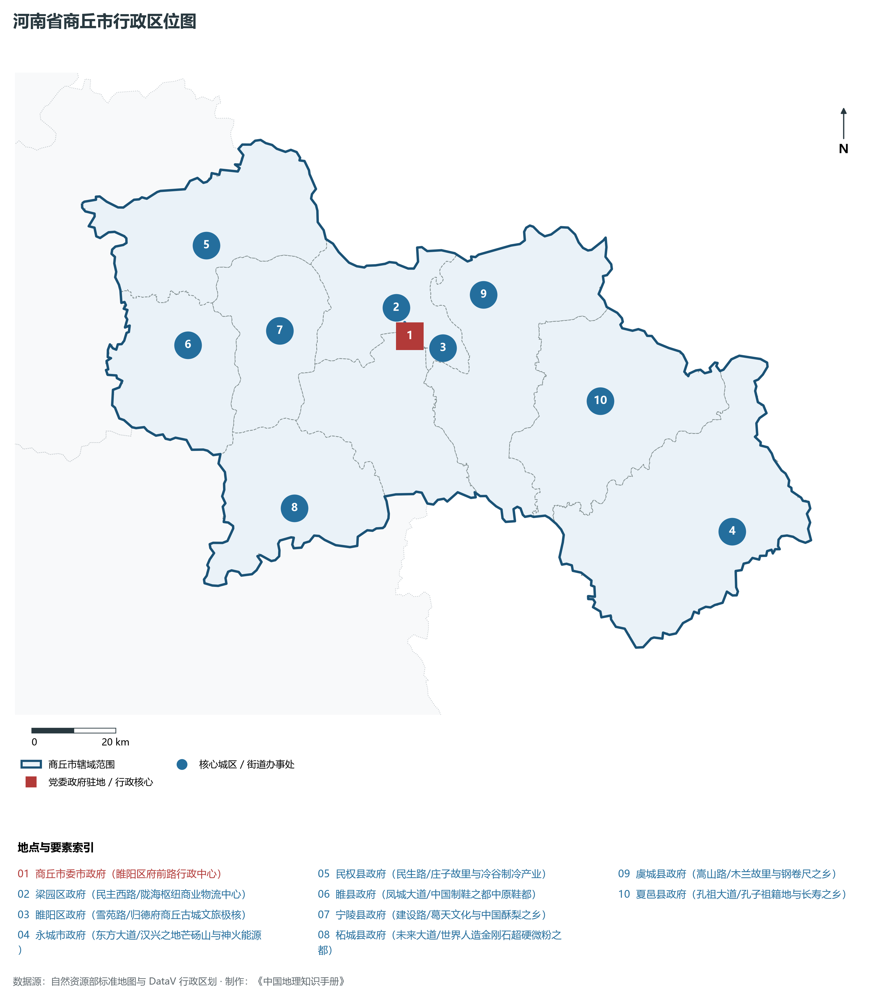
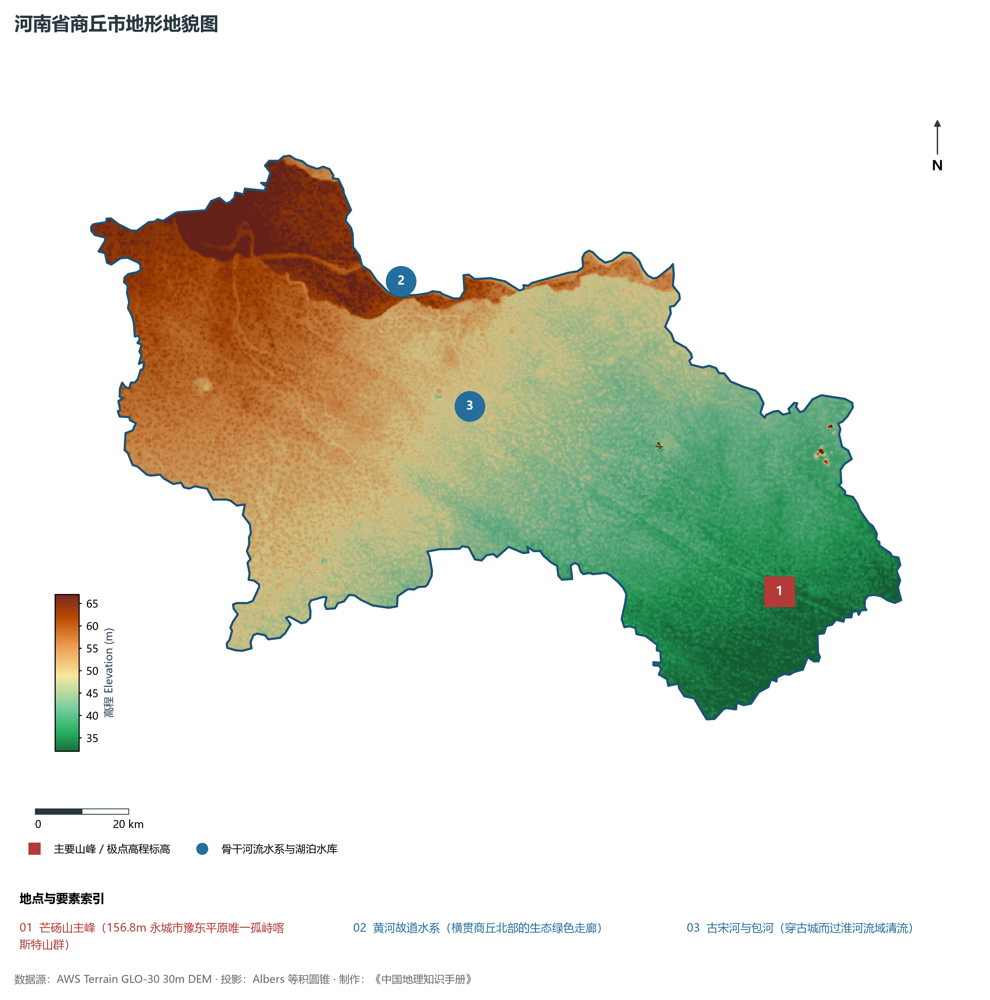
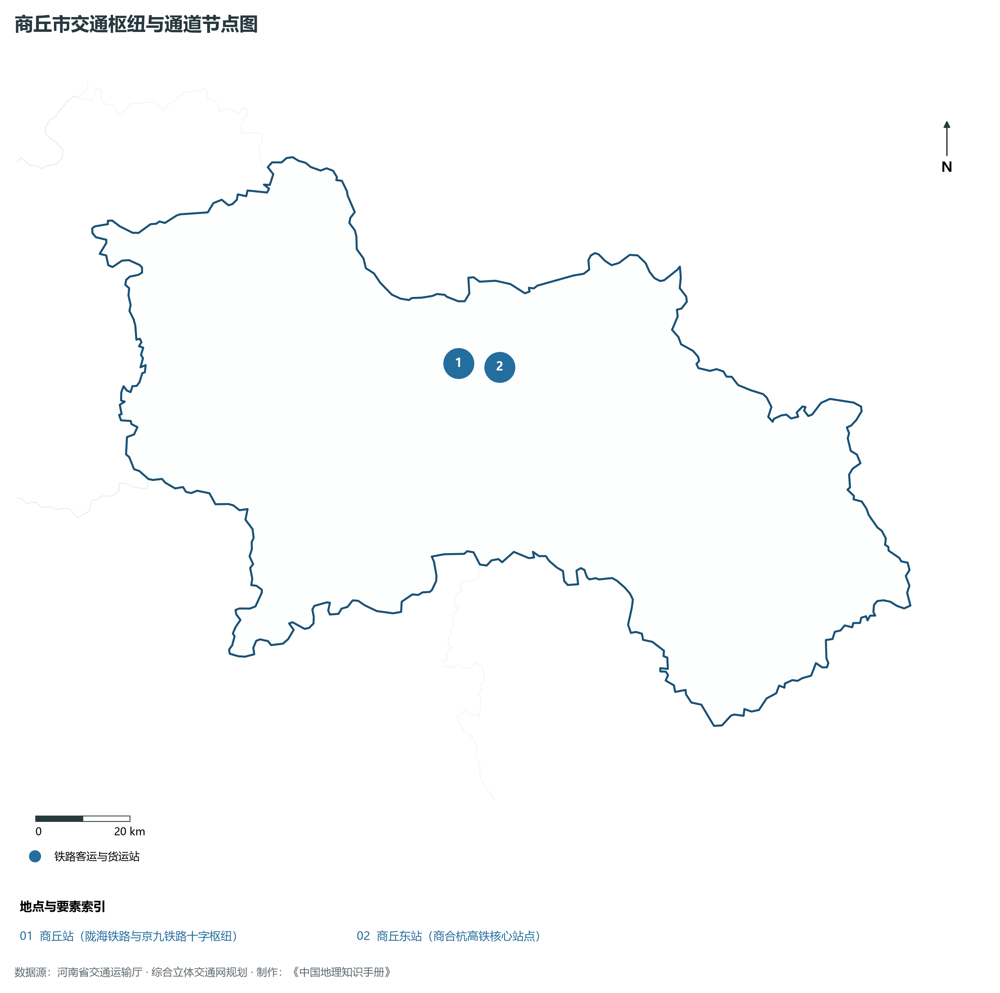
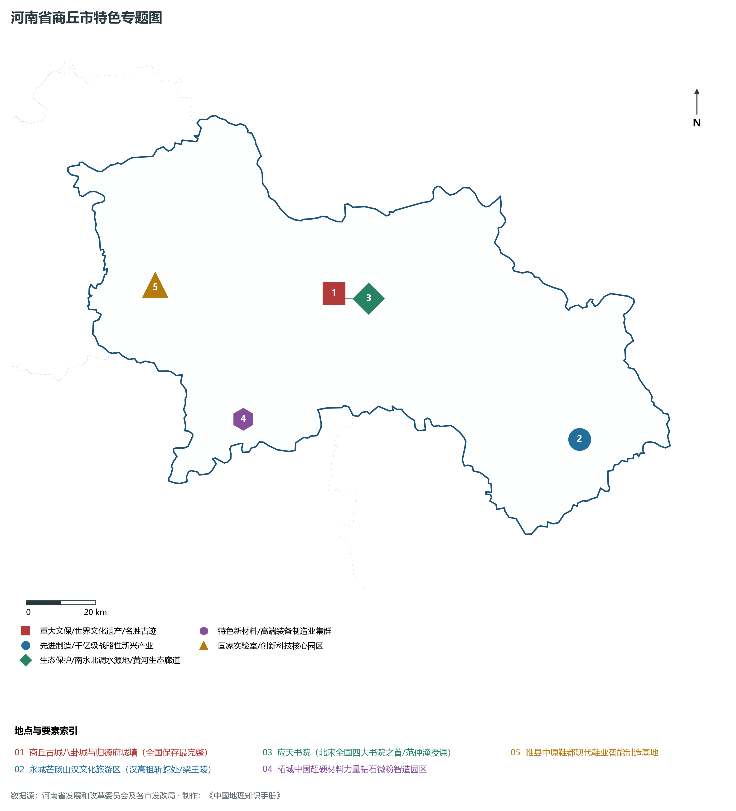
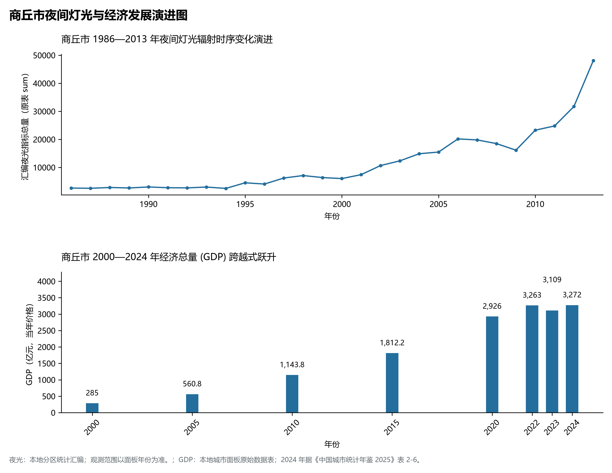

# 15.14 商丘市

商丘市，地处河南省核心战略功能区与中原经济区关键节点，其城市综合战略定位与发展愿景概括为：**华商之源·殷商祖地·国家历史文化名城·国家综合交通枢纽·全球超硬材料之都·芒砀山汉文化圣地**。2024 年常住人口 **763 万人**，常住人口城镇化率 **49.93%**，地区生产总值 **3,272 亿元**（当年价格），人均地区生产总值 **42,808 元**，三次产业构成为 **16.96 : 33.5 : 49.54**。

---

## 一、自然地理底盘与山川水系机理

区域骨干控制性山峰、高程标高极点与主要地貌控制节点包括：

- **芒砀山主峰 (156.8m 永城市豫东平原唯一孤峙喀斯特山群)**（空间坐标约东经 116.360°、北纬 33.935°，海拔标高约 156.8 m）；

本节列示的主要河湖与水系节点：

- **黄河故道水系 (横贯商丘北部的生态绿色走廊)**（水系坐标约东经 115.550°、北纬 34.600°）；
- **古宋河与包河 (穿古城而过淮河流域清流)**（水系坐标约东经 115.680°、北纬 34.350°）；

---

## 二、行政区划沿革与城镇空间体系

商丘市建置沿革源远流长，文脉绵延数千年，自古即为华夏聚居、三代都邑、百家争鸣或商贾重镇。夏商周立国分封、汉唐置郡设州、宋元设路设府、明清建州设县，历经千百载风云变迁，积淀下极为厚重的政区地名文化遗产。新中国成立后特别是改革开放以来，伴随撤地设市、行政区划合理调整、城区组团式向外延展与以人为核心的新型城镇化深入推进，构建了中心极核强引领、县域板块协同支撑、重点中心镇特色鲜明、产城人文深度融合的现代化多极城镇空间体系：

- **商丘市委市政府 (睢阳区府前路行政中心)**（驻地坐标：115.655°E, 34.415°N）；
- **梁园区政府 (民主西路/陇海枢纽商业物流中心)**（驻地坐标：115.645°E, 34.445°N）；
- **睢阳区政府 (雪苑路/归德府商丘古城文旅极核)**（驻地坐标：115.650°E, 34.390°N）；
- **永城市政府 (东方大道/汉兴之地芒砀山与神火能源)**（驻地坐标：116.440°E, 33.930°N）；
- **民权县政府 (民生路/庄子故里与冷谷制冷产业)**（驻地坐标：115.145°E, 34.650°N）；
- **睢县政府 (凤城大道/中国制鞋之都中原鞋都)**（驻地坐标：115.070°E, 34.445°N）；
- **宁陵县政府 (建设路/葛天文化与中国酥梨之乡)**（驻地坐标：115.315°E, 34.455°N）；
- **柘城县政府 (未来大道/世界人造金刚石超硬微粉之都)**（驻地坐标：115.305°E, 34.080°N）；
- **虞城县政府 (嵩山路/木兰故里与钢卷尺之乡)**（驻地坐标：115.860°E, 34.485°N）；
- **夏邑县政府 (孔祖大道/孔子祖籍地与长寿之乡)**（驻地坐标：116.135°E, 34.235°N）；

在国土空间总体规划指引下，商丘市坚决严守耕地保护红线、生态保护红线与城镇开发边界“三条控制线”，优化“生产、生活、生态”空间协同布局，全面提升城市韧性与基础设施能级，持续缩小城乡基本公共服务差距，打造宜居、韧性、智慧、绿色的现代化和美家园。

---

## 三、综合立体交通网络与现代枢纽通道

本节列示的主要交通节点与通道：

**核心综合客货运交通枢纽节点与交通干线走廊：**

- **商丘站 (陇海铁路与京九铁路十字枢纽)**（空间坐标：115.655°E, 34.440°N）；
- **商丘东站 (商合杭高铁核心站点)**（空间坐标：115.750°E, 34.425°N）；

---

## 四、现代产业体系与新质生产力布局

商丘市坚定不移实施工业立市、制造业强市战略，对标河南省“7+28+N”产业链群布局要求，推动传统优势产业高端化、智能化、绿色化转型，做强战略性新兴产业，前瞻培育未来产业，构筑起实体经济厚重挺拔、创新动能蓬勃涌动的现代产业高地：

**标志性先进制造业集群、特色产业园区、国家重点实验室与产业地标：**

- **商丘古城八卦城与归德府城墙 (全国保存最完整)**（空间坐标：115.635°E, 34.375°N）；
- **永城芒砀山汉文化旅游区 (汉高祖斩蛇处/梁王陵)**（空间坐标：116.360°E, 33.935°N）；
- **应天书院 (北宋全国四大书院之首/范仲淹授课)**（空间坐标：115.655°E, 34.360°N）；
- **柘城中国超硬材料力量钻石微粉智造园区**（空间坐标：115.305°E, 34.080°N）；
- **睢县中原鞋都现代鞋业智能制造基地**（空间坐标：115.070°E, 34.445°N）；

通过深入实施工业产业链“链长制”与领航企业培育计划，商丘市聚力推动创新链、产业链、资金链、人才链深度融合，梯次培育单项冠军企业、高新技术企业与专精特新“小巨人”企业集群，积极抢占新材料、先进装备、新能源、高端电子信息、绿色食品与现代生物医药等细分赛道制高点，夯实现代化经济强市的实体支撑。

---

## 五、历史文化名胜、人文底蕴与全域文旅地理

商丘市的文化旅游与相关地标：

- **商丘古城八卦城与归德府城墙 (全国保存最完整)**；
- **永城芒砀山汉文化旅游区 (汉高祖斩蛇处/梁王陵)**；
- **应天书院 (北宋全国四大书院之首/范仲淹授课)**；
- **柘城中国超硬材料力量钻石微粉智造园区**；
- **睢县中原鞋都现代鞋业智能制造基地**；

立足“行走河南·读懂中国”文旅超级品牌，商丘市大力实施文旅文创融合战略，推动考古遗址公园、历史文化街区、沉浸式演艺与生态休闲度假深度跨界赋能，以数字科技再现千年华夏古韵，打造享誉海内外的中华文化寻根研学旅行胜地。

---

## 六、夜间灯光辐射与跨世纪经济变化时序演进

本节夜光图的观测年份为 1986—2013 年，指标为行政区汇总值（原表 sum）。

| 年份 | 地区生产总值（亿元，当年价格） |
|:---|---:|
| 2000 年 | 285 |
| 2005 年 | 560.8 |
| 2010 年 | 1,143.8 |
| 2015 年 | 1,812.2 |
| 2020 年 | 2,926 |
| 2022 年 | 3,263 |
| 2023 年 | 3,109 |
| 2024 年 | 3,272 |

2024 年统计来源：《中国城市统计年鉴 2025》表 2-1、2-6、2-7（2024 年，全市）。其他年份 GDP 据本地城市面板“原始数据”表，单位为亿元、当年价格。
