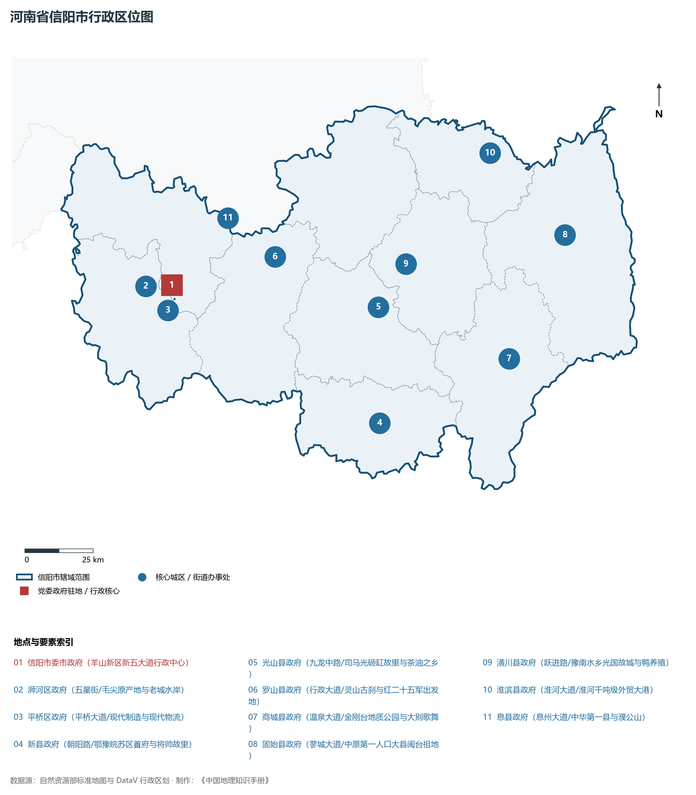
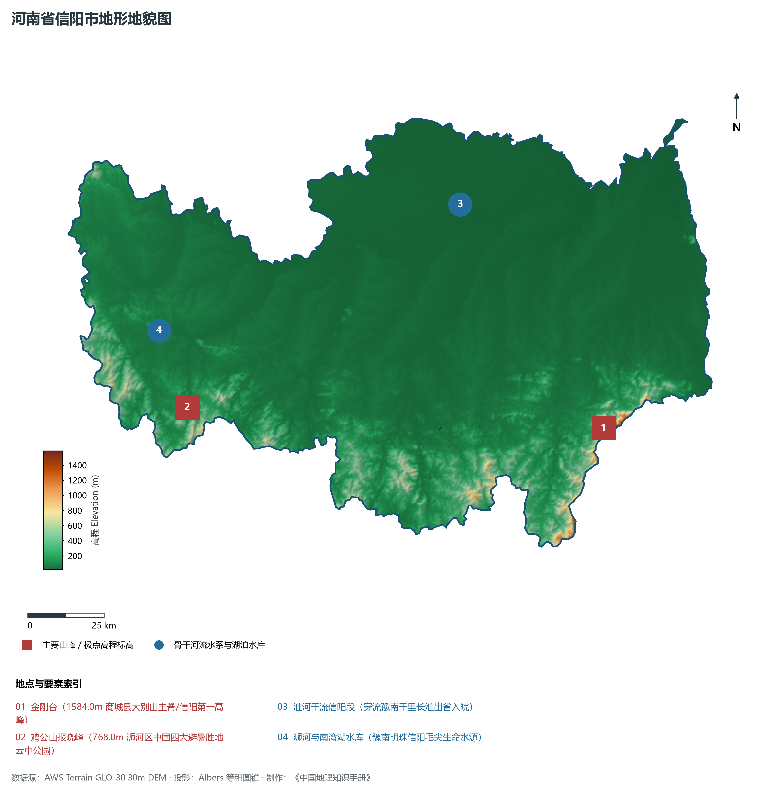
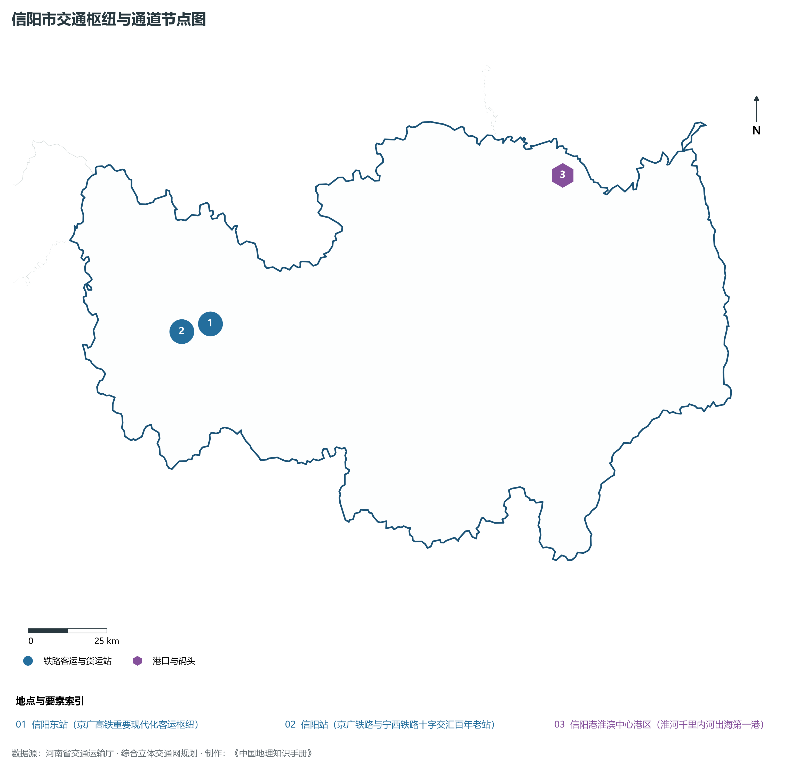
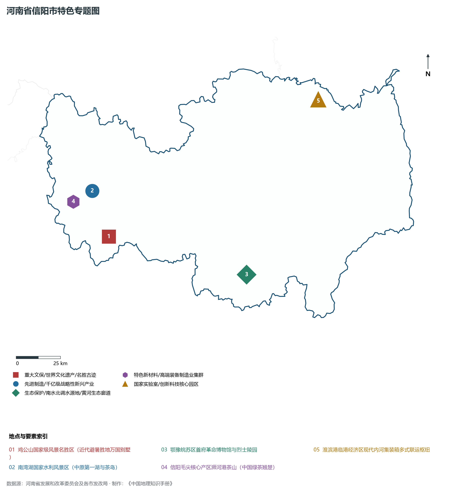
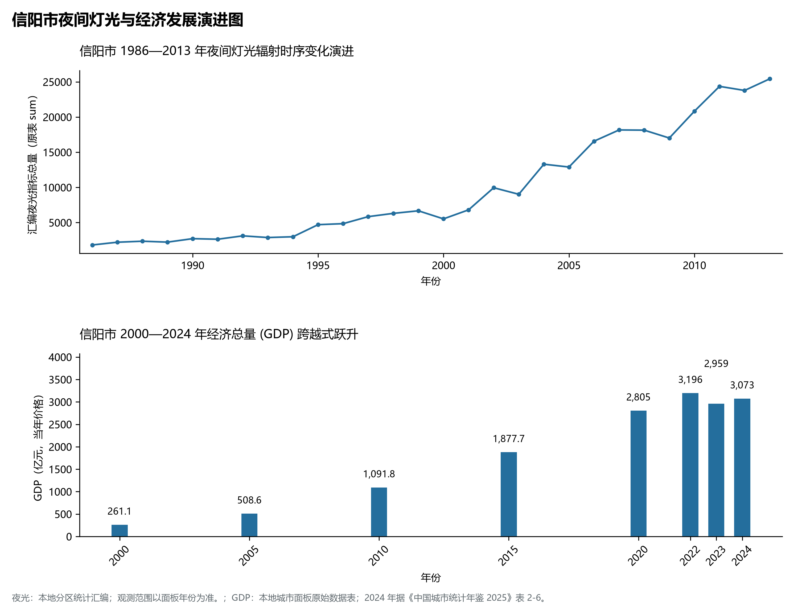

# 15.15 信阳市

信阳市，地处河南省核心战略功能区与中原经济区关键节点，其城市综合战略定位与发展愿景概括为：**江南北国·北国江南·中国毛尖之都·大别山革命老区首府·红二十五军长征出发地·避暑胜地鸡公山**。2024 年常住人口 **600 万人**，常住人口城镇化率 **53.85%**，地区生产总值 **3,073 亿元**（当年价格），人均地区生产总值 **51,010 元**，三次产业构成为 **16.25 : 32.11 : 51.64**。

---

## 一、自然地理底盘与山川水系机理

区域骨干控制性山峰、高程标高极点与主要地貌控制节点包括：

- **金刚台 (1584.0m 商城县大别山主脊/信阳第一高峰)**（空间坐标约东经 115.520°、北纬 31.710°，海拔标高约 1584.0 m）；
- **鸡公山报晓峰 (768.0m 浉河区中国四大避暑胜地云中公园)**（空间坐标约东经 114.075°、北纬 31.890°，海拔标高约 768.0 m）；

本节列示的主要河湖与水系节点：

- **淮河干流信阳段 (穿流豫南千里长淮出省入皖)**（水系坐标约东经 115.100°、北纬 32.400°）；
- **浉河与南湾湖水库 (豫南明珠信阳毛尖生命水源)**（水系坐标约东经 114.000°、北纬 32.120°）；

---

## 二、行政区划沿革与城镇空间体系

信阳市建置沿革源远流长，文脉绵延数千年，自古即为华夏聚居、三代都邑、百家争鸣或商贾重镇。夏商周立国分封、汉唐置郡设州、宋元设路设府、明清建州设县，历经千百载风云变迁，积淀下极为厚重的政区地名文化遗产。新中国成立后特别是改革开放以来，伴随撤地设市、行政区划合理调整、城区组团式向外延展与以人为核心的新型城镇化深入推进，构建了中心极核强引领、县域板块协同支撑、重点中心镇特色鲜明、产城人文深度融合的现代化多极城镇空间体系：

- **信阳市委市政府 (羊山新区新五大道行政中心)**（驻地坐标：114.120°E, 32.145°N）；
- **浉河区政府 (五星街/毛尖原产地与老城水岸)**（驻地坐标：114.060°E, 32.125°N）；
- **平桥区政府 (平桥大道/现代制造与现代物流)**（驻地坐标：114.125°E, 32.100°N）；
- **新县政府 (朝阳路/鄂豫皖苏区首府与将帅故里)**（驻地坐标：114.880°E, 31.635°N）；
- **光山县政府 (九龙中路/司马光砸缸故里与茶油之乡)**（驻地坐标：114.920°E, 32.010°N）；
- **罗山县政府 (行政大道/灵山古刹与红二十五军出发地)**（驻地坐标：114.535°E, 32.205°N）；
- **商城县政府 (温泉大道/金刚台地质公园与大别歌舞)**（驻地坐标：115.410°E, 31.800°N）；
- **固始县政府 (蓼城大道/中原第一人口大县闽台祖地)**（驻地坐标：115.680°E, 32.180°N）；
- **潢川县政府 (跃进路/豫南水乡光国故城与鸭养殖)**（驻地坐标：115.045°E, 32.140°N）；
- **淮滨县政府 (淮河大道/淮河千吨级外贸大港)**（驻地坐标：115.420°E, 32.470°N）；
- **息县政府 (息州大道/中华第一县与濮公山)**（驻地坐标：114.365°E, 32.345°N）；

在国土空间总体规划指引下，信阳市坚决严守耕地保护红线、生态保护红线与城镇开发边界“三条控制线”，优化“生产、生活、生态”空间协同布局，全面提升城市韧性与基础设施能级，持续缩小城乡基本公共服务差距，打造宜居、韧性、智慧、绿色的现代化和美家园。

---

## 三、综合立体交通网络与现代枢纽通道

本节列示的主要交通节点与通道：

**核心综合客货运交通枢纽节点与交通干线走廊：**

- **信阳东站 (京广高铁重要现代化客运枢纽)**（空间坐标：114.165°E, 32.150°N）；
- **信阳站 (京广铁路与宁西铁路十字交汇百年老站)**（空间坐标：114.065°E, 32.135°N）；
- **信阳港淮滨中心港区 (淮河千里内河出海第一港)**（空间坐标：115.420°E, 32.470°N）；

---

## 四、现代产业体系与新质生产力布局

信阳市坚定不移实施工业立市、制造业强市战略，对标河南省“7+28+N”产业链群布局要求，推动传统优势产业高端化、智能化、绿色化转型，做强战略性新兴产业，前瞻培育未来产业，构筑起实体经济厚重挺拔、创新动能蓬勃涌动的现代产业高地：

**标志性先进制造业集群、特色产业园区、国家重点实验室与产业地标：**

- **鸡公山国家级风景名胜区 (近代避暑胜地万国别墅)**（空间坐标：114.075°E, 31.890°N）；
- **南湾湖国家水利风景区 (中原第一湖与茶岛)**（空间坐标：114.000°E, 32.125°N）；
- **鄂豫皖苏区首府革命博物馆与烈士陵园**（空间坐标：114.880°E, 31.635°N）；
- **信阳毛尖核心产区浉河港茶山 (中国绿茶翘楚)**（空间坐标：113.880°E, 32.080°N）；
- **淮滨港临港经济区现代内河集装箱多式联运枢纽**（空间坐标：115.420°E, 32.470°N）；

通过深入实施工业产业链“链长制”与领航企业培育计划，信阳市聚力推动创新链、产业链、资金链、人才链深度融合，梯次培育单项冠军企业、高新技术企业与专精特新“小巨人”企业集群，积极抢占新材料、先进装备、新能源、高端电子信息、绿色食品与现代生物医药等细分赛道制高点，夯实现代化经济强市的实体支撑。

---

## 五、历史文化名胜、人文底蕴与全域文旅地理

信阳市的文化旅游与相关地标：

- **鸡公山国家级风景名胜区 (近代避暑胜地万国别墅)**；
- **南湾湖国家水利风景区 (中原第一湖与茶岛)**；
- **鄂豫皖苏区首府革命博物馆与烈士陵园**；
- **信阳毛尖核心产区浉河港茶山 (中国绿茶翘楚)**；
- **淮滨港临港经济区现代内河集装箱多式联运枢纽**；

立足“行走河南·读懂中国”文旅超级品牌，信阳市大力实施文旅文创融合战略，推动考古遗址公园、历史文化街区、沉浸式演艺与生态休闲度假深度跨界赋能，以数字科技再现千年华夏古韵，打造享誉海内外的中华文化寻根研学旅行胜地。

---

## 六、夜间灯光辐射与跨世纪经济变化时序演进

本节夜光图的观测年份为 1986—2013 年，指标为行政区汇总值（原表 sum）。

| 年份 | 地区生产总值（亿元，当年价格） |
|:---|---:|
| 2000 年 | 261.1 |
| 2005 年 | 508.6 |
| 2010 年 | 1,091.8 |
| 2015 年 | 1,877.7 |
| 2020 年 | 2,805 |
| 2022 年 | 3,196 |
| 2023 年 | 2,959 |
| 2024 年 | 3,073 |

2024 年统计来源：《中国城市统计年鉴 2025》表 2-1、2-6、2-7（2024 年，全市）。其他年份 GDP 据本地城市面板“原始数据”表，单位为亿元、当年价格。
