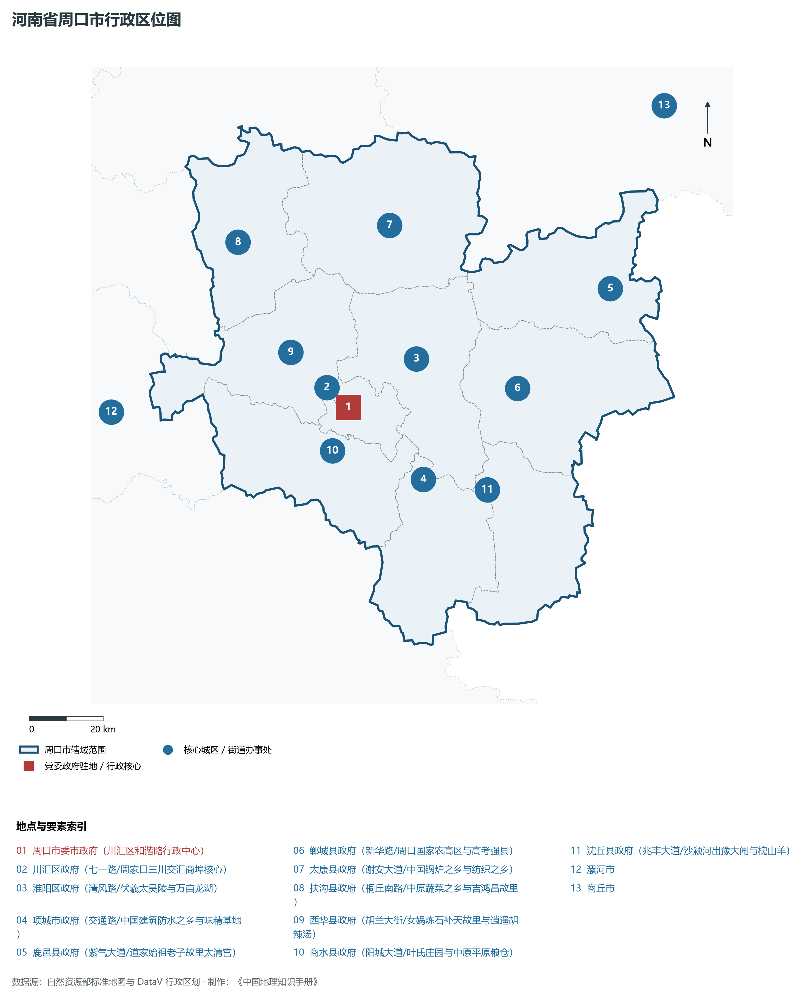
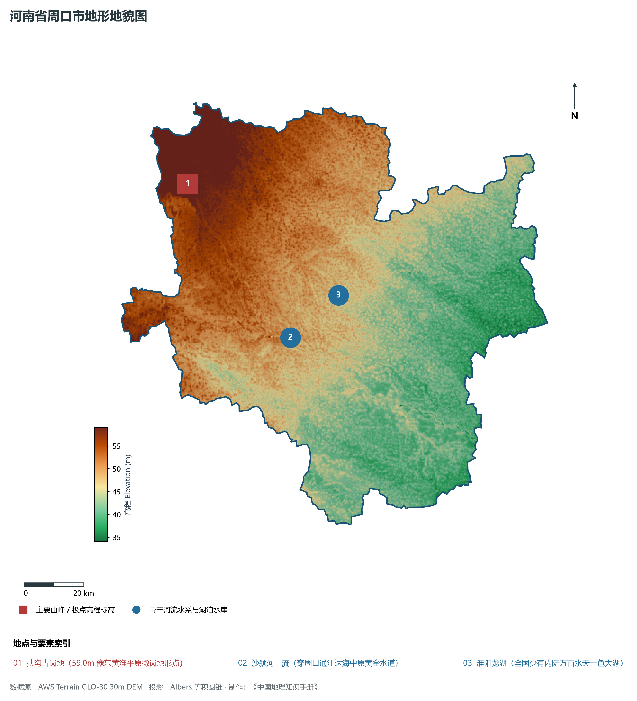
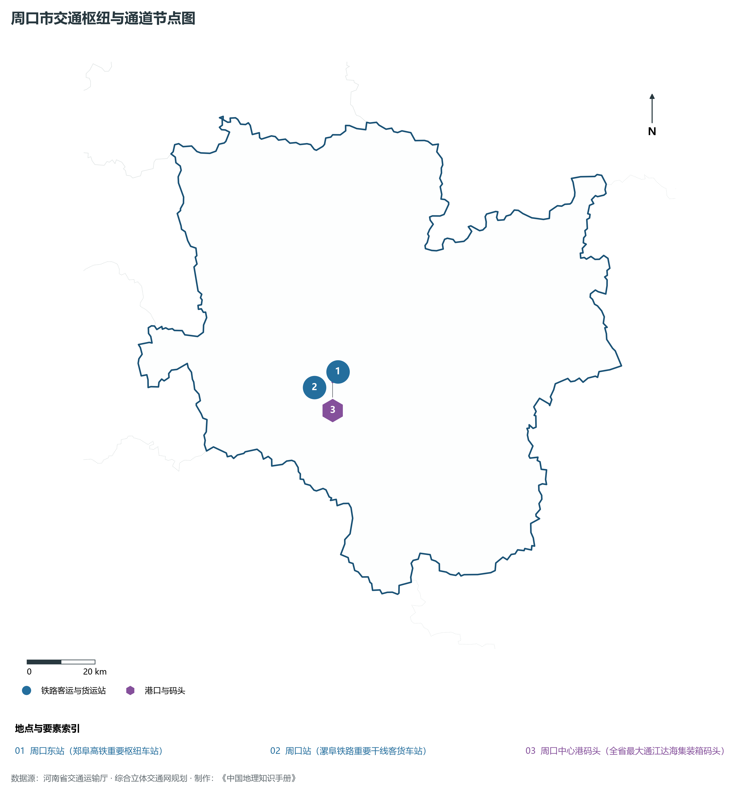
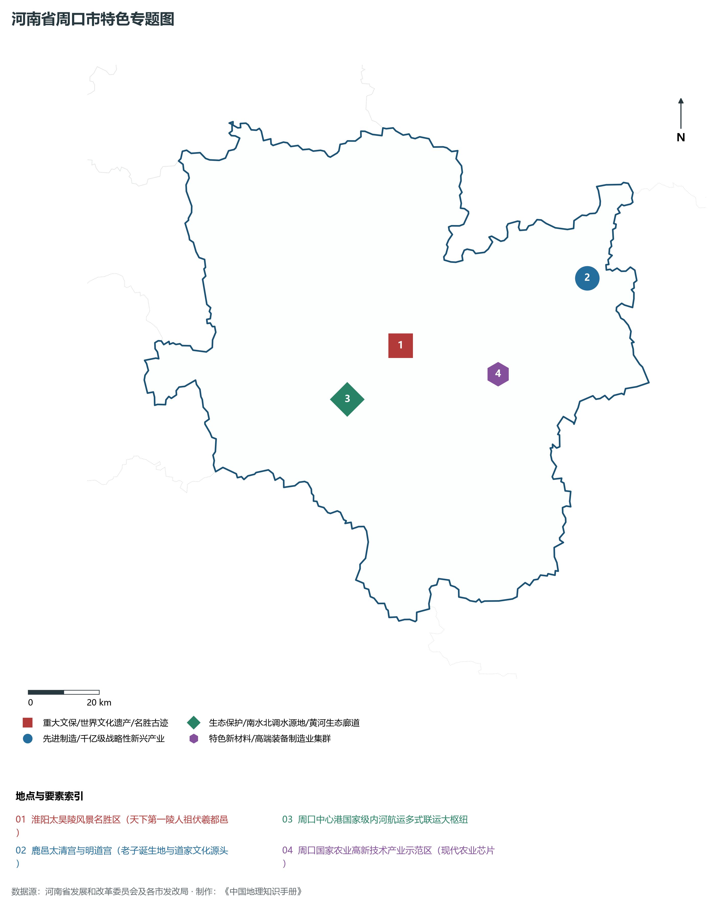
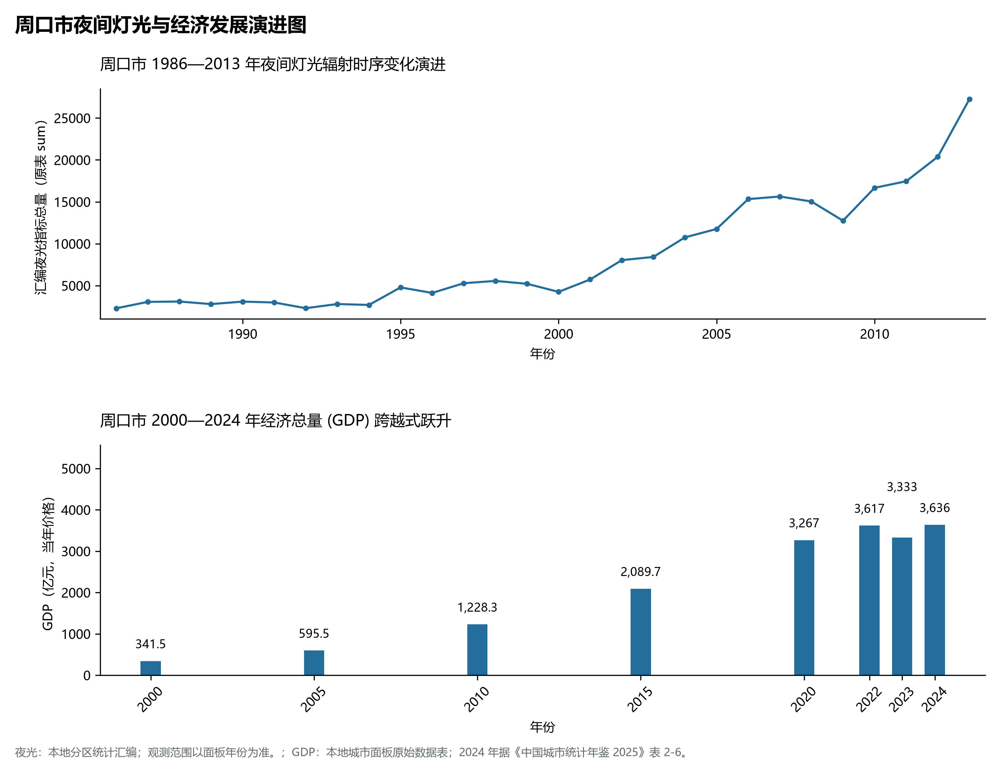

# 15.16 周口市

周口市，地处河南省核心战略功能区与中原经济区关键节点，其城市综合战略定位与发展愿景概括为：**羲皇故都·老子故里·中原内河航运第一大港·国家农高区·中华百亿斤超级粮仓**。2024 年常住人口 **863 万人**，常住人口城镇化率 **46.51%**，地区生产总值 **3,636 亿元**（当年价格），人均地区生产总值 **42,038 元**，三次产业构成为 **16.02 : 32.95 : 51.04**。

---

## 一、自然地理底盘与山川水系机理

区域骨干控制性山峰、高程标高极点与主要地貌控制节点包括：

- **扶沟古岗地 (59.0m 豫东黄淮平原微岗地形点)**（空间坐标约东经 114.380°、北纬 34.100°，海拔标高约 59.0 m）；

本节列示的主要河湖与水系节点：

- **沙颍河干流 (穿周口通江达海中原黄金水道)**（水系坐标约东经 114.700°、北纬 33.620°）；
- **淮阳龙湖 (全国少有内陆万亩水天一色大湖)**（水系坐标约东经 114.890°、北纬 33.730°）；

---

## 二、行政区划沿革与城镇空间体系

周口市建置沿革源远流长，文脉绵延数千年，自古即为华夏聚居、三代都邑、百家争鸣或商贾重镇。夏商周立国分封、汉唐置郡设州、宋元设路设府、明清建州设县，历经千百载风云变迁，积淀下极为厚重的政区地名文化遗产。新中国成立后特别是改革开放以来，伴随撤地设市、行政区划合理调整、城区组团式向外延展与以人为核心的新型城镇化深入推进，构建了中心极核强引领、县域板块协同支撑、重点中心镇特色鲜明、产城人文深度融合的现代化多极城镇空间体系：

- **周口市委市政府 (川汇区和谐路行政中心)**（驻地坐标：114.675°E, 33.640°N）；
- **川汇区政府 (七一路/周家口三川交汇商埠核心)**（驻地坐标：114.655°E, 33.625°N）；
- **淮阳区政府 (清风路/伏羲太昊陵与万亩龙湖)**（驻地坐标：114.890°E, 33.740°N）；
- **项城市政府 (交通路/中国建筑防水之乡与味精基地)**（驻地坐标：114.875°E, 33.450°N）；
- **鹿邑县政府 (紫气大道/道家始祖老子故里太清宫)**（驻地坐标：115.485°E, 33.860°N）；
- **郸城县政府 (新华路/周口国家农高区与高考强县)**（驻地坐标：115.180°E, 33.645°N）；
- **太康县政府 (谢安大道/中国锅炉之乡与纺织之乡)**（驻地坐标：114.850°E, 34.065°N）；
- **扶沟县政府 (桐丘南路/中原蔬菜之乡与吉鸿昌故里)**（驻地坐标：114.395°E, 34.060°N）；
- **西华县政府 (胡兰大街/女娲炼石补天故里与逍遥胡辣汤)**（驻地坐标：114.520°E, 33.785°N）；
- **商水县政府 (阳城大道/叶氏庄园与中原平原粮仓)**（驻地坐标：114.615°E, 33.540°N）；
- **沈丘县政府 (兆丰大道/沙颍河出豫大闸与槐山羊)**（驻地坐标：115.060°E, 33.410°N）；

在国土空间总体规划指引下，周口市坚决严守耕地保护红线、生态保护红线与城镇开发边界“三条控制线”，优化“生产、生活、生态”空间协同布局，全面提升城市韧性与基础设施能级，持续缩小城乡基本公共服务差距，打造宜居、韧性、智慧、绿色的现代化和美家园。

---

## 三、综合立体交通网络与现代枢纽通道

本节列示的主要交通节点与通道：

**核心综合客货运交通枢纽节点与交通干线走廊：**

- **周口东站 (郑阜高铁重要枢纽车站)**（空间坐标：114.730°E, 33.645°N）；
- **周口站 (漯阜铁路重要干线客货车站)**（空间坐标：114.650°E, 33.610°N）；
- **周口中心港码头 (全省最大通江达海集装箱码头)**（空间坐标：114.710°E, 33.620°N）；

---

## 四、现代产业体系与新质生产力布局

周口市坚定不移实施工业立市、制造业强市战略，对标河南省“7+28+N”产业链群布局要求，推动传统优势产业高端化、智能化、绿色化转型，做强战略性新兴产业，前瞻培育未来产业，构筑起实体经济厚重挺拔、创新动能蓬勃涌动的现代产业高地：

**标志性先进制造业集群、特色产业园区、国家重点实验室与产业地标：**

- **淮阳太昊陵风景名胜区 (天下第一陵人祖伏羲都邑)**（空间坐标：114.890°E, 33.740°N）；
- **鹿邑太清宫与明道宫 (老子诞生地与道家文化源头)**（空间坐标：115.485°E, 33.860°N）；
- **周口中心港国家级内河航运多式联运大枢纽**（空间坐标：114.710°E, 33.620°N）；
- **周口国家农业高新技术产业示范区 (现代农业芯片)**（空间坐标：115.180°E, 33.645°N）；

通过深入实施工业产业链“链长制”与领航企业培育计划，周口市聚力推动创新链、产业链、资金链、人才链深度融合，梯次培育单项冠军企业、高新技术企业与专精特新“小巨人”企业集群，积极抢占新材料、先进装备、新能源、高端电子信息、绿色食品与现代生物医药等细分赛道制高点，夯实现代化经济强市的实体支撑。

---

## 五、历史文化名胜、人文底蕴与全域文旅地理

周口市的文化旅游与相关地标：

- **淮阳太昊陵风景名胜区 (天下第一陵人祖伏羲都邑)**；
- **鹿邑太清宫与明道宫 (老子诞生地与道家文化源头)**；
- **周口中心港国家级内河航运多式联运大枢纽**；
- **周口国家农业高新技术产业示范区 (现代农业芯片)**；

立足“行走河南·读懂中国”文旅超级品牌，周口市大力实施文旅文创融合战略，推动考古遗址公园、历史文化街区、沉浸式演艺与生态休闲度假深度跨界赋能，以数字科技再现千年华夏古韵，打造享誉海内外的中华文化寻根研学旅行胜地。

---

## 六、夜间灯光辐射与跨世纪经济变化时序演进

本节夜光图的观测年份为 1986—2013 年，指标为行政区汇总值（原表 sum）。

| 年份 | 地区生产总值（亿元，当年价格） |
|:---|---:|
| 2000 年 | 341.5 |
| 2005 年 | 595.5 |
| 2010 年 | 1,228.3 |
| 2015 年 | 2,089.7 |
| 2020 年 | 3,267 |
| 2022 年 | 3,617 |
| 2023 年 | 3,333 |
| 2024 年 | 3,636 |

2024 年统计来源：《中国城市统计年鉴 2025》表 2-1、2-6、2-7（2024 年，全市）。其他年份 GDP 据本地城市面板“原始数据”表，单位为亿元、当年价格。
