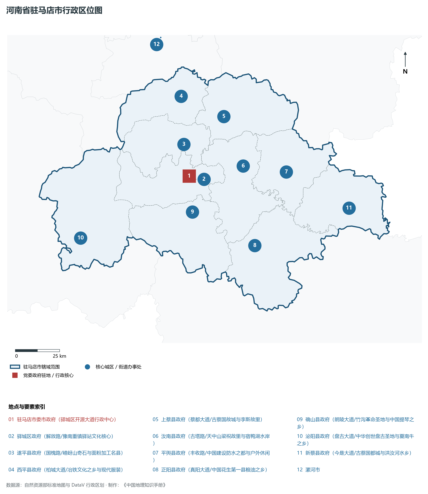
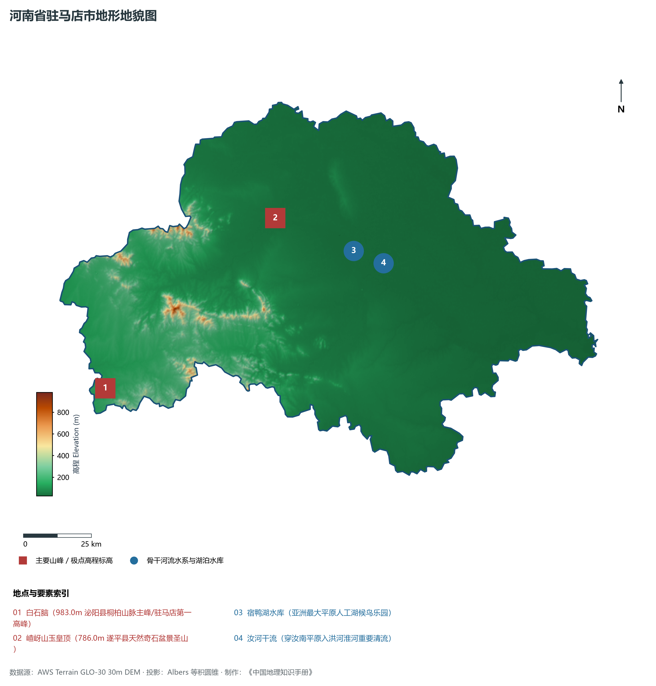
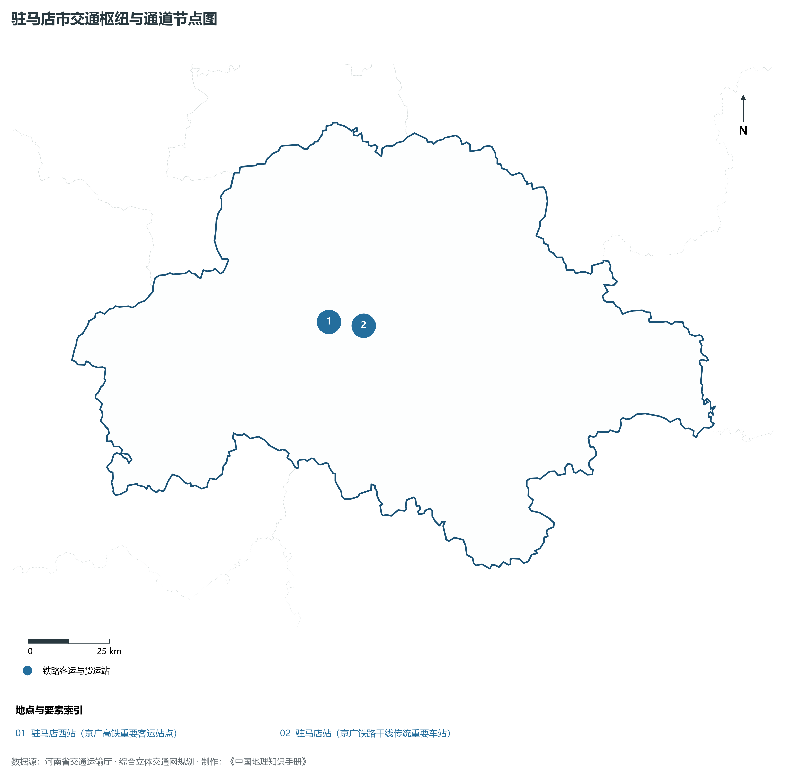
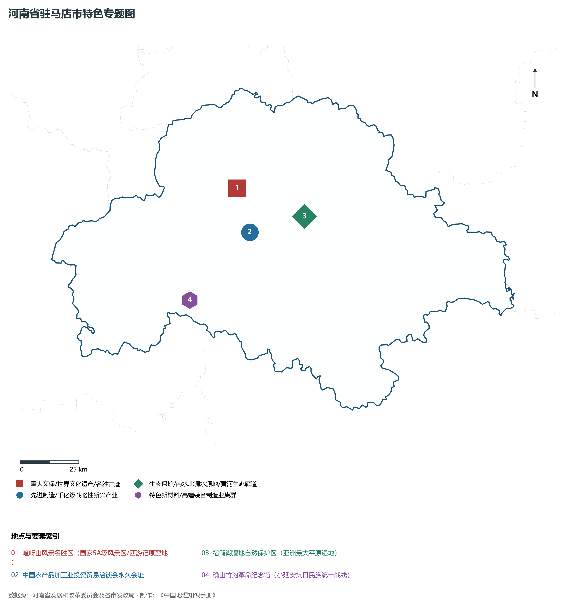
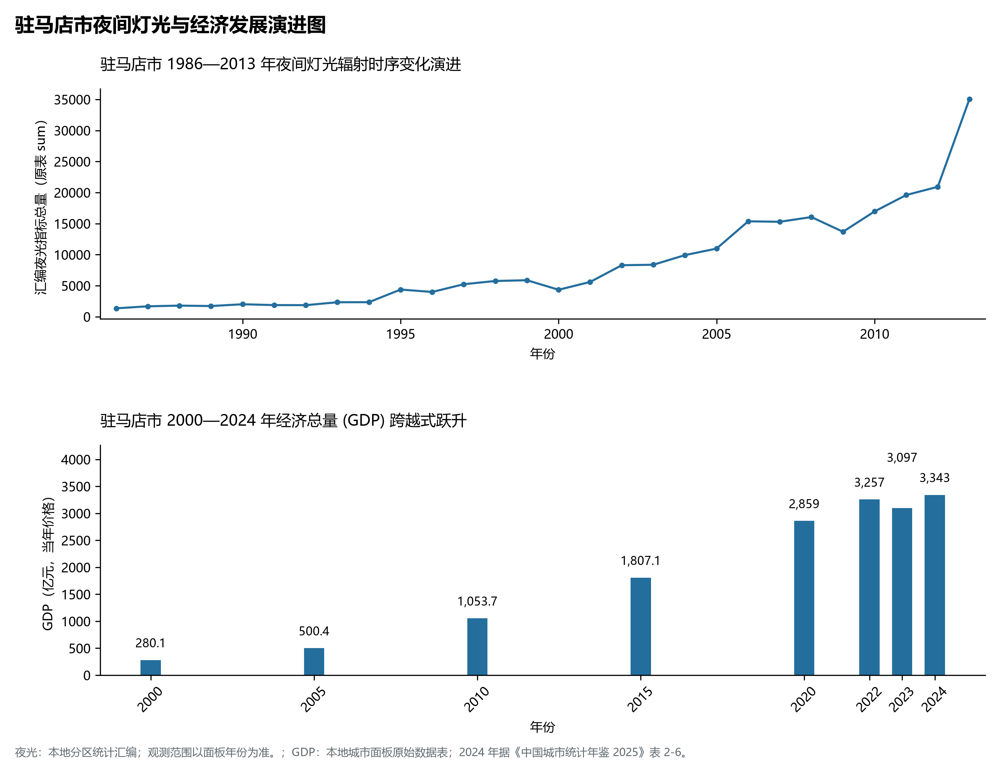

# 15.17 驻马店市

驻马店市，地处河南省核心战略功能区与中原经济区关键节点，其城市综合战略定位与发展愿景概括为：**豫州之腹地·天下之中·中国农产品加工业之都·嵖岈山西游胜境·亚洲最大平原水库宿鸭湖**。2024 年常住人口 **671 万人**，常住人口城镇化率 **48.03%**，地区生产总值 **3,343 亿元**（当年价格），人均地区生产总值 **49,610 元**，三次产业构成为 **16.69 : 33.39 : 49.93**。

---

## 一、自然地理底盘与山川水系机理

区域骨干控制性山峰、高程标高极点与主要地貌控制节点包括：

- **白石脑 (983.0m 泌阳县桐柏山脉主峰/驻马店第一高峰)**（空间坐标约东经 113.250°、北纬 32.650°，海拔标高约 983.0 m）；
- **嵖岈山玉皇顶 (786.0m 遂平县天然奇石盆景圣山)**（空间坐标约东经 113.985°、北纬 33.155°，海拔标高约 786.0 m）；

本节列示的主要河湖与水系节点：

- **宿鸭湖水库 (亚洲最大平原人工湖候鸟乐园)**（水系坐标约东经 114.285°、北纬 33.025°）；
- **汝河干流 (穿汝南平原入洪河淮河重要清流)**（水系坐标约东经 114.350°、北纬 32.980°）；

---

## 二、行政区划沿革与城镇空间体系

驻马店市建置沿革源远流长，文脉绵延数千年，自古即为华夏聚居、三代都邑、百家争鸣或商贾重镇。夏商周立国分封、汉唐置郡设州、宋元设路设府、明清建州设县，历经千百载风云变迁，积淀下极为厚重的政区地名文化遗产。新中国成立后特别是改革开放以来，伴随撤地设市、行政区划合理调整、城区组团式向外延展与以人为核心的新型城镇化深入推进，构建了中心极核强引领、县域板块协同支撑、重点中心镇特色鲜明、产城人文深度融合的现代化多极城镇空间体系：

- **驻马店市委市政府 (驿城区开源大道行政中心)**（驻地坐标：114.025°E, 32.985°N）；
- **驿城区政府 (解放路/豫南重镇驿站文化核心)**（驻地坐标：114.015°E, 32.970°N）；
- **遂平县政府 (国槐路/嵖岈山奇石与面粉加工名县)**（驻地坐标：114.010°E, 33.145°N）；
- **西平县政府 (柏城大道/冶铁文化之乡与现代服装)**（驻地坐标：114.020°E, 33.385°N）；
- **上蔡县政府 (蔡都大道/古蔡国故城与李斯故里)**（驻地坐标：114.270°E, 33.265°N）；
- **汝南县政府 (古塔路/天中山梁祝故里与宿鸭湖水岸)**（驻地坐标：114.360°E, 33.010°N）；
- **平舆县政府 (丰收路/中国建设防水之都与户外休闲)**（驻地坐标：114.620°E, 32.960°N）；
- **正阳县政府 (真阳大道/中国花生第一县粮油之乡)**（驻地坐标：114.385°E, 32.610°N）；
- **确山县政府 (朗陵大道/竹沟革命圣地与中国提琴之乡)**（驻地坐标：114.025°E, 32.805°N）；
- **泌阳县政府 (盘古大道/中华创世盘古圣地与夏南牛之乡)**（驻地坐标：113.330°E, 32.725°N）；
- **新蔡县政府 (今是大道/古蔡国都城与洪汝河水乡)**（驻地坐标：114.980°E, 32.750°N）；

在国土空间总体规划指引下，驻马店市坚决严守耕地保护红线、生态保护红线与城镇开发边界“三条控制线”，优化“生产、生活、生态”空间协同布局，全面提升城市韧性与基础设施能级，持续缩小城乡基本公共服务差距，打造宜居、韧性、智慧、绿色的现代化和美家园。

---

## 三、综合立体交通网络与现代枢纽通道

本节列示的主要交通节点与通道：

**核心综合客货运交通枢纽节点与交通干线走廊：**

- **驻马店西站 (京广高铁重要客运站点)**（空间坐标：113.965°E, 32.990°N）；
- **驻马店站 (京广铁路干线传统重要车站)**（空间坐标：114.030°E, 32.975°N）；

---

## 四、现代产业体系与新质生产力布局

驻马店市坚定不移实施工业立市、制造业强市战略，对标河南省“7+28+N”产业链群布局要求，推动传统优势产业高端化、智能化、绿色化转型，做强战略性新兴产业，前瞻培育未来产业，构筑起实体经济厚重挺拔、创新动能蓬勃涌动的现代产业高地：

**标志性先进制造业集群、特色产业园区、国家重点实验室与产业地标：**

- **嵖岈山风景名胜区 (国家5A级风景区/西游记原型地)**（空间坐标：113.985°E, 33.155°N）；
- **中国农产品加工业投资贸易洽谈会永久会址**（空间坐标：114.025°E, 32.985°N）；
- **宿鸭湖湿地自然保护区 (亚洲最大平原湿地)**（空间坐标：114.285°E, 33.025°N）；
- **确山竹沟革命纪念馆 (小延安抗日民族统一战线)**（空间坐标：113.720°E, 32.750°N）；

通过深入实施工业产业链“链长制”与领航企业培育计划，驻马店市聚力推动创新链、产业链、资金链、人才链深度融合，梯次培育单项冠军企业、高新技术企业与专精特新“小巨人”企业集群，积极抢占新材料、先进装备、新能源、高端电子信息、绿色食品与现代生物医药等细分赛道制高点，夯实现代化经济强市的实体支撑。

---

## 五、历史文化名胜、人文底蕴与全域文旅地理

驻马店市的文化旅游与相关地标：

- **嵖岈山风景名胜区 (国家5A级风景区/西游记原型地)**；
- **中国农产品加工业投资贸易洽谈会永久会址**；
- **宿鸭湖湿地自然保护区 (亚洲最大平原湿地)**；
- **确山竹沟革命纪念馆 (小延安抗日民族统一战线)**；

立足“行走河南·读懂中国”文旅超级品牌，驻马店市大力实施文旅文创融合战略，推动考古遗址公园、历史文化街区、沉浸式演艺与生态休闲度假深度跨界赋能，以数字科技再现千年华夏古韵，打造享誉海内外的中华文化寻根研学旅行胜地。

---

## 六、夜间灯光辐射与跨世纪经济变化时序演进

本节夜光图的观测年份为 1986—2013 年，指标为行政区汇总值（原表 sum）。

| 年份 | 地区生产总值（亿元，当年价格） |
|:---|---:|
| 2000 年 | 280.1 |
| 2005 年 | 500.4 |
| 2010 年 | 1,053.7 |
| 2015 年 | 1,807.1 |
| 2020 年 | 2,859 |
| 2022 年 | 3,257 |
| 2023 年 | 3,097 |
| 2024 年 | 3,343 |

2024 年统计来源：《中国城市统计年鉴 2025》表 2-1、2-6、2-7（2024 年，全市）。其他年份 GDP 据本地城市面板“原始数据”表，单位为亿元、当年价格。
