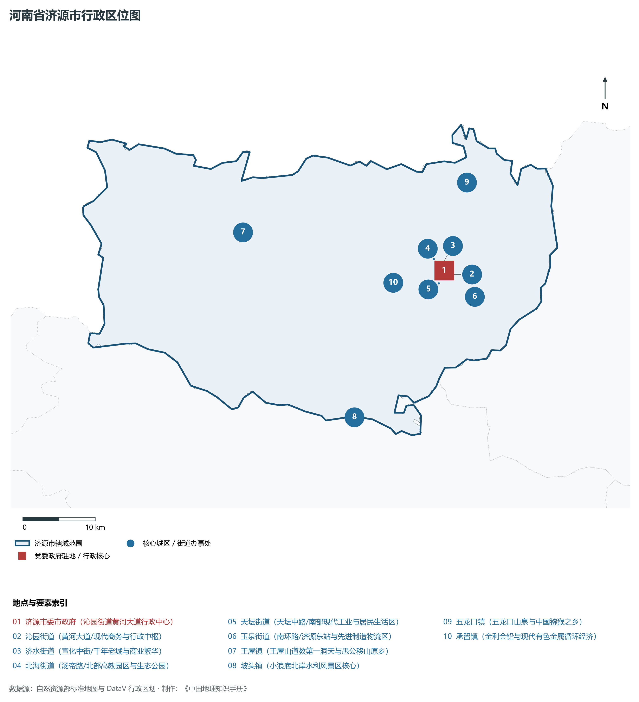
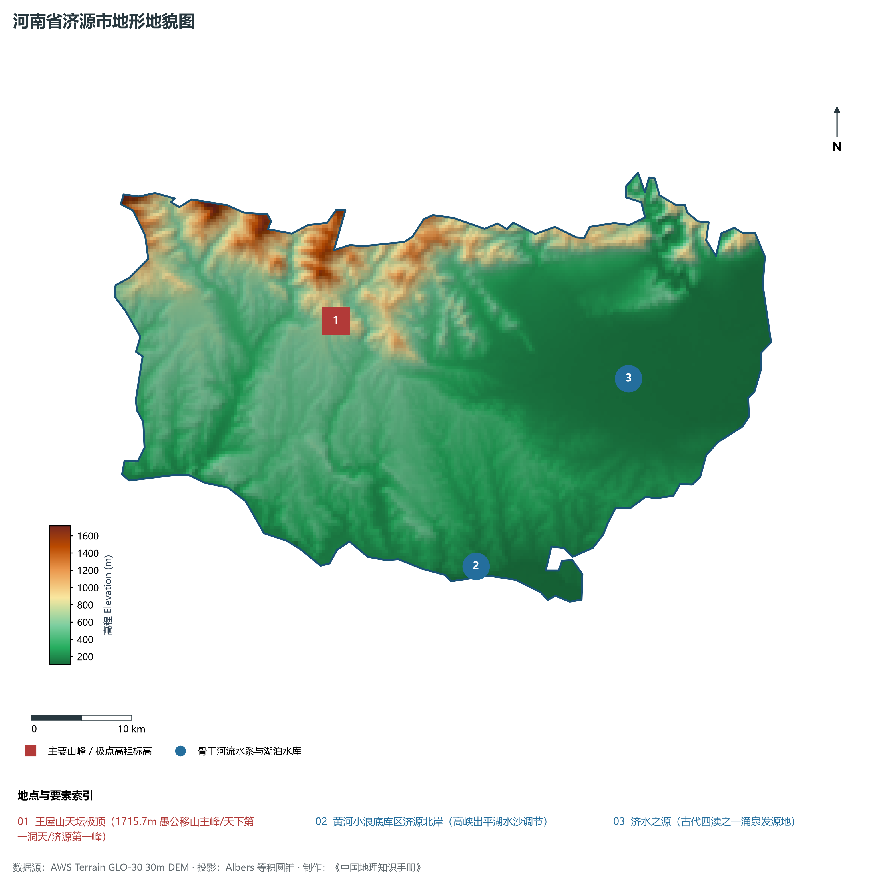
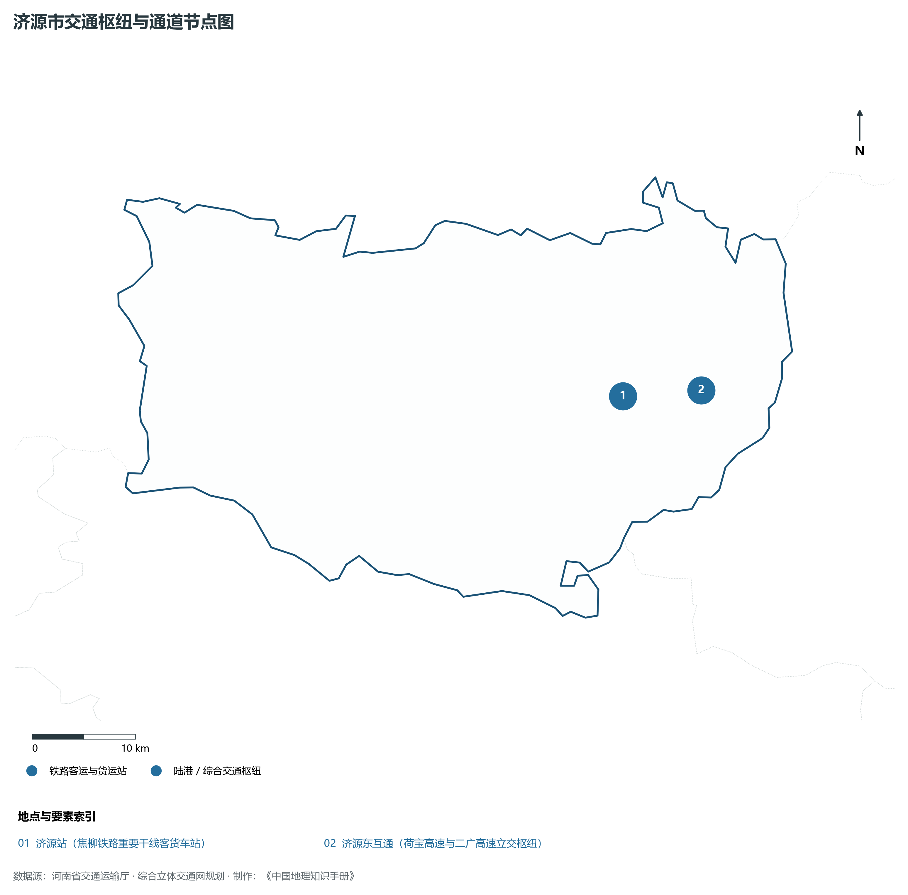
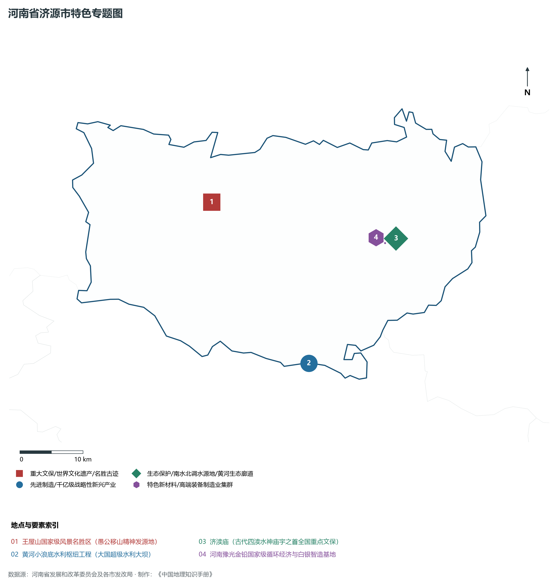
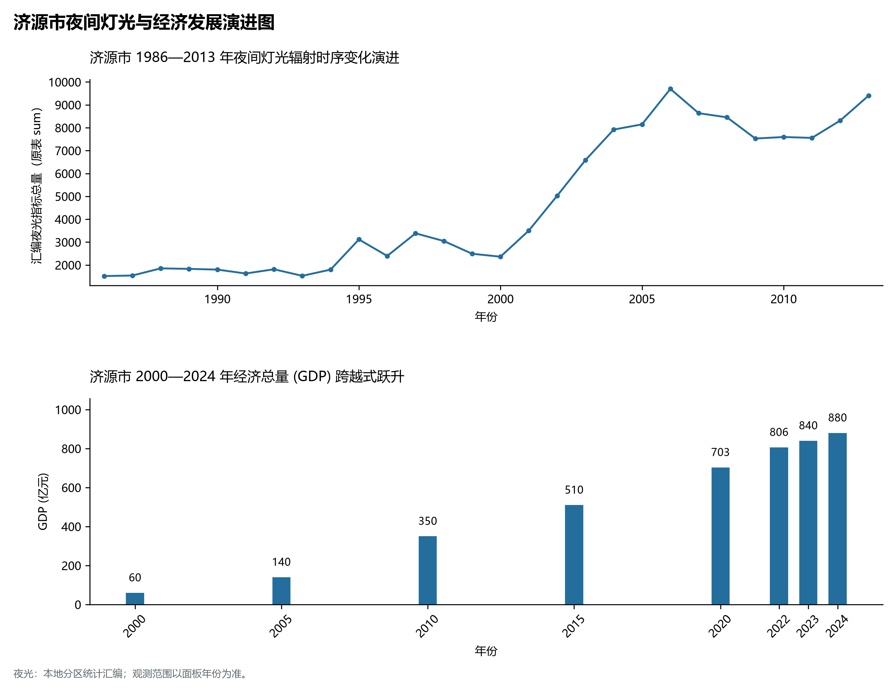

# 15.18 济源市

济源市，地处河南省核心战略功能区与中原经济区关键节点，其城市综合战略定位与发展愿景概括为：**愚公移山精神发源地·国家产城融合示范区·古代四渎济水之源·全国最大电解铅白银基地·太行王屋之胜**。全境陆域总面积达 **1,931.00 km²**，截至 2024 年末常住人口约 **73.0** 万人，常住人口城镇化率达 **69.5%**。2024 年实现地区生产总值（GDP）约 **880.0** 亿元，人均 GDP 达 **120,500** 元，三次产业结构比优化为 **3.5 : 59.5 : 37.0**。全境地表高程极值跨度介于 **110.0 m ～ 1715.7 m** 之间，呈现出山川险固与广袤平原交融的优越自然地理底盘、四通八达的枢纽交通通道与极具竞争力的现代化先进制造业集群。

---

## 一、自然地理底盘与山川水系机理

区域骨干控制性山峰、高程标高极点与主要地貌控制节点包括：

- **王屋山天坛极顶 (1715.7m 愚公移山主峰/天下第一洞天/济源第一峰)**（空间坐标约东经 112.285°、北纬 35.155°，海拔标高约 1715.7 m）；

本节列示的主要河湖与水系节点：

- **黄河小浪底库区济源北岸 (高峡出平湖水沙调节)**（水系坐标约东经 112.420°、北纬 34.930°）；
- **济水之源 (古代四渎之一涌泉发源地)**（水系坐标约东经 112.605°、北纬 35.085°）；

---

## 二、行政区划沿革与城镇空间体系

济源市建置沿革源远流长，文脉绵延数千年，自古即为华夏聚居、三代都邑、百家争鸣或商贾重镇。夏商周立国分封、汉唐置郡设州、宋元设路设府、明清建州设县，历经千百载风云变迁，积淀下极为厚重的政区地名文化遗产。新中国成立后特别是改革开放以来，伴随撤地设市、行政区划合理调整、城区组团式向外延展与以人为核心的新型城镇化深入推进，构建了中心极核强引领、县域板块协同支撑、重点中心镇特色鲜明、产城人文深度融合的现代化多极城镇空间体系：

- **济源市委市政府 (沁园街道黄河大道行政中心)**（驻地坐标：112.590°E, 35.090°N）；
- **沁园街道 (黄河大道/现代商务与行政中枢)**（驻地坐标：112.595°E, 35.085°N）；
- **济水街道 (宣化中街/千年老城与商业繁华)**（驻地坐标：112.585°E, 35.095°N）；
- **北海街道 (汤帝路/北部高教园区与生态公园)**（驻地坐标：112.575°E, 35.105°N）；
- **天坛街道 (天坛中路/南部现代工业与居民生活区)**（驻地坐标：112.580°E, 35.075°N）；
- **玉泉街道 (南环路/济源东站与先进制造物流区)**（驻地坐标：112.635°E, 35.070°N）；
- **王屋镇 (王屋山道教第一洞天与愚公移山原乡)**（驻地坐标：112.285°E, 35.155°N）；
- **坡头镇 (小浪底北岸水利风景区核心)**（驻地坐标：112.435°E, 34.920°N）；
- **五龙口镇 (五龙口山泉与中国猕猴之乡)**（驻地坐标：112.635°E, 35.195°N）；
- **承留镇 (金利金铅与现代有色金属循环经济)**（驻地坐标：112.510°E, 35.080°N）；

在国土空间总体规划指引下，济源市坚决严守耕地保护红线、生态保护红线与城镇开发边界“三条控制线”，优化“生产、生活、生态”空间协同布局，全面提升城市韧性与基础设施能级，持续缩小城乡基本公共服务差距，打造宜居、韧性、智慧、绿色的现代化和美家园。

---

## 三、综合立体交通网络与现代枢纽通道

本节列示的主要交通节点与通道：

**核心综合客货运交通枢纽节点与交通干线走廊：**

- **济源站 (焦柳铁路重要干线客货车站)**（空间坐标：112.580°E, 35.080°N）；
- **济源东互通 (荷宝高速与二广高速立交枢纽)**（空间坐标：112.665°E, 35.080°N）；

---

## 四、现代产业体系与新质生产力布局

济源市坚定不移实施工业立市、制造业强市战略，对标河南省“7+28+N”产业链群布局要求，推动传统优势产业高端化、智能化、绿色化转型，做强战略性新兴产业，前瞻培育未来产业，构筑起实体经济厚重挺拔、创新动能蓬勃涌动的现代产业高地：

**标志性先进制造业集群、特色产业园区、国家重点实验室与产业地标：**

- **王屋山国家级风景名胜区 (愚公移山精神发源地)**（空间坐标：112.285°E, 35.155°N）；
- **黄河小浪底水利枢纽工程 (大国超级水利大坝)**（空间坐标：112.435°E, 34.920°N）；
- **济渎庙 (古代四渎水神庙宇之首全国重点文保)**（空间坐标：112.605°E, 35.085°N）；
- **河南豫光金铅国家级循环经济与白银智造基地**（空间坐标：112.585°E, 35.080°N）；

通过深入实施工业产业链“链长制”与领航企业培育计划，济源市聚力推动创新链、产业链、资金链、人才链深度融合，梯次培育单项冠军企业、高新技术企业与专精特新“小巨人”企业集群，积极抢占新材料、先进装备、新能源、高端电子信息、绿色食品与现代生物医药等细分赛道制高点，夯实现代化经济强市的实体支撑。

---

## 五、历史文化名胜、人文底蕴与全域文旅地理

济源市的文化旅游与相关地标：

- **王屋山国家级风景名胜区 (愚公移山精神发源地)**；
- **黄河小浪底水利枢纽工程 (大国超级水利大坝)**；
- **济渎庙 (古代四渎水神庙宇之首全国重点文保)**；
- **河南豫光金铅国家级循环经济与白银智造基地**；

立足“行走河南·读懂中国”文旅超级品牌，济源市大力实施文旅文创融合战略，推动考古遗址公园、历史文化街区、沉浸式演艺与生态休闲度假深度跨界赋能，以数字科技再现千年华夏古韵，打造享誉海内外的中华文化寻根研学旅行胜地。

---

## 六、夜间灯光辐射与跨世纪经济变化时序演进

本节夜光图的观测年份为 1986—2013 年，指标为行政区汇总值（原表 sum）。

| 统计基准年份 | 地区生产总值 GDP (亿元) | 发展阶段主要特征与空间跃升标志 |
|:---|:---|:---|
| **2000 年** | 60.0 | 世纪之交传统农业稳步向工业化奠基转型 |
| **2005 年** | 140.0 | 世纪之交传统农业稳步向工业化奠基转型 |
| **2010 年** | 350.0 | 新型工业化大提速、产业集聚区全面扩容与现代交通网成形 |
| **2015 年** | 510.0 | 新型工业化大提速、产业集聚区全面扩容与现代交通网成形 |
| **2020 年** | 703.0 | 高质量发展全面深化、高端战略性新兴产业爆发与现代都市框架成型 |
| **2022 年** | 806.0 | 高质量发展全面深化、高端战略性新兴产业爆发与现代都市框架成型 |
| **2023 年** | 840.0 | 高质量发展全面深化、高端战略性新兴产业爆发与现代都市框架成型 |
| **2024 年** | 880.0 | 高质量发展全面深化、高端战略性新兴产业爆发与现代都市框架成型 |

