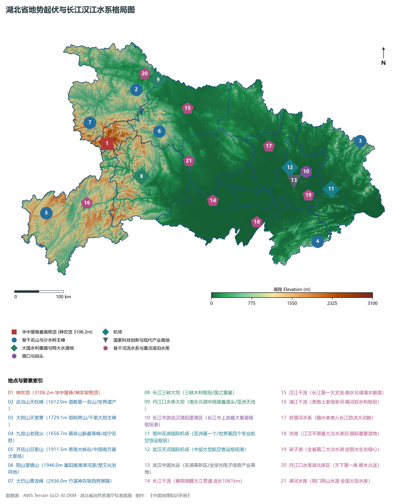
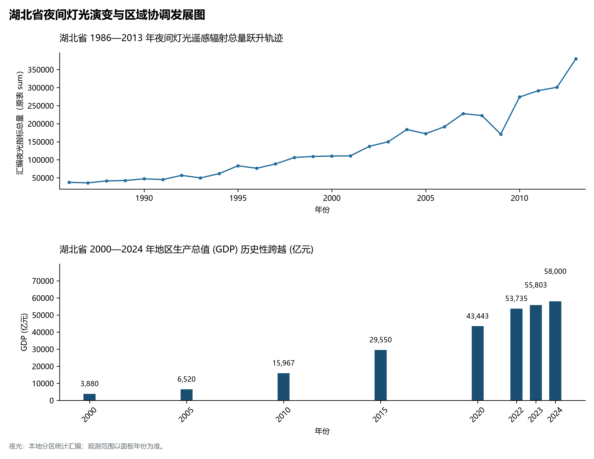
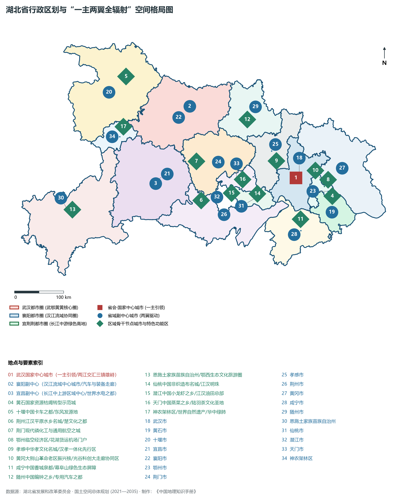
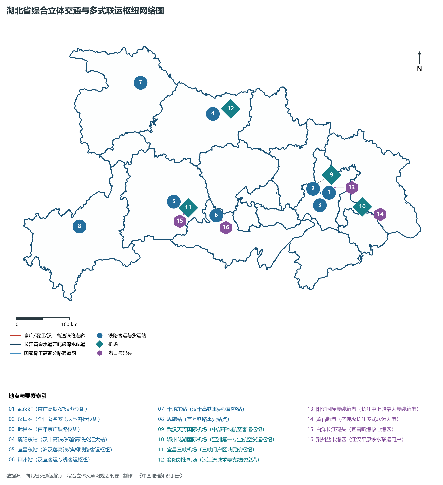
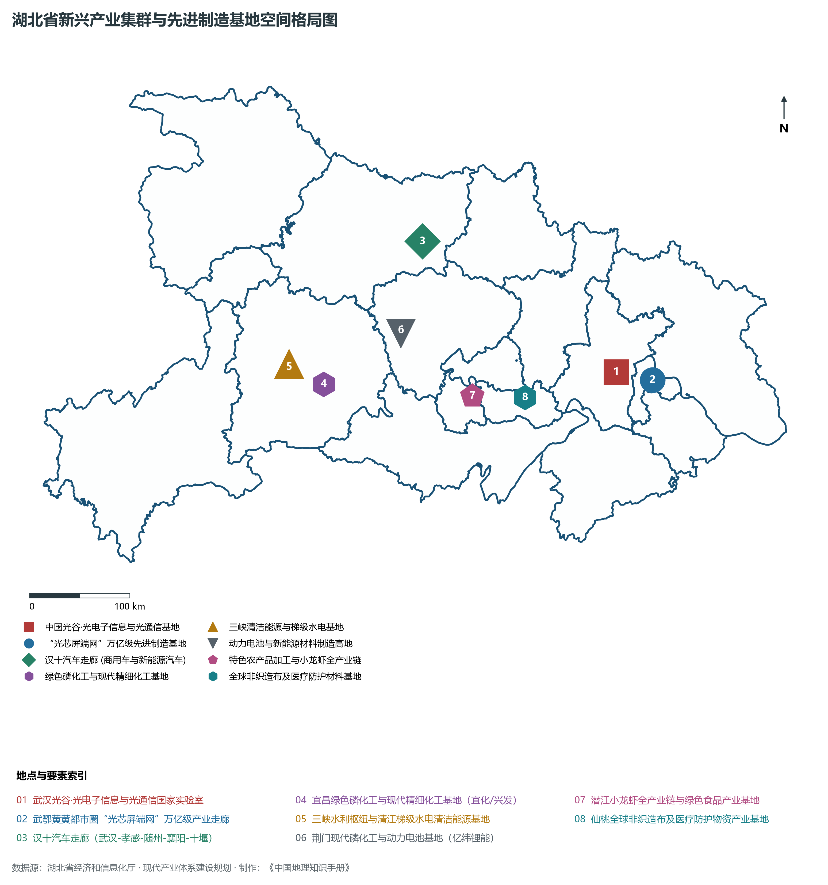

# 16.0 湖北省地理统揽

湖北省，简称“鄂”，省会武汉市，地处中国中部、长江中游腹地，位于东经 108° 21' ～ 116° 07'、北纬 29° 01' ～ 33° 6'  之间。全省陆域总面积达 **18.59 × 10⁴ km²**，占全国国土总面积的 1.94%。湖北东邻安徽，南界江西、湖南，西连重庆，西北接陕西，北毗河南，自古享有“九省通衢”、“荆楚门户”、“中原腹心”、“鱼米之乡”之美誉，是长江经济带承东启西的脊梁与新时代推动中部地区崛起的重要战略支点。境内坐拥**长江**（干流在鄂流长达 **1061 km**）与长江第一大支流**汉江**，江汉平原沃野千里，河港汊流湖泊星罗棋布，自古素称**“千湖之省”**。

从宏观地势格局剖析，湖北省地势呈现出壮丽开阔的**“三面环山、江汉平原居中、向南敞开”**的不完整马蹄形盆地地貌总构架。西起巫山、大巴山与武当山，北枕桐柏山、大洪山与大别山，东与东南环绕幕阜山脉，群山环抱之间，是由长江、汉江及其支流千年冲积而成的江汉平原。全省现辖 12 个地级市（武汉、黄石、十堰、宜昌、襄阳、鄂州、荆门、孝感、荆州、黄冈、咸宁、随州）、1 个自治州（恩施土家族苗族自治州）、3 个省直管县级市（仙桃市、潜江市、天门市）及 1 个省直管林区（神农架林区）。截至 2024 年末，全省常住人口达到 **5838.0 万人**，常住人口城镇化率达 **65.5%**。2024 年全省实现地区生产总值（GDP）突破 **5.80 万亿元**（达 58,000 亿元），稳居全国第七位与中部前列。当前，湖北正牢牢把握“建成支点、走在前列、谱写新篇”历史使命，大力推进“一主两翼全辐射”与三大都市圈建设，在推进中国式现代化建设中奋力谱写更加绚丽的荆楚新篇章。

---

## 一、大地构造、地势阶梯与“三面环山、江汉中卧”宏观地理底盘

湖北省横跨扬子准地台与秦岭造山带、大别造山带两大一级大地构造单元，构造演化历经古元古代黄陵陆核形成、晋宁期扬子地台基底固结、加里东与印支造山运动推覆、以及极其强烈的燕山期中生代陆内造山与岩浆侵入活动。进入新生代喜马拉雅运动期，西部强烈断块隆升成崇山深谷，中部断陷沉降并被第三纪、第四纪巨厚河湖相泥沙泥质沉积层充填，塑造了“西峻东缓、三面峻岭、江汉平原坦荡低平”的宏观地理格局：

全省地表高程极值跨度介于黄梅县小池镇长江出省境处江面沙滩的 **10.0 m** 至神农架林区神农顶绝顶的 **3106.2 m** 之间，相对垂直高差高达 **3096.2 m**，为中原以南中国大陆的最高海拔极值点：

- **全省乃至华中大陆最高绝顶（华中第一峰·华中屋脊）**：位于神农架林区西南部的**神农顶（海拔 3106.2 m）**，峰峦崔嵬，古木参天，原始冷杉林海苍茫，是中国大陆中东部唯一的 3000 米以上超级高山，联合国教科文组织世界自然遗产；
- **鄂西北大巴山余脉最高峰**：竹溪县与神农架界岭**青龙峰（海拔 2740.0 m）**与大巴山主脉，深峡如削；
- **鄂西南巫山南延第一绝顶**：巴东县境内**五福山（海拔 2318.0 m）**与恩施齐岳山甘家山（1911.5 m），南国草场如茵；
- **武当山脉主峰（天下第一仙山）**：十堰丹江口市境内的**天柱峰（海拔 1612.0 m）**，武当金顶一柱擎天，世界文化遗产；
- **荆山主脊最高峰**：保康县与南漳县界岭**望佛山（海拔 1946.0 m）**，楚国早期拓殖之摇篮；
- **大洪山脉主峰**：随州境内的**宝珠峰（海拔 1055.0 m）**，楚北天空第一峰；
- **大别山脉主脊绝顶**：黄冈罗田县与安徽界岭**天堂寨（海拔 1729.1 m）**，雄峙鄂东；
- **幕阜山脉最高峰**：咸宁通山县境内的**九宫山老鸦尖（海拔 1656.7 m）**，华中著名道教与避暑胜地；
- **全省最低点**：黄冈市黄梅县小池镇长江水流出省界水面及滩涂，海拔标高仅 **10.0 m**。

从宏观地貌形态与成因组合来看，湖北省可清晰划分为五大地貌大区：

1. **鄂西高中山与深切峡谷区**：神农架、大巴山、巫山、武陵山交错，海拔多在 1200～ 3000 m，长江三峡、清江大峡谷、恩施大峡谷千仞绝壁，喀斯特地貌与生物特化生境高度富集；
2. **鄂西北中低山与武当山脉断块中山区**：武当山、荆山拔地而起，汉江自西向东深切贯穿，丹江口大坝锁钥江汉；
3. **鄂北冈陵走廊与大洪山中山区**：低缓丘陵与河谷台地交错，自古为“襄随咽喉”、“南北走廊”；
4. **鄂东北低山丘陵区（大别山南麓）与鄂东南幕阜山低中山区**：花岗岩低山与红层盆地相间，茶园竹海连绵；
5. **江汉中南部冲积平原湖泊区**：占全省总面积的 20% 以上，平均海拔仅 20～ 40 m，河流纵横，湖泊星罗棋布，是全国重要的商品粮棉油与水产基地。

**湖北省地貌自西向东阶梯剖面格局纵览**

| 华中屋脊神农架 | 长江三峡深切峡口 | 千湖之省江汉平原 | 长江出境低平门户 |
| --- | --- | --- | --- |
| (神农顶 3106.2m)；华中第一峰·动植物基因库；世界自然遗产·金丝猴 | (三峡大坝·葛洲坝)；峡江天堑·水电明珠；黄金水道·翻坝物流 | (两江交汇·沃野千里)；鱼米之乡·九省通衢；中国光谷·超大城市 | (黄梅小池江面 10m)；万里长江·奔腾东流；矿冶之都·水运出海 |

西缘极高山地 (神农顶 3106.2m) · → 峡江深切谷地 (三峡/清江峡谷) · → 冲积江汉平原 (荆州/仙桃/武汉) · → 沿江低丘平原 (黄石/黄梅 10m)

---

## 二、北亚热带温暖季风气候与“两江交汇、千湖汇流”水文生态网络

湖北省全境位于**北亚热带温暖湿润季风气候区**，气候温暖湿润、四季分明、雨热同季、水热充沛：

- **气温与热量特征**：全省年平均气温在 **15.0°C ～ 17.5°C** 之间，自东南向西北、从平原向高山规律性递减。平原江汉地区年均温达 16.5°C ～ 17.2°C，无霜期长达 240～ 300 d；而神农顶、大巴山高海拔山岳常年寒凉，夏季清凉，是华中首屈一指的避暑胜地；
- **降水时空分配格局**：全省年降水量在 **800～ 1600 mm** 之间。南部幕阜山麓与鄂西南山地降水充沛，年降水量达 1400～ 1600 mm；江汉平原年降水量在 1100～ 1300 mm；鄂西北十堰、襄阳降水略少，在 800～ 950 mm 左右。降水集中在 5—8 月（占全年 55%～ 65%），梅雨期与夏秋季暴雨易导致平原渍涝与山洪滑坡，防洪抗涝长年居于全省水安全首位。

湖北江河密布、湖库相依，是长江中游最为关键的水资源调蓄与生态安全屏障中枢：

1. **长江干流（万里大江·中流砥柱）**：
   - 长江自重庆巫山滚滚东入湖北巴东，穿西陵峡经三峡大坝、葛洲坝出峡口进入平原，流经宜昌、荆州、武汉、鄂州、黄冈、黄石、咸宁，于黄梅县出省入江西、安徽。干流在湖北境内长达 **1061 km**，占长江干流全长的近六分之一。**三峡水利枢纽**与**葛洲坝水利工程**构筑起长江防洪、航运、发电与水资源调度的国之重器；
2. **汉江水系（江汉之母·南水北调清水廊道）**：
   - 汉江全长 1577 km，在湖北境内流长 **878 km**，流经十堰、襄阳、荆门、天门、潜江、仙桃、孝感，在武汉汉口龙王庙注入长江。丹江口水库是**南水北调中线工程**水源地，碧水长流，润泽华北；
3. **清江水系（土家母亲河·八百里如画）**：
   - 全长 423 km，发源于利川市齐岳山，向东奔流穿过恩施大峡谷，流经恩施、建始、长阳、宜都注入长江，建有水布垭、隔河岩、高坝洲三大高坝梯级水利枢纽；
4. **千湖水系与国际湿地群**：
   - 湖北省千湖之省名扬天下，拥有**洪湖**（江汉平原最大淡水湖，水域约 348 km²）、**梁子湖**（全省第二大淡水湖，水质优良）、**汈汊湖**、**长湖**、**东湖**（城市最大名湖）、**沉湖**等大型湖泊湿地，是全球候鸟迁飞通道的关键停歇地与生境保护区。

---

## 三、行政区划、人口与“一主两翼全辐射”空间协同战略

湖北省现辖 12 个地级市、1 个自治州、3 个省直管县级市、1 个省直管林区，下设 39 个市辖区、26 个县级市、35 个县、2 个自治县、1 个林区，共 103 个县级行政区。截至 2024 年末，全省常住人口达到 5838.0 万人，常住人口城镇化率达 65.5%。

立足国家区域发展战略与自身地理禀赋，湖北省高规格确立了**“一主两翼全辐射”**与三大都市圈协调发展新格局：

1. **“一主引领”：武汉国家中心城市与武汉都市圈极核驱动**：
   - 强化武汉作为超大城市与国家中心城市的科技创新、现代金融、高端制造与综合枢纽能级；深入推进**武鄂黄黄（武汉、鄂州、黄石、黄冈）**核心区协同发展，打造具有全国影响力的万亿级现代化都市圈；
2. **“两翼驱动”：襄阳副中心与宜昌副中心双轮竞进**：
   - **襄阳省域副中心城市**：辐射带动“襄十随神”城市群，打造汉江流域高能级中心城市与汉十汽车产业走廊核心支撑；
   - **宜昌省域副中心城市**：辐射带动“宜荆荆恩”城市群，做强世界级清洁能源基地、绿色磷化工新材料与三峡现代物流中心；
3. **“全域协同”：县域经济壮大与美丽湖北全域共繁荣**：
   - 壮大仙桃非织造布、潜江小龙虾、天门服装电商等千亿特色县域产业板块，深入推进以县城为重要载体的新型城镇化，构建城乡融合发展与绿色崛起新标杆。

---

## 四、综合立体交通网络与“九省通衢、空铁水陆多式联运”大枢纽

湖北交通区位得天独厚，素称“九省通衢”，现已全面建成陆水空一体协同的高水准综合立体交通网络：

1. **全国高铁“超米字型”枢纽网**：
   - 京广高铁纵贯全省南北，沪汉蓉沿江高铁、汉十客专、郑渝高铁、黄黄高铁交织成网，全面形成以武汉为极核、辐射周边省会及重点城市的 1~3 小时高铁交通圈；
   - **武汉站、汉口站、武昌站、襄阳东站、宜昌东站**等成为全国性骨干特大型铁路综合客运枢纽；
2. **长江“黄金水道”航运中心与通江达海**：
   - 长江万吨级船队可常年直达武汉港（阳逻港区），阳逻港集装箱吞吐量稳居长江中上游首位，开通直达日本、韩国及欧美的铁海联运与江海直达航线；黄石新港、宜昌新港、荆州港迈入现代化亿吨大港梯队；
3. **“客货双枢纽”航空网络全球瞩目**：
   - **武汉天河国际机场**（4F 级）为中部大型国际客运枢纽港；
   - **鄂州花湖国际机场**（4E 级）作为亚洲第一个、世界第四个专业航空货运枢纽，顺丰航空全球转运中心正式落户运营，与天河机场共同构建起湖北“客货双枢纽”比翼齐飞的新格局；
4. **国家高速公路网密集互联**：
   - 京港澳、大广、沪渝、福银、二广、杭瑞等国家级高速大动脉纵横贯通，全省高速公路通车里程突破 7800 公里。

---

## 五、现代产业体系建设、“光芯屏端网”与新质生产力布局

湖北深入实施工业强省战略，大力推进新型工业化，着力打造**“51020”现代产业集群**与新质生产力增长极：

1. **中国光谷与全球“光芯屏端网”超级集群**：
   - 武汉东湖高新区（中国光谷）聚集长飞光纤、烽火通信、华工科技、高德红外、长江存储等龙头，光纤光缆产销量全球第一，光器件市场份额全球领先，3D NAND 闪存芯片实现历史性突破，新型显示与移动智能终端规模超万亿；
2. **东风汽车发祥地与汉十新能源智能网联汽车走廊**：
   - 串联武汉（东风汽车总部、东风本田、岚图、路特斯）、孝感、随州（专汽之都）、襄阳（轻型商用车）、十堰（商用车之都），构建起全链条自主可控的现代汽车产业航母；
3. **世界级清洁能源与大国重器基地**：
   - 三峡大坝、葛洲坝、清江梯级电站形成全球最密集的水电清洁能源集群；中国船舶重工 719 所、701 所、武昌造船等奠定国家高端船舶与海洋工程核心地位；
4. **现代绿色磷化工与新能源动力电池高地**：
   - 宜昌（兴发集团、宜化集团）、荆门（亿纬锂能动力电池基地）构筑从磷矿采选、精细磷化工到磷酸铁锂新能源正极材料全产业链，成为全球领先的锂电新能源产业基地；
5. **特色现代农业、生物医药与县域千亿集群**：
   - 潜江小龙虾、仙桃非织造布（全球防护物资高地）、天门纺织服装、蕲春蕲艾、宜昌柑橘、随州香菇、恩施富硒茶等享誉海内外。

---

## 六、夜间灯光遥感时序与跨越式区域协调演变

本节夜光图的观测年份为 1986—2013 年，指标为行政区汇总值（原表 sum）。

- **1980—1990 年代（核心三镇点状亮起，沿江工矿初步集聚）**：
- **2000—2010 年代（“光谷与车谷”并驱，宜昌襄阳两翼隆起）**：

极目楚天舒，万里长江横！六千万荆楚儿女在长江两岸与神农高山之间砥砺攻坚、开拓创新，正以更加昂扬奋进的姿态，奋勇谱写新时代中部崛起的壮美篇章！
