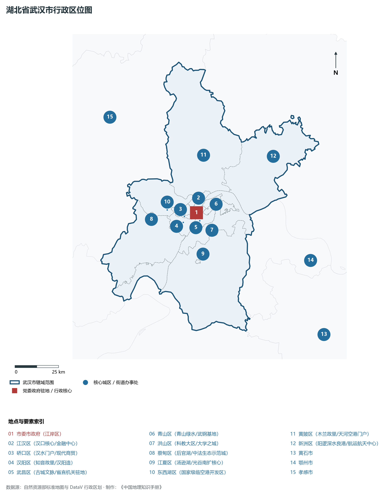
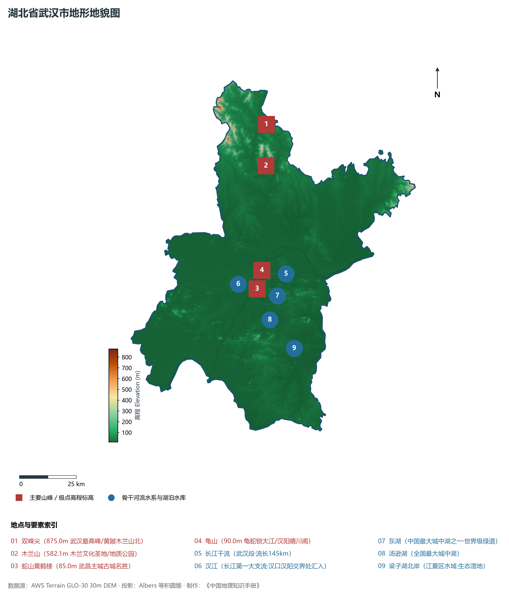
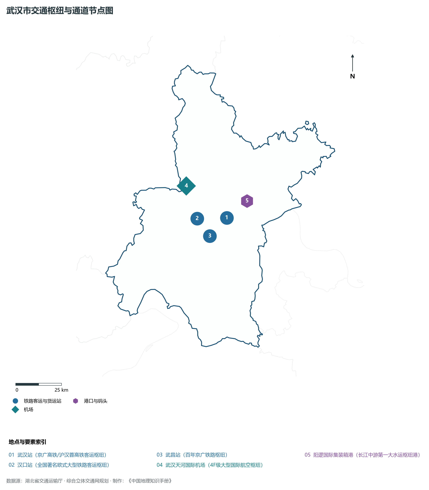
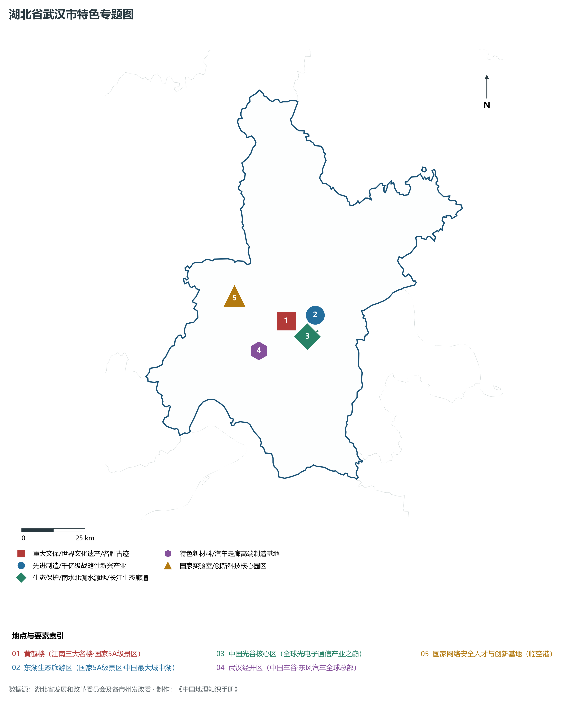
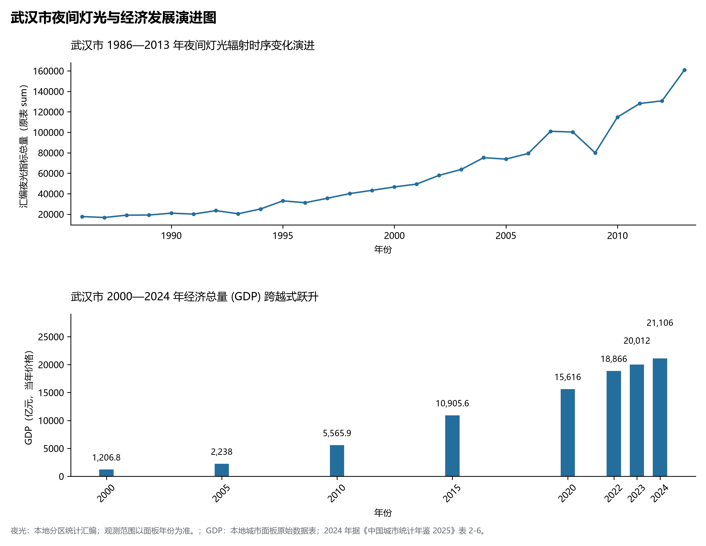

# 16.1 武汉市

武汉市，地处湖北省核心发展板块与长江中游城市群关键节点，其城市综合定位与发展愿景概括为：**湖北省会·副省级市·国家中心城市·长江中游城市群极核·中国光谷·九省通衢·世界湿地之都**。2024 年常住人口 **1,381 万人**，常住人口城镇化率 **85%**，地区生产总值 **21,106 亿元**（当年价格），人均地区生产总值 **153,037 元**，三次产业构成为 **2.4 : 31.2 : 66.4**。

---

## 一、自然地理底盘与山川水系机理

在气候水热配置方面，武汉市全境位于典型的北亚热带温暖湿润季风气候区，温暖湿润、四季分明、热量丰沛、雨热同期。年平均气温在 15.2°C ～ 17.5°C 之间，极端最低气温大多在 -5°C 以上，无霜期长达 245 ～ 290 d，年均日照时数长达 1800 ～ 2150 h。优越的光温条件极利于水稻、油菜、水产、特色林果及亚热带经济林木生长。多年平均降水量达 1050 ～ 1550 mm，降水时空分配年内集中在 5—8 月汛期，暴雨过程频密，山溪性河流短促陡急，江河湖库防洪抗涝与山洪地质灾害防御责任重大；而在秋冬之交常伴有伏秋旱，大型骨干水库蓄水保供、灌区调蓄与水资源统一配置发挥着不可或缺的保障功能。

区域骨干控制性山峰、高程标高极点与主要地貌控制节点包括：

- **双峰尖 (875.0m 武汉最高峰/黄陂木兰山北)**（空间坐标约东经 114.420°、北纬 31.180°，海拔标高约 875.0 m）：构成区域地形骨架与水源生态安全屏障的关键控制极点，在区域气候水热调节、地表水径流汇集拦截与生物多样性保护中具有不可替代的基石功能；
- **木兰山 (582.1m 木兰文化圣地/地质公园)**（空间坐标约东经 114.400°、北纬 31.020°，海拔标高约 582.1 m）：构成区域地形骨架与水源生态安全屏障的关键控制极点，在区域气候水热调节、地表水径流汇集拦截与生物多样性保护中具有不可替代的基石功能；
- **蛇山黄鹤楼 (85.0m 武昌主城古城名胜)**（空间坐标约东经 114.305°、北纬 30.545°，海拔标高约 85.0 m）：构成区域地形骨架与水源生态安全屏障的关键控制极点，在区域气候水热调节、地表水径流汇集拦截与生物多样性保护中具有不可替代的基石功能；
- **龟山 (90.0m 龟蛇锁大江/汉阳晴川阁)**（空间坐标约东经 114.280°、北纬 30.550°，海拔标高约 90.0 m）：构成区域地形骨架与水源生态安全屏障的关键控制极点，在区域气候水热调节、地表水径流汇集拦截与生物多样性保护中具有不可替代的基石功能；

水系水网与生态湿地廊道方面，武汉市江河纵横、湖库密布，深度融入长江、汉江或清江大水系网络：

- **长江干流 (武汉段·流长145km)**（水系坐标约东经 114.350°、北纬 30.600°）：发挥着流域防洪减灾、排涝调峰、农业自流灌溉、工业及城乡优质生活饮用水源保障、内河深水航运物流与水生生物资源保护的核心功能；
- **汉江 (长江第一大支流·汉口汉阳交界处汇入)**（水系坐标约东经 114.220°、北纬 30.570°）：发挥着流域防洪减灾、排涝调峰、农业自流灌溉、工业及城乡优质生活饮用水源保障、内河深水航运物流与水生生物资源保护的核心功能；
- **东湖 (中国最大城中湖之一·世界级绿道)**（水系坐标约东经 114.400°、北纬 30.550°）：发挥着流域防洪减灾、排涝调峰、农业自流灌溉、工业及城乡优质生活饮用水源保障、内河深水航运物流与水生生物资源保护的核心功能；
- **汤逊湖 (全国最大城中湖)**（水系坐标约东经 114.350°、北纬 30.420°）：发挥着流域防洪减灾、排涝调峰、农业自流灌溉、工业及城乡优质生活饮用水源保障、内河深水航运物流与水生生物资源保护的核心功能；
- **梁子湖北岸 (江夏区水域·生态湿地)**（水系坐标约东经 114.450°、北纬 30.300°）：发挥着流域防洪减灾、排涝调峰、农业自流灌溉、工业及城乡优质生活饮用水源保障、内河深水航运物流与水生生物资源保护的核心功能；

---

## 二、行政区划沿革与城镇空间体系

武汉市建置沿革源远流长，文脉绵延数千年，自古即为荆楚要地、兵家必争、商贾辐辏或革命红色摇篮。先秦封楚立国、秦汉设郡立县、唐宋置州设路、明清立府设县，千百年来留下了极其璀璨的历史地名与人文遗迹。新中国成立后特别是改革开放以来，伴随撤地设市、行政区划合理调整、城区组团式向外延展与以人为核心的新型城镇化深入推进，构建了中心城区引领极核、县域板块协同支撑、重点特色城镇星罗棋布、产城人景深度融合的现代多中心城镇空间网络体系：

- **市委市政府 (江岸区)**（驻地坐标：114.305°E, 30.592°N）：区域公共治理行政中枢、现代生产生活综合服务集聚地与新型城镇化战略承载极核；
- **江汉区 (汉口核心/金融中心)**（驻地坐标：114.270°E, 30.600°N）：区域公共治理行政中枢、现代生产生活综合服务集聚地与新型城镇化战略承载极核；
- **硚口区 (汉水门户/现代商贸)**（驻地坐标：114.230°E, 30.580°N）：区域公共治理行政中枢、现代生产生活综合服务集聚地与新型城镇化战略承载极核；
- **汉阳区 (知音故里/汉阳造)**（驻地坐标：114.220°E, 30.550°N）：区域公共治理行政中枢、现代生产生活综合服务集聚地与新型城镇化战略承载极核；
- **武昌区 (古城文脉/省直机关驻地)**（驻地坐标：114.320°E, 30.550°N）：区域公共治理行政中枢、现代生产生活综合服务集聚地与新型城镇化战略承载极核；
- **青山区 (青山绿水/武钢基地)**（驻地坐标：114.380°E, 30.630°N）：区域公共治理行政中枢、现代生产生活综合服务集聚地与新型城镇化战略承载极核；
- **洪山区 (科教大区/大学之城)**（驻地坐标：114.340°E, 30.500°N）：区域公共治理行政中枢、现代生产生活综合服务集聚地与新型城镇化战略承载极核；
- **蔡甸区 (后官湖/中法生态示范城)**（驻地坐标：114.030°E, 30.580°N）：区域公共治理行政中枢、现代生产生活综合服务集聚地与新型城镇化战略承载极核；
- **江夏区 (汤逊湖/光谷南扩核心)**（驻地坐标：114.320°E, 30.380°N）：区域公共治理行政中枢、现代生产生活综合服务集聚地与新型城镇化战略承载极核；
- **东西湖区 (国家级临空港开发区)**（驻地坐标：114.130°E, 30.620°N）：区域公共治理行政中枢、现代生产生活综合服务集聚地与新型城镇化战略承载极核；
- **黄陂区 (木兰故里/天河空港门户)**（驻地坐标：114.380°E, 30.880°N）：区域公共治理行政中枢、现代生产生活综合服务集聚地与新型城镇化战略承载极核；
- **新洲区 (阳逻深水良港/航运航天中心)**（驻地坐标：114.800°E, 30.840°N）：区域公共治理行政中枢、现代生产生活综合服务集聚地与新型城镇化战略承载极核；

在国土空间总体规划指引下，武汉市统筹推进“三区三线”科学划定与刚性管控，严守耕地和永久基本农田保护红线、生态保护红线与城镇开发边界，统筹优化农业空间、生态空间与城镇空间布局，推动高能级产业园区集聚集约转型，持续缩小城乡基本公共服务差距，打造宜居、韧性、智慧、绿色的现代化和美之城。

---

## 三、综合立体交通网络与现代枢纽通道

武汉市地处“九省通衢”交通走廊核心，全方位融入国家综合立体交通网与长江经济带高质量发展大局。依托设计时速 350 公里高铁干线、国家干线货运铁路、纵横交错的国家高速公路网、现代化民用航空港以及长江黄金水道高等级深水航道，构筑起外畅内通、铁水公空多式联运的现代综合立体交通体系：

**核心综合交通客运与货运物流枢纽节点：**

- **武汉站 (京广高铁/沪汉蓉高铁客运枢纽)**（空间坐标：114.425°E, 30.608°N）：客流高铁干线快速转换、大宗工业原料与货物集装箱铁水公空多式联运转换、以及全面对接长江经济带与全球现代物流体系的核心交通支点；
- **汉口站 (全国著名欧式大型铁路客运枢纽)**（空间坐标：114.255°E, 30.618°N）：客流高铁干线快速转换、大宗工业原料与货物集装箱铁水公空多式联运转换、以及全面对接长江经济带与全球现代物流体系的核心交通支点；
- **武昌站 (百年京广铁路枢纽)**（空间坐标：114.318°E, 30.528°N）：客流高铁干线快速转换、大宗工业原料与货物集装箱铁水公空多式联运转换、以及全面对接长江经济带与全球现代物流体系的核心交通支点；
- **武汉天河国际机场 (4F级大型国际航空枢纽)**（空间坐标：114.210°E, 30.780°N）：客流高铁干线快速转换、大宗工业原料与货物集装箱铁水公空多式联运转换、以及全面对接长江经济带与全球现代物流体系的核心交通支点；
- **阳逻国际集装箱港 (长江中游第一大水运枢纽港)**（空间坐标：114.550°E, 30.680°N）：客流高铁干线快速转换、大宗工业原料与货物集装箱铁水公空多式联运转换、以及全面对接长江经济带与全球现代物流体系的核心交通支点；

当前，武汉市持续加快交通基础设施数字化升级、智慧调度平台建设与绿色低碳改造，重点攻坚“铁水公空”多式联运无缝衔接与枢纽集疏运道路闭环，大力拓展中欧班列集结、铁水联运班列与国际货运空中走廊，全力打造安全便捷、内通外畅、绿色智能的现代化交通强市。

---

## 四、现代产业体系与新质生产力布局

武汉市坚定不移实施“制造业强市、产业兴市”核心战略，深入贯彻落实湖北省“51020”现代产业集群行动方案，推进传统优势产业高端化智改数转网联，聚力发展战略性新兴产业，前瞻布局未来前沿产业，加速构建体现自身特色与国际国内市场竞争力的现代产业体系：

**标志性先进制造园区、特色产业基地、创新平台与重大产业地标：**

- **黄鹤楼 (江南三大名楼·国家5A级景区)**（空间坐标：114.305°E, 30.545°N）；
- **东湖生态旅游区 (国家5A级景区·中国最大城中湖)**（空间坐标：114.380°E, 30.560°N）；
- **中国光谷核心区 (全球光电子通信产业之巅)**（空间坐标：114.430°E, 30.500°N）；
- **武汉经开区 (中国车谷·东风汽车全球总部)**（空间坐标：114.180°E, 30.450°N）；
- **国家网络安全人才与创新基地 (临空港)**（空间坐标：114.100°E, 30.650°N）；

通过深入实施工业“链长制”与领航企业培育工程，武汉市围绕产业链上下游部署创新链、资金链与人才链，梯次培育国家级高新技术企业、制造业单项冠军与专精特新“小巨人”企业集群，积极抢占新材料、先进装备制造、新能源与智能网联汽车、高端电子信息、现代绿色化工、特色农产品加工等赛道制高点，全力夯实现代化经济强市的实体产业硬核底盘。

---

## 五、历史文化名胜、人文底蕴与全域文旅地理

武汉市文源深脉长、名胜甲于江汉，融汇了荆楚文化源头探寻、三国风云英雄豪气、红色革命峥嵘记忆与壮美秀丽的自然山水风光，拥有数量众多的世界文化/自然遗产、国家 5A 级风景区、国家历史文化名城与全国重点文物保护单位：

- **黄鹤楼 (江南三大名楼·国家5A级景区)**；
- **东湖生态旅游区 (国家5A级景区·中国最大城中湖)**；
- **中国光谷核心区 (全球光电子通信产业之巅)**；
- **武汉经开区 (中国车谷·东风汽车全球总部)**；
- **国家网络安全人才与创新基地 (临空港)**；

立足全域旅游与高品质度假康养新时代需求，武汉市坚持“以文塑旅、以旅彰文”，推进红色文化研学、古城风貌保护活化、高山生态避暑、峡江风光探险与乡村农文旅深度融合，打造享誉海内外的特色文旅超级品牌。

---

## 六、夜间灯光辐射与跨世纪经济变化时序演进

本节夜光图的观测年份为 1986—2013 年，指标为行政区汇总值（原表 sum）。

| 年份 | 地区生产总值（亿元，当年价格） |
|:---|---:|
| 2000 年 | 1,206.8 |
| 2005 年 | 2,238 |
| 2010 年 | 5,565.9 |
| 2015 年 | 10,905.6 |
| 2020 年 | 15,616 |
| 2022 年 | 18,866 |
| 2023 年 | 20,012 |
| 2024 年 | 21,106 |

- **1996 年前后**：汉口汉阳武昌老城三镇鼎立；
- **2005 年前后**：中国光谷破土与沌口车谷崛起；

---

2024 年统计来源：《中国城市统计年鉴 2025》表 2-1、2-6、2-7（2024 年，全市）。其他年份 GDP 据本地城市面板“原始数据”表，单位为亿元、当年价格。
