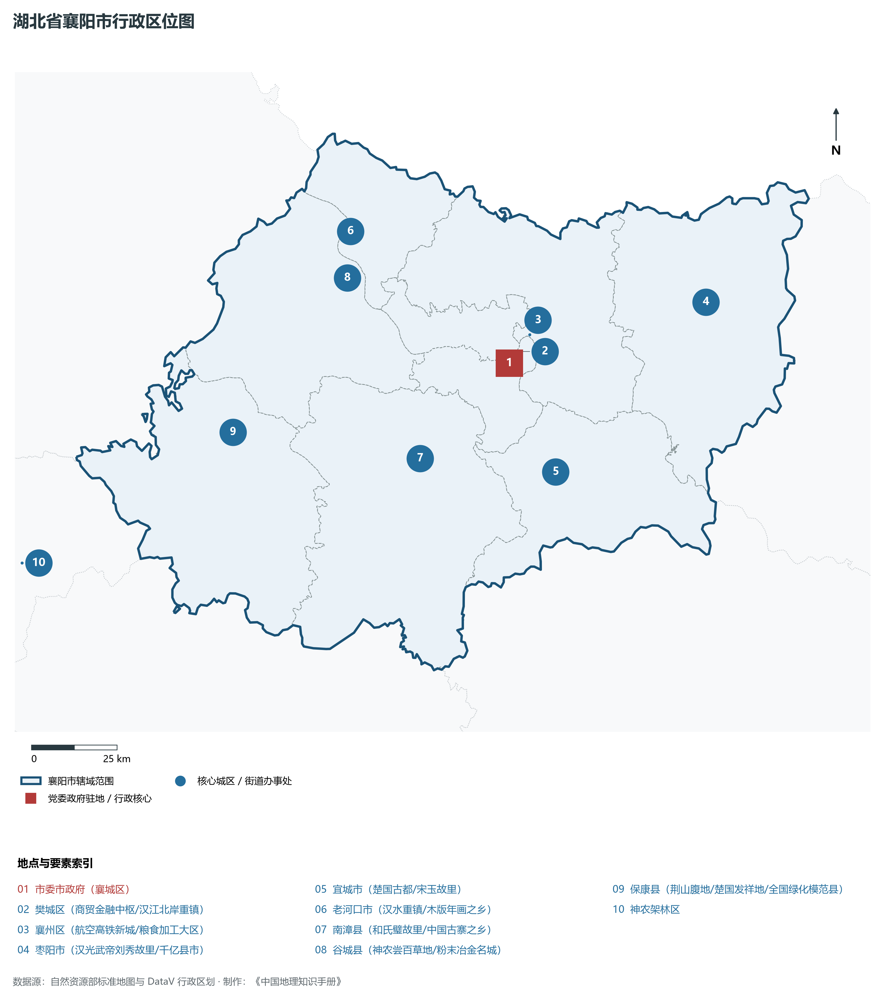
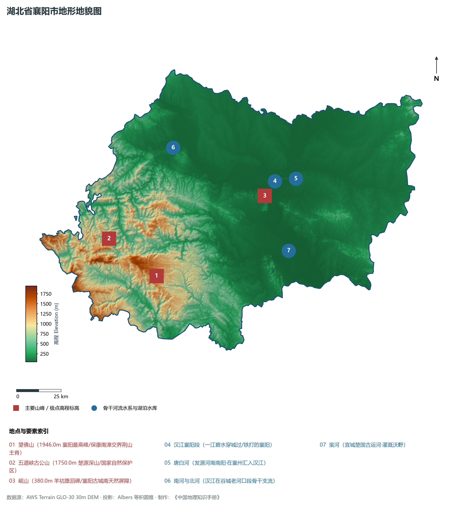
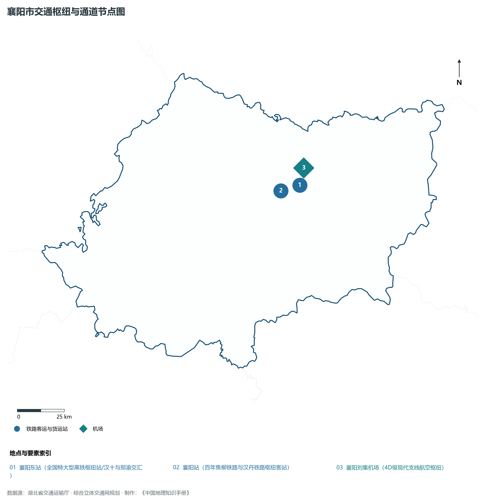
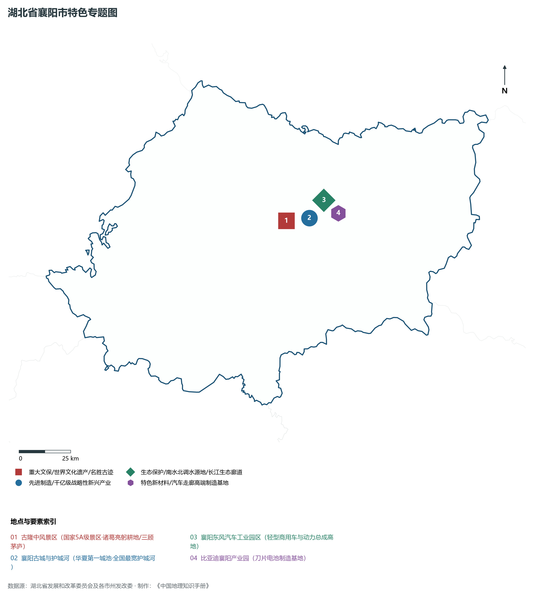
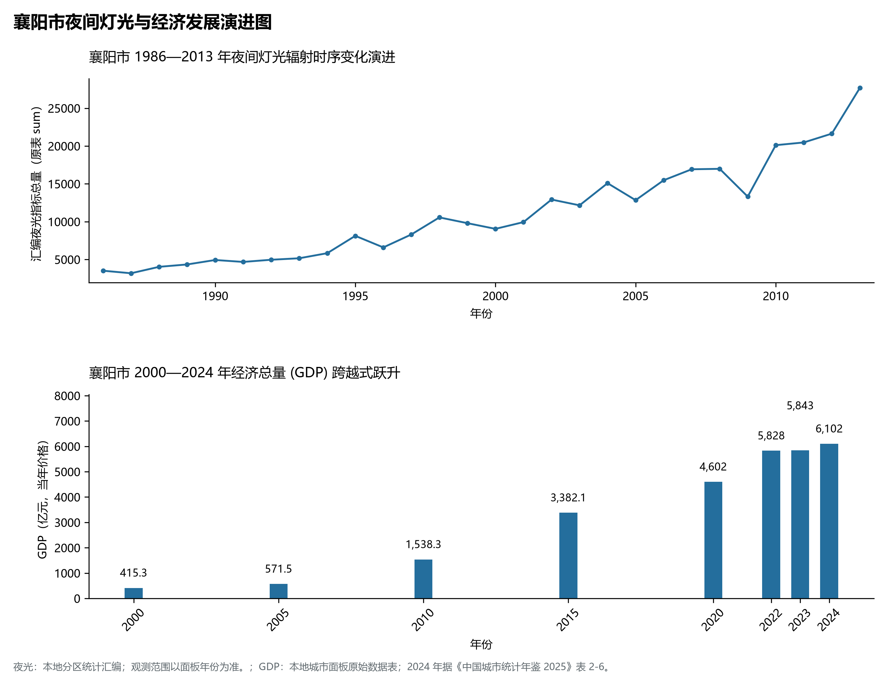

# 16.5 襄阳市

襄阳市，地处湖北省核心发展板块与长江中游城市群关键节点，其城市综合定位与发展愿景概括为：**湖北省域副中心·汉江流域中心城市·兵家必争铁打襄阳·南船北马交通枢纽·中国商用车与新能源汽车基地**。2024 年常住人口 **528 万人**，常住人口城镇化率 **65.16%**，地区生产总值 **6,102 亿元**（当年价格），人均地区生产总值 **115,596 元**，三次产业构成为 **9.78 : 40.95 : 49.27**。

---

## 一、自然地理底盘与山川水系机理

在气候水热配置方面，襄阳市全境位于典型的北亚热带温暖湿润季风气候区，温暖湿润、四季分明、热量丰沛、雨热同期。年平均气温在 15.2°C ～ 17.5°C 之间，极端最低气温大多在 -5°C 以上，无霜期长达 245 ～ 290 d，年均日照时数长达 1800 ～ 2150 h。优越的光温条件极利于水稻、油菜、水产、特色林果及亚热带经济林木生长。多年平均降水量达 1050 ～ 1550 mm，降水时空分配年内集中在 5—8 月汛期，暴雨过程频密，山溪性河流短促陡急，江河湖库防洪抗涝与山洪地质灾害防御责任重大；而在秋冬之交常伴有伏秋旱，大型骨干水库蓄水保供、灌区调蓄与水资源统一配置发挥着不可或缺的保障功能。

区域骨干控制性山峰、高程标高极点与主要地貌控制节点包括：

- **望佛山 (1946.0m 襄阳最高峰/保康南漳交界荆山主脊)**（空间坐标约东经 111.450°、北纬 31.620°，海拔标高约 1946.0 m）：构成区域地形骨架与水源生态安全屏障的关键控制极点，在区域气候水热调节、地表水径流汇集拦截与生物多样性保护中具有不可替代的基石功能；
- **五道峡古公山 (1750.0m 楚源深山/国家自然保护区)**（空间坐标约东经 111.180°、北纬 31.820°，海拔标高约 1750.0 m）：构成区域地形骨架与水源生态安全屏障的关键控制极点，在区域气候水热调节、地表水径流汇集拦截与生物多样性保护中具有不可替代的基石功能；
- **岘山 (380.0m 羊祜堕泪碑/襄阳古城南天然屏障)**（空间坐标约东经 112.130°、北纬 31.980°，海拔标高约 380.0 m）：构成区域地形骨架与水源生态安全屏障的关键控制极点，在区域气候水热调节、地表水径流汇集拦截与生物多样性保护中具有不可替代的基石功能；

水系水网与生态湿地廊道方面，襄阳市江河纵横、湖库密布，深度融入长江、汉江或清江大水系网络：

- **汉江襄阳段 (一江碧水穿城过/铁打的襄阳)**（水系坐标约东经 112.150°、北纬 32.030°）：发挥着流域防洪减灾、排涝调峰、农业自流灌溉、工业及城乡优质生活饮用水源保障、内河深水航运物流与水生生物资源保护的核心功能；
- **唐白河 (发源河南南阳·在襄州汇入汉江)**（水系坐标约东经 112.220°、北纬 32.060°）：发挥着流域防洪减灾、排涝调峰、农业自流灌溉、工业及城乡优质生活饮用水源保障、内河深水航运物流与水生生物资源保护的核心功能；
- **南河与北河 (汉江在谷城老河口段骨干支流)**（水系坐标约东经 111.600°、北纬 32.250°）：发挥着流域防洪减灾、排涝调峰、农业自流灌溉、工业及城乡优质生活饮用水源保障、内河深水航运物流与水生生物资源保护的核心功能；
- **蛮河 (宜城楚国古运河·灌溉沃野)**（水系坐标约东经 112.250°、北纬 31.700°）：发挥着流域防洪减灾、排涝调峰、农业自流灌溉、工业及城乡优质生活饮用水源保障、内河深水航运物流与水生生物资源保护的核心功能；

---

## 二、行政区划沿革与城镇空间体系

襄阳市建置沿革源远流长，文脉绵延数千年，自古即为荆楚要地、兵家必争、商贾辐辏或革命红色摇篮。先秦封楚立国、秦汉设郡立县、唐宋置州设路、明清立府设县，千百年来留下了极其璀璨的历史地名与人文遗迹。新中国成立后特别是改革开放以来，伴随撤地设市、行政区划合理调整、城区组团式向外延展与以人为核心的新型城镇化深入推进，构建了中心城区引领极核、县域板块协同支撑、重点特色城镇星罗棋布、产城人景深度融合的现代多中心城镇空间网络体系：

- **市委市政府 (襄城区)**（驻地坐标：112.140°E, 32.010°N）：区域公共治理行政中枢、现代生产生活综合服务集聚地与新型城镇化战略承载极核；
- **樊城区 (商贸金融中枢/汉江北岸重镇)**（驻地坐标：112.150°E, 32.040°N）：区域公共治理行政中枢、现代生产生活综合服务集聚地与新型城镇化战略承载极核；
- **襄州区 (航空高铁新城/粮食加工大区)**（驻地坐标：112.210°E, 32.080°N）：区域公共治理行政中枢、现代生产生活综合服务集聚地与新型城镇化战略承载极核；
- **枣阳市 (汉光武帝刘秀故里/千亿县市)**（驻地坐标：112.770°E, 32.130°N）：区域公共治理行政中枢、现代生产生活综合服务集聚地与新型城镇化战略承载极核；
- **宜城市 (楚国古都/宋玉故里)**（驻地坐标：112.260°E, 31.720°N）：区域公共治理行政中枢、现代生产生活综合服务集聚地与新型城镇化战略承载极核；
- **老河口市 (汉水重镇/木版年画之乡)**（驻地坐标：111.670°E, 32.380°N）：区域公共治理行政中枢、现代生产生活综合服务集聚地与新型城镇化战略承载极核；
- **南漳县 (和氏璧故里/中国古寨之乡)**（驻地坐标：111.840°E, 31.780°N）：区域公共治理行政中枢、现代生产生活综合服务集聚地与新型城镇化战略承载极核；
- **谷城县 (神农尝百草地/粉末冶金名城)**（驻地坐标：111.650°E, 32.260°N）：区域公共治理行政中枢、现代生产生活综合服务集聚地与新型城镇化战略承载极核；
- **保康县 (荆山腹地/楚国发祥地/全国绿化模范县)**（驻地坐标：111.260°E, 31.880°N）：区域公共治理行政中枢、现代生产生活综合服务集聚地与新型城镇化战略承载极核；

在国土空间总体规划指引下，襄阳市统筹推进“三区三线”科学划定与刚性管控，严守耕地和永久基本农田保护红线、生态保护红线与城镇开发边界，统筹优化农业空间、生态空间与城镇空间布局，推动高能级产业园区集聚集约转型，持续缩小城乡基本公共服务差距，打造宜居、韧性、智慧、绿色的现代化和美之城。

---

## 三、综合立体交通网络与现代枢纽通道

襄阳市地处“九省通衢”交通走廊核心，全方位融入国家综合立体交通网与长江经济带高质量发展大局。依托设计时速 350 公里高铁干线、国家干线货运铁路、纵横交错的国家高速公路网、现代化民用航空港以及长江黄金水道高等级深水航道，构筑起外畅内通、铁水公空多式联运的现代综合立体交通体系：

**核心综合交通客运与货运物流枢纽节点：**

- **襄阳东站 (全国特大型高铁枢纽站/汉十与郑渝交汇)**（空间坐标：112.260°E, 32.070°N）：客流高铁干线快速转换、大宗工业原料与货物集装箱铁水公空多式联运转换、以及全面对接长江经济带与全球现代物流体系的核心交通支点；
- **襄阳站 (百年焦柳铁路与汉丹铁路枢纽客站)**（空间坐标：112.150°E, 32.050°N）：客流高铁干线快速转换、大宗工业原料与货物集装箱铁水公空多式联运转换、以及全面对接长江经济带与全球现代物流体系的核心交通支点；
- **襄阳刘集机场 (4D级现代支线航空枢纽)**（空间坐标：112.290°E, 32.150°N）：客流高铁干线快速转换、大宗工业原料与货物集装箱铁水公空多式联运转换、以及全面对接长江经济带与全球现代物流体系的核心交通支点；

当前，襄阳市持续加快交通基础设施数字化升级、智慧调度平台建设与绿色低碳改造，重点攻坚“铁水公空”多式联运无缝衔接与枢纽集疏运道路闭环，大力拓展中欧班列集结、铁水联运班列与国际货运空中走廊，全力打造安全便捷、内通外畅、绿色智能的现代化交通强市。

---

## 四、现代产业体系与新质生产力布局

襄阳市坚定不移实施“制造业强市、产业兴市”核心战略，深入贯彻落实湖北省“51020”现代产业集群行动方案，推进传统优势产业高端化智改数转网联，聚力发展战略性新兴产业，前瞻布局未来前沿产业，加速构建体现自身特色与国际国内市场竞争力的现代产业体系：

**标志性先进制造园区、特色产业基地、创新平台与重大产业地标：**

- **古隆中风景区 (国家5A级景区·诸葛亮躬耕地/三顾茅庐)**（空间坐标：112.030°E, 32.010°N）；
- **襄阳古城与护城河 (华夏第一城池·全国最宽护城河)**（空间坐标：112.150°E, 32.015°N）；
- **襄阳东风汽车工业园区 (轻型商用车与动力总成高地)**（空间坐标：112.180°E, 32.090°N）；
- **比亚迪襄阳产业园 (刀片电池制造基地)**（空间坐标：112.250°E, 32.030°N）；

通过深入实施工业“链长制”与领航企业培育工程，襄阳市围绕产业链上下游部署创新链、资金链与人才链，梯次培育国家级高新技术企业、制造业单项冠军与专精特新“小巨人”企业集群，积极抢占新材料、先进装备制造、新能源与智能网联汽车、高端电子信息、现代绿色化工、特色农产品加工等赛道制高点，全力夯实现代化经济强市的实体产业硬核底盘。

---

## 五、历史文化名胜、人文底蕴与全域文旅地理

襄阳市文源深脉长、名胜甲于江汉，融汇了荆楚文化源头探寻、三国风云英雄豪气、红色革命峥嵘记忆与壮美秀丽的自然山水风光，拥有数量众多的世界文化/自然遗产、国家 5A 级风景区、国家历史文化名城与全国重点文物保护单位：

- **古隆中风景区 (国家5A级景区·诸葛亮躬耕地/三顾茅庐)**；
- **襄阳古城与护城河 (华夏第一城池·全国最宽护城河)**；
- **襄阳东风汽车工业园区 (轻型商用车与动力总成高地)**；
- **比亚迪襄阳产业园 (刀片电池制造基地)**；

立足全域旅游与高品质度假康养新时代需求，襄阳市坚持“以文塑旅、以旅彰文”，推进红色文化研学、古城风貌保护活化、高山生态避暑、峡江风光探险与乡村农文旅深度融合，打造享誉海内外的特色文旅超级品牌。

---

## 六、夜间灯光辐射与跨世纪经济变化时序演进

本节夜光图的观测年份为 1986—2013 年，指标为行政区汇总值（原表 sum）。

| 年份 | 地区生产总值（亿元，当年价格） |
|:---|---:|
| 2000 年 | 415.3 |
| 2005 年 | 571.5 |
| 2010 年 | 1,538.3 |
| 2015 年 | 3,382.1 |
| 2020 年 | 4,602 |
| 2022 年 | 5,828 |
| 2023 年 | 5,843 |
| 2024 年 | 6,102 |

- **1996 年前后**：襄城樊城隔汉江相对·东风汽车基地启动；

---

2024 年统计来源：《中国城市统计年鉴 2025》表 2-1、2-6、2-7（2024 年，全市）。其他年份 GDP 据本地城市面板“原始数据”表，单位为亿元、当年价格。
