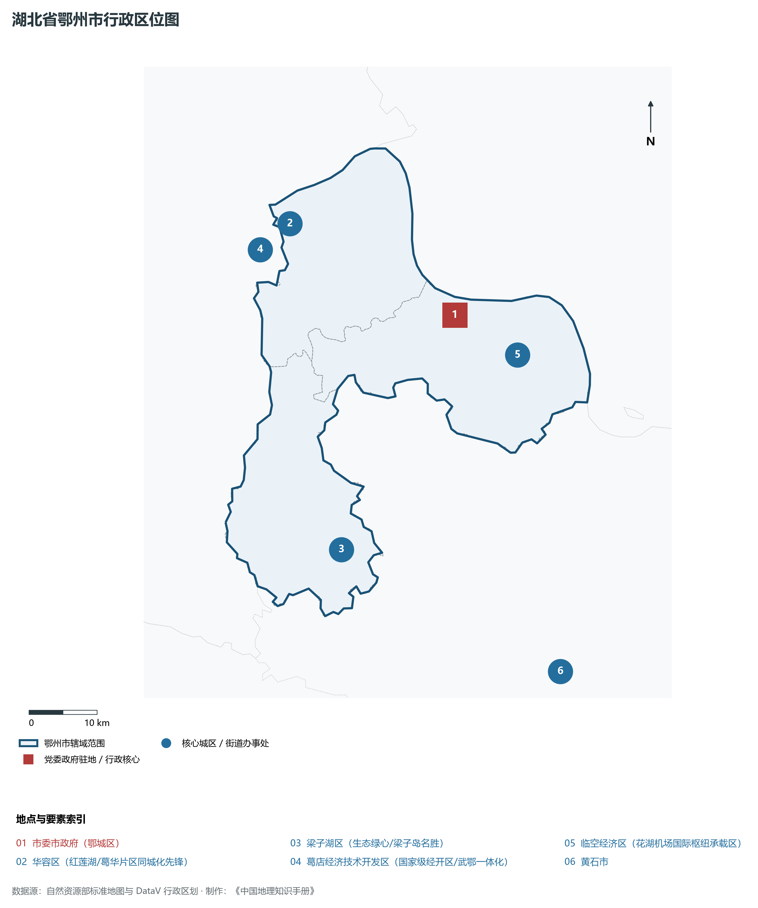
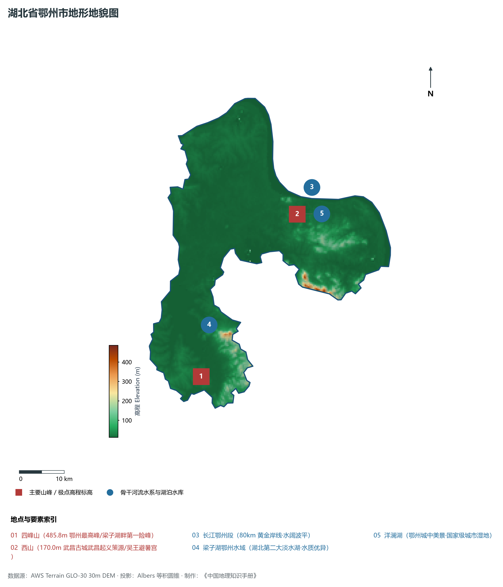
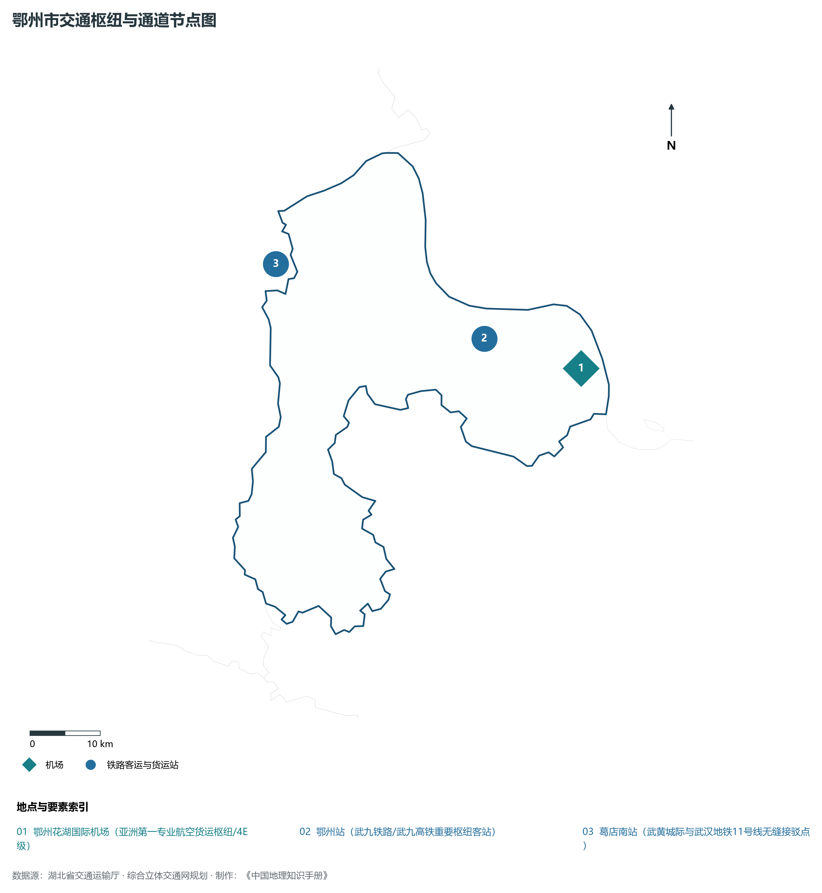
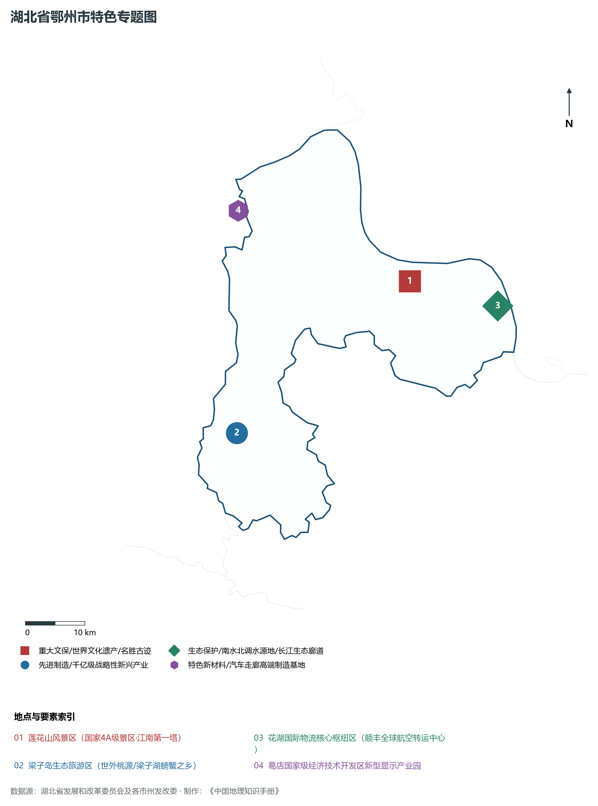
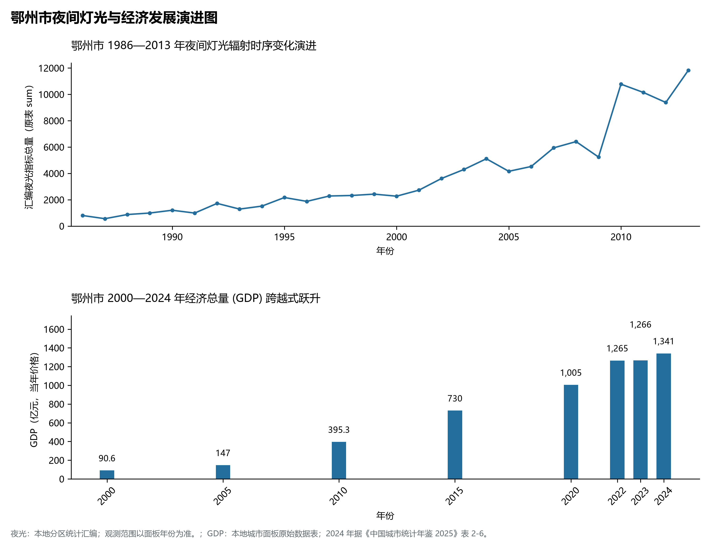

# 16.6 鄂州市

鄂州市，地处湖北省核心发展板块与长江中游城市群关键节点，其城市综合定位与发展愿景概括为：**吴都古城·百湖之市·花湖国际航空货运超级枢纽·武鄂同城化桥头堡·临空经济高地**。2024 年常住人口 **107 万人**，常住人口城镇化率 **69.15%**，地区生产总值 **1,341 亿元**（当年价格），人均地区生产总值 **125,063 元**，三次产业构成为 **8.7 : 42.36 : 48.94**。

---

## 一、自然地理底盘与山川水系机理

在气候水热配置方面，鄂州市全境位于典型的北亚热带温暖湿润季风气候区，温暖湿润、四季分明、热量丰沛、雨热同期。年平均气温在 15.2°C ～ 17.5°C 之间，极端最低气温大多在 -5°C 以上，无霜期长达 245 ～ 290 d，年均日照时数长达 1800 ～ 2150 h。优越的光温条件极利于水稻、油菜、水产、特色林果及亚热带经济林木生长。多年平均降水量达 1050 ～ 1550 mm，降水时空分配年内集中在 5—8 月汛期，暴雨过程频密，山溪性河流短促陡急，江河湖库防洪抗涝与山洪地质灾害防御责任重大；而在秋冬之交常伴有伏秋旱，大型骨干水库蓄水保供、灌区调蓄与水资源统一配置发挥着不可或缺的保障功能。

区域骨干控制性山峰、高程标高极点与主要地貌控制节点包括：

- **四峰山 (485.8m 鄂州最高峰/梁子湖畔第一险峰)**（空间坐标约东经 114.620°、北纬 30.080°，海拔标高约 485.8 m）：构成区域地形骨架与水源生态安全屏障的关键控制极点，在区域气候水热调节、地表水径流汇集拦截与生物多样性保护中具有不可替代的基石功能；
- **西山 (170.0m 武昌古城武昌起义策源/吴王避暑宫)**（空间坐标约东经 114.880°、北纬 30.380°，海拔标高约 170.0 m）：构成区域地形骨架与水源生态安全屏障的关键控制极点，在区域气候水热调节、地表水径流汇集拦截与生物多样性保护中具有不可替代的基石功能；

水系水网与生态湿地廊道方面，鄂州市江河纵横、湖库密布，深度融入长江、汉江或清江大水系网络：

- **长江鄂州段 (80km 黄金岸线·水阔波平)**（水系坐标约东经 114.920°、北纬 30.430°）：发挥着流域防洪减灾、排涝调峰、农业自流灌溉、工业及城乡优质生活饮用水源保障、内河深水航运物流与水生生物资源保护的核心功能；
- **梁子湖鄂州水域 (湖北第二大淡水湖·水质优异)**（水系坐标约东经 114.650°、北纬 30.180°）：发挥着流域防洪减灾、排涝调峰、农业自流灌溉、工业及城乡优质生活饮用水源保障、内河深水航运物流与水生生物资源保护的核心功能；
- **洋澜湖 (鄂州城中美景·国家级城市湿地)**（水系坐标约东经 114.890°、北纬 30.380°）：发挥着流域防洪减灾、排涝调峰、农业自流灌溉、工业及城乡优质生活饮用水源保障、内河深水航运物流与水生生物资源保护的核心功能；

---

## 二、行政区划沿革与城镇空间体系

鄂州市建置沿革源远流长，文脉绵延数千年，自古即为荆楚要地、兵家必争、商贾辐辏或革命红色摇篮。先秦封楚立国、秦汉设郡立县、唐宋置州设路、明清立府设县，千百年来留下了极其璀璨的历史地名与人文遗迹。新中国成立后特别是改革开放以来，伴随撤地设市、行政区划合理调整、城区组团式向外延展与以人为核心的新型城镇化深入推进，构建了中心城区引领极核、县域板块协同支撑、重点特色城镇星罗棋布、产城人景深度融合的现代多中心城镇空间网络体系：

- **市委市政府 (鄂城区)**（驻地坐标：114.890°E, 30.390°N）：区域公共治理行政中枢、现代生产生活综合服务集聚地与新型城镇化战略承载极核；
- **华容区 (红莲湖/葛华片区同城化先锋)**（驻地坐标：114.650°E, 30.530°N）：区域公共治理行政中枢、现代生产生活综合服务集聚地与新型城镇化战略承载极核；
- **梁子湖区 (生态绿心/梁子岛名胜)**（驻地坐标：114.680°E, 30.100°N）：区域公共治理行政中枢、现代生产生活综合服务集聚地与新型城镇化战略承载极核；
- **葛店经济技术开发区 (国家级经开区/武鄂一体化)**（驻地坐标：114.600°E, 30.500°N）：区域公共治理行政中枢、现代生产生活综合服务集聚地与新型城镇化战略承载极核；
- **临空经济区 (花湖机场国际枢纽承载区)**（驻地坐标：114.980°E, 30.330°N）：区域公共治理行政中枢、现代生产生活综合服务集聚地与新型城镇化战略承载极核；

在国土空间总体规划指引下，鄂州市统筹推进“三区三线”科学划定与刚性管控，严守耕地和永久基本农田保护红线、生态保护红线与城镇开发边界，统筹优化农业空间、生态空间与城镇空间布局，推动高能级产业园区集聚集约转型，持续缩小城乡基本公共服务差距，打造宜居、韧性、智慧、绿色的现代化和美之城。

---

## 三、综合立体交通网络与现代枢纽通道

鄂州市地处“九省通衢”交通走廊核心，全方位融入国家综合立体交通网与长江经济带高质量发展大局。依托设计时速 350 公里高铁干线、国家干线货运铁路、纵横交错的国家高速公路网、现代化民用航空港以及长江黄金水道高等级深水航道，构筑起外畅内通、铁水公空多式联运的现代综合立体交通体系：

**核心综合交通客运与货运物流枢纽节点：**

- **鄂州花湖国际机场 (亚洲第一专业航空货运枢纽/4E级)**（空间坐标：115.050°E, 30.320°N）：客流高铁干线快速转换、大宗工业原料与货物集装箱铁水公空多式联运转换、以及全面对接长江经济带与全球现代物流体系的核心交通支点；
- **鄂州站 (武九铁路/武九高铁重要枢纽客站)**（空间坐标：114.910°E, 30.370°N）：客流高铁干线快速转换、大宗工业原料与货物集装箱铁水公空多式联运转换、以及全面对接长江经济带与全球现代物流体系的核心交通支点；
- **葛店南站 (武黄城际与武汉地铁11号线无缝接驳点)**（空间坐标：114.610°E, 30.490°N）：客流高铁干线快速转换、大宗工业原料与货物集装箱铁水公空多式联运转换、以及全面对接长江经济带与全球现代物流体系的核心交通支点；

当前，鄂州市持续加快交通基础设施数字化升级、智慧调度平台建设与绿色低碳改造，重点攻坚“铁水公空”多式联运无缝衔接与枢纽集疏运道路闭环，大力拓展中欧班列集结、铁水联运班列与国际货运空中走廊，全力打造安全便捷、内通外畅、绿色智能的现代化交通强市。

---

## 四、现代产业体系与新质生产力布局

鄂州市坚定不移实施“制造业强市、产业兴市”核心战略，深入贯彻落实湖北省“51020”现代产业集群行动方案，推进传统优势产业高端化智改数转网联，聚力发展战略性新兴产业，前瞻布局未来前沿产业，加速构建体现自身特色与国际国内市场竞争力的现代产业体系：

**标志性先进制造园区、特色产业基地、创新平台与重大产业地标：**

- **莲花山风景区 (国家4A级景区·江南第一塔)**（空间坐标：114.910°E, 30.380°N）；
- **梁子岛生态旅游区 (世外桃源/梁子湖螃蟹之乡)**（空间坐标：114.580°E, 30.180°N）；
- **花湖国际物流核心枢纽区 (顺丰全球航空转运中心)**（空间坐标：115.060°E, 30.330°N）；
- **葛店国家级经济技术开发区新型显示产业园**（空间坐标：114.620°E, 30.510°N）；

通过深入实施工业“链长制”与领航企业培育工程，鄂州市围绕产业链上下游部署创新链、资金链与人才链，梯次培育国家级高新技术企业、制造业单项冠军与专精特新“小巨人”企业集群，积极抢占新材料、先进装备制造、新能源与智能网联汽车、高端电子信息、现代绿色化工、特色农产品加工等赛道制高点，全力夯实现代化经济强市的实体产业硬核底盘。

---

## 五、历史文化名胜、人文底蕴与全域文旅地理

鄂州市文源深脉长、名胜甲于江汉，融汇了荆楚文化源头探寻、三国风云英雄豪气、红色革命峥嵘记忆与壮美秀丽的自然山水风光，拥有数量众多的世界文化/自然遗产、国家 5A 级风景区、国家历史文化名城与全国重点文物保护单位：

- **莲花山风景区 (国家4A级景区·江南第一塔)**；
- **梁子岛生态旅游区 (世外桃源/梁子湖螃蟹之乡)**；
- **花湖国际物流核心枢纽区 (顺丰全球航空转运中心)**；
- **葛店国家级经济技术开发区新型显示产业园**；

立足全域旅游与高品质度假康养新时代需求，鄂州市坚持“以文塑旅、以旅彰文”，推进红色文化研学、古城风貌保护活化、高山生态避暑、峡江风光探险与乡村农文旅深度融合，打造享誉海内外的特色文旅超级品牌。

---

## 六、夜间灯光辐射与跨世纪经济变化时序演进

本节夜光图的观测年份为 1986—2013 年，指标为行政区汇总值（原表 sum）。

| 年份 | 地区生产总值（亿元，当年价格） |
|:---|---:|
| 2000 年 | 90.6 |
| 2005 年 | 147 |
| 2010 年 | 395.3 |
| 2015 年 | 730 |
| 2020 年 | 1,005 |
| 2022 年 | 1,265 |
| 2023 年 | 1,266 |
| 2024 年 | 1,341 |

- **2005 年前后**：武东重工聚集·葛店开发区融入武汉；

---

2024 年统计来源：《中国城市统计年鉴 2025》表 2-1、2-6、2-7（2024 年，全市）。其他年份 GDP 据本地城市面板“原始数据”表，单位为亿元、当年价格。
