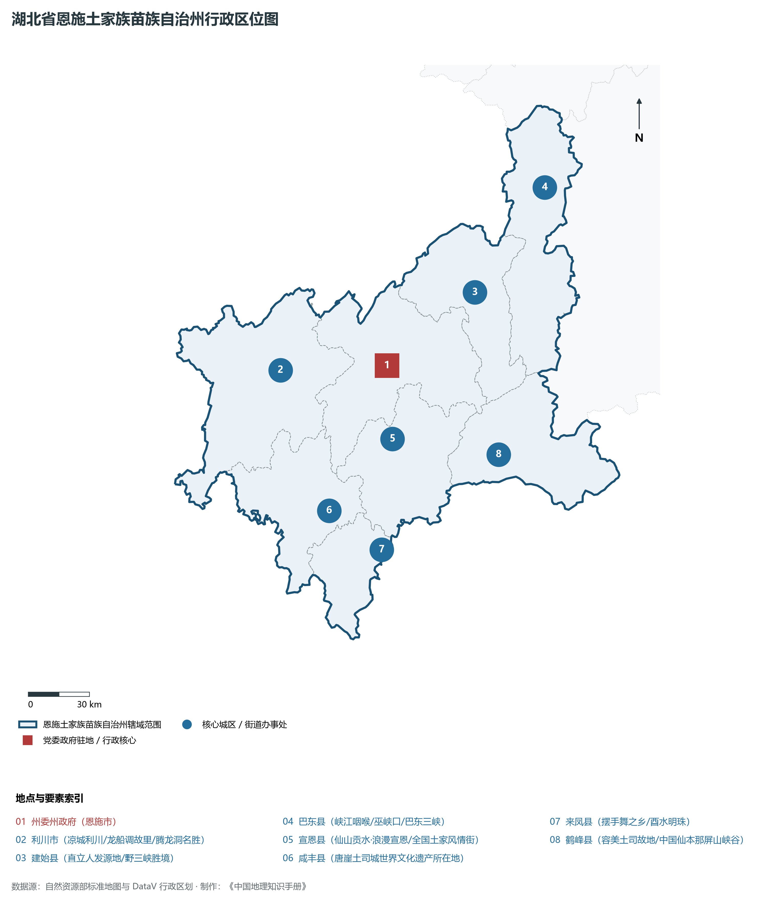
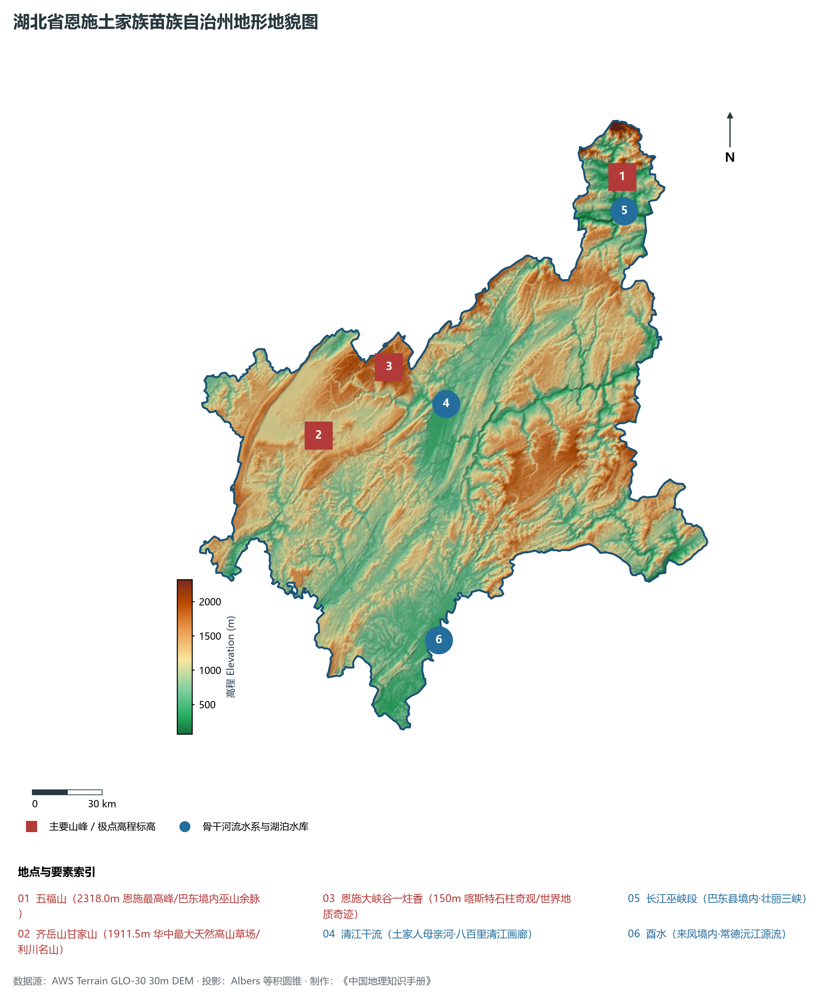
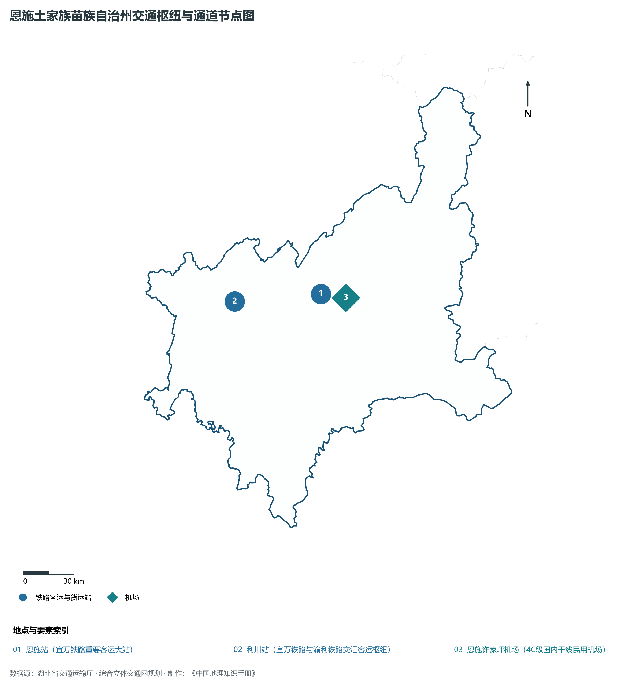
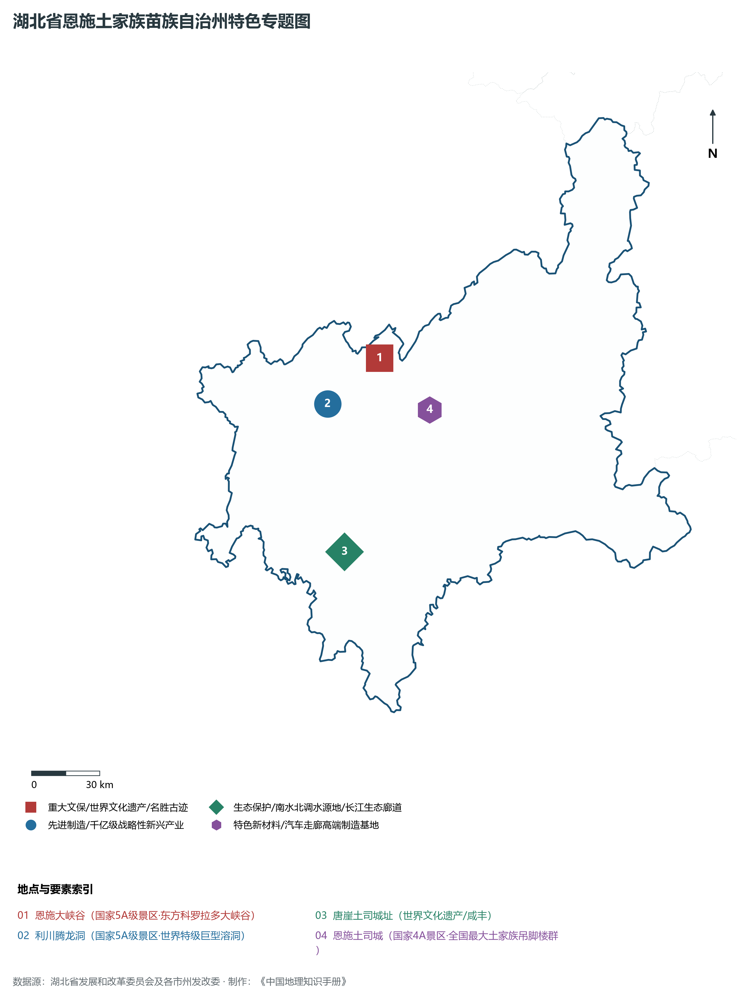
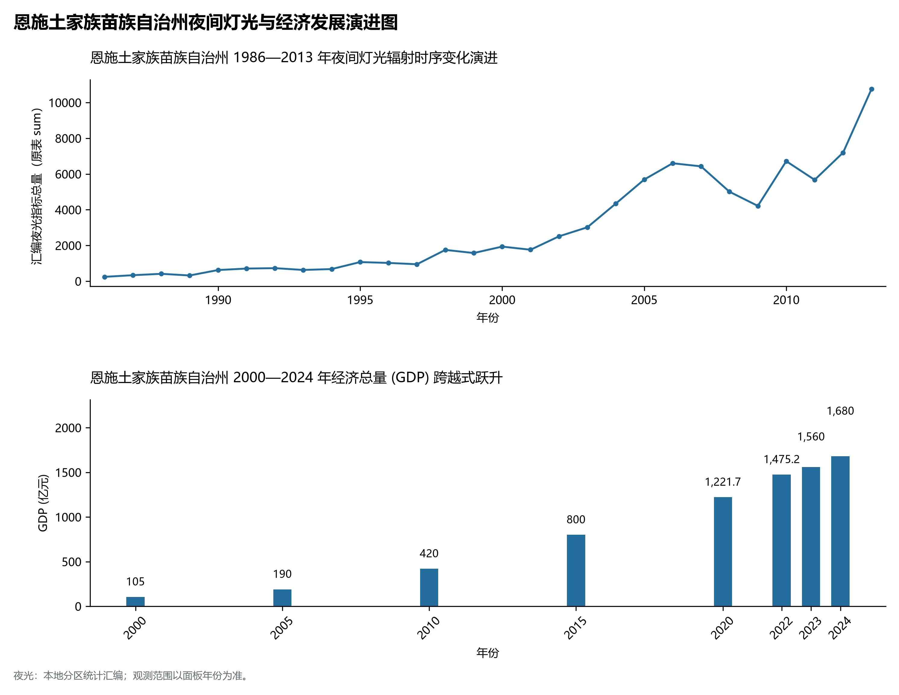

# 16.13 恩施土家族苗族自治州

恩施土家族苗族自治州，地处湖北省核心发展板块与长江中游城市群关键节点，其城市综合定位与发展愿景概括为：**世界硒都·华中药库·鄂西生态文化旅游圈核心·土家族苗族风情圣地·恩施大峡谷壮美画卷**。全境陆域总面积达 **24,111.00 km²**，截至 2024 年末常住人口约 **341.0** 万人，常住人口城镇化率达 **50.2%**。2024 年实现地区生产总值（GDP）约 **1,680.0** 亿元，人均 GDP 达 **49,270** 元，三次产业结构比优化为 **16.5 : 28.5 : 55.0**。全境地表高程极值跨度介于 **66.8 m ～ 2318.0 m** 之间，呈现出壮阔江河与高峻峰峦交相辉映的优越自然地理底盘、四通八达的综合立体交通枢纽网络与极富活力的现代新兴产业集群。

---

## 一、自然地理底盘与山川水系机理

在气候水热配置方面，恩施土家族苗族自治州全境位于典型的北亚热带温暖湿润季风气候区，温暖湿润、四季分明、热量丰沛、雨热同期。年平均气温在 15.2°C ～ 17.5°C 之间，极端最低气温大多在 -5°C 以上，无霜期长达 245 ～ 290 d，年均日照时数长达 1800 ～ 2150 h。优越的光温条件极利于水稻、油菜、水产、特色林果及亚热带经济林木生长。多年平均降水量达 1050 ～ 1550 mm，降水时空分配年内集中在 5—8 月汛期，暴雨过程频密，山溪性河流短促陡急，江河湖库防洪抗涝与山洪地质灾害防御责任重大；而在秋冬之交常伴有伏秋旱，大型骨干水库蓄水保供、灌区调蓄与水资源统一配置发挥着不可或缺的保障功能。

区域骨干控制性山峰、高程标高极点与主要地貌控制节点包括：

- **五福山 (2318.0m 恩施最高峰/巴东境内巫山余脉)**（空间坐标约东经 110.350°、北纬 31.180°，海拔标高约 2318.0 m）：构成区域地形骨架与水源生态安全屏障的关键控制极点，在区域气候水热调节、地表水径流汇集拦截与生物多样性保护中具有不可替代的基石功能；
- **齐岳山甘家山 (1911.5m 华中最大天然高山草场/利川名山)**（空间坐标约东经 108.920°、北纬 30.250°，海拔标高约 1911.5 m）：构成区域地形骨架与水源生态安全屏障的关键控制极点，在区域气候水热调节、地表水径流汇集拦截与生物多样性保护中具有不可替代的基石功能；
- **恩施大峡谷一炷香 (150m 喀斯特石柱奇观/世界地质奇迹)**（空间坐标约东经 109.250°、北纬 30.500°，海拔标高约 1200.0 m）：构成区域地形骨架与水源生态安全屏障的关键控制极点，在区域气候水热调节、地表水径流汇集拦截与生物多样性保护中具有不可替代的基石功能；

水系水网与生态湿地廊道方面，恩施土家族苗族自治州江河纵横、湖库密布，深度融入长江、汉江或清江大水系网络：

- **清江干流 (土家人母亲河·八百里清江画廊)**（水系坐标约东经 109.500°、北纬 30.350°）：发挥着流域防洪减灾、排涝调峰、农业自流灌溉、工业及城乡优质生活饮用水源保障、内河深水航运物流与水生生物资源保护的核心功能；
- **长江巫峡段 (巴东县境内·壮丽三峡)**（水系坐标约东经 110.350°、北纬 31.050°）：发挥着流域防洪减灾、排涝调峰、农业自流灌溉、工业及城乡优质生活饮用水源保障、内河深水航运物流与水生生物资源保护的核心功能；
- **酉水 (来凤境内·常德沅江源流)**（水系坐标约东经 109.420°、北纬 29.450°）：发挥着流域防洪减灾、排涝调峰、农业自流灌溉、工业及城乡优质生活饮用水源保障、内河深水航运物流与水生生物资源保护的核心功能；

---

## 二、行政区划沿革与城镇空间体系

恩施土家族苗族自治州建置沿革源远流长，文脉绵延数千年，自古即为荆楚要地、兵家必争、商贾辐辏或革命红色摇篮。先秦封楚立国、秦汉设郡立县、唐宋置州设路、明清立府设县，千百年来留下了极其璀璨的历史地名与人文遗迹。新中国成立后特别是改革开放以来，伴随撤地设市、行政区划合理调整、城区组团式向外延展与以人为核心的新型城镇化深入推进，构建了中心城区引领极核、县域板块协同支撑、重点特色城镇星罗棋布、产城人景深度融合的现代多中心城镇空间网络体系：

- **州委州政府 (恩施市)**（驻地坐标：109.480°E, 30.300°N）：区域公共治理行政中枢、现代生产生活综合服务集聚地与新型城镇化战略承载极核；
- **利川市 (凉城利川/龙船调故里/腾龙洞名胜)**（驻地坐标：108.930°E, 30.300°N）：区域公共治理行政中枢、现代生产生活综合服务集聚地与新型城镇化战略承载极核；
- **建始县 (直立人发源地/野三峡胜境)**（驻地坐标：109.950°E, 30.600°N）：区域公共治理行政中枢、现代生产生活综合服务集聚地与新型城镇化战略承载极核；
- **巴东县 (峡江咽喉/巫峡口/巴东三峡)**（驻地坐标：110.340°E, 31.040°N）：区域公共治理行政中枢、现代生产生活综合服务集聚地与新型城镇化战略承载极核；
- **宣恩县 (仙山贡水·浪漫宣恩/全国土家风情街)**（驻地坐标：109.490°E, 29.980°N）：区域公共治理行政中枢、现代生产生活综合服务集聚地与新型城镇化战略承载极核；
- **咸丰县 (唐崖土司城世界文化遗产所在地)**（驻地坐标：109.150°E, 29.680°N）：区域公共治理行政中枢、现代生产生活综合服务集聚地与新型城镇化战略承载极核；
- **来凤县 (摆手舞之乡/酉水明珠)**（驻地坐标：109.410°E, 29.500°N）：区域公共治理行政中枢、现代生产生活综合服务集聚地与新型城镇化战略承载极核；
- **鹤峰县 (容美土司故地/中国仙本那屏山峡谷)**（驻地坐标：110.030°E, 29.890°N）：区域公共治理行政中枢、现代生产生活综合服务集聚地与新型城镇化战略承载极核；

在国土空间总体规划指引下，恩施土家族苗族自治州统筹推进“三区三线”科学划定与刚性管控，严守耕地和永久基本农田保护红线、生态保护红线与城镇开发边界，统筹优化农业空间、生态空间与城镇空间布局，推动高能级产业园区集聚集约转型，持续缩小城乡基本公共服务差距，打造宜居、韧性、智慧、绿色的现代化和美之城。

---

## 三、综合立体交通网络与现代枢纽通道

恩施土家族苗族自治州地处“九省通衢”交通走廊核心，全方位融入国家综合立体交通网与长江经济带高质量发展大局。依托设计时速 350 公里高铁干线、国家干线货运铁路、纵横交错的国家高速公路网、现代化民用航空港以及长江黄金水道高等级深水航道，构筑起外畅内通、铁水公空多式联运的现代综合立体交通体系：

**核心综合交通客运与货运物流枢纽节点：**

- **恩施站 (宜万铁路重要客运大站)**（空间坐标：109.490°E, 30.340°N）：客流高铁干线快速转换、大宗工业原料与货物集装箱铁水公空多式联运转换、以及全面对接长江经济带与全球现代物流体系的核心交通支点；
- **利川站 (宜万铁路与渝利铁路交汇客运枢纽)**（空间坐标：108.950°E, 30.320°N）：客流高铁干线快速转换、大宗工业原料与货物集装箱铁水公空多式联运转换、以及全面对接长江经济带与全球现代物流体系的核心交通支点；
- **恩施许家坪机场 (4C级国内干线民用机场)**（空间坐标：109.490°E, 30.320°N）：客流高铁干线快速转换、大宗工业原料与货物集装箱铁水公空多式联运转换、以及全面对接长江经济带与全球现代物流体系的核心交通支点；

当前，恩施土家族苗族自治州持续加快交通基础设施数字化升级、智慧调度平台建设与绿色低碳改造，重点攻坚“铁水公空”多式联运无缝衔接与枢纽集疏运道路闭环，大力拓展中欧班列集结、铁水联运班列与国际货运空中走廊，全力打造安全便捷、内通外畅、绿色智能的现代化交通强市。

---

## 四、现代产业体系与新质生产力布局

恩施土家族苗族自治州坚定不移实施“制造业强市、产业兴市”核心战略，深入贯彻落实湖北省“51020”现代产业集群行动方案，推进传统优势产业高端化智改数转网联，聚力发展战略性新兴产业，前瞻布局未来前沿产业，加速构建体现自身特色与国际国内市场竞争力的现代产业体系：

**标志性先进制造园区、特色产业基地、创新平台与重大产业地标：**

- **恩施大峡谷 (国家5A级景区·东方科罗拉多大峡谷)**（空间坐标：109.250°E, 30.500°N）；
- **利川腾龙洞 (国家5A级景区·世界特级巨型溶洞)**（空间坐标：109.000°E, 30.330°N）；
- **唐崖土司城址 (世界文化遗产/咸丰)**（空间坐标：109.050°E, 29.750°N）；
- **恩施土司城 (国家4A景区·全国最大土家族吊脚楼群)**（空间坐标：109.470°E, 30.290°N）；

通过深入实施工业“链长制”与领航企业培育工程，恩施土家族苗族自治州围绕产业链上下游部署创新链、资金链与人才链，梯次培育国家级高新技术企业、制造业单项冠军与专精特新“小巨人”企业集群，积极抢占新材料、先进装备制造、新能源与智能网联汽车、高端电子信息、现代绿色化工、特色农产品加工等赛道制高点，全力夯实现代化经济强市的实体产业硬核底盘。

---

## 五、历史文化名胜、人文底蕴与全域文旅地理

恩施土家族苗族自治州文源深脉长、名胜甲于江汉，融汇了荆楚文化源头探寻、三国风云英雄豪气、红色革命峥嵘记忆与壮美秀丽的自然山水风光，拥有数量众多的世界文化/自然遗产、国家 5A 级风景区、国家历史文化名城与全国重点文物保护单位：

- **恩施大峡谷 (国家5A级景区·东方科罗拉多大峡谷)**；
- **利川腾龙洞 (国家5A级景区·世界特级巨型溶洞)**；
- **唐崖土司城址 (世界文化遗产/咸丰)**；
- **恩施土司城 (国家4A景区·全国最大土家族吊脚楼群)**；

立足全域旅游与高品质度假康养新时代需求，恩施土家族苗族自治州坚持“以文塑旅、以旅彰文”，推进红色文化研学、古城风貌保护活化、高山生态避暑、峡江风光探险与乡村农文旅深度融合，打造享誉海内外的特色文旅超级品牌。

---

## 六、夜间灯光辐射与跨世纪经济变化时序演进

本节夜光图的观测年份为 1986—2013 年，指标为行政区汇总值（原表 sum）。

| 统计基准年份 | 地区生产总值 GDP (亿元) | 发展阶段主要特征与空间跃升标志 |
|:---|:---|:---|
| **2000 年** | 105.0 | 新世纪初传统工农业稳步增长与招商引资起步 |
| **2005 年** | 190.0 | 新世纪初传统工农业稳步增长与招商引资起步 |
| **2010 年** | 420.0 | 新型工业化全面提速、园区集群扩容与综合高铁交通成网 |
| **2015 年** | 800.0 | 新型工业化全面提速、园区集群扩容与综合高铁交通成网 |
| **2020 年** | 1,221.7 | 高质量跨越式发展、高端战略性新兴产业爆发与现代绿色制造体系成型 |
| **2022 年** | 1,475.2 | 高质量跨越式发展、高端战略性新兴产业爆发与现代绿色制造体系成型 |
| **2023 年** | 1,560.0 | 高质量跨越式发展、高端战略性新兴产业爆发与现代绿色制造体系成型 |
| **2024 年** | 1,680.0 | 高质量跨越式发展、高端战略性新兴产业爆发与现代绿色制造体系成型 |

- **2005 年前后**：沪渝高速穿越高山天堑·峡谷旅游大开发；

---
