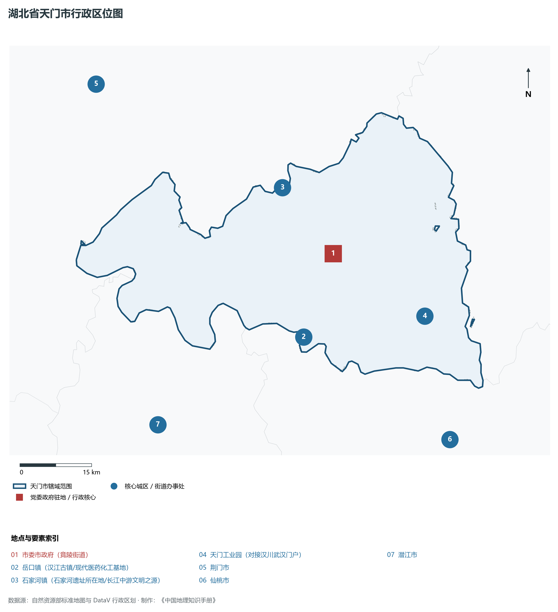
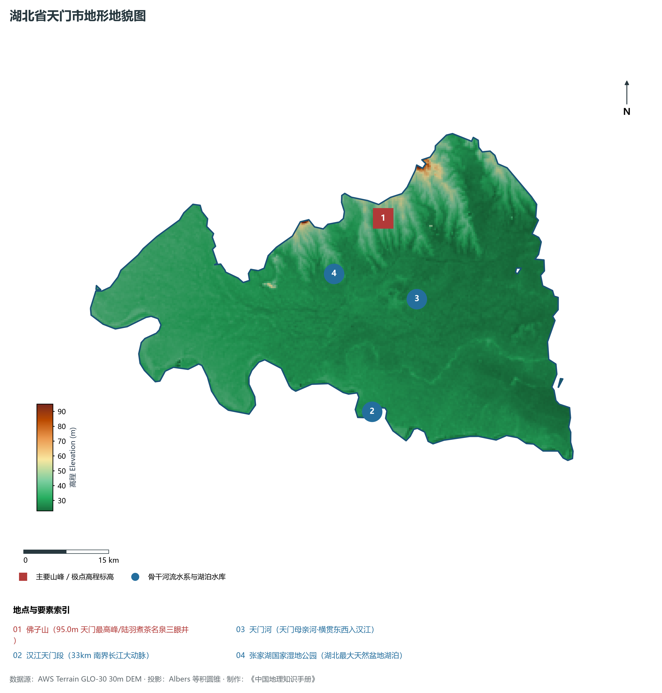
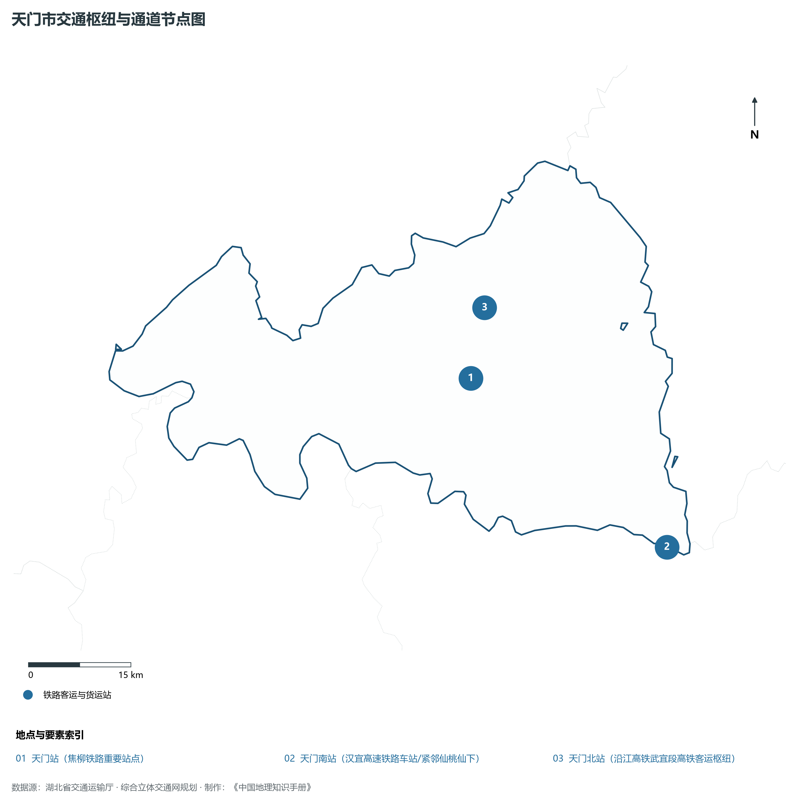
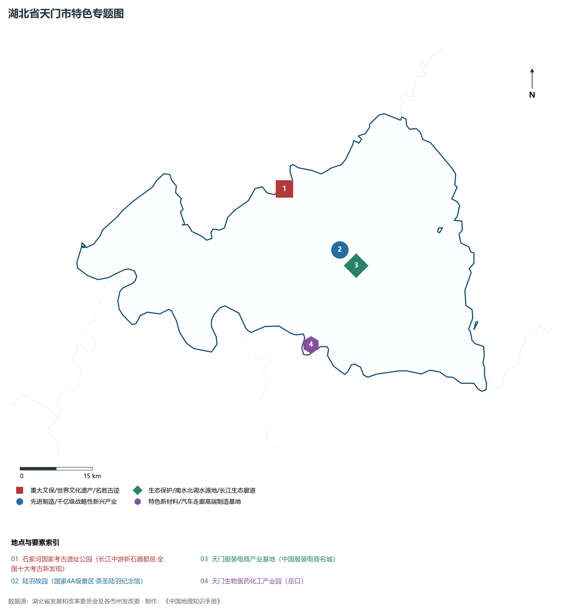
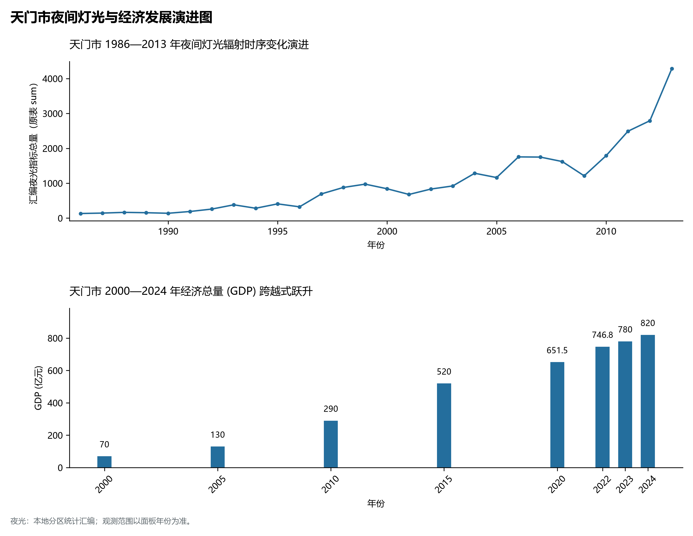

# 16.16 天门市

天门市，地处湖北省核心发展板块与长江中游城市群关键节点，其城市综合定位与发展愿景概括为：**省直辖县级市·中国蒸菜之乡·茶圣陆羽故里·华侨之乡·石家河史前文化圣地·汉江平原现代织造之城**。全境陆域总面积达 **2,622.00 km²**，截至 2024 年末常住人口约 **113.0** 万人，常住人口城镇化率达 **54.5%**。2024 年实现地区生产总值（GDP）约 **820.0** 亿元，人均 GDP 达 **72,560** 元，三次产业结构比优化为 **14.5 : 39.5 : 46.0**。全境地表高程极值跨度介于 **23.0 m ～ 95.0 m** 之间，呈现出壮阔江河与高峻峰峦交相辉映的优越自然地理底盘、四通八达的综合立体交通枢纽网络与极富活力的现代新兴产业集群。

---

## 一、自然地理底盘与山川水系机理

在气候水热配置方面，天门市全境位于典型的北亚热带温暖湿润季风气候区，温暖湿润、四季分明、热量丰沛、雨热同期。年平均气温在 15.2°C ～ 17.5°C 之间，极端最低气温大多在 -5°C 以上，无霜期长达 245 ～ 290 d，年均日照时数长达 1800 ～ 2150 h。优越的光温条件极利于水稻、油菜、水产、特色林果及亚热带经济林木生长。多年平均降水量达 1050 ～ 1550 mm，降水时空分配年内集中在 5—8 月汛期，暴雨过程频密，山溪性河流短促陡急，江河湖库防洪抗涝与山洪地质灾害防御责任重大；而在秋冬之交常伴有伏秋旱，大型骨干水库蓄水保供、灌区调蓄与水资源统一配置发挥着不可或缺的保障功能。

区域骨干控制性山峰、高程标高极点与主要地貌控制节点包括：

- **佛子山 (95.0m 天门最高峰/陆羽煮茶名泉三眼井)**（空间坐标约东经 113.150°、北纬 30.780°，海拔标高约 95.0 m）：构成区域地形骨架与水源生态安全屏障的关键控制极点，在区域气候水热调节、地表水径流汇集拦截与生物多样性保护中具有不可替代的基石功能；

水系水网与生态湿地廊道方面，天门市江河纵横、湖库密布，深度融入长江、汉江或清江大水系网络：

- **汉江天门段 (33km 南界长江大动脉)**（水系坐标约东经 113.100°、北纬 30.480°）：发挥着流域防洪减灾、排涝调峰、农业自流灌溉、工业及城乡优质生活饮用水源保障、内河深水航运物流与水生生物资源保护的核心功能；
- **天门河 (天门母亲河·横贯东西入汉江)**（水系坐标约东经 113.200°、北纬 30.650°）：发挥着流域防洪减灾、排涝调峰、农业自流灌溉、工业及城乡优质生活饮用水源保障、内河深水航运物流与水生生物资源保护的核心功能；
- **张家湖国家湿地公园 (湖北最大天然盆地湖泊)**（水系坐标约东经 113.050°、北纬 30.700°）：发挥着流域防洪减灾、排涝调峰、农业自流灌溉、工业及城乡优质生活饮用水源保障、内河深水航运物流与水生生物资源保护的核心功能；

---

## 二、行政区划沿革与城镇空间体系

天门市建置沿革源远流长，文脉绵延数千年，自古即为荆楚要地、兵家必争、商贾辐辏或革命红色摇篮。先秦封楚立国、秦汉设郡立县、唐宋置州设路、明清立府设县，千百年来留下了极其璀璨的历史地名与人文遗迹。新中国成立后特别是改革开放以来，伴随撤地设市、行政区划合理调整、城区组团式向外延展与以人为核心的新型城镇化深入推进，构建了中心城区引领极核、县域板块协同支撑、重点特色城镇星罗棋布、产城人景深度融合的现代多中心城镇空间网络体系：

- **市委市政府 (竟陵街道)**（驻地坐标：113.160°E, 30.650°N）：区域公共治理行政中枢、现代生产生活综合服务集聚地与新型城镇化战略承载极核；
- **岳口镇 (汉江古镇/现代医药化工基地)**（驻地坐标：113.080°E, 30.500°N）：区域公共治理行政中枢、现代生产生活综合服务集聚地与新型城镇化战略承载极核；
- **石家河镇 (石家河遗址所在地/长江中游文明之源)**（驻地坐标：113.060°E, 30.780°N）：区域公共治理行政中枢、现代生产生活综合服务集聚地与新型城镇化战略承载极核；
- **天门工业园 (对接汉川武汉门户)**（驻地坐标：113.350°E, 30.520°N）：区域公共治理行政中枢、现代生产生活综合服务集聚地与新型城镇化战略承载极核；

在国土空间总体规划指引下，天门市统筹推进“三区三线”科学划定与刚性管控，严守耕地和永久基本农田保护红线、生态保护红线与城镇开发边界，统筹优化农业空间、生态空间与城镇空间布局，推动高能级产业园区集聚集约转型，持续缩小城乡基本公共服务差距，打造宜居、韧性、智慧、绿色的现代化和美之城。

---

## 三、综合立体交通网络与现代枢纽通道

天门市地处“九省通衢”交通走廊核心，全方位融入国家综合立体交通网与长江经济带高质量发展大局。依托设计时速 350 公里高铁干线、国家干线货运铁路、纵横交错的国家高速公路网、现代化民用航空港以及长江黄金水道高等级深水航道，构筑起外畅内通、铁水公空多式联运的现代综合立体交通体系：

**核心综合交通客运与货运物流枢纽节点：**

- **天门站 (焦柳铁路重要站点)**（空间坐标：113.150°E, 30.630°N）：客流高铁干线快速转换、大宗工业原料与货物集装箱铁水公空多式联运转换、以及全面对接长江经济带与全球现代物流体系的核心交通支点；
- **天门南站 (汉宜高速铁路车站/紧邻仙桃仙下)**（空间坐标：113.430°E, 30.390°N）：客流高铁干线快速转换、大宗工业原料与货物集装箱铁水公空多式联运转换、以及全面对接长江经济带与全球现代物流体系的核心交通支点；
- **天门北站 (沿江高铁武宜段高铁客运枢纽)**（空间坐标：113.180°E, 30.720°N）：客流高铁干线快速转换、大宗工业原料与货物集装箱铁水公空多式联运转换、以及全面对接长江经济带与全球现代物流体系的核心交通支点；

当前，天门市持续加快交通基础设施数字化升级、智慧调度平台建设与绿色低碳改造，重点攻坚“铁水公空”多式联运无缝衔接与枢纽集疏运道路闭环，大力拓展中欧班列集结、铁水联运班列与国际货运空中走廊，全力打造安全便捷、内通外畅、绿色智能的现代化交通强市。

---

## 四、现代产业体系与新质生产力布局

天门市坚定不移实施“制造业强市、产业兴市”核心战略，深入贯彻落实湖北省“51020”现代产业集群行动方案，推进传统优势产业高端化智改数转网联，聚力发展战略性新兴产业，前瞻布局未来前沿产业，加速构建体现自身特色与国际国内市场竞争力的现代产业体系：

**标志性先进制造园区、特色产业基地、创新平台与重大产业地标：**

- **石家河国家考古遗址公园 (长江中游新石器都邑·全国十大考古新发现)**（空间坐标：113.060°E, 30.780°N）；
- **陆羽故园 (国家4A级景区·茶圣陆羽纪念馆)**（空间坐标：113.170°E, 30.660°N）；
- **天门服装电商产业基地 (中国服装电商名城)**（空间坐标：113.180°E, 30.630°N）；
- **天门生物医药化工产业园 (岳口)**（空间坐标：113.090°E, 30.490°N）；

通过深入实施工业“链长制”与领航企业培育工程，天门市围绕产业链上下游部署创新链、资金链与人才链，梯次培育国家级高新技术企业、制造业单项冠军与专精特新“小巨人”企业集群，积极抢占新材料、先进装备制造、新能源与智能网联汽车、高端电子信息、现代绿色化工、特色农产品加工等赛道制高点，全力夯实现代化经济强市的实体产业硬核底盘。

---

## 五、历史文化名胜、人文底蕴与全域文旅地理

天门市文源深脉长、名胜甲于江汉，融汇了荆楚文化源头探寻、三国风云英雄豪气、红色革命峥嵘记忆与壮美秀丽的自然山水风光，拥有数量众多的世界文化/自然遗产、国家 5A 级风景区、国家历史文化名城与全国重点文物保护单位：

- **石家河国家考古遗址公园 (长江中游新石器都邑·全国十大考古新发现)**；
- **陆羽故园 (国家4A级景区·茶圣陆羽纪念馆)**；
- **天门服装电商产业基地 (中国服装电商名城)**；
- **天门生物医药化工产业园 (岳口)**；

立足全域旅游与高品质度假康养新时代需求，天门市坚持“以文塑旅、以旅彰文”，推进红色文化研学、古城风貌保护活化、高山生态避暑、峡江风光探险与乡村农文旅深度融合，打造享誉海内外的特色文旅超级品牌。

---

## 六、夜间灯光辐射与跨世纪经济变化时序演进

本节夜光图的观测年份为 1986—2013 年，指标为行政区汇总值（原表 sum）。

| 统计基准年份 | 地区生产总值 GDP (亿元) | 发展阶段主要特征与空间跃升标志 |
|:---|:---|:---|
| **2000 年** | 70.0 | 新世纪初传统工农业稳步增长与招商引资起步 |
| **2005 年** | 130.0 | 新世纪初传统工农业稳步增长与招商引资起步 |
| **2010 年** | 290.0 | 新型工业化全面提速、园区集群扩容与综合高铁交通成网 |
| **2015 年** | 520.0 | 新型工业化全面提速、园区集群扩容与综合高铁交通成网 |
| **2020 年** | 651.5 | 高质量跨越式发展、高端战略性新兴产业爆发与现代绿色制造体系成型 |
| **2022 年** | 746.8 | 高质量跨越式发展、高端战略性新兴产业爆发与现代绿色制造体系成型 |
| **2023 年** | 780.0 | 高质量跨越式发展、高端战略性新兴产业爆发与现代绿色制造体系成型 |
| **2024 年** | 820.0 | 高质量跨越式发展、高端战略性新兴产业爆发与现代绿色制造体系成型 |

- **1996 年前后**：天门老城区与竟陵微光初现；
- **2005 年前后**：天门纺织与现代农业基地扩容；

---
