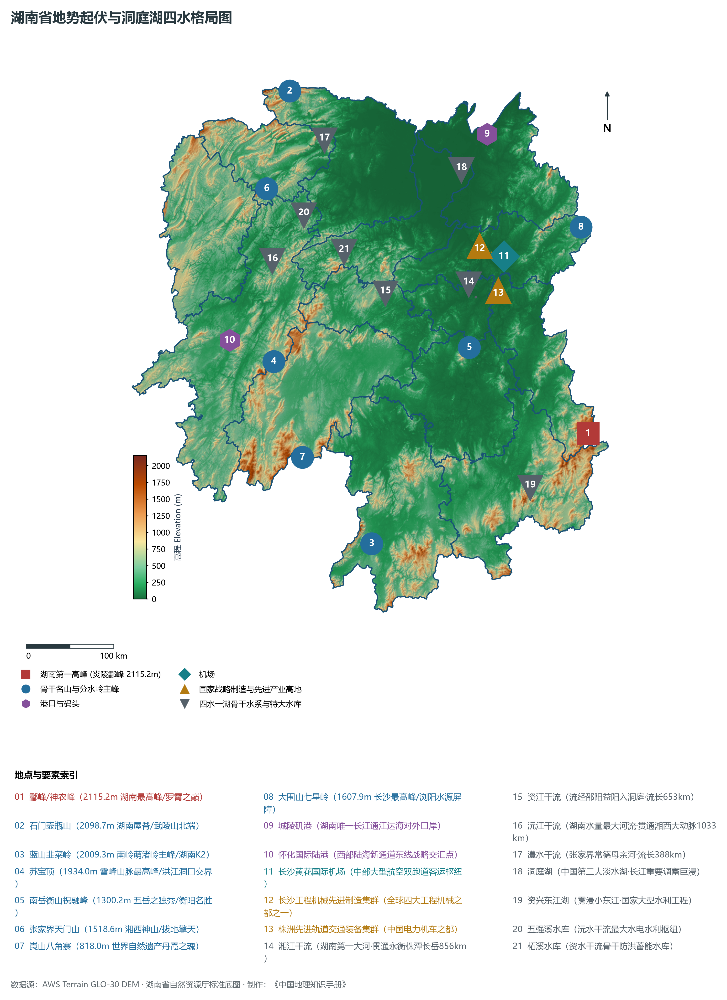
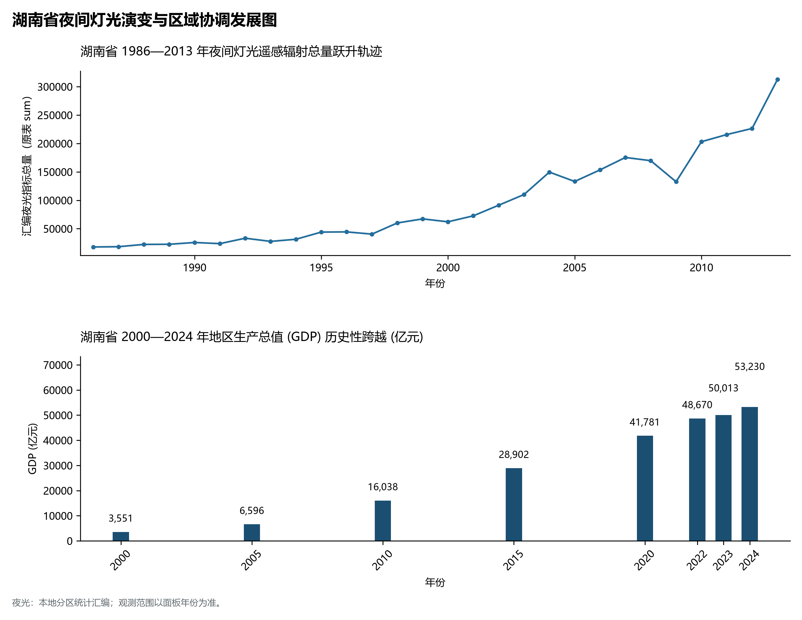
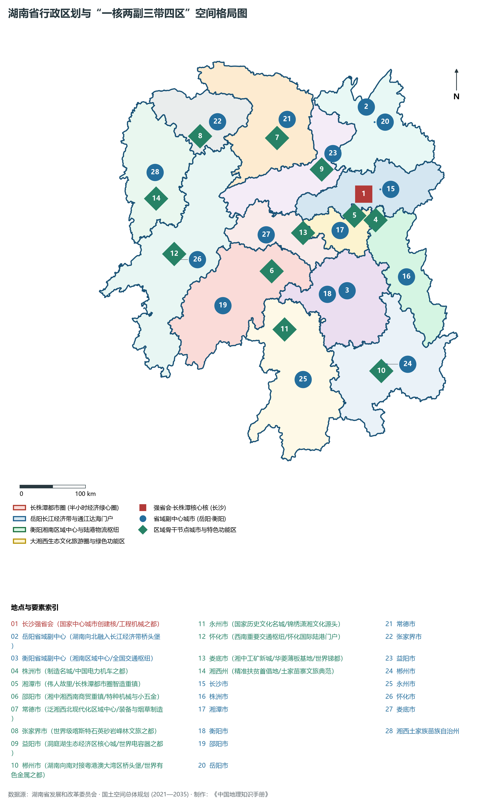
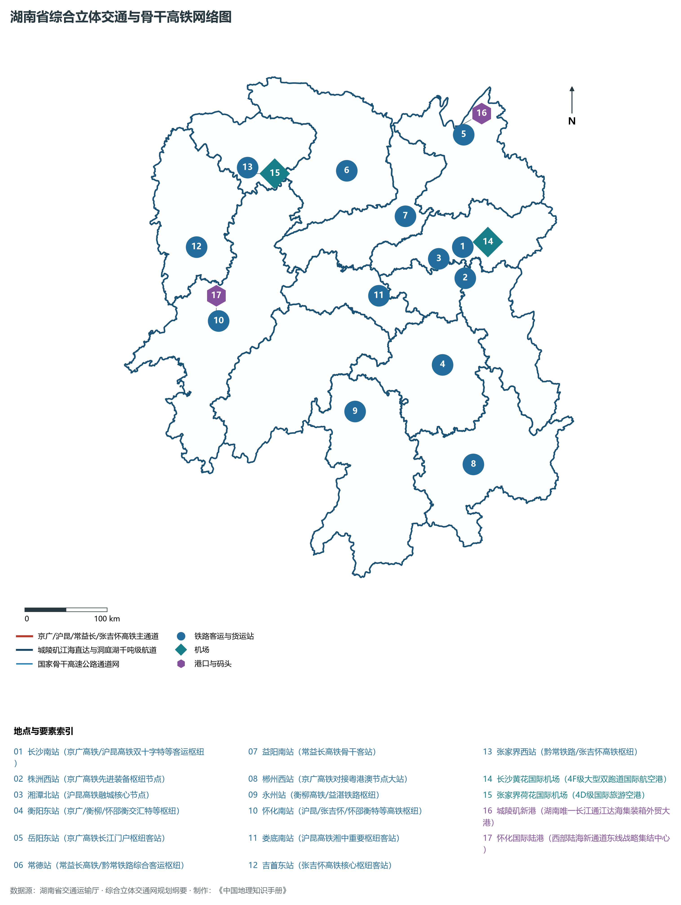
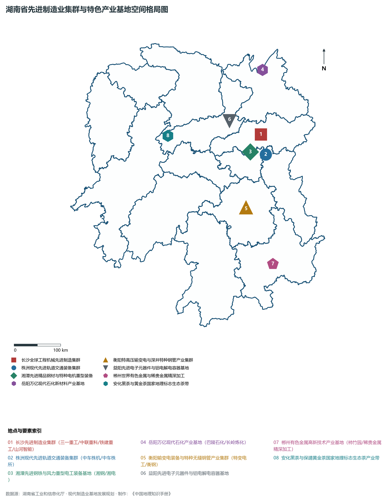

# 17.0 湖南省地理统揽

湖南省，简称“湘”，省会驻长沙市，地处中国中部偏南、长江中游南岸，位于东经 108° 47' ～ 114° 15'、北纬 24° 38' ～ 30° 08' 之间。全省陆域总面积达 **21.18 × 10⁴ km²**，占全国国土总面积的 2.20%。湖南东临江西，南接广东、广西，西连贵州、重庆，北毗湖北，自古享有“三湘四水”、“芙蓉国度”、“鱼米之乡”、“湖湘圣地”之美誉，是长江经济带南翼的重要支撑极与对接粤港澳大湾区的前沿通衢。境内坐拥我国第二大淡水湖**洞庭湖**，湘江、资江、沅江、澧水“四水归堂”浩荡北注，千流汇聚城陵矶入长江，构筑起维系长江中游水生态安全的中流砥柱。

从宏观地势构造格局剖析，湖南省呈现出极具辨识度的**“三面环山、一湖汇流、四水归堂、朝北敞开”**的不完整马蹄形盆地地貌宏伟骨架。东面罗霄山脉雄峙湘赣界岭，南面南岭群山横亘湘粤桂门户，西面雪峰山脉与武陵山脉拔地擎天，三面屏障环护，地势自东、南、西三方向中北部衡阳盆地、湘潭盆地与洞庭湖平原渐次倾斜下沉。全省现辖 13 个地级市（长沙、株洲、湘潭、衡阳、邵阳、岳阳、常德、张家界、益阳、郴州、永州、怀化、娄底）与 1 个自治州（湘西土家族苗族自治州）。截至 2024 年末，全省常住人口达到 **6568.0 万人**，常住人口城镇化率达 **61.5%**。2024 年全省实现地区生产总值（GDP）突破 **5.32 万亿元**（达 53,230 亿元），稳居全国前十位与中部前列。当前，湖南正牢固树立新发展理念，全力聚焦打造“国家重要先进制造业高地、具有核心竞争力的科技创新高地、内陆地区改革开放高地”，在推进中国式现代化进程中勇挑重担、奋勇争先。

---

## 一、大地构造、地势阶梯与“三面环山、四水归堂”宏观地理底盘

湖南省地跨华南褶皱系与扬子准地台两大一级构造单元，江南古陆斜贯全省中部。地质演化经历晋宁运动基底固结、加里东运动强烈的褶皱回返与花岗岩侵入、印支运动强烈挤压推覆，以及白垩纪至古近纪燕山运动晚期以来的陆内断块差异升降与红色断陷盆地沉降，最终定型了“边缘高山耸立、中部盆丘交错、北部平原巨浸”的壮丽阶梯地貌：

全省地表高程极值跨度介于临湘市白螺矶长江出省境处江面沙滩的 **23.0 m** 至炎陵县酃峰（神农峰）绝顶的 **2115.2 m** 之间，相对垂直高差高达 **2092.2 m**，形成了高差悬殊、层次分明的垂直自然带：

- **全省最高绝顶（湖南第一峰·罗霄之巅）**：位于株洲市炎陵县东部与江西井冈山交界处的**酃峰（神农峰，海拔 2115.2 m）**，峰峦险峻，古木森然，是湘赣两大水系的分水岭主脊；
- **湘西北武陵山脉最高峰（湖南屋脊）**：常德石门县西北部的**壶瓶山（海拔 2098.7 m）**，原始森林苍茫浩瀚，被誉为“华中动植物基因库”；
- **湘西南南岭萌渚岭主峰（湖南K2）**：永州市蓝山县与道县界岭**韭菜岭（海拔 2009.3 m）**，孤峰插云，地形极其复杂原始；
- **雪峰山脉主峰（湘西地理分界脊梁）**：怀化洪江市与邵阳洞口县交界的**苏宝顶（海拔 1934.0 m）**，横亘湖南中部，为资水与沅水天然分水岭；
- **南岭越城岭莽山最高峰**：郴州市宜章县境内的**猛坑石（海拔 1902.0 m）**，群峰耸翠，素有“南岭明珠”美誉；
- **五岳之南岳独秀**：衡阳市境内的**南岳衡山祝融峰（海拔 1300.2 m）**，逶迤八百里，秀冠五岳；
- **世界地质奇观天门绝壁**：张家界市城南**天门山（海拔 1518.6 m）**，拔地擎天，天门洞开；
- **全省最低点**：岳阳市临湘市白螺矶长江出省水面沙滩，海拔标高仅 **23.0 m**。

从宏观地貌格局演变来看，湖南可清晰归纳为三大环状地貌带：

1. **外围隆起山地带**：东部幕阜—连云—大围—罗霄山脉，南部越城—骑田—萌渚—都庞五岭群山，西部雪峰—武陵山脉，构成三面抵御寒潮与滞留东南暖湿气流的巨大天然屏障；
2. **中环丘陵盆地过渡带**：湘江、资江中游分布着大片红层与石灰岩溶蚀盆地（如衡阳盆地、湘潭盆地、涟源盆地），冈峦起伏，土地肥沃；
3. **内环北部冲积平原沉降带**：洞庭湖平原及环湖低平湿地，河网交织，湖沼密布，是享誉全国的“湖广熟、天下足”鱼米之仓。

**湖南省自西向东阶梯地貌剖面结构示意表**

| 武陵山与雪峰山脉 | 湘中丘陵与溶蚀盆地 | 湘江干流河谷平原 | 罗霄山脉与大围山 |
| --- | --- | --- | --- |
| (苏宝顶 1934.0m)；峡谷峰林·生态屏障；喀斯特发育·水能充沛 | (衡阳/娄底/邵阳盆地)；冈峦起伏·工矿腹地；农林交错·物产丰饶 | (长株潭城市群核心)；智造高地·强省会极核；九省通衢·综合枢纽 | (酃峰 2115.2m)；湖南绝顶·革命红都；井冈余脉·生态绿肺 |

西翼崇山武陵/雪峰 · → 湘中波状丘陵盆地 · → 湘江宽缓河谷与长株潭 · → 东翼界山罗霄山脉

---

## 二、中亚热带湿润季风气候与“四水一湖”水文生态网络

湖南全境属典型的**中亚热带季风湿润气候**，光热充沛、降水丰沛、雨热同季、四季分明：

- **热量与气温格局**：全省年平均气温在 **16.0°C ～ 18.5°C** 之间，自南向北递减。南部郴州、永州年均温达 17.5°C ～ 18.5°C，无霜期长达 270～ 310 d；中北部平原丘陵区年均温在 16.8°C ～ 17.5°C 之间；武陵、雪峰等高山区域气温较低，山地垂直气候分异显著；
- **降水空间分布与水热峰值**：全省多年平均降水量在 **1200～ 1700 mm** 之间，是我国南方多雨湿润省区之一。降水主要受东南季风与西南暖湿气流共同影响，呈现“两多两少”格局：罗霄山脉东侧山麓、南岭五岭北坡以及雪峰山东坡迎风面为多雨中心（年雨量常突破 1600～ 1800 mm）；湘西北山间盆地与洞庭湖平原中部雨量相对略少（约 1200～ 1350 mm）。降水集中在 4—7 月，梅雨锋面雨与初夏暴雨频密，极易形成全流域防洪抗涝压力。

在水系网络方面，湖南水资源十分丰富，形成了极其规整的“四水归堂、汇入洞庭、通达长江”的向心型向北倾注水系格局：

1. **湘江干流（三湘母亲河·流长 856 km）**：
   - 湘江发源于永州市蓝山县野狗岭，干流全长 **856 km**（省内流长约 670 km），流域面积近 9.5 × 10⁴ km²。自南向北浩荡纵贯永州、衡阳、株洲、湘潭、长沙，于岳阳湘阴县注入洞庭湖，沿岸集聚了全省超过 60% 的人口与 70% 以上的经济总量，是湖南经济命脉；
2. **资江水系（滩多流急·穿山越岭 653 km）**：
   - 发源于越城岭北麓，流经邵阳、娄底、益阳，全长 **653 km**。上游穿行于雪峰山余脉深山峡谷，中游建有大型**柘溪水库**水电站，下游注入南洞庭湖；
3. **沅江干流（水量最大·贯穿湘西 1033 km）**：
   - 湖南水量第一大河、省内流长仅次于湘江的骨干干流，全长 **1033 km**（省内长约 568 km）。干流自贵州东流经怀化、湘西、常德，汇集五溪之水注入西洞庭湖。建有**五强溪水电站**（装机 120万 kW）与托口、凤滩等大型骨干水利枢纽；
4. **澧水水系（喀斯特秀水·全省最短大干流 388 km）**：
   - 全长 **388 km**，发源于桑植县杉木界，穿行于张家界三千奇峰峡谷与常德平原，水质清澈纯净，由津市注入西洞庭湖；
5. **八百里洞庭湖（长江之肾·巨浸调蓄中枢）**：
   - 中国第二大淡水湖泊，由东洞庭湖、南洞庭湖和西洞庭湖组成，常年水面面积超 2600 km²。洞庭湖不仅调蓄湘资沅澧四水，更在汛期承接长江荆江三口（松滋口、太平口、藕池口）分流洪水，经岳阳城陵矶汇流出江，对整个长江中下游防洪和湿地生态安全具有决定性中枢作用。

---

## 三、行政区划、人口与“一核两副三带四区”空间协同战略

湖南省现辖 13 个地级市、1 个自治州，下设 36 个市辖区、19 个县级市、60 个县、7 个自治县，共 122 个县级行政区。截至 2024 年末，全省常住人口达到 6568.0 万人，常住人口城镇化率达 61.5%。

围绕推动区域协调发展与国土空间高质量开发，湖南省高水平构建**“一核两副三带四区”**战略发展格局：

1. **“一核”：长株潭都市圈核心引擎**：
   - 以省会长沙为龙头，推进长株潭半小时交通圈、产业协同圈与生态绿心一体化同城化，建设国家中心城市创建核、国家综合性科学中心承载地与全球工程机械、先进轨交装备智造高地；
2. **“两副”：岳阳与衡阳两大省域副中心**：
   - **岳阳副中心**：依托城陵矶港与长江黄金岸线，打造湖南融入长江经济带与共建“一带一路”通江达海门户枢纽，建设万亿级现代石化与绿色新材料高地；
   - **衡阳副中心**：发挥全国交通枢纽与湘南区域中心优势，建设先进制造强市、中国输变电之都与现代物流枢纽；
3. **“三带”：骨干经济与创新发展带**：
   - 京广高铁战略大走廊、沪昆高铁战略走廊、渝长厦高铁创新走廊；
4. **“四区”：全域差异化功能特色发展板块**：
   - **长株潭核心区**：自主创新与现代服务业主导；
   - **洞庭湖生态经济区**：绿色生态、大宗粮油水产与临港物流；
   - **大湘西生态文化旅游圈**：精准扶贫成果巩固、绿色生态屏障与世界级文旅目的地；
   - **湘南承接产业转移示范区**：对接粤港澳大湾区与海西经济区桥头堡。

---

## 四、综合立体交通网络与“五纵五横”骨干高铁大动脉

湖南自古为“七省通衢”、“南北交会之冲”，依托国家综合立体交通网络建设，已构建起集高速铁路、黄金水道、现代航空与密集高速公路于一体的立体大通道：

1. **高速铁路黄金十字枢纽**：
   - **京广高速铁路**（时速 350 km 客运干线）：自岳阳穿过长沙、株洲、衡阳、郴州出省南下广州深圳，长沙至广州仅需 2 小时；
   - **沪昆高速铁路**（时速 350 km 横向动脉）：经醴陵、株洲、湘潭、娄底、邵阳、怀化、新晃出省西入贵阳昆明；
   - **常益长高铁与渝厦通道**：常德至益阳至长沙高铁通车运营，推动湘西北全线接入国家高铁大网；
   - **张吉怀高铁**：串联张家界、吉首、凤凰与怀化，被誉为“湘西最美文旅高铁黄金线”；
   - **怀邵衡铁路与衡柳铁路**：沟通西南内陆与华南沿海的快捷联络大动脉；
2. **长江黄金水道与洞庭湖航运网络**：
   - **岳阳城陵矶港**：拥有长江中游深水岸线，是全省唯一通江达海的国际集装箱枢纽港，常年通航万吨级海轮；
   - 湘江千吨级航道梯级常年通达长沙、株洲、衡阳，规划推进松虎航道与虞公港万吨级码头工程；
3. **航空客货运枢纽群**：
   - **长沙黄花国际机场**（4F 级大型国际航空港）：客货吞吐量稳居中部前列，拥有双跑道及 T3 航站楼超级工程；
   - **张家界荷花国际机场**（4D 级国际旅游航空口岸）：直飞东南亚及国内外重点客源城市；
   - 衡阳南岳机场、常德桃花源机场、郴州北湖机场、怀化芷江机场、湘西边城机场等支线机场覆盖全省；
4. **西部陆海新通道东线战略支点**：
   - **怀化国际陆港**：依托焦柳、湘黔、沪昆铁路交汇优势，成为湖南及中部省份对接东盟、开行跨境铁海联运班列的核心陆港集结中心。

---

## 五、国家重要先进制造业高地与“4×4”现代优势产业集群

湖南深入实施“制造强省”战略，聚焦打造国家重要先进制造业高地，培育壮大以全球工程机械、轨道交通装备等为标志的万亿级与千亿级产业舰队：

1. **全球工程机械先进制造业集群（长沙）**：
   - 汇集三一重工、中联重科、铁建重工、山河智能 4 家全球工程机械前 50 强企业，混凝土机械、大型起重机械、全断面隧道掘进机市场份额稳居全球前列，拥有全球最大塔机生产基地与灯塔工厂；
2. **先进轨道交通装备世界级集群（株洲）**：
   - “中国电力机车之都”，中车株机、中车时代电气、中车株所集聚，电力机车全球市场占有率连续十余年领跑全球，动车组核心电传动与变流系统实现自主自立；航空动力南方工业公司研发制造中小航空发动机与轻型燃气轮机；
3. **先进精品钢材与特种电机重型装备（湘潭）**：
   - 华菱湘钢宽厚板基地（超大型船舶与桥梁特种厚板）、湘电集团（兆瓦级风电与特种全电动力推进系统）、吉利汽车新能源乘用车基地；
4. **万亿级现代石化与绿色新材料（岳阳）**：
   - 中国石化巴陵石化与长岭炼化核心园区，己内酰胺、热塑性弹性体产能世界领先，打造沿江绿色化工产业高地；
5. **特高压输变电与特种深井钢管（衡阳）**：
   - 特变电工衡阳变压器（超高压、特高压交流变压器研制基地）、华菱衡钢（全球最大深井特种无缝钢管制造基地之一）、常宁水口山有色金属基地；
6. **电子元器件与特色优势制造业**：
   - 益阳铝电解电容器产业（全球主要生产基地之一）、郴州中国银都与稀贵金属提纯加工基地、冷水江世界锑都与涟钢薄板基材、邵东全球打火机与小五金制造基地；
7. **生态农业与国家地理标志全产业链**：
   - 安化黑茶、保靖黄金茶、古丈毛尖、洞庭湖生态稻虾米、炎陵黄桃、黔阳冰糖橙、临武鸭等享誉中外。

---

## 六、近四十年夜间灯光时序演进与跨世纪崛起轨迹

本节夜光图的观测年份为 1986—2013 年，指标为行政区汇总值（原表 sum）。

- **2000—2010 年代（长株潭融城破土，星沙九华园区强劲拓荒）**：
- **2010—2024 年（高铁十字交织成网，全域强光喷涌）**：

芙蓉国里尽朝晖，敢教日月换新天！六千五百万湖湘儿女在这片红色的热土上弘扬“心忧天下、敢为人先”的湖湘文化精神，在新时代高质量发展的壮丽航程中披荆斩棘、奋勇向前！
