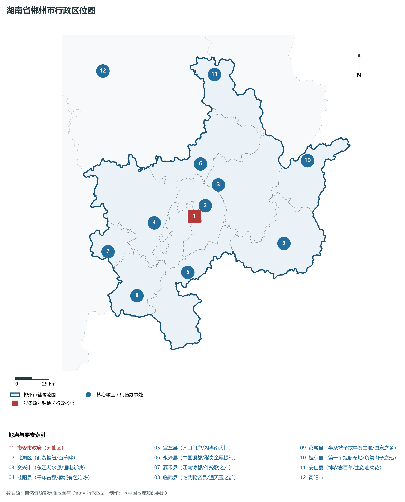
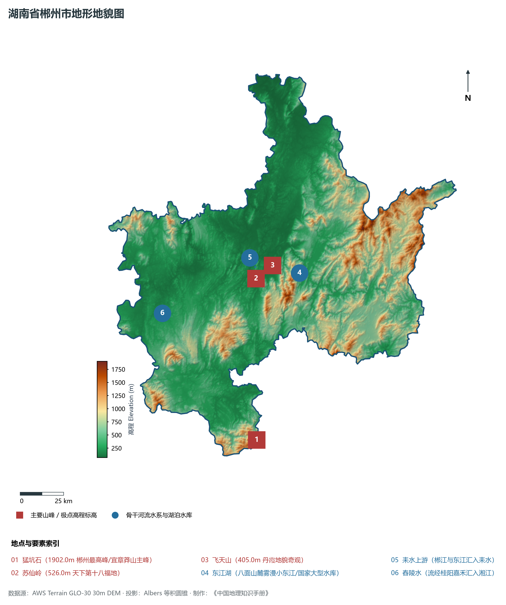
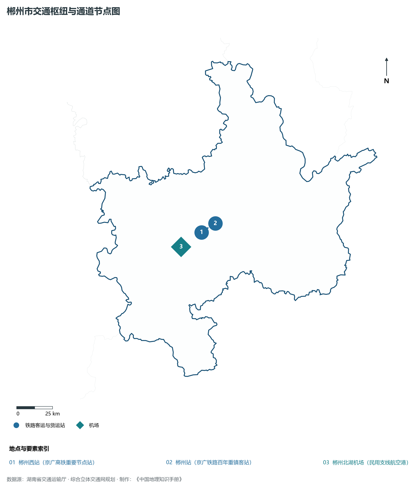
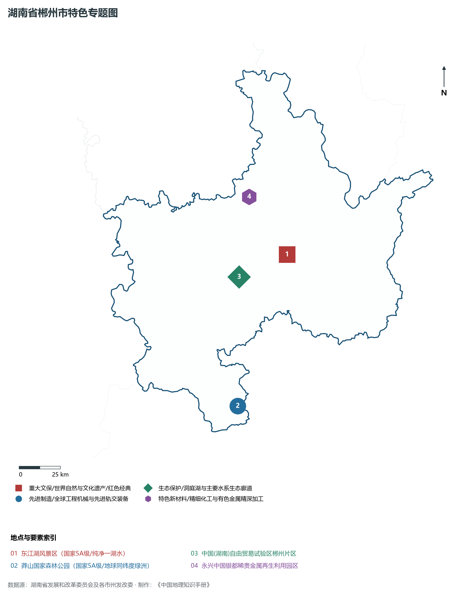
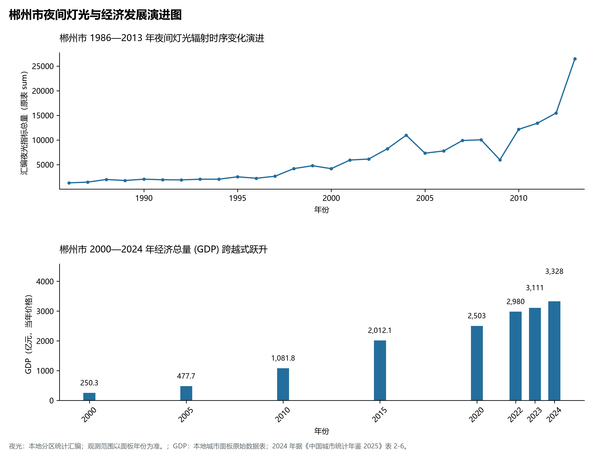

# 17.10 郴州市

郴州市，地处湖南省经济社会发展战略要地与长江中游综合发展走廊关键节点，其城市综合定位与发展愿景概括为：**林邑·福城·湖南对接粤港澳大湾区南大门·世界有色金属博物馆·中国银都·小东江避暑胜地**。2024 年常住人口 **458 万人**，常住人口城镇化率 **61.3%**，地区生产总值 **3,328 亿元**（当年价格），人均地区生产总值 **72,514 元**，三次产业构成为 **10.34 : 39.02 : 50.64**。

---

## 一、自然地理底盘与山川水系机理

在气候水热配置方面，郴州市全境位于典型的中亚热带湿润季风气候区，气候温暖湿润、四季分明、水热同步、热量充裕。年平均气温在 16.2°C ～ 18.2°C 之间，极端最低气温大多在 -3°C 以上，无霜期长达 255 ～ 295 d，年均日照时数达 1650 ～ 1980 h。优越的光温条件极利于优质水稻、油菜、亚热带经济林木、特色柑橘、茶叶及名优水产快速生长。多年平均降水量达 1250 ～ 1680 mm，降水时空分配年内集中在 4—7 月汛期，暴雨过程频密，山溪性河流短促陡急，江河湖库防洪抗涝与山洪地质灾害防御责任重大；而在秋冬之交易伴有伏秋旱，骨干防洪水利枢纽、大中型水库调峰蓄能与现代化大型灌区发挥着不可替代的战略保供功能。

区域骨干控制性山峰、高程标高极点与主要地貌控制节点包括：

- **猛坑石 (1902.0m 郴州最高峰/宜章莽山主峰)**（空间坐标约东经 112.980°、北纬 24.960°，海拔标高约 1902.0 m）：构成区域地形骨架与水源生态安全屏障的关键控制极点，在区域局部微气候调节、地表径流涵养截留与生物多样性庇护中具有基石支撑功能；
- **苏仙岭 (526.0m 天下第十八福地)**（空间坐标约东经 113.050°、北纬 25.790°，海拔标高约 526.0 m）：构成区域地形骨架与水源生态安全屏障的关键控制极点，在区域局部微气候调节、地表径流涵养截留与生物多样性庇护中具有基石支撑功能；
- **飞天山 (405.0m 丹霞地貌奇观)**（空间坐标约东经 113.150°、北纬 25.850°，海拔标高约 405.0 m）：构成区域地形骨架与水源生态安全屏障的关键控制极点，在区域局部微气候调节、地表径流涵养截留与生物多样性庇护中具有基石支撑功能；

水系水网与生态湿地廊道方面，郴州市江河纵横、湖库交汇，深度融入湖南“四水一湖”生态水网：

- **东江湖 (八面山麓雾漫小东江/国家大型水库)**（水系坐标约东经 113.300°、北纬 25.800°）：承担着流域防洪蓄洪、排涝调峰、农业自流灌溉、工业及城乡优质生活饮用水源安全保障、水运物流航道与生态环境保护的核心功能；
- **耒水上游 (郴江与东江汇入耒水)**（水系坐标约东经 113.050°、北纬 25.850°）：承担着流域防洪蓄洪、排涝调峰、农业自流灌溉、工业及城乡优质生活饮用水源安全保障、水运物流航道与生态环境保护的核心功能；
- **舂陵水 (流经桂阳嘉禾汇入湘江)**（水系坐标约东经 112.500°、北纬 25.650°）：承担着流域防洪蓄洪、排涝调峰、农业自流灌溉、工业及城乡优质生活饮用水源安全保障、水运物流航道与生态环境保护的核心功能；

---

## 二、行政区划沿革与城镇空间体系

郴州市建置沿革源远流长，文脉绵延数千年，自古即为湖湘重镇、楚越要冲、人文荟萃之地或革命红色沃土。先秦封楚辟疆、秦汉置郡立县、唐宋设州置监、明清立府设县，千百年来留下了极其深厚的历史地名传承与人文胜迹。新中国成立后特别是改革开放以来，伴随撤地设市、行政区划优化重组、城区组团式跨江向外拓展与以人为核心的新型城镇化深入推进，构建了中心城区极核引领、骨干区县协同支撑、重点特色城镇星罗棋布、产城人景深度融合的现代多中心城镇空间网络体系：

- **市委市政府 (苏仙区)**（驻地坐标：113.032°E, 25.770°N）：区域公共治理行政中枢、现代生产生活综合服务集聚地与新型城镇化战略承载极核；
- **北湖区 (商贸枢纽/百草畔)**（驻地坐标：113.010°E, 25.790°N）：区域公共治理行政中枢、现代生产生活综合服务集聚地与新型城镇化战略承载极核；
- **资兴市 (东江湖水源/锂电新城)**（驻地坐标：113.230°E, 25.970°N）：区域公共治理行政中枢、现代生产生活综合服务集聚地与新型城镇化战略承载极核；
- **桂阳县 (千年古郡/蓉城有色冶炼)**（驻地坐标：112.730°E, 25.750°N）：区域公共治理行政中枢、现代生产生活综合服务集聚地与新型城镇化战略承载极核；
- **宜章县 (莽山门户/湘粤南大门)**（驻地坐标：112.950°E, 25.400°N）：区域公共治理行政中枢、现代生产生活综合服务集聚地与新型城镇化战略承载极核；
- **永兴县 (中国银都/稀贵金属提纯)**（驻地坐标：113.110°E, 26.120°N）：区域公共治理行政中枢、现代生产生活综合服务集聚地与新型城镇化战略承载极核；
- **嘉禾县 (江南铸都/伴嫁歌之乡)**（驻地坐标：112.370°E, 25.580°N）：区域公共治理行政中枢、现代生产生活综合服务集聚地与新型城镇化战略承载极核；
- **临武县 (临武鸭名县/通天玉之都)**（驻地坐标：112.560°E, 25.270°N）：区域公共治理行政中枢、现代生产生活综合服务集聚地与新型城镇化战略承载极核；
- **汝城县 (半条被子故事发生地/温泉之乡)**（驻地坐标：113.680°E, 25.540°N）：区域公共治理行政中枢、现代生产生活综合服务集聚地与新型城镇化战略承载极核；
- **桂东县 (第一军规颁布地/负氧离子之冠)**（驻地坐标：113.910°E, 26.080°N）：区域公共治理行政中枢、现代生产生活综合服务集聚地与新型城镇化战略承载极核；
- **安仁县 (神农尝百草/生药油菜花)**（驻地坐标：113.270°E, 26.710°N）：区域公共治理行政中枢、现代生产生活综合服务集聚地与新型城镇化战略承载极核；

在国土空间总体规划指引下，郴州市统筹推进“三区三线”科学划定与刚性管控，严守耕地和永久基本农田保护红线、生态保护红线与城镇开发边界，统筹优化农业空间、生态空间与城镇空间布局，推动高能级产业园区集聚集约转型，持续缩小城乡基本公共服务差距，打造宜居、韧性、智慧、绿色的现代化和美之城。

---

## 三、综合立体交通网络与现代枢纽通道

郴州市地处湖南综合立体交通走廊关键节点，全方位融入国家骨干交通大通道与区域协同发展大局。依托设计时速 350 公里高铁干线、国家干线铁路编组、纵横交织的国家高速公路网、现代化民用机场以及千吨级骨干内河航道，构筑起外畅内通、铁水公空无缝衔接的现代综合立体交通体系：

**核心综合交通客运与货运物流枢纽节点：**

- **郴州西站 (京广高铁重要节点站)**（空间坐标：112.980°E, 25.780°N）：客流高铁干线快速转换、大宗工业原料与集装箱多式联运中转、以及全面对接长江经济带与粤港澳大湾区现代物流体系的核心交通支点；
- **郴州站 (京广铁路百年重镇客站)**（空间坐标：113.025°E, 25.805°N）：客流高铁干线快速转换、大宗工业原料与集装箱多式联运中转、以及全面对接长江经济带与粤港澳大湾区现代物流体系的核心交通支点；
- **郴州北湖机场 (民用支线航空港)**（空间坐标：112.830°E, 25.700°N）：客流高铁干线快速转换、大宗工业原料与集装箱多式联运中转、以及全面对接长江经济带与粤港澳大湾区现代物流体系的核心交通支点；

当前，郴州市持续加快交通基础设施数字化升级、智慧交通平台建设与多式联运集疏运体系优化，重点攻坚“铁水公空”集疏运闭环，大力开行货运班列与内河集装箱直达航线，全力打造绿色高效、安全便捷、内通外畅的现代化交通枢纽。

---

## 四、现代产业体系与新质生产力布局

郴州市坚定不移贯彻落实“产业兴市、工业强市”核心战略，深入融入湖南打造“国家重要先进制造业高地”与“4×4”现代化产业体系战略部署，推进传统优势产业高端化智改数转，聚力发展战略性新兴产业，前瞻布局未来特色产业，加快构建具有自身特色与核心竞争力的现代产业体系：

**标志性先进制造园区、特色产业基地、创新平台与重大产业地标：**

- **东江湖风景区 (国家5A级/纯净一湖水)**（空间坐标：113.320°E, 25.820°N）：区域战略性优势产业深度集聚、龙头企业引领与新质生产力全面赋能的现代核心载体；
- **莽山国家森林公园 (国家5A级/地球同纬度绿洲)**（空间坐标：112.950°E, 25.020°N）：区域战略性优势产业深度集聚、龙头企业引领与新质生产力全面赋能的现代核心载体；
- **中国(湖南)自由贸易试验区郴州片区**（空间坐标：113.020°E, 25.720°N）：区域战略性优势产业深度集聚、龙头企业引领与新质生产力全面赋能的现代核心载体；
- **永兴中国银都稀贵金属再生利用园区**（空间坐标：113.120°E, 26.150°N）：区域战略性优势产业深度集聚、龙头企业引领与新质生产力全面赋能的现代核心载体；

通过深入实施工业“链长制”与领航企业梯次培育工程，郴州市围绕产业链上下游部署创新链、资金链与人才链，梯次培育国家级高新技术企业、制造业单项冠军与专精特新“小巨人”企业集群，积极抢占先进装备制造、电子信息、新能源新材料、绿色食品加工、现代生物医药等赛道制高点，全力夯实现代化经济强市的实体产业硬核底盘。

---

## 五、历史文化名胜、人文底蕴与全域文旅地理

郴州市文源深脉长、人文鼎盛，融汇了湖湘文化精髓、革命红色初心、民俗非遗风情与神奇秀美的自然山水风光，拥有数量众多的国家 5A 级风景区、世界文化/自然遗产、全国重点文物保护单位与中国历史文化名城名镇名村：

- **东江湖风景区 (国家5A级/纯净一湖水)**；
- **莽山国家森林公园 (国家5A级/地球同纬度绿洲)**；
- **中国(湖南)自由贸易试验区郴州片区**；
- **永兴中国银都稀贵金属再生利用园区**；

立足全域旅游与高品质度假康养新时代需求，郴州市坚持“以文塑旅、以旅彰文”，推进红色文化研学、古城风貌保护活化、高山生态避暑、民俗非遗体验与乡村农文旅深度融合，打造享誉全国的特色文旅超级名片。

---

## 六、夜间灯光辐射与跨世纪经济变化时序演进

本节夜光图的观测年份为 1986—2013 年，指标为行政区汇总值（原表 sum）。

| 年份 | 地区生产总值（亿元，当年价格） |
|:---|---:|
| 2000 年 | 250.3 |
| 2005 年 | 477.7 |
| 2010 年 | 1,081.8 |
| 2015 年 | 2,012.1 |
| 2020 年 | 2,503 |
| 2022 年 | 2,980 |
| 2023 年 | 3,111 |
| 2024 年 | 3,328 |

- **2005 年前后**：京珠高速走廊与郴州高新区工业拓展；
- **2013 年前后**：武广高铁郴州西站与东江湖文旅连片跃升；
- **2023 年前后**：自贸试验区与大湾区产业承接示范区全面高光；

---

2024 年统计来源：《中国城市统计年鉴 2025》表 2-1、2-6、2-7（2024 年，全市）。其他年份 GDP 据本地城市面板“原始数据”表，单位为亿元、当年价格。
