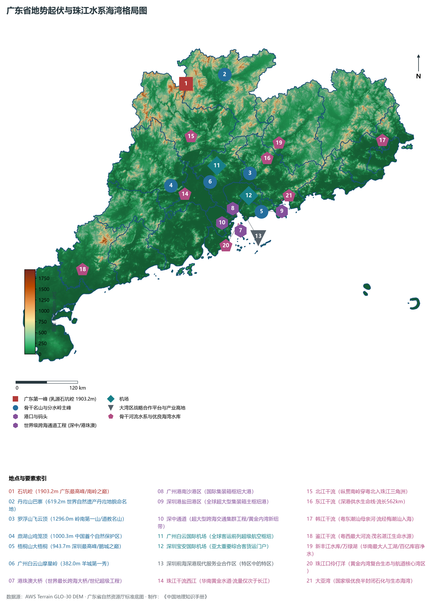
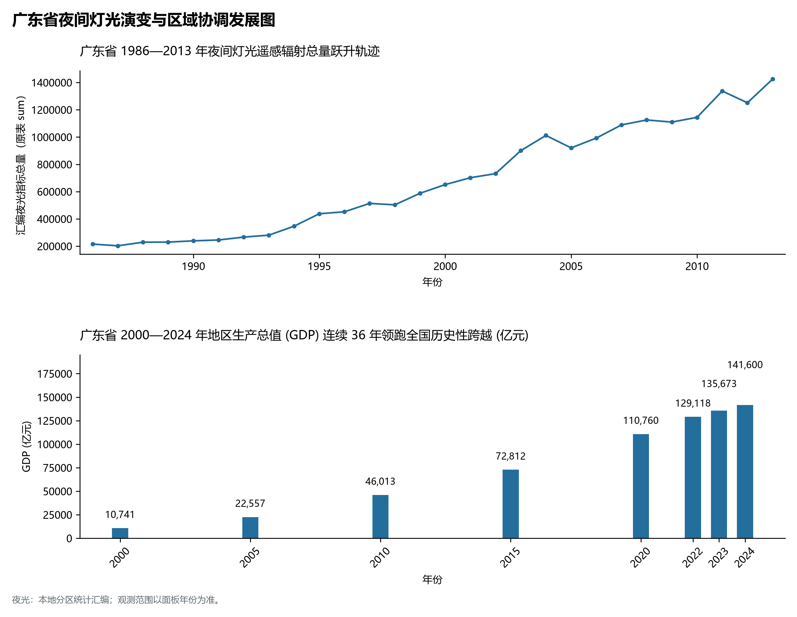
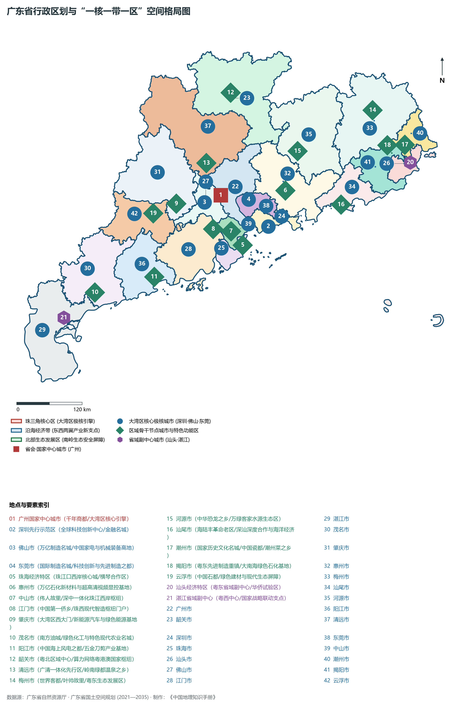
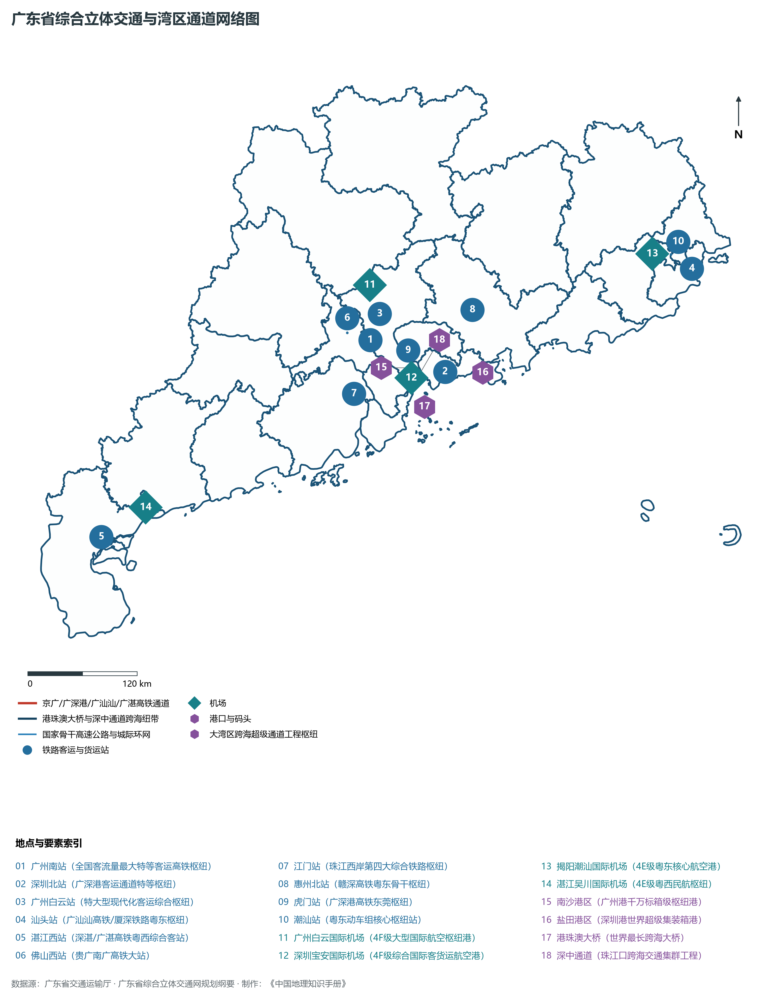
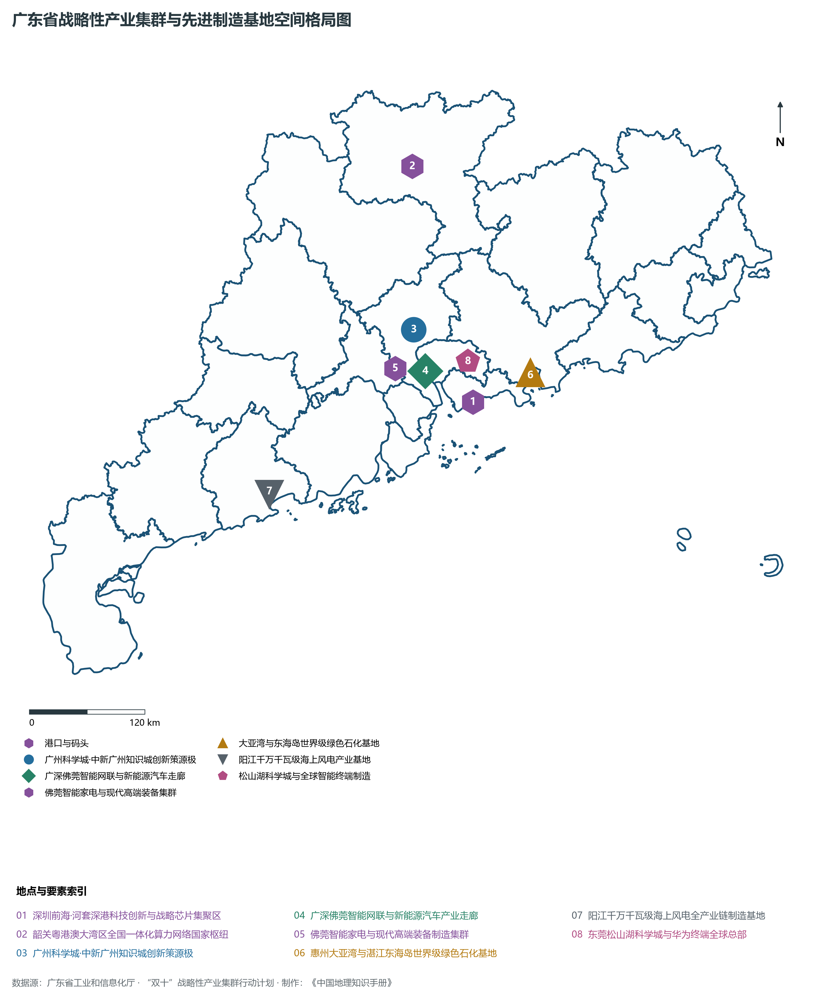

# 18.0 广东省地理统揽

广东省，简称“粤”，省会驻广州市，地处中国大陆最南部、南岭以南，南海之滨，地理坐标介于东经 109° 39' ～ 117° 19'、北纬 20° 13' ～ 25° 31' 之间。全省陆域总面积达 **17.97 × 10⁴ km²**，大陆海岸线长达 **4114.3 km**（居全国各省区首位），管辖海域面积达 **41.93 × 10⁴ km²**，拥有面积大于 500 m² 的海岛 1963 个。广东东邻福建，北接江西、湖南，西连广西，南邻南海，与香港、澳门陆海相连，西隔琼州海峡与海南相望。自古以来，广东便是中华民族通往东南亚、南亚、中东乃至欧美大洋航线的重要门户，是“古代海上丝绸之路”的发祥地、近现代中国民主革命的策源地和当代中国改革开放的前沿窗口与先行试验区。

从宏观地貌与地理构造演化格局剖析，广东省呈现出极具辨识度的**“北依南岭、南面南海、山原环抱、珠江汇流、八门入海”**的壮阔地理底盘。自北向南，巍峨雄峙的南岭群山构筑起阻隔北方冷空气侵袭与维系全省水热循环的天然生态屏障；中部江河纵横、丘陵盆地镶嵌，西江、北江、东江三大骨干干流在珠江三角洲交汇冲积成坦荡开阔的平原网河区，并经由“八大口门”奔流入海；南部面临广袤的南海大陆架，曲折深秀的岬角海湾与千岛列布构建起极其优良的海港与海洋经济空间。全省现辖 21 个地级市（其中广州、深圳为副省级市，东莞、中山为不设区的地级市）。截至 2024 年末，全省常住人口达到 **12706.0 万人**（连续 18 年稳居全国第一常住人口大省），常住人口城镇化率达 **75.4%**。2024 年全省实现地区生产总值（GDP）突破 **14.16 万亿元**（连续 36 年领跑全国），人均 GDP 达到 **111,440 元**。当前，广东正坚决贯彻落实习近平总书记对广东重要讲话和重要指示精神，紧紧围绕“在推进中国式现代化建设中走在前列”的总目标，锚定“走在前列”总要求，大力实施“百县千镇万村高质量发展工程”、坚持“制造业当家”、纵深推进粤港澳大湾区建设，以昂扬之姿奋力书写中国式现代化的广东新篇章。

---

## 一、大地构造、地势阶梯与“北依南岭、南面南海”宏观地理底盘

广东省地处华南准地台的南部核心地带，地跨华南褶皱系南岭褶皱带与华南沿海变质沉降带两大构造构造单元。区域地质演化漫长而剧烈，经历元古宙基底固结、加里东运动强烈的褶皱隆起、印支运动强烈的南北向推覆挤压与花岗岩大侵入，以及燕山期极其剧烈的断块差异升降与广泛的火山断陷活动。白垩纪至古近纪，境内发育了大量红层断陷盆地（如丹霞盆地、三水盆地、南雄盆地）；进入新生代喜马拉雅期以来，南岭持续间歇性隆升，珠江三角洲及沿海断陷盆地强烈下沉接受深厚第四纪沉积，最终定型了“北高南低、山地丘陵占优、台地平原临海、水系向心汇流”的复合阶梯地貌总骨架：

全省地表高程极值跨度介于南海沿岸潮间带海平面的 **0.0 m** 至清远市连州市阳山县与韶关市乳源瑶族自治县交界处的**石坑崆（海拔 1903.2 m）**之间，相对垂直高差达到 **1903.2 m**，形成了高差悬殊、层级清晰的垂直自然带与生态梯度：

- **全省最高绝顶（广东第一峰·南岭之巅）**：位于清远阳山县与韶关乳源县界岭的**石坑崆（海拔 1903.2 m）**，隶属于南岭萌渚岭与骑田岭交会群山，古木参天，瀑布奔涌，是全省最重要的水源涵养林与生物多样性格局核心；
- **全省陆域次高峰**：清远连州市大龙山主峰**发罗冠（海拔 1885.9 m）**与连南板田岭主峰**滑石冲（海拔 1879.0 m）；
- **世界地学瑰宝与丹霞地貌命名地**：韶关仁化县与浈江区交界处的**丹霞山巴寨（海拔 619.2 m）**，赤壁丹崖，由红层白垩系砂砾岩经流水切割侵蚀与风化崩塌形成，被联合国教科文组织评定为世界自然遗产与世界地质公园；
- **岭南第一名山与道教仙山**：惠州博罗县境内**罗浮山飞云顶（海拔 1296.0 m）**，峰峦起伏，仙灵秀异，素有“蓬莱仙境”之称；
- **中国第一个自然保护区**：肇庆市鼎湖区**鼎湖山鸡笼顶（海拔 1000.3 m）**，被誉为“北回归线沙漠带上的绿色明珠”与天然氧吧；
- **粤东第一高峰**：梅州大埔县与丰顺县交界处的**铜鼓嶂（海拔 1559.5 m）**，韩江水系与榕江水系天然分水岭；
- **特区第一峰**：深圳市盐田区与罗湖区交界处的**梧桐山大梧桐（海拔 943.7 m）**，俯瞰大鹏湾与深圳河，雄峙南海之滨；
- **羊城地标第一峰**：广州市中心城区**白云山摩星岭（海拔 382.0 m）**，羊城八景之首，历史文化与现代名城绿心；
- **全省地表最低极点**：南海沿岸广袤的潮间带与港湾滩涂，海拔标高为 **0.0 m**。

从宏观地貌格局演变来看，广东可清晰归纳为四大地貌圈层：

1. **粤北南岭高山峡谷生态屏障区**：由大庾岭、骑田岭、萌渚岭等五岭群山组成，海拔多在 1000 m 以上，山势雄奇险峻，构筑阻挡寒潮南侵的坚固屏障；
2. **中部低山丘陵与红色断陷盆地过渡带**：主要分布在西江、北江中游与东江流域，山丘起伏，发育了著名的丹霞盆地、南雄红层恐龙化石盆地及三水古湖盆；
3. **珠江三角洲冲积平原沉降区**：由西江、北江、东江泥沙在溺谷湾内长期淤积形成，水网密布、土地肥沃，是全省人口最密集、经济最繁华的核心承载区；
4. **南部沿海台地低丘与海岛湿地区**：包括雷州半岛玄武岩台地、广海湾、大亚湾、红海湾等海湾海岸带，拥有极长的大陆架与优良天然深水港湾。

**广东省自北向南阶梯地貌剖面结构示意表**

| 南岭国家级山脉脊梁 | 韶关/清远/梅州丘陵盆地 | 珠江三角洲网河平原 | 南海大陆架与大洋深水港 |
| --- | --- | --- | --- |
| (石坑崆 1903.2m)；高山峡谷·天然屏障；寒潮阻隔·水热策源 | (丹霞山/南雄/三水盆地)；冈峦起伏·水源涵养；农林特产·文旅胜境 | (广深港澳核心引擎)；八门入海·万亿集群；改革前沿·世界工厂 | (盐田港/南沙港/湛江港)；港阔水深·通达五洲；海洋经济·蓝色增长 |

北翼巍峨南岭 · → 粤北丘陵溶蚀与红层盆地 · → 珠三角平原与广深都市圈 · → 南海沿岸大洋门户

---

## 二、华南热带亚热带季风气候与“珠江三江汇流、八门入海”水文水资源

广东省全境处于热带与南亚热带季风气候区，北回归线自东向西穿过从化、增城、博罗、封开等地，造就了全国最为优越的光热与水热动力配置：

- **热量资源与温润特征**：全省年平均气温在 **21.8°C ～ 23.5°C** 之间，自北向南阶梯递增。粤北山区年均温约为 19.0°C ～ 21.0°C，珠三角平原在 22.5°C ～ 23.2°C 之间，雷州半岛年均温超过 23.5°C。全省年均无霜期长达 **335 ～ 365 d**（珠三角及以南地区终年无冬），年日照时数达 1700 ～ 2300 h，农作物四季常青、全年皆可耕作；
- **降水空间格局与三大暴雨中心**：全省多年平均降水量达 **1500 ～ 2200 mm**，是我国大陆年降水量最多的省区之一。降水主要受季风槽、锋面切变线与热带气旋（台风）三重动力驱动，年内分布呈现 4—6 月“前汛期”（锋面暴雨）与 7—9 月“后汛期”（台风与热带低压暴雨）两大高峰。境内形成了三大著名暴雨中心：
  1. 粤西恩平—阳江海晏暴雨中心（多年均降水量超 2400 mm）；
  2. 粤北清远佛冈—从化暴雨中心（南岭南麓地形强抬升作用）；
  3. 粤东海丰—陆丰莲花山脉暴雨中心（夏季东南暖湿气流迎风坡截留）。

在水文网络与流域水资源格局方面，广东是我国水资源最丰沛的省区之一，年均地表径流总量超过 **1800 亿 m³**，客水入境量更是超过 **2300 亿 m³**。境内江河水系呈现“三江并流汇集三角洲、中小河流独流入海”的向心与放射状水网系统：

1. **珠江水系（全国径流量第二大河流·华南生命动脉）**：
   - 珠江由**西江、北江、东江**三大干流及三角洲诸河汇合而成，总流域面积达 45.37 × 10⁴ km²（省内流域面积约 11.13 × 10⁴ km²）。年均入海径流总量超过 **3300 亿 m³**，仅次于长江，居全国第二位，约为黄河年径流量的近 6 倍；
   - **西江（珠江主干流）**：华南第一黄金水道，自桂粤交界处封开县入境，经肇庆、佛山，水丰流稳，通航 3000 吨级内河大型驳船，径流量占珠江水系的 70% 以上；
   - **北江（粤北水网命脉）**：发源于南岭，流贯韶关、清远、佛山，千回百转汇入珠三角，是沟通粤港澳与大中原的古代商贸水运要冲；
   - **东江（深港供水生命线）**：发源于江西寻乌，穿流河源、惠州、东莞，水质清澈优良，华南最大人工水库**新丰江水库（万绿湖，总库容 139 亿 m³）**雄踞上游，承担着香港、深圳、东莞、广州东部超 4000 万人口的战略饮用水保障任务；
2. **珠江八门入海奇观**：
   - 西江、北江、东江在佛山三水思贤滘与广州、东莞交界处复杂交织分流，形成世界罕见的复合河口三角洲，最终通过“东四门”（虎门、蕉门、洪奇门、横门）与“西四门”（磨刀门、鸡啼门、虎跳门、崖门）共 **“八大口门”** 浩荡倾注伶仃洋与黄茅海；
3. **韩江水系（粤东潮汕母亲河）**：
   - 由梅江与汀江在三河坝汇流而成，流经梅州、潮州、汕头，于澄海与汕头市区汇入南海，是潮汕平原农耕与城市文明的滋养沃土；
4. **鉴江水系（粤西第一大河）**：
   - 流经茂名信宜、高州、化州及湛江吴川，注入南海水东湾与博茂港，是粤西沿海重化工业与绿色粮仓的核心供水源泉。

---

## 三、行政区划、人口聚集与“一核一带一区”国土空间新战略

广东省现辖 21 个地级市（其中广州、深圳为副省级市，东莞、中山为不设区的地级市），下辖 65 个市辖区、20 个县级市、34 个县、3 个自治县，共 122 个县级行政区。截至 2024 年末，全省常住人口规模达 **12706.0 万人**，占全国总人口的 9.0%，是我国第一人口大省、第一劳动力吸纳大省与全国最年轻、最具活力的省份之一。

为破解区域发展不平衡不协调的历史短板，广东省委、省政府高瞻远瞩，系统构建并大力实施**“一核一带一区”**区域发展新格局：

1. **“一核”：珠三角核心区（创新引领极核·高质量发展主引擎）**：
   - 涵盖广州、深圳、珠海、佛山、惠州、东莞、中山、江门、肇庆 9 市，陆域面积约 5.6× 10⁴ km²（占全省 31%），集聚了全省近 70% 的常住人口与超过 80% 的经济总量。作为粤港澳大湾区内地核心区，重点打造广深港、广珠澳科技创新走廊，建设全球具有国际影响力的先进制造业基地、现代服务业中心与现代金融创新高地；
2. **“一带”：沿海经济带（东西两翼串珠成链·陆海统筹发展主战场）**：
   - 涵盖东翼的汕头、汕尾、潮州、揭阳 4 市，以及西翼的湛江、茂名、阳江 3 市，依托全省长达 4114 公里的黄金大陆海岸线，串珠成链打造沿海临港产业带。重点布局千万吨级现代化钢铁石化基地、海上风电及重型装备制造、现代海洋渔业与滨海高品质旅游走廊，支持湛江建设省域副中心城市、携手海南相向发展，支持汕头建设省域副中心城市、打造新时代数字经济与华侨经济文化合作试验区；
3. **“一区”：北部生态发展区（绿色发展典范·筑牢南岭生态安全屏障）**：
   - 涵盖韶关、梅州、清远、河源、云浮 5 市，面积占全省近 43%。该区以“不搞大开发、强化大保护”为原则，重点发展全域绿色生态农业、高品质森林康养、清洁能源、大数据绿色算力与文旅研学，全力建设南岭国家公园，打造广东绿色生态屏障与高价值“绿水青山转化为金山银山”试验田。

---

## 四、综合立体交通网络与世界级海空枢纽集群

广东省依托国际贸易大港、世界级繁忙航空枢纽、超密高速公路与高等级客货运铁路网，建成了全方位通达全球、辐射大西南的综合立体交通强省：

1. **高速铁路与城际轨道“内通外联、轨道上的大湾区”**：
   - 拥有京广客专、广深港高铁、京九铁路、贵广高铁、南广高铁、厦深高铁、赣深高铁、广汕高铁、汕汕高铁以及在建的广湛高铁、深南高铁等骨干大动脉，全省高铁运营里程突破 **3000 公里**；
   - 广清城际、佛莞城际、穗莞深城际、广佛环线等城际铁路密集贯通，实现珠三角九市与港澳“1小时生活圈”；
2. **全球级集装箱海港群与内河水运网络**：
   - **深圳港**：全球第四大集装箱港口，盐田港区拥有全球最大单体集装箱码头，常年靠泊超大型集装箱巨轮；
   - **广州港**：拥有南沙港区深水主枢纽，集装箱吞吐量稳居全球前六位，内河内贸集装箱第一大港；
   - 珠海高栏港、湛江港（40万吨级深水航道）、汕头港等形成东西两翼两极支撑，全省港口年货物吞吐量超 20 亿吨；
3. **世界级复合型航空枢纽门户**：
   - **广州白云国际机场**：旅客吞吐量多年蝉联全国单体机场首位，三期扩建完成后年旅客吞吐能力将达 1.2 亿人次；
   - **深圳宝安国际机场**：全球前列的客货运复合型航空枢纽，卫星厅与第三跑道构筑强劲空中门户；
   - 珠海金湾机场、揭阳潮汕机场、湛江吴川机场、惠州平潭机场等形成协同高效的干支机场群；
4. **世纪跨海超级工程重塑“黄金内湾”**：
   - **港珠澳大桥**：全长 55 km，世界最长跨海大桥与沉管隧道集群工程，一桥连通粤港澳三地；
   - **深中通道**：集“桥、岛、隧、水下互通”于一体的世界级超长跨海通道，深圳与中山车程从 2 小时缩短至 20 分钟；
   - 虎门大桥、南沙大桥、黄茅海跨海通道等构筑起伶仃洋与黄茅海跨江通道集群，彻底打破珠江东西两岸空间壁垒。

---

## 五、现代化产业体系与世界级先进制造产业集群

作为中国现代工业制造业当之无愧的“第一大省”，广东工业增加值连续多年突破 4 万亿元，工业综合实力与产业链供应链完整度全球领先。当前，广东正高规格推进“制造业当家”，系统构建“8+5+X”战略性产业集群格局：

1. **新一代电子信息产业集群（超 4 万亿级规模·全球中枢）**：
   - 深圳、东莞、惠州、广州集聚了华为、中兴、腾讯、OPPO、vivo、荣耀等全球科技领军企业，智能手机、5G通信基站、超高清视频终端全球产量第一；
2. **新能源汽车与高端汽车产业集群（全国第一汽车大省）**：
   - 2024 年全省新能源汽车产量突破 300 万辆，占全国近 1/3。比亚迪（全球新能源汽车销冠）、广汽埃安、小鹏汽车等龙头齐聚，构建了从锂电材料、动力电池（中创新航、欣旺达）、驱动电机到整车制造的全球最完整产业链；
3. **绿色石化与先进材料产业集群（世界级沿海石化基地）**：
   - 惠州大亚湾石化区（埃克森美孚、中海油、中海壳牌）、湛江东海岛石化基地（巴斯夫一体化项目）、揭阳大南海石化工业区（中石油广东石化炼化一体化）、茂名中国石化炼化基地，构筑起全球一流的绿色石化产业长廊；
4. **智能家电与现代轻工纺织产业集群（全球家电智造之都）**：
   - 佛山美的、珠海格力、TCL 等千亿龙头引领，空调、微波炉、电饭煲、厨房电器占全球市场份额 50% 以上；
5. **高端装备制造、低空经济与生物医药新赛道**：
   - 广州大湾区生命健康产业高地、深圳无人机之都（大疆创新占全球消费级无人机 70% 以上市场）、低空经济先导区、中广核核电装备与广船国际豪华客滚船等重器彰显“大国重器”底气。

---

## 六、近四十年夜间灯光时序演进与跨世纪腾飞奇迹

本节夜光图的观测年份为 1986—2013 年，指标为行政区汇总值（原表 sum）。

- **2000—2010 年代（加入 WTO 与珠三角“世界工厂”全面爆发）**：
- **2010—2024 年（粤港澳大湾区国家战略实施，黄金内湾强光璀璨）**：

南粤大地，春潮滚滚；南海之滨，再立新功！一亿两千七百万南粤儿女在改革开放的最前沿弘扬“敢为人先、务实开放、包容创新”的时代精神，向着全面建设社会主义现代化国家的目标扬帆远航、勇毅前行！
