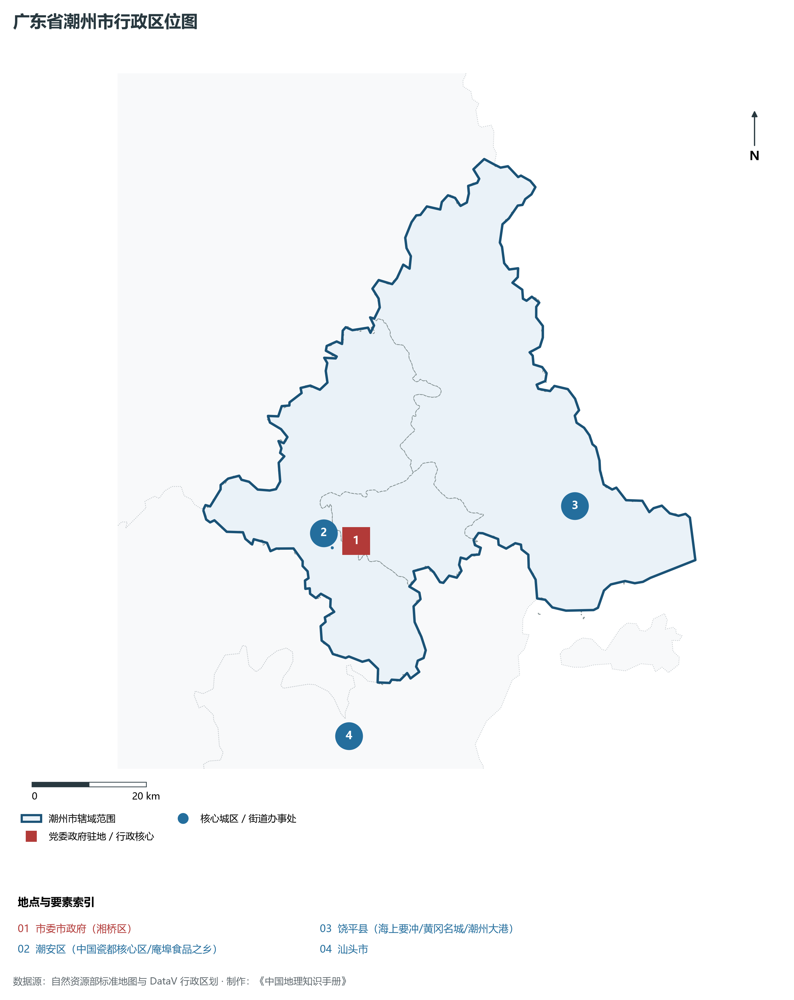
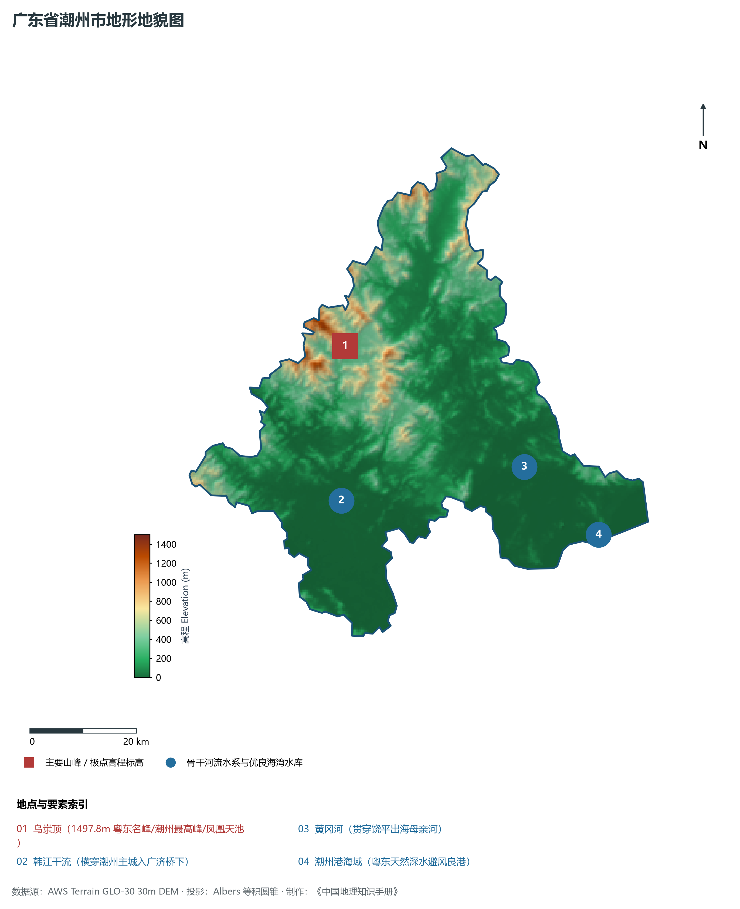
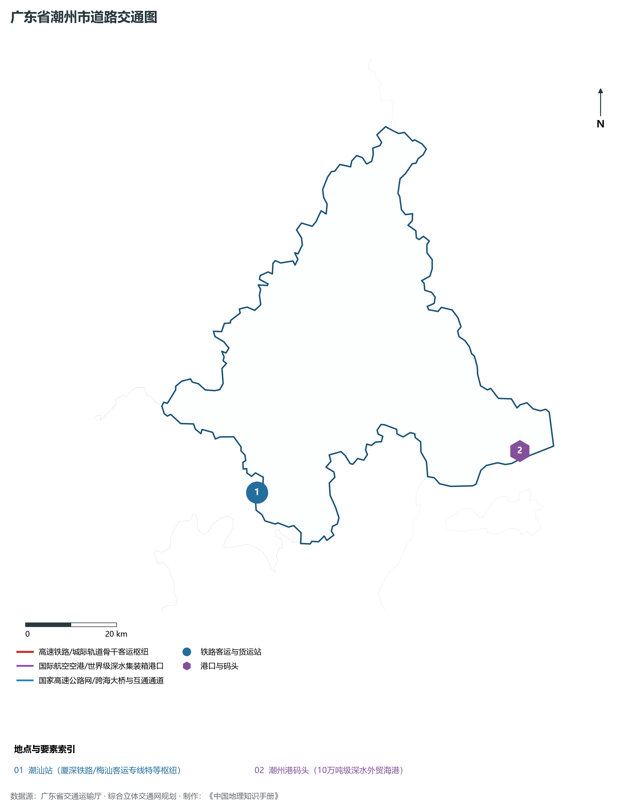
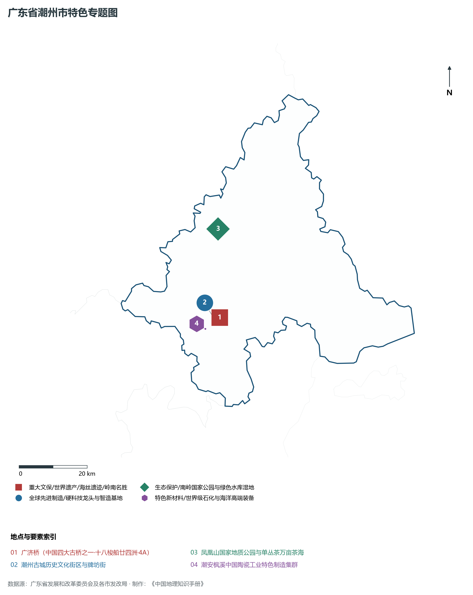
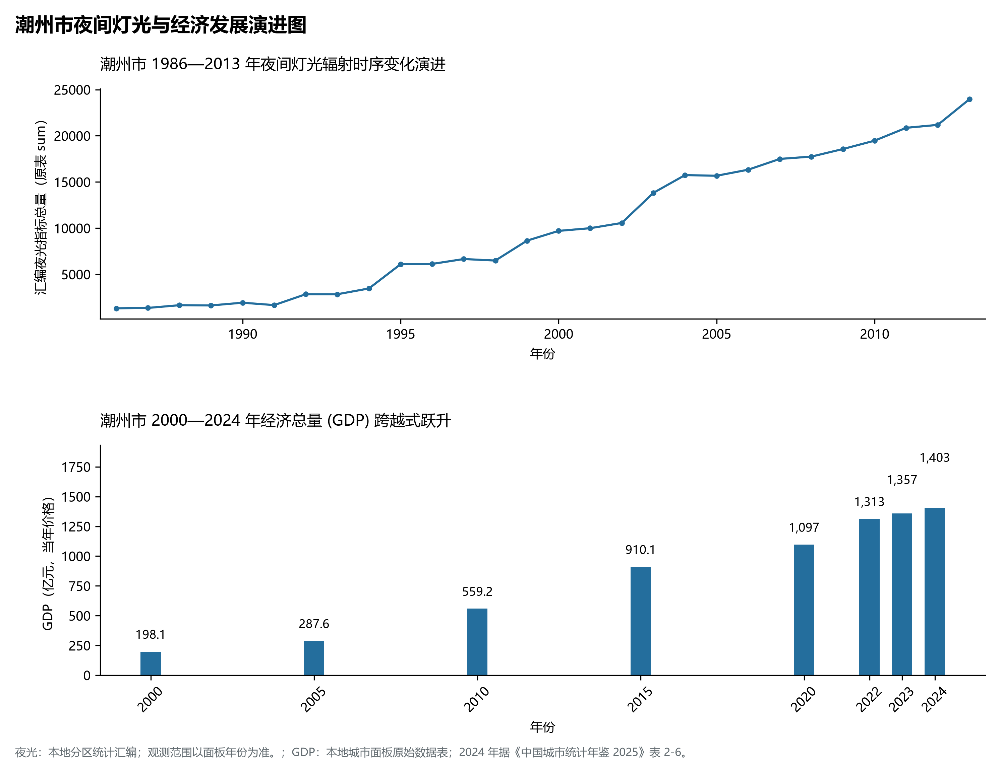

# 18.19 潮州市

潮州市，地处广东省改革开放与现代化建设关键战略前沿走廊，其在全省乃至全国的综合定位概括为：**国家历史文化名城·中国瓷都·中国潮州菜之乡·中国工夫茶之乡·凤凰单丛茶之乡·广济桥十八梭船**。2024 年常住人口 **258 万人**，常住人口城镇化率 **65.35%**，地区生产总值 **1,403 亿元**（当年价格），人均地区生产总值 **57,455 元**，三次产业构成为 **9.98 : 45.41 : 44.61**。

---

## 一、自然地理底盘与山川水系机理

潮州市在区域大地构造演化史上隶属于华南准地台南岭褶皱带或华南沿海断块升降沉降复合区，地质演化历经加里东期基底回返褶皱、印支期剧烈推覆碰撞造山与燕山期强烈的断块差异升降及大规模多期次花岗岩侵入活动。进入新生代喜马拉雅期以来，受差异性断块断裂、流水深切侵蚀堆积及南海海平面升降反复改造，定型了境内山丘起伏挺拔、台地开阔延展、冲积平原坦荡连绵、河网港湾密布交织的复合地貌格局。全境地表最低标高为 **0.0 m**，最高隆起山峰或主要控制性地形标高达 **1497.8 m**，显著的垂直高差梯度为江河径流涵养截留、特色动植物多样性保护、优质现代高品质农业生产、以及世界级城市群与现代制造业临水临港布局提供了丰富而广阔的国土空间承载骨架。

在气候水热配置方面，潮州市全境位于典型的南亚热带或中亚热带湿润季风气候区，气候温暖湿润、光照充足、雨量丰沛、四季常青、水热同步。多年平均气温在 20.8°C ～ 23.8°C 之间，终年无雪，极少有严寒霜冻，无霜期长达 330 ～ 365 d，年均日照时数在 1750 ～ 2250 h 之间。优越的气候水热条件极其利于岭南佳果（荔枝、龙眼、香蕉、菠萝、柑橘）、优质双季稻、特色亚热带水产养殖与现代花卉产业的高效蓬勃生长。多年平均降水量达 1550 ～ 2350 mm，降水时空分配年内集中在 4—9 月汛期，前汛期受高空槽与切变线锋面影响降雨集中，后汛期常受热带气旋、强台风与热带低压剧烈侵袭，防风防汛排涝与水旱灾害综合防御责任重大；而在秋冬季节受东北干冷季风控制降水偏少，大中型骨干水库蓄能调峰、江海堤防加固与现代化防潮排涝枢纽发挥着极其关键的战略保供与防灾屏障功能。

区域骨干控制性山峰、高程标高极点与主要地貌控制节点包括：

- **乌岽顶 (1497.8m 粤东名峰/潮州最高峰/凤凰天池)**（空间坐标约东经 116.680°、北纬 23.920°，海拔标高约 1497.8 m）：构成区域地形骨架与水源生态安全屏障的关键控制极点，在区域局部微气候调节、水源林涵养、地质遗迹保护与城市山林绿心屏障中发挥基石支撑作用；

水系水网与海湾湿地廊道方面，潮州市江河纵横交织、水网如织、湖库港湾环绕，深度融入广东江海连通生态网络：

- **韩江干流 (横穿潮州主城入广济桥下)**（水系坐标约东经 116.640°、北纬 23.660°）：承担着流域防洪排涝调峰、工业园区与千家万户优质生活饮用水源安全供给、大宗物资江海联运水运航道、以及滨水滨海生态岸线保育的核心功能；
- **黄冈河 (贯穿饶平出海母亲河)**（水系坐标约东经 116.980°、北纬 23.680°）：承担着流域防洪排涝调峰、工业园区与千家万户优质生活饮用水源安全供给、大宗物资江海联运水运航道、以及滨水滨海生态岸线保育的核心功能；
- **潮州港海域 (粤东天然深水避风良港)**（水系坐标约东经 117.100°、北纬 23.550°）：承担着流域防洪排涝调峰、工业园区与千家万户优质生活饮用水源安全供给、大宗物资江海联运水运航道、以及滨水滨海生态岸线保育的核心功能；

---

## 二、行政区划沿革与城镇空间体系

潮州市建置沿革源远流长，文脉绵延数千年，自古即为南粤重镇、百越故地、海上丝绸之路重要节点或岭南文化核心发祥地之一。先秦百越之地，秦汉平定岭南后置郡立县，唐宋设州置监，明清设府立县，千百年来留下了极其深厚的历史文化传承、海丝贸易遗存与华侨故里文脉。新中国成立后特别是改革开放四十余年来，伴随撤县设市（区）、高新技术园区成片开发、撤镇设街与以人为核心的新型城镇化纵深推进，构建了行政文化极核引领、功能区协同联动、产业重镇与现代街区网络交织的现代化大都市/高品质区域中心城镇空间网络体系：

- **市委市政府 (湘桥区)**（驻地坐标：116.622°E, 23.656°N）：区域公共治理行政中枢、现代生产生活综合服务集聚地与新型城镇化战略承载极核；
- **潮安区 (中国瓷都核心区/庵埠食品之乡)**（驻地坐标：116.580°E, 23.650°N）：区域公共治理行政中枢、现代生产生活综合服务集聚地与新型城镇化战略承载极核；
- **饶平县 (海上要冲/黄冈名城/潮州大港)**（驻地坐标：117.000°E, 23.670°N）：区域公共治理行政中枢、现代生产生活综合服务集聚地与新型城镇化战略承载极核；

在国土空间总体规划刚性引领下，潮州市统筹推进“三区三线”科学划定与全域管控，严守耕地和永久基本农田保护红线、生态保护红线与城镇开发边界，统筹优化农业空间、生态空间与城镇空间布局，推动城镇开发边界内节约集约高效利用，加快推进老旧城区更新改造与“百千万工程”县域产业集聚，持续优化公共服务均等化配置，打造山青水秀、宜居宜业、富有创新创业活力的现代高品质城市。

---

## 三、综合立体交通网络与现代枢纽通道

潮州市地处广东综合立体交通大走廊关键咽喉节点，全方位深度融入粤港澳大湾区世界级交通枢纽体系。依托设计时速 350 公里高铁干线、密集交织的国家骨干高速公路网、现代化民用航空机场、万吨级深水海港码头以及骨干高等级内河航道，构筑起空铁公水无缝衔接、高频通达全球各地的现代化综合立体交通体系：

**核心综合交通客运与货运物流枢纽节点：**

- **潮汕站 (厦深铁路/梅汕客运专线特等枢纽)**（空间坐标：116.550°E, 23.540°N）：高铁干线枢纽换乘、大宗工业原料与外贸集装箱海铁联运中转、以及全面融入粤港澳大湾区“半小时/一小时生活圈”与全球供应链网络的核心交通支点；
- **潮州港码头 (10万吨级深水外贸海港)**（空间坐标：117.120°E, 23.560°N）：高铁干线枢纽换乘、大宗工业原料与外贸集装箱海铁联运中转、以及全面融入粤港澳大湾区“半小时/一小时生活圈”与全球供应链网络的核心交通支点；

当前，潮州市正全面推进交通基础设施智慧化、绿色化数字化转型升级，大力提升枢纽集疏运一体化水平，重点攻坚“铁水公空”多式联运大闭环，深化区域路网互联互通，持续降低全社会综合物流成本，为高质量发展注入强劲的交通通达动能。

---

## 四、现代产业体系与新质生产力布局

潮州市坚定不移贯彻落实广东省委“制造业当家”战略部署，聚焦实体经济发展根基，紧密围绕全省“双十”战略性产业集群建设大局，坚持以科技创新引领产业创新，加快推进传统优势产业高端化、智能化、绿色化转型，全力培育壮大战略性新兴产业，前瞻谋划布局未来前沿产业，加快构建具有国际竞争力的现代现代化产业体系：

**标志性先进制造园区、特色产业基地、创新平台与重大产业地标：**

- **广济桥 (中国四大古桥之一·十八梭船廿四洲·4A)**（空间坐标：116.645°E, 23.665°N）：战略性优势产业集聚壮大、新质生产力加快生成与链主龙头企业引领的现代产业承载高地；
- **潮州古城历史文化街区与牌坊街**（空间坐标：116.630°E, 23.660°N）：战略性优势产业集聚壮大、新质生产力加快生成与链主龙头企业引领的现代产业承载高地；
- **凤凰山国家地质公园与单丛茶万亩茶海**（空间坐标：116.670°E, 23.900°N）：战略性优势产业集聚壮大、新质生产力加快生成与链主龙头企业引领的现代产业承载高地；
- **潮安枫溪中国陶瓷工业特色制造集群**（空间坐标：116.600°E, 23.640°N）：战略性优势产业集聚壮大、新质生产力加快生成与链主龙头企业引领的现代产业承载高地；

通过深入实施工业“链长制”与领军企业培优扶强工程，潮州市围绕产业链痛点打通创新链、匹配资金链、吸纳人才链，全力培育国家级高新技术企业、国家制造业单项冠军企业与专精特新“小巨人”企业雁阵，积极抢占新一代信息技术、高端装备制造、新材料、绿色低碳、现代生物医药与数字经济等前沿制高点，筑牢实体经济坚如磐石的硬核根基。

---

## 五、历史文化名胜、人文底蕴与全域文旅地理

潮州市文源深脉长、人文荟萃、风华绝代，融汇了广府文化、潮汕文化、客家文化等岭南优秀传统文化精髓，享有光荣的近现代革命红色基因、绵延千年的古代海丝海商文明与得天独厚的南国山海自然胜景，拥有丰厚的世界文化/自然遗产、国家 5A/4A 级旅游景区、全国重点文物保护单位与各级非物质文化遗产珍品：

- **广济桥 (中国四大古桥之一·十八梭船廿四洲·4A)**：承载深厚历史记忆与鲜明时代精神，展现南粤先民开疆拓土的坚韧气魄、近代志士敢为人先的革命情怀、古建园林与非遗技艺的精湛绝伦、以及南海滨海休闲胜地的无限魅力；
- **潮州古城历史文化街区与牌坊街**：承载深厚历史记忆与鲜明时代精神，展现南粤先民开疆拓土的坚韧气魄、近代志士敢为人先的革命情怀、古建园林与非遗技艺的精湛绝伦、以及南海滨海休闲胜地的无限魅力；
- **凤凰山国家地质公园与单丛茶万亩茶海**：承载深厚历史记忆与鲜明时代精神，展现南粤先民开疆拓土的坚韧气魄、近代志士敢为人先的革命情怀、古建园林与非遗技艺的精湛绝伦、以及南海滨海休闲胜地的无限魅力；
- **潮安枫溪中国陶瓷工业特色制造集群**：承载深厚历史记忆与鲜明时代精神，展现南粤先民开疆拓土的坚韧气魄、近代志士敢为人先的革命情怀、古建园林与非遗技艺的精湛绝伦、以及南海滨海休闲胜地的无限魅力；

立足新时代文旅深度融合发展与国际一流旅游度假目的地建设，潮州市坚持“以文塑旅、以旅彰文”，推进红色文化研学游、岭南古邑历史文化街区保护活化、滨海海岛休闲度假、森林温泉康养与侨乡非遗特色民俗农文旅深度融合，打造享誉海内外的超级文化旅游金字招牌。

---

## 六、夜间灯光辐射与跨世纪经济变化时序演进

本节夜光图的观测年份为 1986—2013 年，指标为行政区汇总值（原表 sum）。

| 年份 | 地区生产总值（亿元，当年价格） |
|:---|---:|
| 2000 年 | 198.1 |
| 2005 年 | 287.6 |
| 2010 年 | 559.2 |
| 2015 年 | 910.1 |
| 2020 年 | 1,097 |
| 2022 年 | 1,313 |
| 2023 年 | 1,357 |
| 2024 年 | 1,403 |

- **2005 年前后**：潮安枫溪中国瓷都陶瓷工业带崛起；
- **2023 年前后**：古城保护提质·凤凰单丛茶与潮瓷全域璀璨；

---

2024 年统计来源：《中国城市统计年鉴 2025》表 2-1、2-6、2-7（2024 年，全市）。其他年份 GDP 据本地城市面板“原始数据”表，单位为亿元、当年价格。
