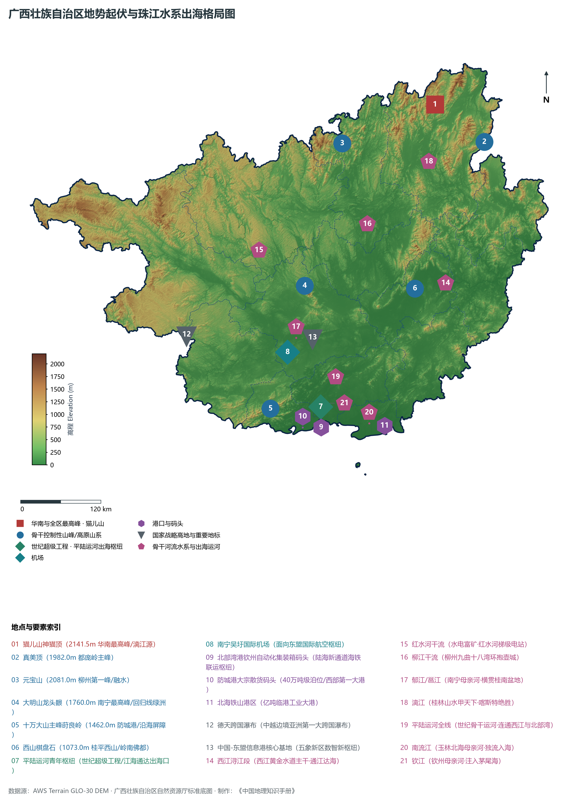
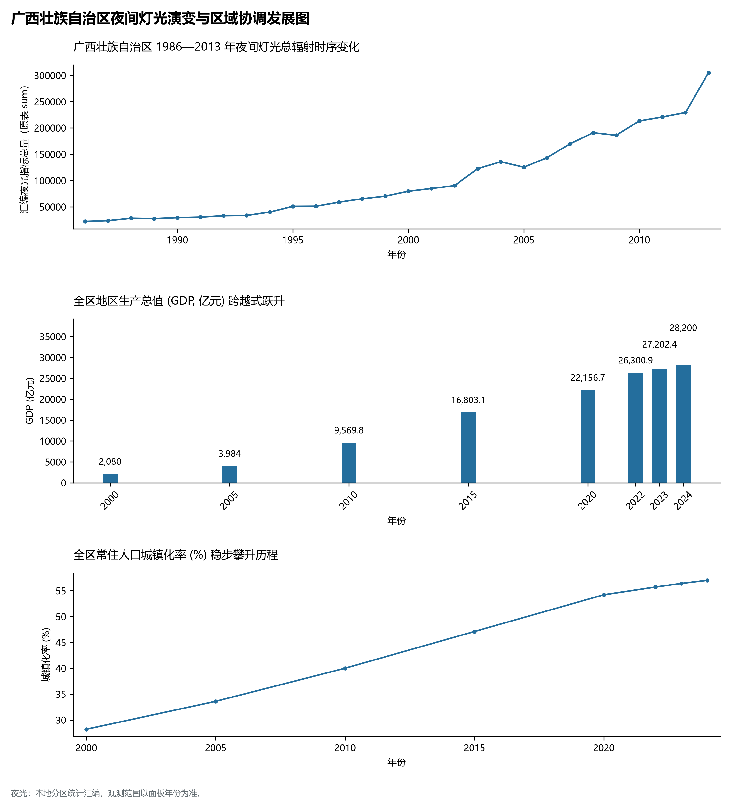
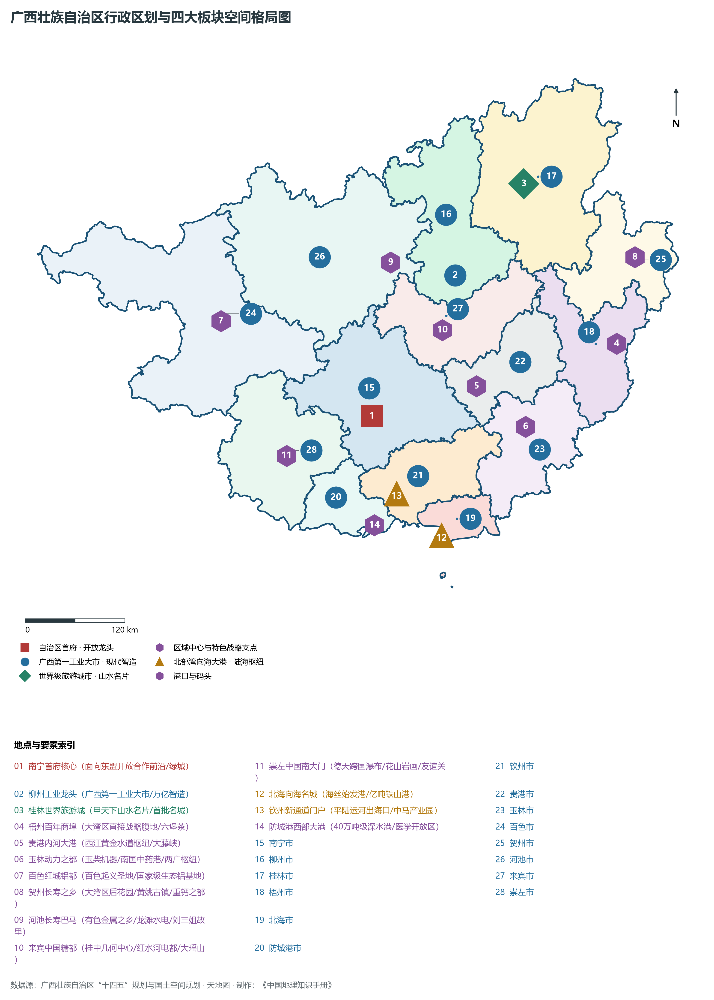
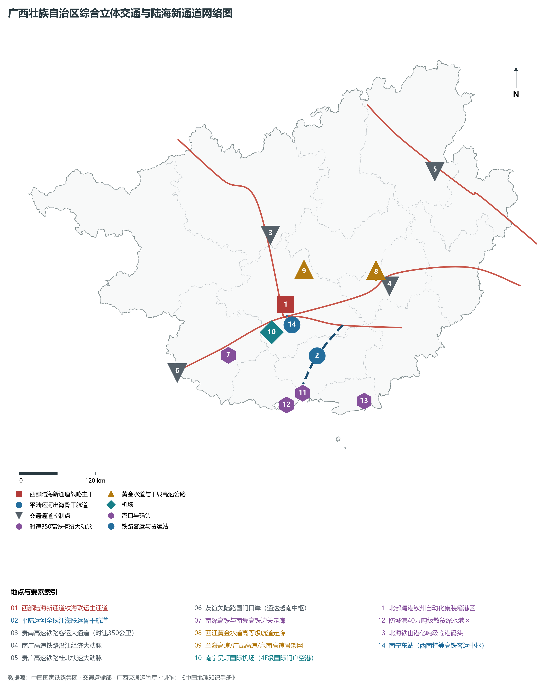
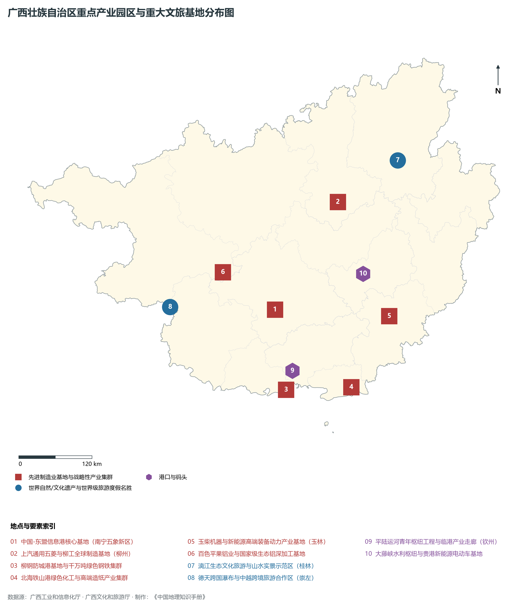

# 19.0 广西壮族自治区地理统揽

广西壮族自治区，简称“桂”，首府驻南宁市，地处中国华南西部，南濒热带北部湾，西南与越南社会主义共和国接壤，地理坐标介于东经 104° 28' ～ 112° 04'、北纬 20° 54' ～ 26° 24' 之间。全区陆域总面积达 **23.76 × 10⁴ km²**，占全国国土总面积的 2.47%。大陆海岸线长达 **1628.6 km**，沿海拥有大小海岛 697 个。广西东连广东，东北邻湖南，西北靠贵州，西接云南，西南与越南谅山、高平、河江、广宁四省山水相连，陆地边境线长达 **1020 km**。作为全国唯一的沿海、沿江、沿边自治区，广西是我国面向东盟开放合作的前沿门户与国际大通道、西南地区最便捷的出海陆海新通道出海口、“一带一路”有机衔接的重要门户，自古享有“桂林山水甲天下”、“岭南美玉”、“中国绿城”、“壮乡歌海”之美誉。

从宏观地貌与大地构造演化格局剖析，广西呈现出极具辨识度的**“盆地四周群山环抱、中部岩溶峰林拔地、西江主干自西向东横贯、南部滨海平原向海敞开”**的马蹄形地貌宏伟骨架。素有**“八山一水一分田”**之称。西北与西部横亘云贵高原边缘大石山区，北部巍峨雄峙五岭南麓越城岭、都庞岭群山，东部连绵云开大山与西江峡谷走廊，南部十万大山阻隔海陆，中部则是广阔的红水河、柳江、郁江盆地。境内广泛发育了全球面积最广、发育最完美、形态最多样的热带-亚热带岩溶（喀斯特）地貌，漓江两岸峰林如簪、拔地擎天，大石围天坑深邃壮观，左江花山崖壁雄奇，绘就了世所罕见的自然美学画卷。全区现辖 14 个地级市（南宁、柳州、桂林、梧州、北海、防城港、钦州、贵港、玉林、百色、贺州、河池、来宾、崇左）。截至 2024 年末，全区常住人口达到 **5027.0 万人**，常住人口城镇化率达 **57.0%**。2024 年全区实现地区生产总值（GDP）突破 **2.82 万亿元**（达 28,200 亿元），人均 GDP 达到 **56,100 元**。当前，广西正深入贯彻落实习近平总书记关于广西工作论述的重要要求，解放思想、创新求变，向海图强、开放发展，聚焦打造“国内国际双循环市场经营便利地、粤港澳大湾区重要战略腹地、沿边临港产业园区、高水平共建西部陆海新通道”，在奋力谱写中国式现代化广西篇章中展现新担当、实现新跨越。

---

## 一、大地构造、地势阶梯与“八山一水一分田”宏观地理底盘

广西地处华南褶皱系与扬子准地台西南缘的复合碰撞带，构造演化漫长而复杂。自元古宙造山运动奠定基底以来，历经早古生代加里东运动强烈褶皱隆起、晚古生代大规模碳酸盐岩超厚沉积（形成深达数千米的石灰岩地层）、中生代印支运动强烈南北向挤压推覆造山，以及白垩纪至古近纪燕山期断块差异升降与花岗岩大侵入。进入新生代喜马拉雅期以来，受青藏高原东向挤出与云贵高原强烈隆升的推挤作用，广西地势自西北向东南呈明显的阶梯状倾斜下沉，形成了西北高山深谷、中部丘陵溶原交错、东南低缓平原临海的壮阔阶梯地貌总纲：

全区地表高程极值跨度介于北部湾沿岸潮间带海平面的 **0.0 m** 至桂林市兴安县与资源县界岭处的**猫儿山主峰神猫顶（海拔 2141.5 m）**之间，相对垂直高差达到 **2141.5 m**，形成了层次分明的高山峡谷、峰丛洼地、峰林平原与滨海滩涂地貌系统：

- **全区最高绝顶（华南第一高峰·五岭之巅）**：位于桂林市兴安县与资源县交界处的**猫儿山神猫顶（海拔 2141.5 m）**，峰峦雄奇，古木葱茏，是珠江水系漓江与长江水系资水的天然分水岭主脊，被誉为“华南之巅·漓江之源”；
- **全区陆域次高峰（柳州最高峰）**：柳州市融水苗族自治县西北部的**元宝山（海拔 2081.0 m）**，原始森林苍茫，生长着世界濒危极危珍稀树种“元宝山冷杉”；
- **滇黔桂界岭最高峰**：百色市西林县与隆林各族自治县界岭**雄国岭（海拔 2062.0 m）**，云贵高原东南前缘骨干高地；
- **桂中第一高峰**：来宾市金秀瑶族自治县境内大瑶山主峰**圣堂山（海拔 1979.0 m）**，峰林耸立，云海杜鹃绝胜；
- **桂北都庞岭主峰**：桂林灌阳县与全州县界岭**真美顶（海拔 1982.0 m）**，湘桂咽喉要道天然屏障；
- **首府第一峰**：南宁市武鸣区与上林县界岭**大明山龙头眼（海拔 1760.0 m）**，北回归线上的绿色明珠与华南水源林典范；
- **粤西桂南沿海第一屏障**：防城港市与钦州市交界处**十万大山主峰莳良岭（海拔 1462.0 m）**，古木参天，瀑布轰鸣，构筑抵御台风海潮的天然陆海屏障；
- **全区地表最低极点**：北部湾沿岸广袤的潮间带与海湾滩涂，海拔标高为 **0.0 m**。

从宏观地貌格局演变来看，广西可系统归纳为四大环状地貌带：

1. **西北与西部高原山地屏障带**：包括云贵高原东南坡、百色高山丘陵及河池大石山区，海拔多在 800～ 1500 m，谷深坡陡，喀斯特峰丛洼地与天坑深密发育；
2. **北部与东北部南岭越城岭—都庞岭中山带**：以猫儿山、元宝山为代表，花岗岩与古老变质岩侵入体高拔矗立，林木茂盛，是全区最重要的水源涵养中枢；
3. **中部与南部开阔盆地与溶原平原带**：以红水河、柳江、黔江、郁江盆地为主体，峰林峰丛如林海泛舟，沃野千顷，为全区城镇与农业核心集聚区；
4. **南部北部湾沿海滨海平原与红树林湿地带**：沿防城港、钦州茅尾海、北海廉州湾与铁山港展布，海岸线曲折深秀，拥有优质天然深水良港与连片红树林“海上森林”。

**广西壮族自治区自西北向东南阶梯地貌剖面结构示意表**

| 云贵高原边缘高山带 | 柳江/郁江盆地峰林溶原 | 西江干流平原与平陆运河 | 北部湾国际门户大港群 |
| --- | --- | --- | --- |
| (雄国岭 2062m)；高原峡谷·天坑群落；生态屏障·有色铝都 | (喀斯特拔地·中国糖都)；土地肥沃·工业重镇；农产丰饶·山水秀美 | (通江达海·世纪水运工程)；江海联运·南向门户；战略腹地·产业集聚 | (钦州/防城港/北海铁山港)；港阔水深·面向东盟；陆海新通道·蓝色增长 |

西北滇黔高山大石山 · → 桂中峰林溶蚀盆地 · → 西江下游黄金水道平原 · → 北部湾滨海大洋门户

---

## 二、华南亚热带湿润季风气候与“西江通贯、独流入海”水文水资源

广西全境处于中亚热带与南亚热带季风气候区，北回归线自东向西横穿梧州、桂平、来宾、上林、平果、百色等地：

- **热量资源与温润气候**：全区年平均气温在 **16.5°C ～ 23.2°C** 之间，自北向南阶梯递增。桂北山区年均温约为 16.5°C ～ 19.5°C，桂中平原在 20.0°C ～ 22.0°C 之间，南部沿海及右江河谷年均温高达 22.5°C ～ 23.2°C。全区无霜期长达 **300 ～ 365 d**（桂南地区终年无霜），年均日照时数达 1500 ～ 1900 h，优越的水热条件造就了全国第一甘蔗产区（全国 65% 以上蔗糖产量）、热带亚热带优质水果（芒果、柑橘、百香果、火龙果、荔枝、龙眼）生产大省；
- **降水空间格局与三大暴雨区**：全区多年平均降水量达 **1500 ～ 2000 mm**，降水丰沛且时空集中。受夏季西南暖湿气流与东南季风共同驱动，并在十万大山、大瑶山、越城岭迎风坡地形强抬升作用下，形成了全区三大著名暴雨中心：
  1. 防城港东兴—十万大山南麓暴雨中心（年雨量常超 2600～ 3000 mm，全国降水量极值区之一）；
  2. 桂东金秀大瑶山暴雨中心（年雨量超 2200 mm）；
  3. 桂北兴安—资源越城岭南坡暴雨中心（年雨量超 2000 mm）。

在水网水文格局方面，广西水系呈现出极其壮丽的**“西江干流贯穿全域、干支汇流奔江入粤、南部诸河独流入海”**的水资源分布格局：

1. **珠江水系西江主干流（华南黄金水运主轴）**：
   - 广西境内江河有 85% 以上属于珠江流域西江水系。南盘江与红水河自滇黔奔流而下，横贯桂中，汇聚柳江、黔江、郁江（邕江）、浔江，最终于梧州汇合桂江成为西江干流，经广东磨刀门、崖门等口门汇入南海。西江干流年出省境水量超过 **2100 亿 m³**，长年通航 3000 吨级内河大型驳船，是联系粤港澳大湾区与西南大腹地的“水上丝绸之路”；
   - **大藤峡水利枢纽**：坐落于贵港桂平市黔江大藤峡出口，总库容超 34 亿立方米，控制西江水资源量的 56%，是珠江流域防洪控扼第一重器、“西电东送”骨干电源与保障大湾区咸潮期供水安全的战略生命工程；
   - **红水河梯级电站群**：龙滩（碾压混凝土第一高坝）、岩滩、大化等十级大型水电站构建起全国著名的大型清洁水电走廊；
2. **世纪超级运河工程：平陆运河（西江连通北部湾世纪奇迹）**：
   - 全长 **134.2 km**，起点位于南宁横州市西津库区平塘江口，跨越分水岭，沿沙坪河向南经钦州市灵山县陆屋镇，下钦江出海，在钦州港青年水闸汇入茅尾海北部湾。设计通航 5000 吨级江海直达巨轮，彻底打破广西内河“虽有黄金水道却需借道广东出海”的历史格局，将大西南经西江出海距离缩短约 560 公里，实现大宗物资向海出洋“通江达海、向海图强”的百年梦想；
3. **南部沿海独流入海诸河**：
   - **南流江**：流长 287 公里，流贯玉林、浦北、合浦，由廉州湾注入北部湾，是桂东南最重要的农业与城乡生活饮用水生命线；
   - **钦江与茅岭江**：流经钦州盆地，滋养茅尾海国家级大蚝养殖区；
   - **北仑河**：中越界河，穿东兴口岸注入北部湾，见证繁荣跨国互市。

---

## 三、行政区划、人口聚集与“一区两地一园一通道”空间新战略

广西壮族自治区现辖 14 个地级市，下辖 41 个市辖区、10 个县级市、48 个县、12 个自治县，共 111 个县级行政区。截至 2024 年末，全区常住人口达 **5027.0 万人**，是全国少数民族人口最多的省区（少数民族人口占比超 38%，壮族人口占全国壮族总人口的 90% 以上），各民族休戚与共、手足相亲，享有“全国民族团结进步模范自治区”美誉。

围绕推动新时代高质量发展与构建高水平开放型经济，广西系统构建并全面推进**“一区两地一园一通道”**战略布局：

1. **“一区”：铸牢中华民族共同体意识示范区**：
   - 全方位促进各民族交往交流交融，推动各民族共同走向社会主义现代化，把民族团结搞得更好、把边疆巩固搞得更好；
2. **“两地”：打造国内国际双循环市场经营便利地与粤港澳大湾区重要战略腹地**：
   - **双循环便利地**：发挥东盟博览会战略平台优势，在投资贸易便利化、要素流动顺畅化、口岸通关高效化、跨境金融创新化上先行先试，成为全球跨国企业进军东盟与东盟企业拓展中国市场的第一站；
   - **大湾区战略腹地**：梧州、贺州、玉林、贵港等东向协同，全面对接大湾区产业链、创新链、资金链与人才链，承接大湾区产业梯度有序转移，共建世界级先进制造业基地与绿色优质农产品供应基地；
3. **“一园”：高标准建设沿边临港产业园区**：
   - 以南宁临空临港产业园、北钦防临港工业园、百色平果生态铝园区、崇左凭祥跨境产业园为重点，打造承接东部先进产业有序转移与面向东盟跨境产业链供应链的核心载体；
4. **“一通道”：高水平共建西部陆海新通道**：
   - 依托平陆运河、黄百铁路、贵南高铁与北部湾港亿吨级现代化深水集装箱航道，构筑连接西北、西南与东盟之间最便捷、最经济的铁海联运与国际贸易战略大动脉。

---

## 四、综合立体交通网络与面向东盟国际海空门户

广西依托国际陆海联运大通道、通江达海高等级航道、高密度高铁公路网与现代化机场群，构筑起面向东盟、辐射大西南的综合立体交通强区：

1. **高速铁路大通道“市市通高铁、出海入粤达西南”**：
   - **时速350公里大通道**：贵南高速铁路（全线贯通，黔桂两省区两小时通达）、南深高速铁路（加快推进）、防东铁路（全国首条直通中越边境口岸的高铁）；
   - **骨干干线成网**：南广高铁、贵广客专、柳南客专、湘桂铁路复线、南昆客专全面成网，全区高铁营业里程突破 **2200 公里**；
2. **世纪超级工程平陆运河跨越江海**：
   - 运河全长 134.2 公里，梯级船闸（马道、企石、青年枢纽）满足 5000 吨级船舶双向全天候通行，打通西江水系连通北部湾的大能力出海新通道；
3. **北部湾国际门户港“向海图强、亿吨巨港”**：
   - **钦州港区**：全国首个海铁联运自动化集装箱码头，集装箱年吞吐量突破 800 万标准箱，铁海联运班列辐射全国 18 省 70 市；
   - **防城港港区**：拥有 40 万吨级超大型矿石散货码头，全国西部沿海第一大港；
   - **北海铁山港区**：大型临港深水工业大港，亿吨级散杂货与集装箱并进；
4. **面向东盟的国际航空枢纽集群**：
   - **南宁吴圩国际机场**：面向东盟门户航空枢纽，T3 航站楼与第二跑道加快建设；
   - 桂林两江国际机场、北海福成机场、柳州白莲机场、玉林福绵机场、百色田阳机场、河池金城江机场形成干支结合的高原与滨海空港网络；
5. **边关口岸与跨境陆路陆港体系**：
   - 拥有友谊关口岸（全国最大东盟水果陆路通关口岸）、东兴口岸、水口口岸、爱店口岸等国家一类陆路开放口岸，中越国际铁路班列与跨境货运穿梭不绝。

---

## 五、现代化产业体系与特色优势产业集群

广西立足资源禀赋与沿海沿边优势，深入推进“工业强桂”战略，构建具有鲜明广西特色的现代化现代产业体系：

1. **先进机械装备与现代汽车产业集群（柳州龙头）**：
   - 上汽通用五菱（全球小型纯电新能源汽车领军者、国民神车五菱宏光）、东风柳汽、柳工集团（中国工程机械行业领军者、全球装载机挖掘机智造高地），构建起从关键零部件到新能源整车的千亿级产业链；
2. **千万吨级现代绿色钢铁与绿色石化产业集群（沿海两翼）**：
   - 防城港柳钢钢铁基地（千万吨级沿海绿色精品钢）、钦州中石油千万吨级炼化一体化与中化新材料、北海铁山港绿色化工产业集群；
3. **高端绿色纸业与林木加工产业集群（全区绿色名片）**：
   - 北海铁山港太阳纸业、斯道拉恩索、玖龙纸业等入驻，广西木材产量占全国近三分之一，打造全球领先林浆纸一体化基地；
4. **国家级生态铝产业基地与有色金属加工（百色、防城港）**：
   - 百色平果铝业、广西百矿集团、防城港生态铝基地，实现由电解铝向航空航天、汽车轻量化高端铝合金新材料产业链深加工跨越；
5. **中国最大特色现代农业与食品糖业集群（中国糖都）**：
   - 蔗糖产量连续多年占全国 65% 以上，柳州螺蛳粉（全产业链年产值突破 600 亿元的大产业奇迹）、百色芒果、恭城月柿、苍梧六堡茶、横州茉莉花（产量占全球 60% 以上）、容县沙田柚闻名天下；
6. **世界级旅游度假与大健康康养产业走廊**：
   - 桂林世界级旅游城市、巴马世界长寿之乡康养基地、德天跨国瀑布、涠洲岛火山海岛度假区、左江花山岩画，构建享誉全球的文化旅游大品牌。

---

## 六、近四十年夜间灯光时序演进与跨世纪腾飞奇迹

本节夜光图的观测年份为 1986—2013 年，指标为行政区汇总值（原表 sum）。

- **2000—2010 年代（东博会落户南宁，北部湾开放开发强劲起势）**：
- **2010—2024 年（高铁网络交织成型，平陆运河开建全区全域璀璨）**：

山清水秀美如画，向海图强壮歌发！五千万八桂各族儿女在秀丽甲天下的喀斯特山水与碧波浩渺的北部湾之间心手相连、奋勇前行，正以更加昂扬的姿态，奋力书写中国式现代化的广西壮美华章！
