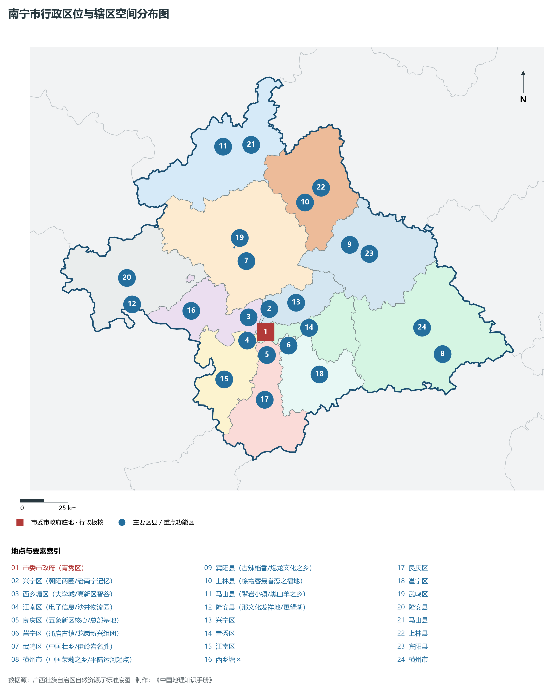
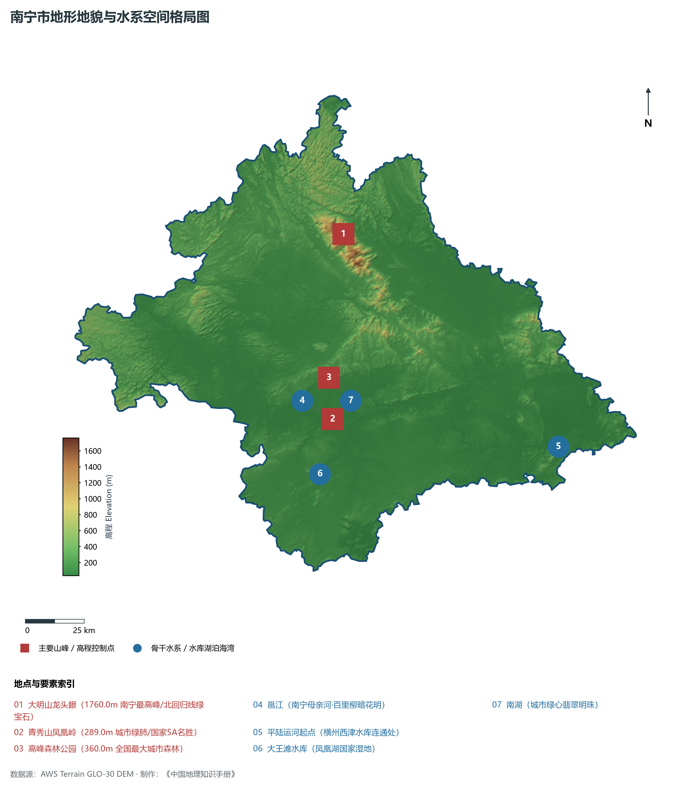
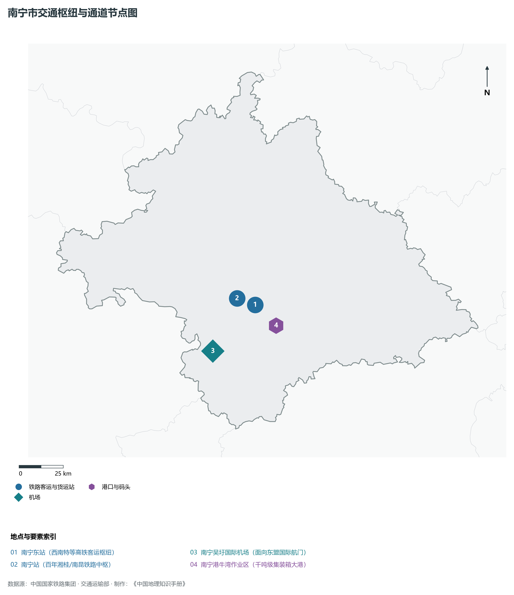
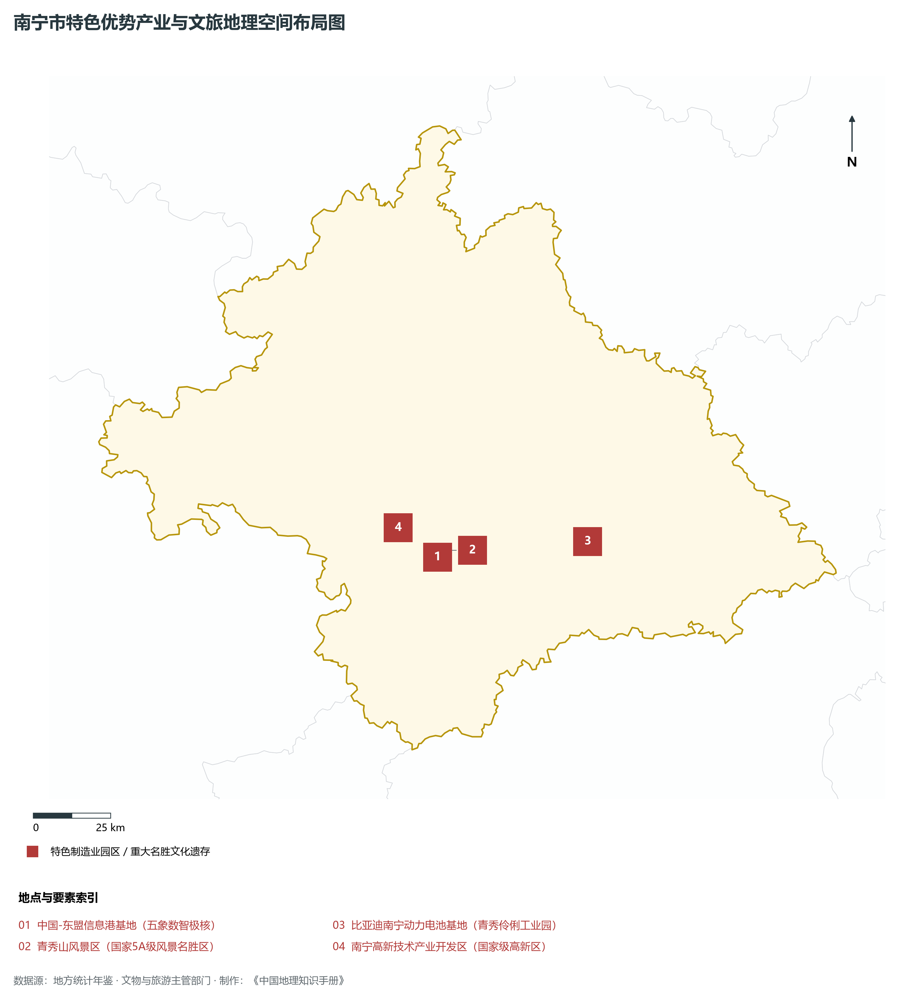
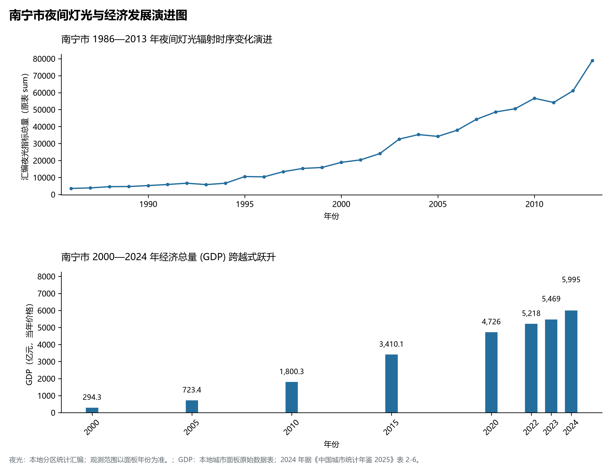

# 19.1 南宁市

南宁市，地处广西壮族自治区经济社会发展关键走廊与对外开放门户枢纽节点，其在全区乃至全国的综合定位概括为：**自治区首府·中国-东盟博览会永久举办地·北部湾城市群核心城市·国家综合交通枢纽·中国绿城**。2024 年常住人口 **897 万人**，常住人口城镇化率 **71.88%**，地区生产总值 **5,995 亿元**（当年价格），人均地区生产总值 **66,940 元**，三次产业构成为 **11.31 : 19.27 : 69.42**。

---

## 一、自然地理底盘与山川水系机理

在气候水热配置方面，南宁市全境位于典型的中亚热带或南亚热带湿润季风气候区，气候温暖多雨、光热充足、雨热同季、四季常绿。多年平均气温在 18.5°C ～ 23.2°C 之间，终年无严冬，极少降雪降冰，无霜期长达 310 ～ 365 d，年均日照时数在 1550 ～ 1950 h 之间。优越的气候水热资源极其利于优质甘蔗、柑橘、芒果、百香果、优质稻米、中药材、特色蔬菜与名优亚热带水产全周期蓬勃生长。多年平均降水量达 1450 ～ 2250 mm，降水时空分配年内集中在 4—9 月汛期，前汛期受高空切变线与低涡锋面影响降雨频密，后汛期常受南海热带气旋、强台风与热带低压剧烈侵袭，山洪地质灾害防御与江河防汛防潮抗旱任务十分繁重；而在秋冬干燥之交易伴有阶段性旱情，骨干大型水库蓄能调峰、生态补水与现代化高标准大型农田灌区发挥着极其关键的战略保供与生态平衡支撑功能。

区域骨干控制性山峰、高程标高极点与主要地貌控制节点包括：

- **大明山龙头眼 (1760.0m 南宁最高峰/北回归线绿宝石)**（空间坐标约东经 108.450°、北纬 23.500°，海拔标高约 1760.0 m）：构成区域地形骨架与水源生态安全屏障的关键控制极点，在区域局部微气候调节、水源涵养林保育、珍稀野生生物庇护与高山生态文旅名胜中发挥重要基石作用；
- **青秀山凤凰岭 (289.0m 城市绿肺/国家5A名胜)**（空间坐标约东经 108.380°、北纬 22.790°，海拔标高约 289.0 m）：构成区域地形骨架与水源生态安全屏障的关键控制极点，在区域局部微气候调节、水源涵养林保育、珍稀野生生物庇护与高山生态文旅名胜中发挥重要基石作用；
- **高峰森林公园 (360.0m 全国最大城市森林)**（空间坐标约东经 108.370°、北纬 22.950°，海拔标高约 360.0 m）：构成区域地形骨架与水源生态安全屏障的关键控制极点，在区域局部微气候调节、水源涵养林保育、珍稀野生生物庇护与高山生态文旅名胜中发挥重要基石作用；

水系水网与生态湿地廊道方面，南宁市江河纵横、山水相依、水质优良，深度融入广西水安全战略网络：

- **邕江 (南宁母亲河·百里柳暗花明)**（水系坐标约东经 108.350°、北纬 22.810°）：承担着流域防洪蓄水、内河高等级航道航运、工业与城镇居民饮用水源安全保供、农田自流灌溉与滨水生态廊道保育的核心功能；
- **平陆运河起点 (横州西津水库连通处)**（水系坐标约东经 109.300°、北纬 22.650°）：承担着流域防洪蓄水、内河高等级航道航运、工业与城镇居民饮用水源安全保供、农田自流灌溉与滨水生态廊道保育的核心功能；
- **大王滩水库 (凤凰湖国家湿地)**（水系坐标约东经 108.320°、北纬 22.580°）：承担着流域防洪蓄水、内河高等级航道航运、工业与城镇居民饮用水源安全保供、农田自流灌溉与滨水生态廊道保育的核心功能；
- **南湖 (城市绿心翡翠明珠)**（水系坐标约东经 108.360°、北纬 22.810°）：承担着流域防洪蓄水、内河高等级航道航运、工业与城镇居民饮用水源安全保供、农田自流灌溉与滨水生态廊道保育的核心功能；

---

## 二、行政区划沿革与城镇空间体系

南宁市建置沿革源远流长，文脉绵延数千年，自古即为百越故地、岭南重镇、边关咽喉要冲或海上丝路古埠。秦设桂林郡、象郡、南海郡，汉置苍梧、郁林郡县，唐宋置羁縻州监，明清设土司、通判与府州县，千百年来留下了极其深厚的历史文化底蕴、壮汉等民族交融交汇的鲜活历史记忆与壮美革命传统。新中国成立后特别是改革开放以来，伴随撤地设市、行政区划科学优化调整、中心城区跨江跨河组团拓展与以人为核心的新型城镇化深入推进，构建了中心城区主城引领、各区县协同联动、重点特色镇星罗棋布、产城人文深度交融的现代化城镇空间格局体系：

- **市委市政府 (青秀区)**（驻地坐标：108.366°E, 22.817°N）：区域公共治理行政中枢、现代生产生活综合服务集聚地与新型城镇化战略承载极核；
- **兴宁区 (朝阳商圈/老南宁记忆)**（驻地坐标：108.330°E, 22.840°N）：区域公共治理行政中枢、现代生产生活综合服务集聚地与新型城镇化战略承载极核；
- **西乡塘区 (大学城/高新区智谷)**（驻地坐标：108.280°E, 22.840°N）：区域公共治理行政中枢、现代生产生活综合服务集聚地与新型城镇化战略承载极核；
- **江南区 (电子信息/沙井物流园)**（驻地坐标：108.270°E, 22.780°N）：区域公共治理行政中枢、现代生产生活综合服务集聚地与新型城镇化战略承载极核；
- **良庆区 (五象新区核心/总部基地)**（驻地坐标：108.370°E, 22.760°N）：区域公共治理行政中枢、现代生产生活综合服务集聚地与新型城镇化战略承载极核；
- **邕宁区 (蒲庙古镇/龙岗新兴组团)**（驻地坐标：108.480°E, 22.750°N）：区域公共治理行政中枢、现代生产生活综合服务集聚地与新型城镇化战略承载极核；
- **武鸣区 (中国壮乡/伊岭岩名胜)**（驻地坐标：108.280°E, 23.160°N）：区域公共治理行政中枢、现代生产生活综合服务集聚地与新型城镇化战略承载极核；
- **横州市 (中国茉莉之乡/平陆运河起点)**（驻地坐标：109.260°E, 22.680°N）：区域公共治理行政中枢、现代生产生活综合服务集聚地与新型城镇化战略承载极核；
- **宾阳县 (古辣稻香/炮龙文化之乡)**（驻地坐标：108.810°E, 23.220°N）：区域公共治理行政中枢、现代生产生活综合服务集聚地与新型城镇化战略承载极核；
- **上林县 (徐霞客最眷恋之福地)**（驻地坐标：108.590°E, 23.430°N）：区域公共治理行政中枢、现代生产生活综合服务集聚地与新型城镇化战略承载极核；
- **马山县 (攀岩小镇/黑山羊之乡)**（驻地坐标：108.180°E, 23.710°N）：区域公共治理行政中枢、现代生产生活综合服务集聚地与新型城镇化战略承载极核；
- **隆安县 (那文化发祥地/更望湖)**（驻地坐标：107.690°E, 22.970°N）：区域公共治理行政中枢、现代生产生活综合服务集聚地与新型城镇化战略承载极核；

在国土空间总体规划刚性引领下，南宁市统筹推进“三区三线”科学划定与全域管控，严守耕地和永久基本农田保护红线、生态保护红线与城镇开发边界，统筹优化农业空间、生态空间与城镇空间布局，推动城市内涵式内聚发展，加快推进老旧小区综合改造与“百千万”乡村振兴工程，持续提升城乡基础设施与基本公共服务均等化水平，打造天蓝地绿水清、宜居宜业宜游的现代和美城市。

---

## 三、综合立体交通网络与现代枢纽通道

南宁市地处广西综合立体交通大走廊关键咽喉节点，全方位深度融入西部陆海新通道与粤港澳大湾区综合交通网络大局。依托高速铁路大干线、国家干线铁路编组枢纽、纵横交织的国家骨干高速公路网、现代化民用机场以及千吨级骨干内河深水航道/万吨级海港码头，构筑起铁水公空立体衔接、内外通达便捷的现代化综合交通网络体系：

**核心综合交通客运与货运物流枢纽节点：**

- **南宁东站 (西南特等高铁客运枢纽)**（空间坐标：108.410°E, 22.840°N）：客运高铁干线高频换乘、大宗工业原料与集装箱多式联运中转、以及全面对接北部湾国际门户港与大湾区现代物流体系的核心交通支点；
- **南宁站 (百年湘桂/南昆铁路中枢)**（空间坐标：108.310°E, 22.825°N）：客运高铁干线高频换乘、大宗工业原料与集装箱多式联运中转、以及全面对接北部湾国际门户港与大湾区现代物流体系的核心交通支点；
- **南宁吴圩国际机场 (面向东盟国际航门)**（空间坐标：108.170°E, 22.610°N）：客运高铁干线高频换乘、大宗工业原料与集装箱多式联运中转、以及全面对接北部湾国际门户港与大湾区现代物流体系的核心交通支点；
- **南宁港牛湾作业区 (千吨级集装箱大港)**（空间坐标：108.520°E, 22.730°N）：客运高铁干线高频换乘、大宗工业原料与集装箱多式联运中转、以及全面对接北部湾国际门户港与大湾区现代物流体系的核心交通支点；

当前，南宁市正全面加快交通基础设施数字化、智慧化改造升级，大力完善多式联运集疏运体系，重点攻坚“铁水公空”集疏运闭环，深化区域路网互联互通，持续降低全社会综合物流成本，为区域高质量开放发展提供强有力的交通硬核支撑。

---

## 四、现代产业体系与新质生产力布局

南宁市坚定不移贯彻落实“工业强桂”战略部署，聚焦实体经济发展根基，紧密围绕全区打造现代产业体系大局，坚持以科技创新引领产业创新，加快推进传统优势产业高端化、智能化、绿色化转型，全力培育壮大战略性新兴产业，前瞻谋划布局未来特色产业，加快构建具有自身特色与核心竞争力的现代产业体系：

**标志性先进制造园区、特色产业基地、创新平台与重大产业地标：**

- **中国-东盟信息港基地 (五象数智极核)**（空间坐标：108.380°E, 22.770°N）：中国面向东盟的数字经济核心战略高地；
- **青秀山风景区 (国家5A级风景名胜区)**（空间坐标：108.380°E, 22.790°N）：南宁城市生态文化地标与热带亚热带植物大观；
- **比亚迪南宁动力电池基地 (青秀伶俐工业园)**（空间坐标：108.850°E, 22.800°N）：华南地区重要的新能源动力电池研制基地；
- **南宁高新技术产业开发区 (国家级高新区)**（空间坐标：108.260°E, 22.860°N）：先进制造、新一代信息技术与生物医药集聚区；

通过深入实施工业“链长制”与领军企业梯次培育工程，南宁市围绕产业链痛点打通创新链、匹配资金链、吸纳人才链，全力培育国家级高新技术企业、国家制造业单项冠军企业与专精特新“小巨人”企业雁阵，积极抢占先进装备制造、电子信息、新材料、绿色化工、生物医药与现代特色食品加工等前沿赛道，筑牢实体经济坚如磐石的硬核根基。

---

## 五、历史文化名胜、人文底蕴与全域文旅地理

南宁市文源深脉长、人文荟萃、风华绝代，融汇了壮族等少数民族绚丽多彩的民俗文化、古代海上丝绸之路与茶船古道商贸文明、光荣卓越的近现代革命红色初心、以及世界级的自然喀斯特山水地质奇观，拥有丰厚的世界文化/自然遗产、国家 5A/4A 级旅游景区、全国重点文物保护单位与各级非物质文化遗产珍品：

- **中国-东盟信息港基地 (五象数智极核)**：承载深厚历史记忆与鲜明时代精神，展现南疆先民披荆斩棘开荒拓土的坚韧气魄、革命先烈敢为人先的英勇情怀、世界级自然奇峰碧水的鬼斧神工与浓郁的壮乡瑶寨民族风情；
- **青秀山风景区 (国家5A级风景名胜区)**：承载深厚历史记忆与鲜明时代精神，展现南疆先民披荆斩棘开荒拓土的坚韧气魄、革命先烈敢为人先的英勇情怀、世界级自然奇峰碧水的鬼斧神工与浓郁的壮乡瑶寨民族风情；
- **比亚迪南宁动力电池基地 (青秀伶俐工业园)**：承载深厚历史记忆与鲜明时代精神，展现南疆先民披荆斩棘开荒拓土的坚韧气魄、革命先烈敢为人先的英勇情怀、世界级自然奇峰碧水的鬼斧神工与浓郁的壮乡瑶寨民族风情；
- **南宁高新技术产业开发区 (国家级高新区)**：承载深厚历史记忆与鲜明时代精神，展现南疆先民披荆斩棘开荒拓土的坚韧气魄、革命先烈敢为人先的英勇情怀、世界级自然奇峰碧水的鬼斧神工与浓郁的壮乡瑶寨民族风情；

立足新时代文化旅游高质量融合发展与世界级旅游目的地建设，南宁市坚持“以文塑旅、以旅彰文”，推进红色文化研学游、岭南古邑历史名胜保护活化、世界级山水景观休闲度假、少数民族节庆民俗非遗体验与乡村农文旅深度融合，打造享誉海内外的超级文化旅游亮丽名片。

---

## 六、夜间灯光辐射与跨世纪经济变化时序演进

本节夜光图的观测年份为 1986—2013 年，指标为行政区汇总值（原表 sum）。

| 年份 | 地区生产总值（亿元，当年价格） |
|:---|---:|
| 2000 年 | 294.3 |
| 2005 年 | 723.4 |
| 2010 年 | 1,800.3 |
| 2015 年 | 3,410.1 |
| 2020 年 | 4,726 |
| 2022 年 | 5,218 |
| 2023 年 | 5,469 |
| 2024 年 | 5,995 |

- **2004 年前后**：首届中国-东盟博览会举办·琅东与青秀CBD强势崛起；
- **2013 年前后**：五象新区大规模拓荒·南宁东站综合交通枢纽成网；

---

2024 年统计来源：《中国城市统计年鉴 2025》表 2-1、2-6、2-7（2024 年，全市）。其他年份 GDP 据本地城市面板“原始数据”表，单位为亿元、当年价格。
