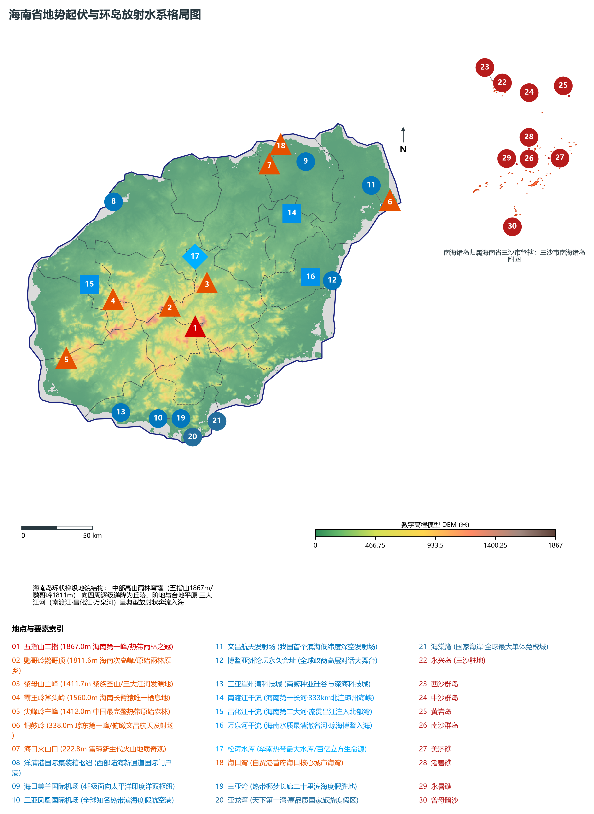
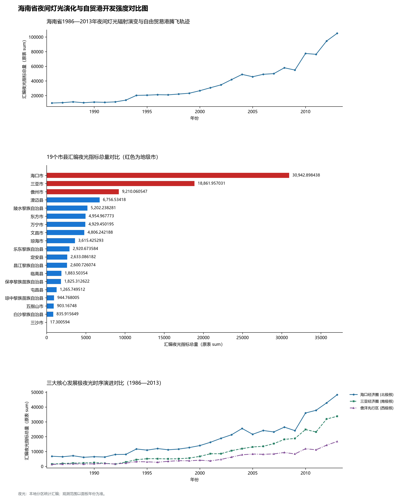
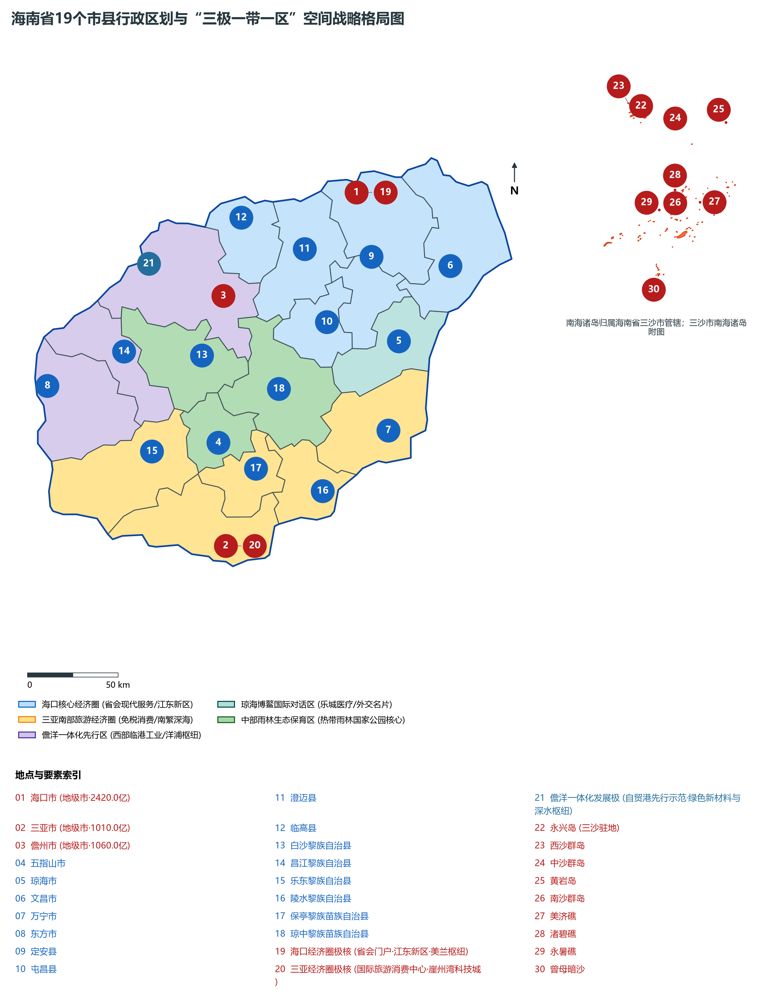
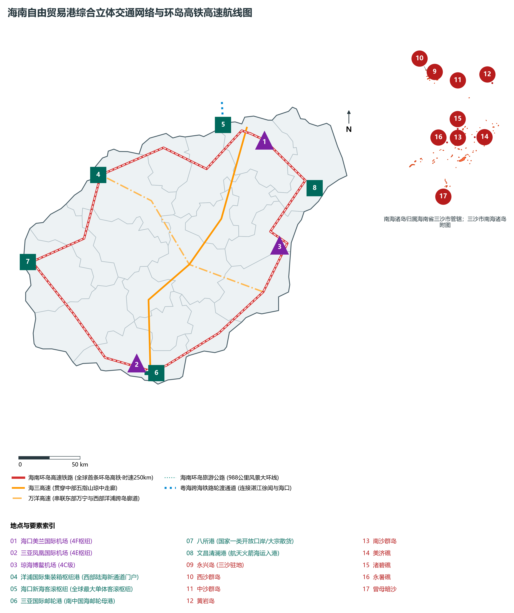
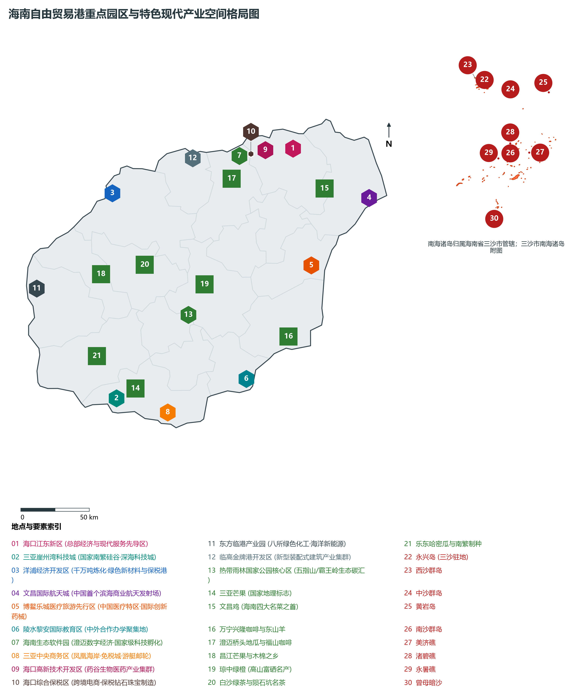

# 20.0 海南省地理统揽

海南省，简称“琼”，省会驻海口市，位于中国最南端，北隔琼州海峡与雷州半岛相望，西临北部湾与越南隔海相对，东面和南面濒临广袤深邃的中国南海，地理坐标介于北纬 3° 58' ～ 20° 16'、东经 108° 37' ～ 117° 50' 之间。全省陆域总面积达 **3.54 × 10⁴ km²**（其中海南岛陆地面积约 **3.39 × 10⁴ km²**，仅次于台湾岛为中国第二大岛）；而管辖海域面积达 **200 × 10⁴ km²**，约占全国管辖海域面积的三分之二，是我国名副其实的海洋大省与陆地面积最小、海洋面积最大的特殊省份。海南海岸线总长达 **1944.4 km**（海南岛本岛海岸线长 1617.8 km），环岛拥有大小海湾 68 处、沿海岛屿 600 余个。作为我国最大的经济特区、唯一的中国特色自由贸易港、国家生态文明试验区、国际旅游消费中心和国家重大战略服务保障区，海南自古享有“琼崖咽喉”、“南海明珠”、“南海祖宗海”、“中国南繁硅谷”、“深海与商业航天新策源地”之盛誉。

从宏观地貌与大地构造演化格局审视，海南呈现出极为规整且富于美学韵律的**“中部雨林高耸穹窿、四周环状逐级递降、三大放射水系奔流入海、广袤南海岛礁深蓝万里”**的地貌骨架体系。素有**“山海相连、岛洋共生”**的独特宏观底盘。全省现辖 4 个地级市（海口、三亚、三沙、儋州）以及 15 个由省直接管辖的县级行政单位（5 个县级市：五指山、琼海、文昌、万宁、东方；4 个县：定安、屯昌、澄迈、临高；6 个自治县：白沙黎族、昌江黎族、乐东黎族、陵水黎族、保亭黎族苗族、琼中黎族苗族）。截至 2024 年末，全省常住人口达到 **1043.0 万人**，常住人口城镇化率提高至 **62.8%**。2024 年全省实现地区生产总值（GDP）突破 **7850 亿元**，人均 GDP 跃升至 **75,260 元**，三次产业结构优化演进为 **20.2 : 19.8 : 60.0**，以旅游业、现代服务业、高新技术产业和热带特色高效农业为主导的四大主导产业占 GDP 比重稳步提升。当前，全省正锚定 2025 年底前实现全岛封关运作的历史性目标，高标准建设自贸港核心政策制度体系，加快构建“三极一带一区”国土空间新格局，以新质生产力赋能高质量跨越式发展，奋力谱写中国式现代化的海南生动篇章。

---

## 一、大地构造、环形梯级地貌与“穹窿山地·台地平原”宏观自然地理底盘

海南岛地处华南大陆板块向南海海盆过渡的构造转折带。地质演化史上，海南岛原本与华南板块雷州半岛紧密相连，在早古生代至中生代经历了加里东运动、印支运动与强烈的燕山期花岗岩岩浆侵入侵蚀，奠定了以五指山、黎母山花岗岩和变质岩侵入体为核心的中部穹窿地貌骨架；至新生代第三纪古新世至第四纪更新世初期，受喜马拉雅运动、华南大陆边缘拉张及南海中央海盆扩张裂解作用，琼州海峡断裂陷落，海水入侵断陷地堑，海南岛最终脱离大陆独立成岛；雷琼断陷带同时伴随大规模新生代火山喷发，形成了海口、澄迈、临高、儋州北部极其壮观的新生代第四纪火山熔岩台地、马鞍岭与雷琼火山群奇观。

海南岛宏观地貌呈现由中心向外围呈环带状、层阶状逐级递降的同心圆穹窿构造格局。以五指山（最高峰二指海拔 **1867.0 m**）和鹦哥岭（次高峰鹦哥顶海拔 **1811.6 m**）为地形最高隆起中心，向四周依次过渡为中山、低山、丘陵、台地和平原，构成了四个特征鲜明的同心圆梯级地貌环带：

1. **中部核心山地雨林穹窿区（海拔 >500～ 1867 m）**：包括五指山山脉、黎母山山脉、霸王岭和尖峰岭，山峦叠翠，沟谷深切，是我国分布最完整、连片面积最大的热带雨林核心生境——海南热带雨林国家公园，是海南岛的“绿色心脏”与全岛水系发源地；
2. **环岛丘陵与阶地过渡带（海拔 100～ 500 m）**：环绕中部山地分布，地形起伏舒缓，土壤以花岗岩风化红壤和砖红壤为主，是热带经济林（橡胶、槟榔、沉香、油茶、高山名茶）的核心种植区；
3. **环岛滨海阶地与熔岩台地带（海拔 20～ 100 m）**：北部为雷琼玄武岩熔岩台地，地表平坦开阔，富含矿质火山灰，富硒土壤广布；南部与西南部为波状台地，日照充沛，是热带高效农业（芒果、哈密瓜、南繁育种）的关键基地；
4. **环岛滨海堆积平原与海岸沙堤湿地带（海拔 <20 m）**：沿海湾断续展布，河流冲积平原、海积平原与潟湖红树林湿地发育，沿海港湾密布，是城镇高度集聚、港口与高铁高速主通道穿行的“环岛黄金经济带”。
5. **广袤深邃的南海海疆诸岛（三沙市海域）**：包括西沙群岛、中沙群岛、南沙群岛及其周边海域，由数以千计的珊瑚岛、礁、沙洲、暗沙、暗滩组成。永兴岛为三沙市政府驻地；中沙群岛黄岩岛巍然矗立；南沙群岛美济礁、渚碧礁、永暑礁构筑起南海交通安全与科学科考的重要堡垒；西沙群岛“三沙永乐龙洞”深达 **300.89 m**，为当今世界已知最深的海洋蓝洞。

全省地貌极值标高体系极为悬殊：

- **全省最高峰（琼崖第一高峰）**：位于五指山市境内的**五指山二指峰（海拔 1867.0 m）**，峰柱拔地千仞，常年云雾缭绕，被誉为“琼崖屋脊”；
- **全省次高峰**：白沙黎族自治县与琼中交界处的**鹦哥岭主峰鹦哥顶（海拔 1811.6 m）**，保存有全球极度濒危的热带原始常绿季雨林；
- **黎族圣山之脊**：琼中黎族苗族自治县与白沙交界的**黎母山主峰（海拔 1411.7 m）**，为海南三大江河发祥地；
- **长臂猿唯一种群庇护所**：昌江与白沙交界的**霸王岭斧头岭（海拔 1560.0 m）**，全球最濒危灵长类海南长臂猿最后的原始原乡；
- **中国最完整滨海热带原始森林**：乐东黎族自治县**尖峰岭主峰（海拔 1412.0 m）**，植物物种多样性位居全国前列；
- **全省陆域最低极点**：环岛海岸线潮间带海平面，海拔标高为 **0.0 m**；深海盆水深则达数千米。

**海南岛自中部山地向四周阶梯环状穹窿剖面结构示意表**

| 五指山/鹦哥岭核心峰群 | 黎母山/霸王岭丘陵带 | 海口/三亚/儋洋台地平原 | 环岛海湾大港与南海诸岛 |
| --- | --- | --- | --- |
| (五指山二指 1867.0m)；热带雨林国家公园中枢；放射状三江水源发源地 | (高山茶园·热带橡胶林)；水源涵养·民族风情廊道；南药繁育·生态价值转化 | (环岛高铁高速·封关园区)；现代产业集聚·自贸港极核；人口经济核心·自贸港枢纽 | (洋浦/新海港·三沙诸岛)；陆海新通道·经略深蓝大洋；国际枢纽港·主权神圣捍卫 |

中部雨林高耸穹窿 · → 环形低山丘陵过渡带 · → 滨海熔岩台地平原 · → 环岛海湾与南海深蓝

---

## 二、热带岛屿季风气候、水热资源与“中部发源、放射入海”水网水利系统

海南省是我国唯一全部处于热带气候带的岛屿省份，属于典型的**热带岛屿季风气候**，气候环境得天独厚：

- **热量资源与温润阳光**：全岛年平均气温在 **22.8°C ～ 26.5°C** 之间，由中北部向南部沿海阶梯递增；年均积温（≥ 10°C）达 8200 ～ 9300°C·d，全省终年无霜雪，四季常绿，草木葱茏。年日照时数在 1750 ～ 2650 h 之间，特别是三亚、东方、乐东等南部与西南部“干爽光照区”，年日照超过 2500 小时，形成了我国冬季避寒康养首选地与国家“南繁科研育种”的天然超级温室大棚；
- **降水时空分布与暴雨干湿差异**：全省多年平均降水量达 **1600 ～ 2400 mm**，雨量丰沛但时空分布极度不均。受中部五指山与黎母山山脉地形强烈抬升影响，迎风的东部琼海、万宁、琼中形成全国知名的“琼东多雨区”（年降雨量常超 2200～ 2800 mm）；而背风的西部东方市、昌江沿海因地形雨影效应与焚风效应，降雨量降至 950～ 1100 mm，蒸发量大，形成独特的热带稀树草原半干旱气候景观与我国最大的天然海盐场——莺歌海盐场。

在水系分布与水资源网络方面，受中央穹窿地貌决定，海南岛水系呈现世界上极具典型意义的**“中部发源、四散分流、呈放射状奔流入海”**的水文分布特征。全岛独流入海河流多达 154 条，其中集水面积大于 100 km² 的骨干河流有 38 条，最著名的当属“三大放射性江河”：

1. **南渡江干流（海南第一长河·北注琼州海峡）**：
   - 发源于白沙黎族自治县南峰山，流贯白沙、儋州、琼中、屯昌、澄迈、定安，于海口市美兰区注入琼州海峡。干流全长 **333.8 km**，流域面积 **7176 km²**，年径流总量达 60 亿立方米。南渡江横贯海口平原，下游冲积三角洲地势平坦、土壤肥沃，孕育了省会海口千年的繁衍生息与今日自贸港江东新区的现代化宏图；
   - **松涛水库（华南热带最大人工水库）**：位于儋州与白沙交界的南渡江上游，总库容达 **33.45 × 10⁸ m³**，水域开阔似海，灌溉全省 300 万亩农田，是保障儋州、海口等琼北经济圈数百万人口城乡供水的“群山生命天池”；
2. **昌化江干流（海南第二大河·西注北部湾）**：
   - 发源于琼中黎族苗族自治县五指山北麓，流经琼中、保亭、乐东、东方，于昌江黎族自治县昌化港注入北部湾。干流全长 **230.0 km**，流域面积 **5150 km²**，水流穿行于高山峡谷，水能资源丰沛。中下游建有**大广坝水利水电枢纽**（总库容 17.1 × 10⁸ m³），为西部临港工业基地与干旱走廊提供不可替代的水电支撑；
3. **万泉河干流（海南水质最清澈名河·东注南海）**：
   - 发源于五指山与黎母山峡谷，流经琼中、万宁，于琼海市博鳌镇东屿岛三江汇流处（万泉河、九曲江、龙滚河）奔腾注入南海。全长 **163.0 km**，流域面积 **3690 km²**。万泉河两岸椰林修竹，奇石滩流，水质常年保持国家I类标准，因一曲《万泉河水清又清》唱响大江南北，更因博鳌亚洲论坛永久落户于其入海口而享誉全球；
   - **牛路岭水库**：位于万泉河中游，总库容 7.78 × 10⁸ m³。

---

## 三、行政区划、人口聚集与“三极一带一区”国土空间新格局

海南省现辖 4 个地级市（海口、三亚、三沙、儋州），下辖 15 个省直辖县级单位（5 个县级市、4 个县、6 个自治县），全省下辖街道、镇、乡共 218 个。海南省实行特殊的“省直管县”扁平化行政管理体制，除了海口、三亚、儋州下辖市辖区外，其余 15 个市县均由海南省直接领导管理，行政审批层级压缩，政策传导高效敏捷，为自贸港全岛封关运作奠定了极其精干高效的制度基础。

截至 2024 年末，全省常住人口达到 **1043.0 万人**，城镇化率达 **62.8%**。在空间分布上，人口呈现“北重南旺、沿海稠密、中部生态疏朗”的显著特征。海口市作为全省政治经济文教中心，常住人口达 294.0 万人，是人口第一极；三亚市作为国际滨海旅游消费度假极，常住人口达 112.5 万人，冬季旅居候鸟人口超百万；儋州市（含洋浦）常住人口近百万，为西部核心增长极。

立足自贸港建设大局与自然地理本底约束，海南省高标准构建**“三极一带一区”**的国土空间保护与高质量发展总体新格局：

1. **“海口经济圈”极核（自贸港核心引领极）**：
   - 以海口为龙头，辐射带动澄迈、文昌、定安、屯昌、临高，打造自贸港核心引擎、全省综合服务中心、先进制造与总部经济聚集区、江东新区现代服务业标杆；
2. **“三亚经济圈”极核（国际旅游消费与深海种业极）**：
   - 以三亚为核心，协同陵水、乐东、保亭，聚焦打造世界一流的国际旅游消费中心、崖州湾科技城（国家南繁硅谷与深海科技城）、免税购物国际天堂与国家重大战略科创枢纽；
3. **“儋洋经济圈”极核（儋州洋浦一体化先行示范极）**：
   - 以儋州洋浦一体化为核心支撑，联动东方、昌江，打造西部陆海新通道国际门户枢纽港、千万吨级绿色新材料产业基地、自贸港高水平对外开放“压力测试”先行区；
4. **环岛滨海经济发展带（“一带”）**：
   - 串联海口、文昌、琼海、万宁、陵水、三亚、乐东、东方、昌江、儋州、临高、澄迈等沿海 12 个市县，统筹港口岸线、滨海旅游公路、重点园区与滨海特色城镇，打造具有全球竞争力的海洋经济与对外开放黄金海岸带；
5. **中部生态保育区（“一区”）**：
   - 涵盖五指山、琼中、白沙以及保亭、昌江等中部山地生态敏感区，严格实行海南热带雨林国家公园体制保护，坚决筑牢生态安全屏障，发展林下经济、热带高效农业与黎苗生态文旅，走绿色低碳可持续发展之路。

---

## 四、全球首条环岛高铁与“海陆空天”综合立体交通网络

海南依托独特的岛屿地理环境，经过三十余年超常规跨越式建设，建成了以**全球第一条环岛高速铁路**为骨干、高等级环岛高速公路与环岛旅游公路为骨架、双4F/4E枢纽机场与洋浦枢纽港为两翼的“海陆空天”现代化综合立体交通网络：

1. **全球首条环岛高速铁路（闭环里程 653 km）**：
   - **海南环岛东环高铁（308 km）**与**海南环岛西环高铁（345 km）**完美闭合交会，设计时速最高达 250 km/h，串联全岛 12 个沿海市县与海口美兰机场、三亚凤凰机场两大国际空港。环岛动车“公交化”密集开行，将全岛环行时间压缩至 3 小时以内，实现了“全岛三小时同城化生活圈”；
2. **“三纵四横”高速公路网与 988 公里环岛旅游公路**：
   - **G98 海南环岛高速公路（612.8 km）**全线闭环畅通，且全省高速公路全面推行燃油附加费改革，全岛无高速收费站，车流通畅无阻；**G9811 海三高速**自海口穿屯昌、琼中、五指山直插三亚，纵贯南北生态脊梁；**G9813 万洋高速**横穿东西；
   - **海南环岛旅游公路（全长 988 km）**：串联全省沿海 12 个市县、68 个海湾、数十个景观驿站与绝美岬角海滩，成为展示自贸港滨海生态风光的“移动风景长廊”；
3. **“两主两辅”国际航空枢纽集群**：
   - **海口美兰国际机场（4F级）**：二期扩建工程全面投用，拥有双跑道与两座航站楼，年旅客吞吐量设计保障能力达 3500 万人次，是面向太平洋与印度洋的门户复合型国际航空枢纽；
   - **三亚凤凰国际机场（4E级）**：三期改扩建火热推进，常年旅客吞吐量突破 2100 万人次，是我国最繁忙的热带度假空港之一；
   - **琼海博鳌机场（4C级）**：高规格保障博鳌亚洲论坛国际盛会，开辟国际国内公务机与康养旅游航线；
4. **自贸港“四方五港”现代港口群与粤海跨海铁路生命线**：
   - **洋浦港**：西部陆海新通道国际集装箱枢纽门户港，拥有洋浦深水保税港区，开通数十条覆盖东盟与环太平洋的内外贸航线；“中国洋浦港”船籍港国际船舶总吨位跨入全国第一方阵；
   - **新海港客滚枢纽**：海口新海客运综合枢纽为全球最大单体客滚枢纽工程，年通过汽车超 300 万辆次、客流超 3500 万人次；
   - **粤海铁路跨海轮渡**：通过巨型跨海火车轮渡连接广东湛江徐闻与海口南港，实现国家铁路网与海南岛的跨海直连；
5. **商业航天与深空发射独门高地**：
   - **文昌航天发射场**：我国唯一的低纬度滨海深空发射场，承担天宫空间站、嫦娥奔月、天问探火等国家重大航天发射使命；伴随中国文昌商业航天发射场建成投用，文昌正跃升为全球瞩目的“国际商业航天之都”。

---

## 五、自由贸易港现代产业体系与 13 大重点园区空间布局

自 2020 年《海南自由贸易港建设总体方案》公布实施以来，海南省大力推行“零关税、低税率、简税制”和“五自由便利一安全有序流动”核心政策，加快构建以**旅游业、现代服务业、高新技术产业、热带特色高效农业**四大主导产业为支撑的自贸港现代产业体系，全力培育打造**种业“南繁硅谷”、深海科技、商业航天“向海图强、向天图强、向数图强”的三大未来产业新赛道**：

全省规划建设的 **13 大自贸港重点园区**构筑起高质量发展的核心增长极与改革试验主阵地：

1. **洋浦经济开发区（自贸港政策先行示范区）**：依托洋浦深水良港，集聚千万吨炼油、百万吨乙烯、绿色新材料制造、国际船舶注册与全球保税加工增值免关税先行先试；
2. **三亚崖州湾科技城（国家重大战略科创枢纽）**：依托国家南繁科研育种基地和深海科考深水港，打造“南繁种业硅谷”与“国家深海科技策源地”；
3. **海口江东新区（自贸港总部经济与现代服务先导区）**：汇聚跨国总部、离岸金融、国际航空维修、跨境电商与数字经济；
4. **博鳌乐城医疗旅游先行区（中国医疗特区）**：享有“特许医疗、特许研究、特许经营、特许国际交流”黄金政策，国际最新药械中国首选地；
5. **文昌国际航天城（国际航天城·低纬度商业发射基地）**：商业火箭组装、卫星超算大数据与航天文化旅游融合极；
6. **陵水黎安国际教育创新试验区（教育高地·中外合作办学聚集地）**：引进全球顶尖大学独立或合作办学，打造中国教育对外开放新标杆；
7. **海南生态软件园（澄迈·千亿数字经济与区块链先导区）**：国家级科技企业孵化器与数字文创中心；
8. **三亚中央商务区（凤凰海岸·免税金融·邮轮游艇之都）**；
9. **海口国家高新技术产业开发区（海南生物医药“药谷”制造集群）**；
10. **海口综合保税区（跨境电商与高端保税加工中心）**；
11. **东方临港产业园（八所港大宗商品绿色化工物流园）**；
12. **临高金牌港开发区（新型装配式建筑制造基地）**；
13. **热带雨林国家公园（五指山·生态保护与碳汇转化典范）**。

---

## 六、1986—2013 年全岛夜间灯光遥感变化与全岛封关运作攻坚

本节夜光图的观测年份为 1986—2013 年，指标为行政区汇总值（原表 sum）。

当前，海南全省正以“时不我待、只争朝夕”的使命担当，全面推进全岛封关运作软硬件攻坚、反走私综合防控体系构筑、高水平开放压力测试，稳步扩大制度型开放，努力成为新时代中国对外开放的重要窗口与新质生产力高质量发展的强劲引擎！

---

## 七、全岛封关运作政策制度体系与国家生态文明试验区机制创新

全岛封关运作是海南自由贸易港建设具有里程碑意义的系统工程。其核心在于构建“一线放开、二线管住、岛内自由”的监管制度架构：

1. **“一线放开”**：指境外与海南自贸港之间，除国家禁止进出口和限制类货物清单外，实施更高标准的货物自由进出与免关税制度，显著降低国际要素跨境流动摩擦成本；
2. **“二线管住”**：指海南自贸港与内地之间，对进入内地的货物实施精准高效监管；对海南自贸港内加工增值超过 30% 的货物经“二线”进入内地免征进口关税，极大激发了现代先进制造业与跨境加工贸易在全岛的集聚繁荣；
3. **“岛内自由”**：各类生产要素在自贸港内部实现平等充分、自由便利的流转配置，全面激发市场主体活力与社会创造力。

与此同时，作为**国家生态文明试验区**，海南坚定不移走生态优先、绿色低碳的高质量发展道路。全省率先立法实施“全面禁塑”，在全国率先实现清洁能源装机占比超过 75%，推广新能源汽车渗透率稳居全国首位，大力推进国家热带雨林公园 GEp（生态系统生产总值）核算与生态产品价值实现机制（VEP）试点，努力使海南得天独厚的绿水青山、碧海蓝天成为子孙后代永续享用的“金山银山”。
