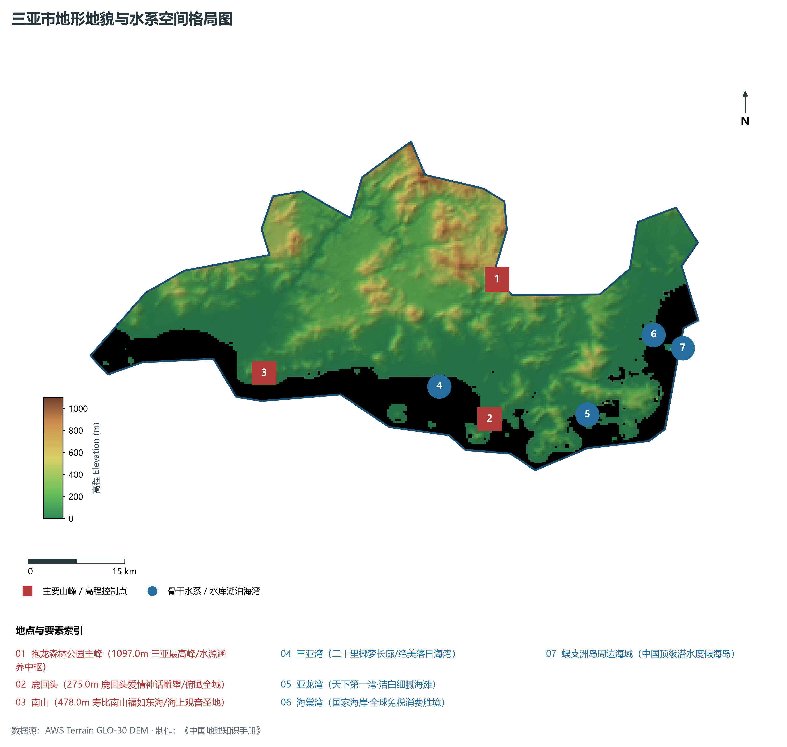
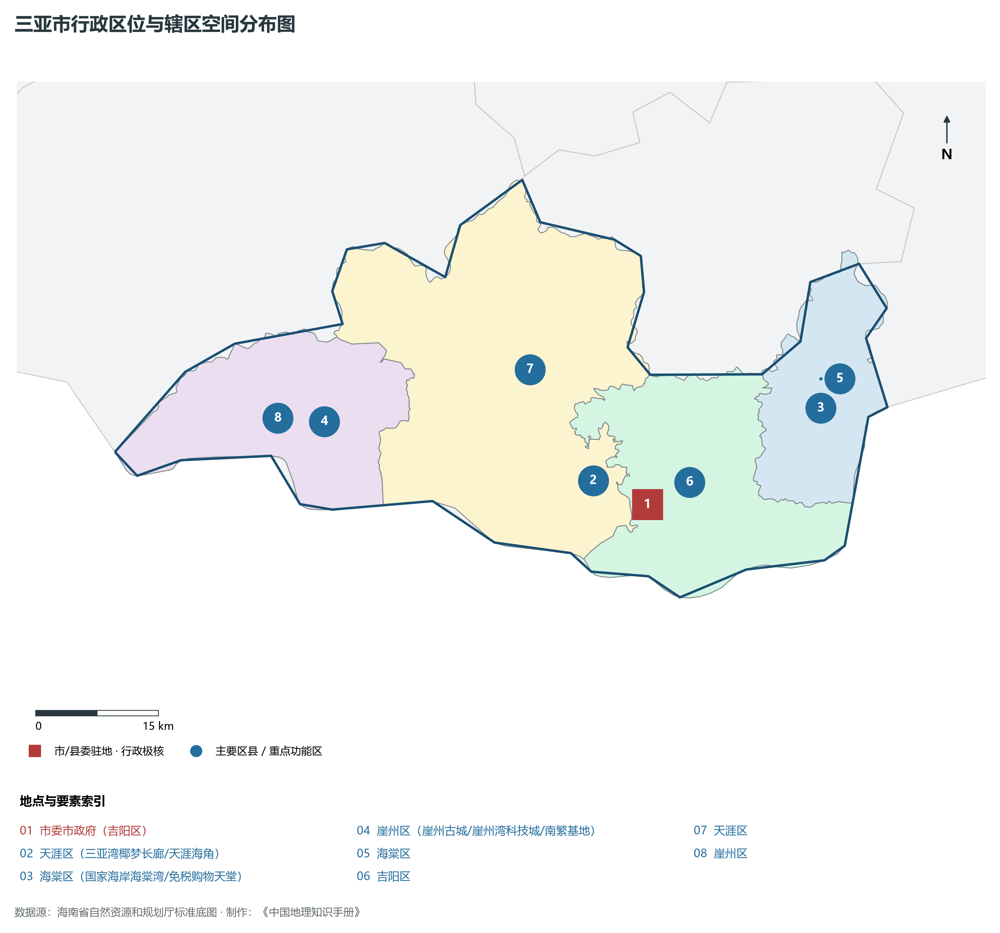
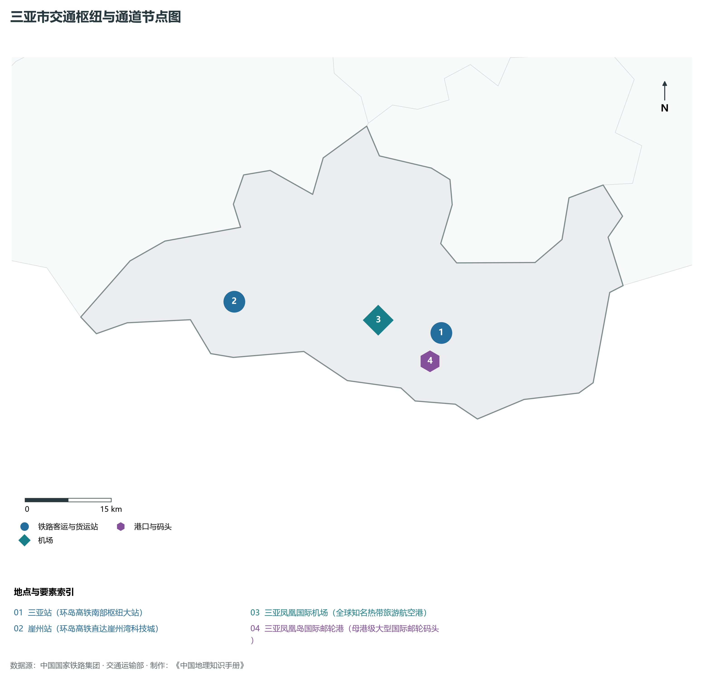
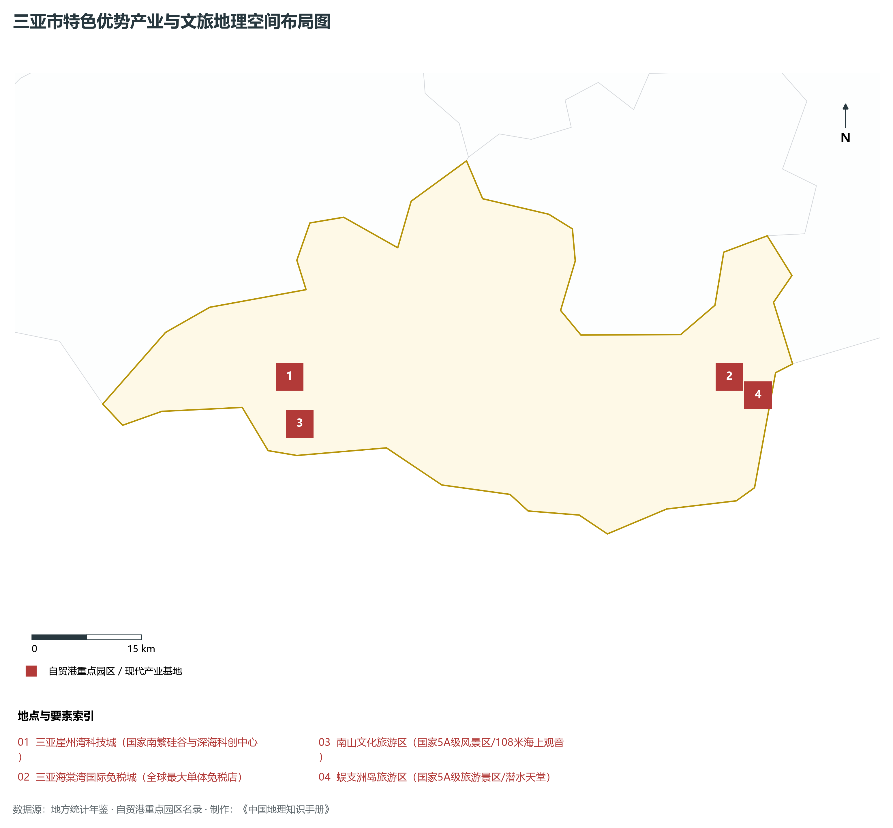
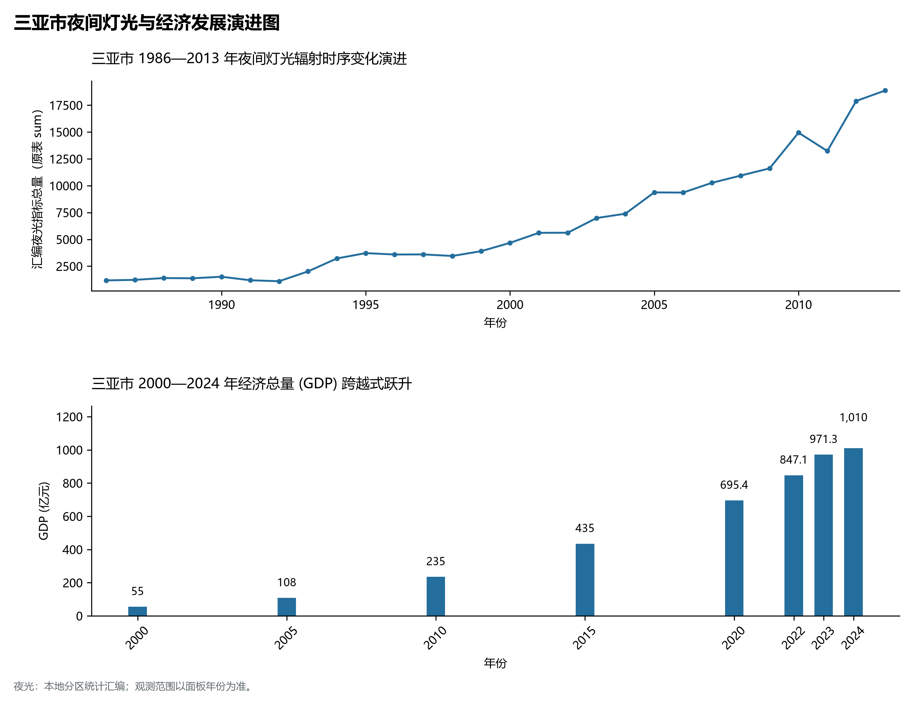

# 20.2 三亚市

## 引言与战略定位

三亚市，国家标准行政区划代码为 **460200**，国际热带滨海旅游名城·国家重大战略支撑平台·南繁硅谷核心·深海科技之城·国家海岸。全辖区陆地面积为 **1919.6 km²**，截至 2024 年末常住人口达到 **110.6 万人**，常住人口城镇化率达 **74.8%**。2024 年全区实现地区生产总值（GDP）突破 **1010.0 亿元**，人均 GDP 跃升至 **91,320 元**，三次产业结构持续优化升级为 **10.5 : 14.5 : 75.0**。在海南自由贸易港全岛封关运作加速推进的大背景下，三亚市凭借其得天独厚的自然禀赋、优越的地理区位、高标准的特色园区载体与创新的体制机制，深度融入全省“三极一带一区”国土空间新格局，成为支撑自贸港高质量发展不可或缺的重要支撑极。

从地缘与宏观经济地理格局审视，三亚市承载着链接全岛陆海统筹发展、连接琼州海峡陆岛通道或面向广袤南海经略深蓝的重要支点功能。作为海南自贸港政策早期安排与压力测试的关键承载单元，辖区不仅享有零关税、低税率、简税制等高水平制度型开放红利，更在体制机制创新、营商环境对标国际最高经贸规则、城乡要素平等自由流动等关键领域勇当探路先锋。全域坚持“生态立市（县）、产业强市（县）、向海图强、向绿图强”，展现出蓬勃兴盛的发展生机与前所未有的时代机遇。

---

## 一、自然地理底盘、地貌起伏与水系水文格局

三亚市地质构造底盘深厚，地貌形态特征鲜明。地质构造上隶属于华南板块南缘与南海北部陆缘伸展盆地的结合部，地表高程极值跨度在 **0 m ～ 1097.0 m** 之间，相对垂直高差达到 **1097.0 m**。地貌单元丰富多样，呈现出由中部穹窿高地或低山丘陵向台地平原、潮间滩涂与滨海港湾过渡的梯度地貌景观。

### 1. 地质构造基础与岩石地层演化
辖区出露地层主要包括前寒武纪深变质岩基底、古生代碳酸盐岩与碎屑岩、中生代燕山期侵入的花岗岩岩体以及新生代第四纪玄武岩熔岩流与海相冲积沉淀物。在地质历史上，经历印支运动剧烈褶皱回返与燕山期强烈的断块差异隆升，奠定了辖区山川起伏的主骨架；第四纪冰期与间冰期海平面旋回升降，并在雷琼裂谷拉张背景下发育玄武岩台地、火山口地貌与海蚀阶地，造就了地表土壤极其深厚的风化壳与富含矿质营养的土壤资源（砖红壤、火山灰富硒土或沙质海滨土），为热带作物生长与生态系统繁衍提供了极其优渥的物质基础。

### 2. 骨干山峰与地貌极值控制点
辖区内地貌骨架清晰，群峰挺拔，主要高程控制点与地貌坐标包括：

- **抱龙森林公园主峰 (1097.0m 三亚最高峰/水源涵养中枢)**：海拔 **1097.0 m**，坐标位于东经 109.52°、北纬 18.42°；
- **鹿回头 (275.0m 鹿回头爱情神话雕塑/俯瞰全城)**：海拔 **275.0 m**，坐标位于东经 109.5°、北纬 18.22°；
- **南山 (478.0m 寿比南山福如东海/海上观音圣地)**：海拔 **478.0 m**，坐标位于东经 109.18°、北纬 18.3°；
各控制峰峦不仅构筑起区域局地微气候的天然屏障，更通过对来自南海的暖湿夏季风与冬季冷空气的阻截抬升，形成局地丰沛的地形雨与垂直带谱分明的水热小生境，成为全辖区的水源涵养中心与生物多样性庇护所。

### 3. 河流水系、水库湖泊与海洋海湾网络
三亚市水网密布，地表径流充沛，主要河流呈典型岛屿短促独流入海特征，水质常年优良清澈。关键河流水系及水体包括：

- **三亚湾 (二十里椰梦长廊/绝美落日海湾)**：经纬度标定 (109.43°E, 18.27°N)；
- **亚龙湾 (天下第一湾·洁白细腻海滩)**：经纬度标定 (109.64°E, 18.22°N)；
- **海棠湾 (国家海岸·全球免税消费胜境)**：经纬度标定 (109.74°E, 18.33°N)；
- **蜈支洲岛周边海域 (中国顶级潜水度假海岛)**：经纬度标定 (109.76°E, 18.31°N)；
受热带海洋性季风气候控制，辖区降水量丰沛且季节分配集中，汛期降水常占全年 75%～ 85%。为了调蓄洪峰流量、保障城乡常住人口与数以百万计候鸟游客的供水安全、支撑特色高效农业反季节灌溉与清洁水力发电，辖区内系统兴建了大批骨干水利工程与引水渠道网络，形成了水系互联互通、库塘梯级连通、水旱从人、人水和谐共生的绿色水网支撑体系。

### 4. 热带海岛生物多样性与生态安全屏障构建
三亚市地处全球生物多样性热点地区之一的海南岛，拥有极其珍贵的热带生物资源基因库。辖区内热带雨林、常绿季雨林、山地常绿阔叶林、红树林湿地及沿海珊瑚礁生态系统层叠交织，分布有众多国家重点保护野生动植物。在海南自贸港全岛封关运作与国家生态文明试验区建设总体部署下，辖区全面坚守“生态保护红线、环境质量底线、资源利用上线和生态环境准入清单”刚性管控约束，统筹山水林田湖草沙海一体化保护与系统治理。大力推行小流域综合整治、水污染防治与化肥农药减量增效工程，筑牢热带海岛极其脆弱而珍贵的水土涵养中枢与蓝色海岸生态屏障。

---

## 二、行政区划沿革、聚落地理与城镇空间格局

三亚市历史文脉悠长，行政建制沿革悠远。自古以来，这里便是中原文化与琼崖黎苗先民交往交流交融的沃土，留存了大量展现东坡居琼文化、红色琼崖革命足迹、黎锦苗绣非遗遗存与古代海上丝绸之路驿站文明的历史遗存。现辖主要行政街道、重点功能区、建制镇及行政中心包括：

### 1. 行政建制沿革与空间组织重组
自汉武帝平定南越在海南设置儋耳、珠崖二郡开启中央有效治理以来，历代中原王朝不断完善地方建置。新中国成立后特别是 1988 年海南撤区建省办全国最大经济特区以来，三亚市经历了多轮行政区划优化与“撤县设市”、“乡镇撤并”、“产城一体”体制重塑。在全省特殊的“省直管市县”扁平化治理架构下，辖区减少了地级中间协调层级，政策执行效率高、项目要素审批敏捷，形成了高水平适配自贸港全岛封关运作的高效行政组织架构。

### 2. 城镇空间网络与“产城人文”深度融合
辖区空间布局紧扣“一核多极、产城融合、山海联动、组团集约”理念展开：

- **中心城区与政治经济文化核心极**：集聚全区行政管理中枢、综合性三甲医疗机构、优质教育科研机构、大型商业综合体与现代金融总部，市政基础设施完备，城市绿地与水体交相辉映，高标准建设展现热带海岛现代风貌的高品质生态人居城区；
- **重点建制镇与特色产业发展支点**：按照“一镇一品、一镇一业”原则，重点培育热带高效农业示范镇、滨海避寒康养小镇、商贸物流枢纽镇、黎苗文化非遗旅游镇，推动人口、产业与基础设施就地集聚，增强对周边农村的辐射带动能力；
- **美丽乡村与热带生态宜居聚落**：全面实施乡村振兴战略，依托热带季雨林茶园、富硒果蔬基地、古朴黎寨苗村与滨海风情渔村，打造串点成线、连片成景的和美乡村风景线，生动践行“绿水青山就是金山银山”的发展真谛。

---

## 三、综合立体交通网络、港口航运与自贸港通道走廊

交通运输是区域经济发展的先行官与自贸港高端生产要素高效集聚流转的生命线。三亚市已构建起“高铁高速通达、航空海运联动、客货分流通畅、城乡无缝衔接”的现代化综合立体交通体系：

### 1. 骨干交通枢纽与关键站点
辖区内重要的交通节点与基础设施包括：

- **三亚站 (环岛高铁南部枢纽大站)**：坐标 (109.51°E, 18.285°N)，功能定位：rail；
- **三亚凤凰国际机场 (全球知名热带旅游航空港)**：坐标 (109.41°E, 18.31°N)，功能定位：airport；
- **三亚凤凰岛国际邮轮港 (母港级大型国际邮轮码头)**：坐标 (109.49°E, 18.24°N)，功能定位：port；
- **崖州站 (环岛高铁直达崖州湾科技城)**：坐标 (109.18°E, 18.35°N)，功能定位：rail；

### 2. “空铁水陆”多式联运通道组织

- **轨道交通与高铁走廊**：深度依托全球首条环岛高速铁路（东环/西环），高频开行环岛“城际动车公交化”列车，直连海口美兰国际机场与三亚凤凰国际机场两大枢纽空港，将辖区全面纳入全岛“1小时都市通勤圈”与“3小时环岛同城化生活圈”；
- **高速公路与环岛旅游干线**：国家高速公路 G98 环岛高速以及跨岛横向与纵向联络线纵横穿梭，全岛实行“取消高速收费站、燃油统一附加费”制度，车辆全程无障碍飞驰畅通；**海南环岛旅游公路**依山傍海蜿蜒贯穿，串联起绝美岬角、海湾、湿地与人文驿站，成为拉动全域旅游跨越发展的黄金通道；
- **港口航运与向海通道**：依托优质深水泊位与现代化装卸设施，主动衔接洋浦国际集装箱枢纽港、新海客运枢纽与南海主航线，积极拓展国际内外贸集装箱班轮航线，打通面向东盟、中东与印度洋的现代海上物流经贸走廊。

---

## 四、自贸港特色支柱产业与现代产业园区空间布局

立足海南自由贸易港“零关税、低税率、简税制”等制度型开放红利，三亚市坚决贯彻新发展理念，坚持把发展经济的着力点放在实体经济上，因地制宜因势利导，构建具有鲜明地域特色和核心竞争力的现代产业体系：

### 1. 重点自贸港园区与战略性产业高地
辖区内布局的特色战略性产业平台与重点基地涵盖：

- **三亚崖州湾科技城 (国家南繁硅谷与深海科创中心)**：坐标 (109.17°E, 18.36°N)，特色定位：国家级种子实验室、深海大型装备研发试验与热带海洋科技高地；
- **三亚海棠湾国际免税城 (全球最大单体免税店)**：坐标 (109.725°E, 18.335°N)，特色定位：国际旅游消费中心标志性地标与高端商品免税购物天堂；
- **南山文化旅游区 (国家5A级风景区/108米海上观音)**：坐标 (109.18°E, 18.3°N)，特色定位：中国热带佛教文化名山与世界最大白衣观音圣像胜境；
- **蜈支洲岛旅游区 (国家5A级旅游景区/潜水天堂)**：坐标 (109.76°E, 18.31°N)，特色定位：中国顶级热带海岛旅游生态潜水胜地与海洋牧场示范区；

### 2. 四大主导产业协同发力机制

1. **旅游消费与现代服务业**：深度推进“旅游+”跨界融合，系统开发滨海免税购物、游艇帆船运动、森林温泉康养、黎苗民俗风情体验与自驾骑行探秘，培育具有全球吸引力的国际旅游消费新标杆；
2. **高新技术产业与新质生产力**：聚焦智能制造、绿色新能源、深海科考装备、商业航天关联制造、热带生物医药与新材料，大力引进专精特新“小巨人”企业，打造区域高新技术产业高地；
3. **热带特色高效农业**：做精做优冬季早熟瓜菜、名优热带水果（芒果、荔枝、菠萝蜜、火龙果、蜜柚）、沉香与南药健康产业、高山生态茶与天然橡胶，延伸热带农产品精深加工产业链，打响国家地理标志品牌；
4. **绿色海洋与向海经济**：大力推进深海大型智能网箱养殖、现代化海洋牧场建设、水产品冷链物流与海洋清洁能源利用，释放经略海洋、向海图强的强劲动能。

---

## 五、1986—2013 年夜间灯光遥感变化与经济重构分析

本节夜光图的观测年份为 1986—2013 年，指标为行政区汇总值（原表 sum）。

### 1. 历年 GDP 总量跃升时序矩阵
从 2000 年至 2024 年，三亚市地区生产总值（GDP）实现了令人瞩目的历史性跃升，经济基本盘持续壮大：

| 年份 | 地区生产总值 (GDP) |
| :---: | :---: |
| 2000 年 | 55.0 亿元 |
| 2005 年 | 108.0 亿元 |
| 2010 年 | 235.0 亿元 |
| 2015 年 | 435.0 亿元 |
| 2020 年 | 695.4 亿元 |
| 2022 年 | 847.1 亿元 |
| 2023 年 | 971.3 亿元 |
| 2024 年 | 1010.0 亿元 |

### 2. 夜光辐射演进特征与关键突变节点

- **1996年突变节点**：三亚河两岸老港区与大东海夜景初显；
- **2005年突变节点**：亚龙湾天下第一湾成型·天涯海角享誉全球；
- **2013年突变节点**：海棠湾国家海岸大开发·全球最大单体免税城落地；
- **2023年突变节点**：崖州湾科技城与南繁深海双轮驱动全域强光；

### 3. 空间集聚演变与时空重构动力学
遥感时序系统计量分析表明：在 20 世纪 80 年代中后期海南建省初期，辖区夜间灯光辐射基数极低，仅在老县城中心呈现微弱点状发光；2000 年后伴随环岛交通基础设施建设与滨海旅游兴起，中心城区周边出现放射状灯光廊道；2010 年“国际旅游岛”国家战略发布与 2015 年环岛高铁全线闭环开通后，夜光面积与强度呈现倍增态势；2020 年《海南自由贸易港建设总体方案》公布实施以来，随着重点特色园区落地投产、封关运作重点工程建设与全岛招商引资热潮，夜间灯光辐射总量呈现“指数级几何跃升”，形成了以核心园区为原点、沿综合交通轴线连片繁茂、多中心网络化协同演进的现代化空间格局。

---
