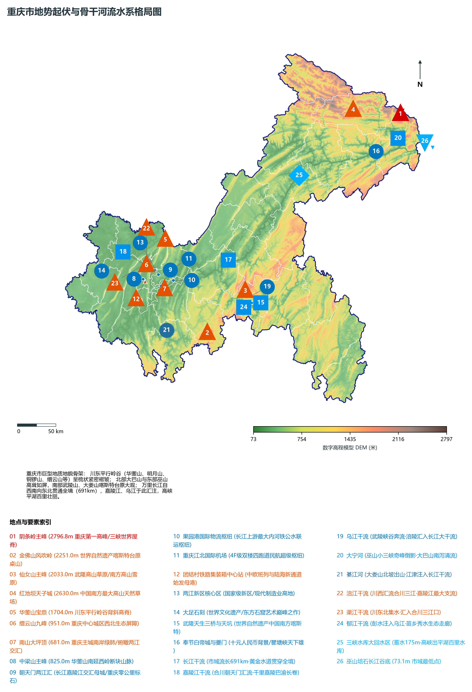
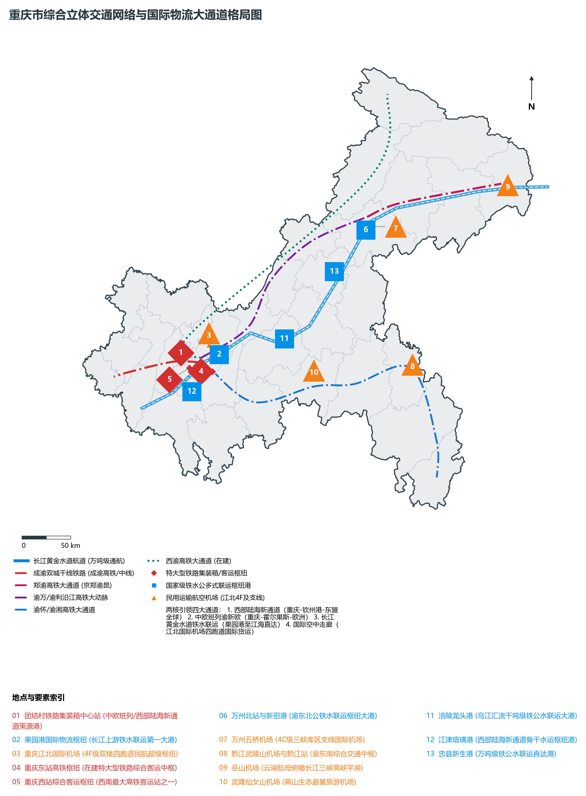
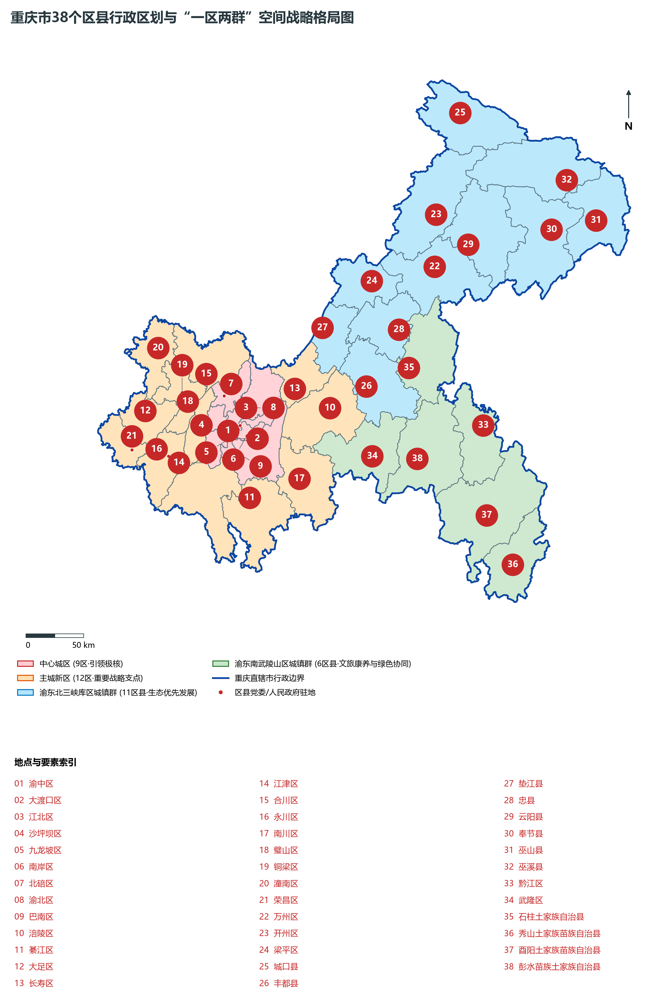
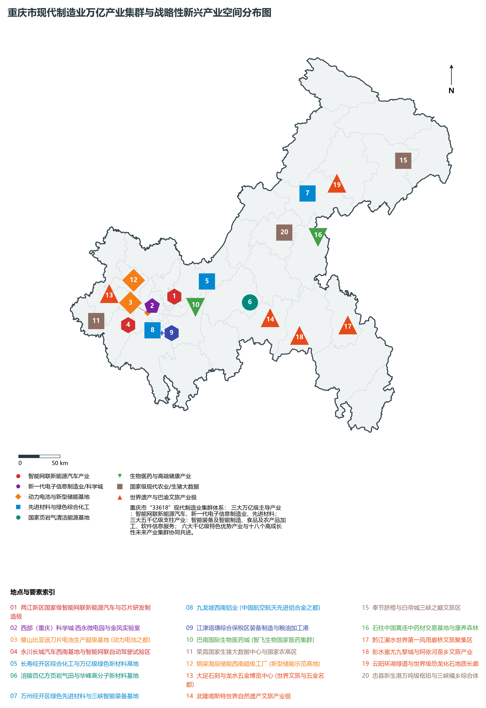
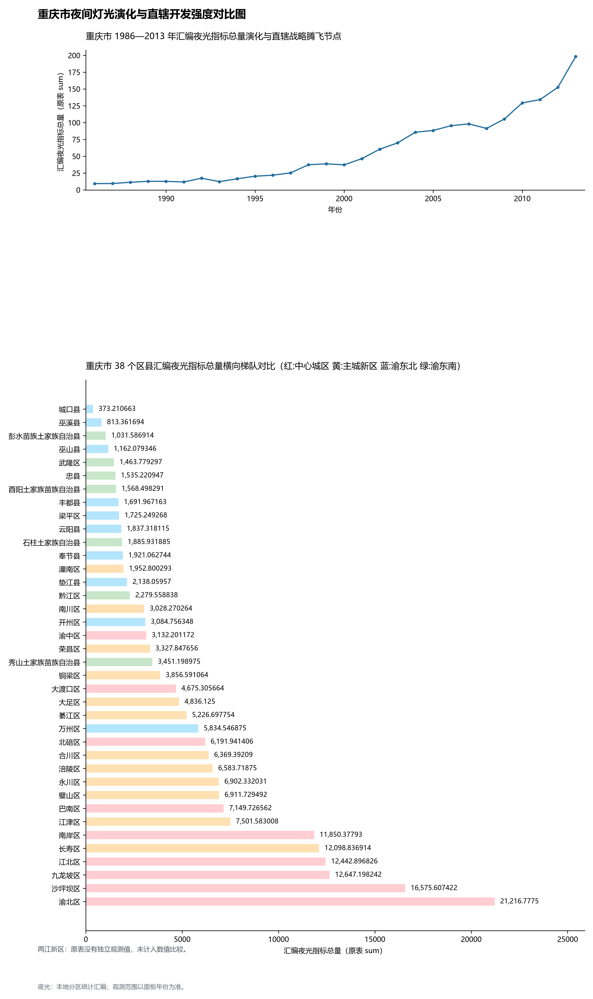

# 21.0 重庆市地理统揽

重庆市，简称“渝”，别称“山城”、“江城”、“雾都”、“桥都”，是我国中西部地区唯一的中央直辖市、国家中心城市、超大城市，国务院批复确定的中国重要的中心城市之一、国家历史文化名城、长江上游地区经济中心、国家重要先进制造业中心、西部金融中心、西部国际综合交通枢纽和国际门户枢纽。重庆地处中国内陆西南部、长江上游地区，地理坐标介于北纬 28° 10' ～ 32° 13'、东经 105° 11' ～ 110° 11' 之间，东西长约 470 km，南北宽约 450 km，幅员陆地总面积达 **8.2403 × 10⁴ km²**，是北京、天津、上海三市总面积的 2.4 倍，堪称“大城市、大农村、大山区、大库区”并存的巨型复合型直辖市。

截至 2024 年末，全市常住人口达到 **3191.43 万人**，常住人口城镇化率提升至 **71.67%**；2024 年全市地区生产总值（GDP）跨越迈上新台阶，达到 **31,100.0 亿元**（按不变价格计算比上年增长 5.7%），成为我国中西部地区首个突破 3 万亿元大关的经济旗舰直辖市；人均 GDP 跃升至 **97,450 元**；三次产业结构比稳健优化演进为 **6.8 : 39.8 : 53.4**，工业经济与数字经济双轮驱动，以智能网联新能源汽车、新一代电子信息制造业、先进材料为代表的“33618”现代制造业集群体系全面成型。全市现辖 38 个区县（包括 26 个市辖区、8 个县、4 个自治县），在市域战略空间上构建起结构严密、分工协同的**“一区两群”**高质量协调发展格局（主城都市区 21 区、渝东北三峡库区城镇群 11 区县、渝东南武陵山区城镇群 6 区县）。作为成渝地区双城经济圈核心极核、西部陆海新通道战略运营中心、长江经济带绿色发展示范区与“一带一路”和长江经济带联结点的战略支点，新时代的重庆正在奋力谱写中国式现代化的新篇章。

---

## 一、大地构造、川东平行岭谷与“四山环抱·高峡幽壑”宏观自然地理底盘

重庆的大地构造位置处于扬子准地台四川台坳与川鄂湘黔隆起褶皱带的交接转换带，构造运动极其剧烈而漫长。地质历史上经历了印支运动、燕山运动与喜马拉雅运动的强烈挤压剪切，形成了世界地貌学上蔚为壮观的**“川东平行岭谷”**与**“周缘重峦断褶山原”**复合共生的巨型山地地貌骨架：

1. **川东平行岭谷（世界梳状褶皱地貌奇观）**：
   - 分布于重庆主城都市区及垫江、梁平一带，由华蓥山、明月山、铜锣山、缙云山、中梁山、龙王洞山等数十条大致呈北北东至北东走向的长条状背斜山脉与相间的向斜宽谷平行相间排列；
   - 构造背斜紧窄直立形成陡峭山岭，两翼石灰岩溶蚀成槽谷，向斜开阔平缓发育成红层丘陵盆地，构成“一山二岭一槽”或“一山三岭二槽”的典型喀斯特隔挡式平行褶皱体系，长江与嘉陵江自西向东横切这些背斜山岭，形成著名的嘉陵江小三峡（沥鼻峡、温塘峡、观音峡）及长江峡谷通道；
2. **周缘崇山峻岭与高海拔喀斯特台原**：
   - **北部大巴山断褶带**：巍峨屏峙于渝陕鄂交界，山势险峻，阴条岭（海拔 **2796.8 m**）为重庆第一高峰，光头山、雪宝山层峦叠嶂，发育有冰川孑遗地貌与深切峡谷；
   - **东部巫山构造带**：巫山十二峰如屏耸立，长江深切其间形成举世闻名的长江三峡（瞿塘峡、巫峡）；
   - **东南武陵山构造带与大娄山北麓**：广泛发育巨厚碳酸盐岩层，由于新生代强烈抬升与流水溶蚀侵蚀，形成了世界级岩溶天坑、溶洞、地缝、盲谷与高山喀斯特台原桌山（如武隆天生三桥、芙蓉洞、奉节小寨天坑、天井峡地缝、南川金佛山喀斯特桌山），武隆喀斯特与金佛山喀斯特先后被联合国教科文组织列入世界自然遗产名录。

全省/全市海拔极值反差极其悬殊：

- **全市最高峰（巴渝之巅）**：巫溪县东北部大巴山余脉的**阴条岭主峰（海拔 2796.8 m）**，属于神农架西延原始森林区，常年冰雪覆盖期达 4 个月；
- **全省次高与喀斯特极顶**：城口县**光头山（海拔 2686.0 m）**、开州区**雪宝山（海拔 2626.0 m）**、巫溪县**红池坝天子城（海拔 2630.0 m）**及南川区**金佛山风吹岭（海拔 2251.0 m）**；
- **全市陆域最低极点**：巫山县东端与湖北省巴东县交界处的**培石乡长江出境谷底水面（海拔 73.1 m）**，高低相对落差达 **2723.7 m**。

**重庆市“川东平行岭谷—长江贯通—周缘高山”立体地貌剖面示意表**

| 华蓥山/铜锣山/缙云山 | 渝中半岛朝天门两江汇 | 瞿塘峡/巫峡/高峡平湖 | 阴条岭2797m/金佛山2251m |
| --- | --- | --- | --- |
| 梳状背斜·长条溶槽谷；嘉陵江小三峡切穿山岭 | 依山筑城·高差错落三维；洪崖洞吊脚楼·轻轨穿楼 | 水位175m·万吨轮直达港；白帝城夔门·神女峰红叶 | 世界自然遗产·南方喀斯特；高山草甸雪原·天坑地缝群 |

川东隔挡平行岭谷 · → 中心城区两江四岸 · → 三峡深切峡江平湖 · → 周缘大巴山/武陵山极顶

---

## 二、山地湿润季风气候、立体水热分异与“长江横贯·百川汇流”水文水系

重庆市属中亚热带湿润季风气候区，因受川东盆地地形阻滞、深山峡谷深切与季风环流共同影响，呈现出极其显著的区域气候特征：

- **热量充沛与夏热冬暖**：年平均气温在 **16.0°C ～ 18.5°C** 之间（高海拔山区如城口、金佛山在 8°C ～ 14°C），无霜期长达 300~340 天。盛夏 7~8 月受西太平洋副热带高压控制，沿江低丘盆地深陷下沉气流，热量不易散失，极端最高气温可超 42°C，历史上享有“四大火炉”之称；而冬季受北面秦岭、大巴山天然高屏障阻挡冷空气南下，气候温和，极少严寒；
- **巴山夜雨与冬春云雾**：年均降水量达 **1000 ～ 1450 mm**，降水集中在 5~9 月。夜间山谷逆温层发育，促使山谷暖湿气流抬升冷凝成雨，“巴山夜雨涨秋池”正是这种地形抬升夜雨现象的真实写照；秋冬季节水汽丰沛而风力微弱，常形成浓重逆温层，年均雾日超过 100 天，壁山、江北、南山云雾迷蒙，“雾都”之名名扬海内外；
- **立体垂直气候带谱极其完备**：从海拔 100 米河谷到近 2800 米高山，气候从南亚热带河谷过渡到暖温带、中温带高山，植物生长期差异显著，孕育了“一山有四季，十里不同天”的农林立体多样性。

在水网水系方面，重庆是长江上游水资源集聚汇流中心。长江干流自江津区石蟆镇入境，向东北斜穿全境，经江津、九龙坡、大渡口、巴南、南岸、渝中、江北、长寿、涪陵、丰都、忠县、万州、云阳、奉节、巫山等 15 个区县，于巫山县培石乡出境进入湖北宜昌，市域干流流程长达 **691 km**，占长江上游干流总长的近三分之一。全市流域面积大于 100 km² 的河流多达 274 条，构成了以长江为骨干大动脉，嘉陵江、乌江两大干支流南北对称汇流的庞大树状水网水系：

1. **嘉陵江水系（汇水广袤的北岸大动脉）**：
   - 嘉陵江自合川区入境，先后接纳涪江、渠江，形成“三江汇流合川”的壮丽景观，继而穿破温塘峡、沥鼻峡、观音峡，流经北碚、沙坪坝、江北，在渝中半岛朝天门与长江干流合龙汇聚。市域流长 **154 km**，年径流总量达 680 亿立方米；
2. **乌江水系（贯通武陵南岸的峡江大河）**：
   - 乌江发源于贵州乌蒙山脉，自酉阳、彭水入境，穿行于武陵山区深谷绝壁之间，经武隆喀斯特峡谷，于涪陵区北岸注入长江。市域流长 **205 km**，水流湍急，水电水能与峡谷旅游价值极高；
3. **大宁河、綦江、涪江与三峡回水大水库**：
   - **大宁河**：巫溪发源南泻，雕凿出名闻天下的大宁河小三峡、小小三峡，于巫山县城注入长江；
   - **綦江**：大娄山发源，北贯綦江、江津注入长江；
   - **三峡工程蓄水回水区**：三峡水库正常蓄水位达到 **175 m**，库区回水直达江津，在重庆境内形成长达 600 余公里的深水“高峡平湖”，千吨级、万吨级船队可常年直抵重庆果园港，彻底释放了长江“黄金水道”的超级水运航运红利。

---

## 三、“一区两群”国土空间格局与成渝地区双城经济圈核心引领极

按照国家赋予的战略使命与重庆市国土空间总体规划，全市统筹划定并纵深推进**“一区两群”**空间战略发展格局：

1. **主城都市区（21 个区·全市高质量发展主引擎与极核）**：
   - 面积达 **2.87 × 10⁴ km²**，集聚了全市约 66% 的常住人口与接近 77% 的经济总量；
   - **中心城区九区（引领极）**：渝中、大渡口、江北、沙坪坝、九龙坡、南岸、北碚、渝北、巴南。重点做优“两江四岸”核心区，做强江北嘴西部金融中心、解放碑商业中枢，建设两江新区先进制造业高地与西部（重庆）科学城科技策源引擎，提升城市综合能级与国际化水平；
   - **主城新区 12 区（战略支点）**：涪陵、长寿、江津、合川、永川、南川、綦江、大足、璧山、铜梁、潼南、荣昌。承接中心城区产业转移与人口疏解，大力发展智能网联新能源汽车零部件、动力电池、先进材料、现代食品装备与特色农业大数据，形成与中心城区功能互补、产城融合的同城化发展网络；
2. **渝东北三峡库区城镇群（11 个区县·生态优先绿色发展示范区）**：
   - 包括万州区、开州区、梁平区、城口县、丰都县、垫江县、忠县、云阳县、奉节县、巫山县、巫溪县；
   - 面积达 **3.39 × 10⁴ km²**。以**万州**为区域中心城市，联动开州、梁平推进“万开云”同城化发展，依托长江黄金水道、郑渝高铁与新田港，重点布局绿色先进材料、现代医药、三峡特色生态旅游与晚熟柑橘（奉节脐橙）、忠县柑橘产业，坚决筑牢长江上游生态屏障；
3. **渝东南武陵山区城镇群（6 个区县·文旅融合与绿色康养高地）**：
   - 包括黔江区、武隆区、石柱土家族自治县、秀山土家族苗族自治县、酉阳土家族苗族自治县、彭水苗族土家族自治县；
   - 面积达 **1.98 × 10⁴ km²**。以**黔江**为区域中心，发挥世界自然遗产（武隆喀斯特）、民俗文化（蚩尤九黎城、濯水风雨廊桥、沈从文边城洪安古镇、酉阳桃花源）与高山森林氧吧（黄水、仙女山、摩围山）独特优势，大力发展生态康养度假、中药材（石柱黄连）与绿色现代农林经济，成为践行“两山论”的高水平样板区。

---

## 四、综合立体交通网络、国家综合货运枢纽与陆海新通道战略策源地

重庆牢牢把握国家综合立体交通网“极”的战略定位，加快建设统筹东西南北的综合立体大通道：

- **西部陆海新通道战略运营中心**：以重庆为运营组织中心，以沙坪坝团结村铁路集装箱中心站、巴南公路物流基地、江津珞璜港为始发港，铁海联运班列直通广西北部湾港出海，辐射全球 120 多个国家和地区的 500 多个港口；
- **中欧班列（渝新欧）始发策源地**：2011 年全国首创首发，横跨欧亚大陆直达德国杜伊斯堡，累计开行量突破 1.5 万列，货值稳居全国领先地位；
- **长江上游航运中心与多式联运大港**：
  - **果园港**：全国最大内河铁水公联运枢纽港，万吨级双向通达；
  - **万州新田港、涪陵龙头港、江津珞璜港、忠县新生港**构筑起干支协同的枢纽港集群；
- **“米”字型高铁网加速成网**：
  - 成渝高铁、成渝中线高铁（时速350公里双核直连）、郑渝高铁（三峡库区快速出海入京）、渝万高铁、渝昆高铁、渝湘高铁、西渝高铁全方位交织，实现成渝 1 小时通达、周边省会 2 小时通达、京津冀长三角粤港澳 6 小时通达；
- **双枢纽民航空港体系**：
  - **重庆江北国际机场（4F级）**：已建成双楼四跑道，年旅客保障能力突破 8000 万人次、货邮保障能力 120 万吨；
  - 万州五桥机场、黔江武陵山机场、巫山机场、武隆仙女山机场构筑起“一大四小”支线航空保障网。

---

## 五、“33618”现代制造业集群体系与高质量现代产业新质生产力

重庆立足坚实的工业底盘，坚定不移推进新型工业化，全力打造“33618”现代制造业集群体系：

1. **三大万亿级主导产业集群**：
   - **智能网联新能源汽车**：聚集长安汽车、赛力斯（AITO问界）、长城汽车、阿维塔、深蓝等头部整车企业，整车年产销突破 230 万辆，新能源汽车产量超 50 万辆，全国汽车第一大城地位强势归来；
   - **新一代电子信息制造业**：全球重要的笔记本电脑生产基地（全球每 3 台笔记本电脑就有 1 台重庆造）与功率半导体生产基地（华润微电子、SK海力士等）；
   - **先进材料**：长寿经开区综合化工新材料、万州先进铝基复合材料、九龙坡西南铝业（航空航天铝合金保障中枢）；
2. **三大五千亿级支柱产业集群**：智能装备及智能制造（工业机器人、高档数控机床）、食品及农产品加工（涪陵榨菜、重庆火锅底料、江小白高粱酒、潼南柠檬）、软件信息服务（满天星行动计划、仙桃数据谷、中国智谷）；
3. **绿色清洁能源与优势特色产业**：涪陵焦石国家级百亿方页岩气田、璧山比亚迪刀片电池生产超级工厂、铜梁海辰储能基地、荣昌国家级生猪大数据中心。

---

## 六、1986—2013年夜间灯光遥感时序变化与直辖空间狂飙

本节夜光图的观测年份为 1986—2013 年，指标为行政区汇总值（原表 sum）。

基于 DMSP-OLS 与 NPP-VIIRS 遥感卫星长时间序列的系统反演分析表明，重庆自 1986 年以来经历了从“局狭母城”到“两江四岸狂飙”、再到“全域多组团璀璨联动”的惊天空间巨变：

