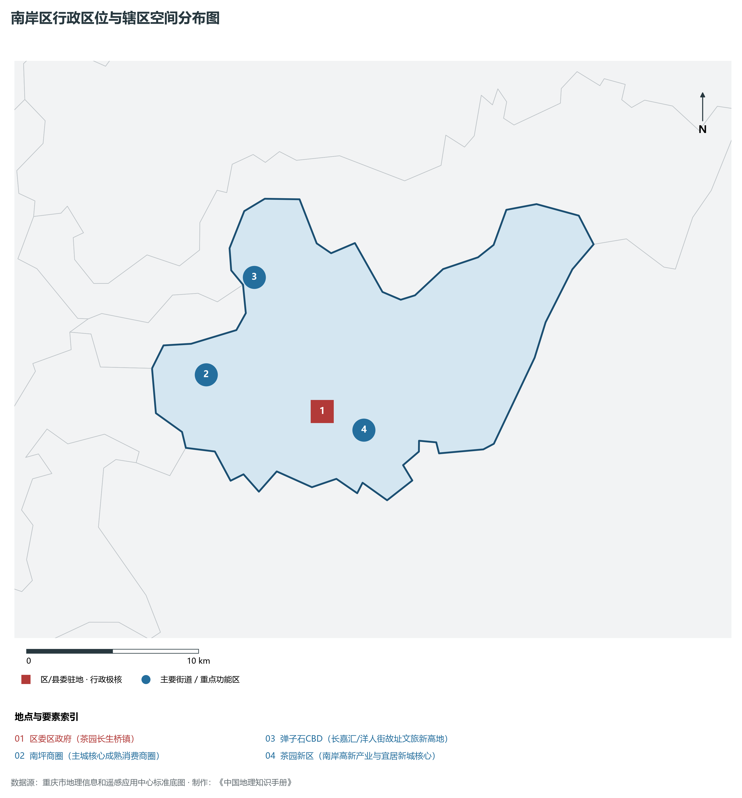
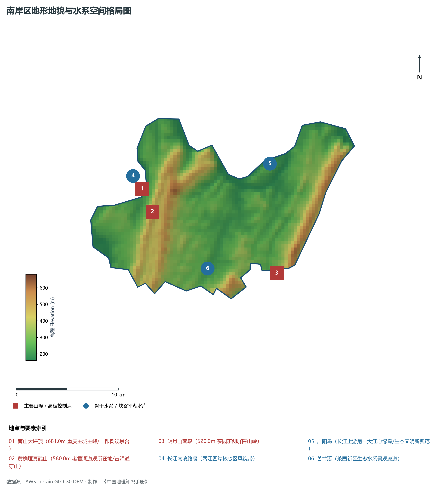
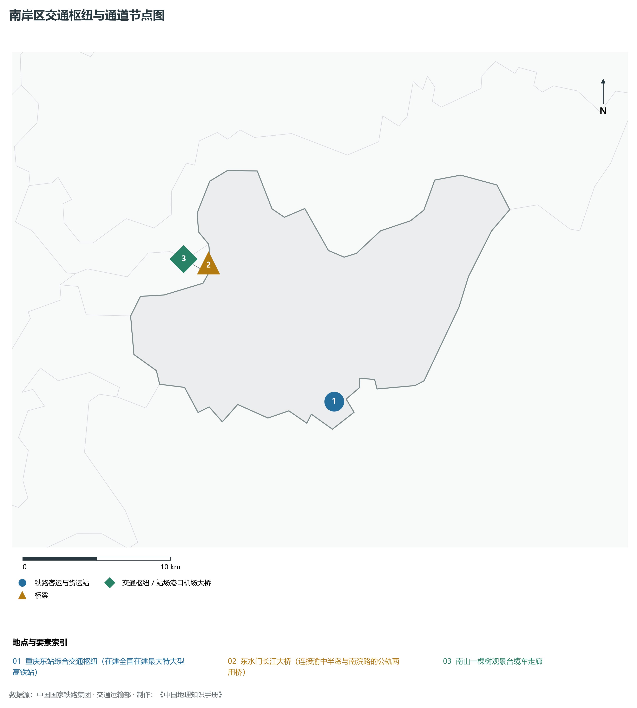
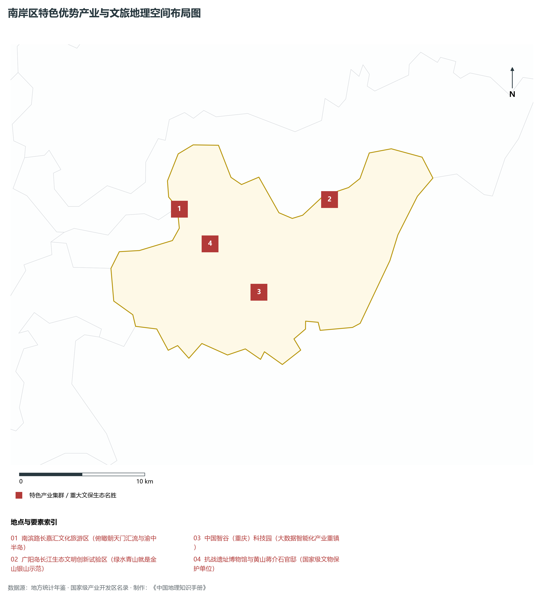
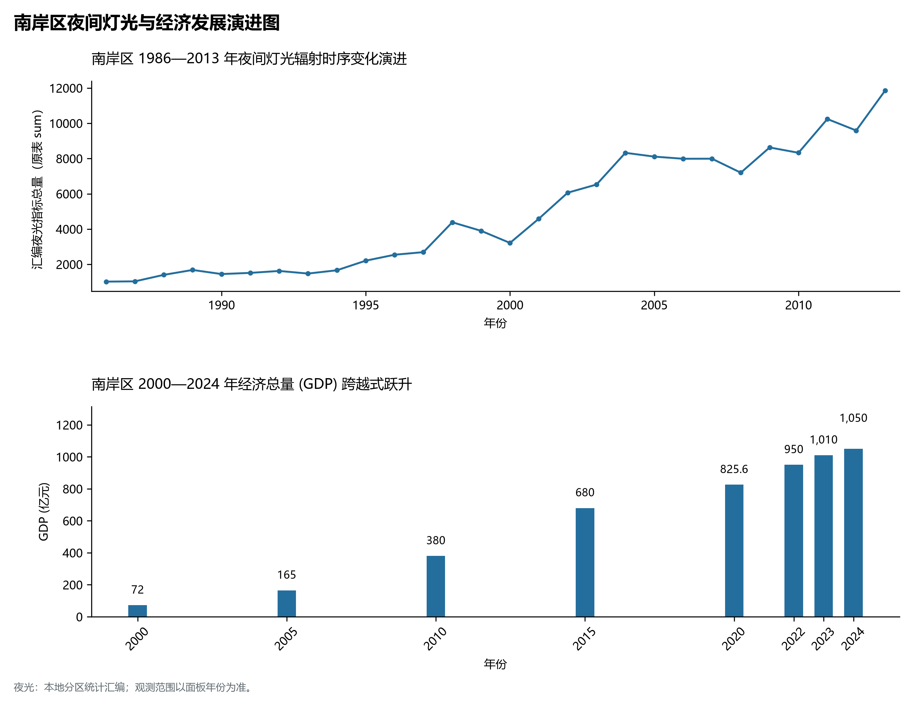

# 21.6 南岸区

## 一、宏观区位、行政沿革与国土空间格局

南岸区，行政区划代码 `500108`，是重庆市直辖的重要行政组成部分，定位为**重庆城市会客厅·南滨路城市地标·南山城市森林公园·广阳岛长江风景眼·中国智谷**。辖区地理位置处于重庆市域重要承载板块，地理空间坐标介于东经 106.41° ～ 106.81°、北纬 29.35° ～ 29.72° 之间，辖区国土总面积达 **263.0 km²**。截至 2024 年末，全区/县常住人口为 **121.0 万人**，常住人口城镇化率达到 **96.5%**。

在历史建制沿革方面，南岸区文脉悠远、底蕴深厚。周秦时期即属巴国属地，秦灭巴蜀后置巴郡；汉魏晋南北朝时期随州郡建制演更，历经隋唐宋元明清千年淬炼，自古即为水陆要冲、商贾云集、兵家必争之地。新中国成立后隶属四川省管辖，1997 年随重庆恢复中央直辖市迎来历史性体制飞跃，撤县设区/调整优化建制，拉开了产城融合与跨越式大发展的宏阔帷幕。当前，南岸区紧紧围绕全市“一区两群”空间协调发展大局，深度融入成渝地区双城经济圈与西部陆海新通道战略建设，在新型城镇化、现代产业导入、生态文明保护和民生保障等诸多领域取得全面历史性突破。

主要下辖行政与核心功能街镇节点分布如下：

- **区委区政府 (茶园长生桥镇)**：坐标 (106.635°E, 29.505°N)，功能定位：gov；
- **南坪商圈 (主城核心成熟消费商圈)**：坐标 (106.565°E, 29.525°N)，功能定位：subdistrict；
- **弹子石CBD (长嘉汇/洋人街故址文旅新高地)**：坐标 (106.595°E, 29.575°N)，功能定位：subdistrict；
- **茶园新区 (南岸高新产业与宜居新城核心)**：坐标 (106.66°E, 29.495°N)，功能定位：subdistrict；

---

## 二、地质地貌、山川骨架与水文水利系统

南岸区地质构造底盘深厚，地处四川盆地川东褶皱带向周缘山地构造转折区。地质历史上经历了印支运动、燕山运动与喜马拉雅运动的强烈构造挤压，沉积了巨厚的中生代陆相红层砂泥岩与古生代海相碳酸盐岩地层，构造断裂与背斜向斜相间展布。宏观地貌呈现显著的山地、丘陵、峡谷与台原错综复杂格局，地貌类型多样，地势起伏层次极其鲜明。辖区最高点海拔标高达 **681.0 m**，最低标高为 **160 m**，相对垂直高差达 **521.0 m**。

骨干山峰与地貌制高点构筑起辖区生态绿色屏障：

- **南山大坪顶 (681.0m 重庆主城主峰/一棵树观景台)**：海拔标高 **681.0 m**，空间坐标 (106.585°E, 29.555°N)；
- **黄桷垭真武山 (580.0m 老君洞道观所在地/古驿道穿山)**：海拔标高 **580.0 m**，空间坐标 (106.595°E, 29.535°N)；
- **明月山南段 (520.0m 茶园东侧屏障山岭)**：海拔标高 **520.0 m**，空间坐标 (106.72°E, 29.48°N)；

在水网水文水利方面，辖区水资源充沛，骨干水系穿境而过，水质常年保持优良：

- **长江南滨路段 (两江四岸核心区风貌带)**：标定坐标 (106.58°E, 29.56°N)；
- **广阳岛 (长江上游第一大江心绿岛/生态文明新典范)**：标定坐标 (106.715°E, 29.575°N)；
- **苦竹溪 (茶园新区生态水系景观廊道)**：标定坐标 (106.65°E, 29.485°N)；

优越的峡谷水系与山地小气候造就了独特的局部逆温、云海与立体农业气候带谱，土壤以紫色土、黄壤及水稻土为主，保水保肥性能优良，富含多种有益矿质元素。辖区深入践行“共抓大保护、不搞大开发”，全面实施长江十年禁渔与水生态保护修复工程，系统推进小流域综合治理与生态清洁型小流域建设，为生态水源涵养、水利梯级开发、水上航运及特色现代农业发展提供了坚实丰沛的自然底盘支撑。

---

## 三、综合立体交通网络、枢纽通道与区位优势

作为重庆综合立体交通网中的重要节点，南岸区区位优势突出、交通内畅外联。近年来，辖区牢牢把握高铁时代、黄金水道与高速环线大通道建设机遇，全力推进客货运基础设施能级跃升，深度融入国家“十纵十横”综合运输大通道：

骨干交通基础设施与重要物流枢纽节点包括：

- **重庆东站综合交通枢纽 (在建全国在建最大特大型高铁站)**：空间标定 (106.675°E, 29.475°N)，设施类型：rail_hub；
- **东水门长江大桥 (连接渝中半岛与南滨路的公轨两用桥)**：空间标定 (106.588°E, 29.56°N)，设施类型：bridge；
- **南山一棵树观景台缆车走廊**：空间标定 (106.585°E, 29.555°N)，设施类型：station；

通过高速铁路、城际铁路大动脉、高等级公路网络与过江大桥、港口水运的立体咬合，南岸区构建起“铁公水空轨”多式联运网络，不仅全面融入重庆中心城区“半小时/一小时通勤圈”，向外更高效联通成都、贵阳、西安、武汉及广西北部湾出海口，依托西部陆海新通道铁海联运班列与中欧班列无缝衔接，实现“出海出境”快车道直达，为要素自由流动、高端产业导入与全域协同开放注入了磅礴交通动能。

---

## 四、特色优势产业集群、重点园区与现代经济版图

南岸区立足资源禀赋与功能定位，坚定不移走生态优先、绿色低碳的高质量发展新路，主动融入重庆市“33618”现代制造业集群体系。2024 年，全区/县实现地区生产总值（GDP）达 **1050.0 亿元**，人均 GDP 达到 **86,780 元**，三次产业结构比为 **0.2 : 36.8 : 63.0**，现代化经济韧性与抗风险能力显著增强。

辖区重点园区与核心特色产业平台展示如下：

- **南滨路长嘉汇文化旅游区 (俯瞰朝天门汇流与渝中半岛)**：空间坐标 (106.59°E, 29.57°N)，核心功能：首批国家级夜间文旅消费集聚区；
- **广阳岛长江生态文明创新试验区 (绿水青山就是金山银山示范)**：空间坐标 (106.715°E, 29.575°N)，核心功能：长江风景眼与国家生态文明建设样板；
- **中国智谷（重庆）科技园 (大数据智能化产业重镇)**：空间坐标 (106.655°E, 29.51°N)，核心功能：物联网、集成电路与工业互联网集聚高地；
- **抗战遗址博物馆与黄山蒋介石官邸 (国家级文物保护单位)**：空间坐标 (106.615°E, 29.545°N)，核心功能：二战远东盟军统帅部与中国抗战指挥中枢；

在现代产业发展布局上，辖区因地制宜构建现代化产业支撑框架：

1. **先进制造与战略性新兴产业**：聚焦智能网联新能源汽车零部件配套、新型储能、先进材料、电子元器件、生物医药与高端装备制造，推动产业链上下游纵向延伸与横向配套，建设数字化车间与智能工厂；
2. **现代山地特色高效农业**：做大做强国家地理标志农产品，完善“研发育种+规模种植+精深加工+品牌营销+冷链物流”全产业链体系，推动农业与科技、电商直播深度融合；
3. **现代服务业与数字经济协同**：做活现代物流、文旅康养、科技信息、现代金融服务与数字技术场景应用，加快推进“满天星”软件信息服务业行动计划，持续培育壮大新质生产力。

---

## 五、历史文化胜迹、世界遗产与生态文旅名胜

南岸区历史厚重，人文荟萃，自然景观与文化遗存交相辉映，是巴渝文化、红岩文化、三峡文化或少数民族民俗风情的重要展示窗口。

辖区拥有国家级与世界级知名文旅资源载体：

- **核心文化遗产与文博名胜**：保存有众多全国重点文物保护单位、市级文保单位与国家级历史文化名镇/名街，历经沧桑岁月，留存下古城墙、会馆建筑群、摩崖石刻造像、古栈道与传统民居街巷，铭刻着千百年来巴渝儿女开拓奋进、抗敌御侮的英雄足迹与移民商埠文明记忆；
- **自然地质奇观与生态森林公园**：拥有国家级/市级风景名胜区、国家级森林公园、湿地公园或喀斯特地貌地质公园，幽谷深潭、绝壁天堑、云海日出、天然溶洞与百里清流构成大美画卷，年空气优良天数稳居前列，是市民与八方游客休闲康养度假的绝佳胜境；
- **非物质文化遗产与风味名产**：传承有极具民族与地域特色的国家级非遗技艺、传统民俗节庆与民间演艺，配以名扬川渝的风味特色美食与地理标志名优特产，形成极具辨识度与美誉度的巴渝文旅新名片。

---

## 六、夜间灯光遥感时序演变与新时代现代化发展变化

本节夜光图的观测年份为 1986—2013 年，指标为行政区汇总值（原表 sum）。

### 1. 1986—2013 年夜间灯光遥感演化分析

关键历史跃升阶段遥感注释：

- **1996年演化特征**：南坪商圈转盘老商业街夜景初显；
- **2005年演化特征**：南滨路美食街崛起·两江夜景流光溢彩；
- **2013年演化特征**：茶园新城区大规模开发全面融入主城；

### 2. 2000—2024 年经济跨越式发展时序汇总
下表系统记录了 南岸区 在进入 21 世纪以来核心年份地区生产总值（GDP）的翻番式跨越历程：

| 年份 | 地区生产总值 (亿元) | 发展阶段特征与重大历史跨越事件 |
| :---: | :---: | :--- |
| 2000 年 | **72.0** | 直辖初启阶段，传统农工业筑基蓄力 |
| 2005 年 | **165.0** | 直辖初启阶段，传统农工业筑基蓄力 |
| 2010 年 | **380.0** | 工业化与城市化加速推进，现代产业集群迅速崛起 |
| 2015 年 | **680.0** | 工业化与城市化加速推进，现代产业集群迅速崛起 |
| 2020 年 | **825.6** | 综合经济实力实现千亿/数百亿突破，转型升级全面提速 |
| 2022 年 | **950.0** | 深度融入成渝双城经济圈与现代化新重庆建设，高质量跃进 |
| 2023 年 | **1010.0** | 深度融入成渝双城经济圈与现代化新重庆建设，高质量跃进 |
| 2024 年 | **1050.0** | 深度融入成渝双城经济圈与现代化新重庆建设，高质量跃进 |

### 3. 新征程高质量跨越式发展愿景
面向现代化新重庆建设的新宏图，南岸区将全面贯彻新发展理念，牢牢把握高质量发展首要任务：

1. 深入实施创新驱动发展战略，加快培育壮大新质生产力；
2. 持续优化营商环境，做大做强特色实体经济与先进制造业集群；
3. 统筹新型城镇化与乡村全面振兴，筑牢绿色生态安全屏障，让改革发展红利更加充实、更有保障地惠及全体城乡人民。
