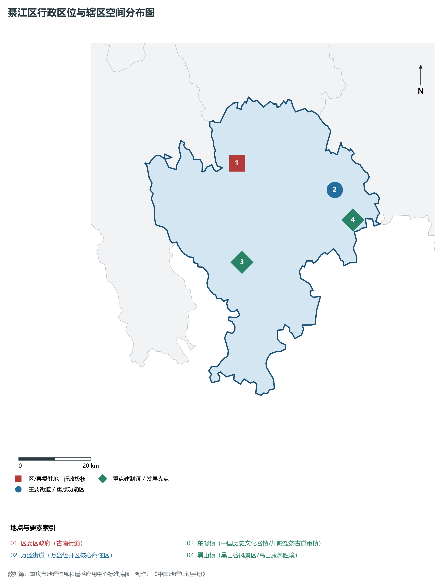
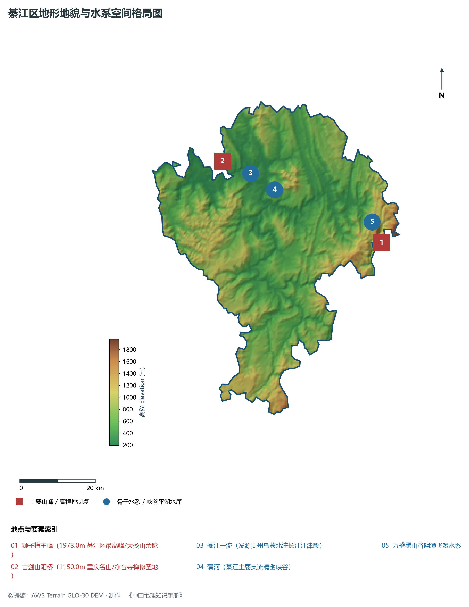
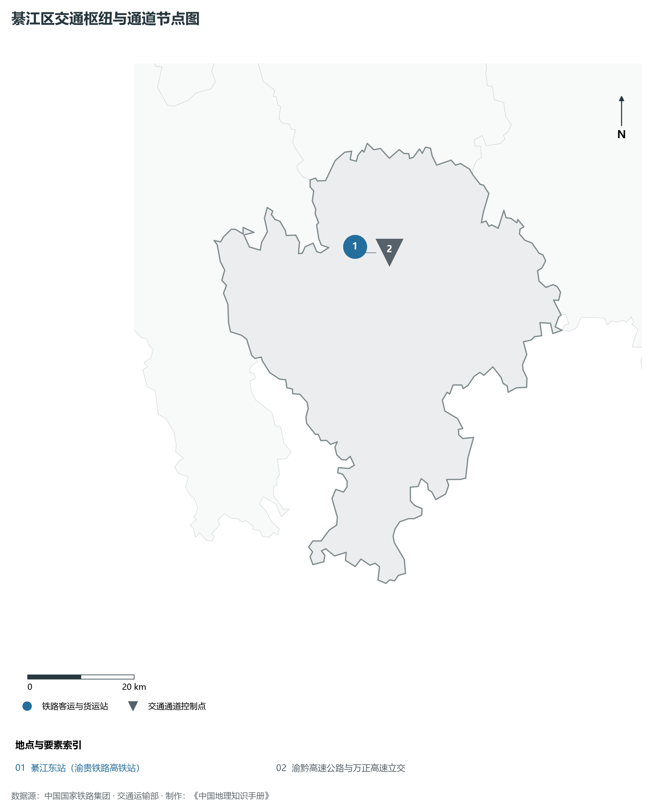
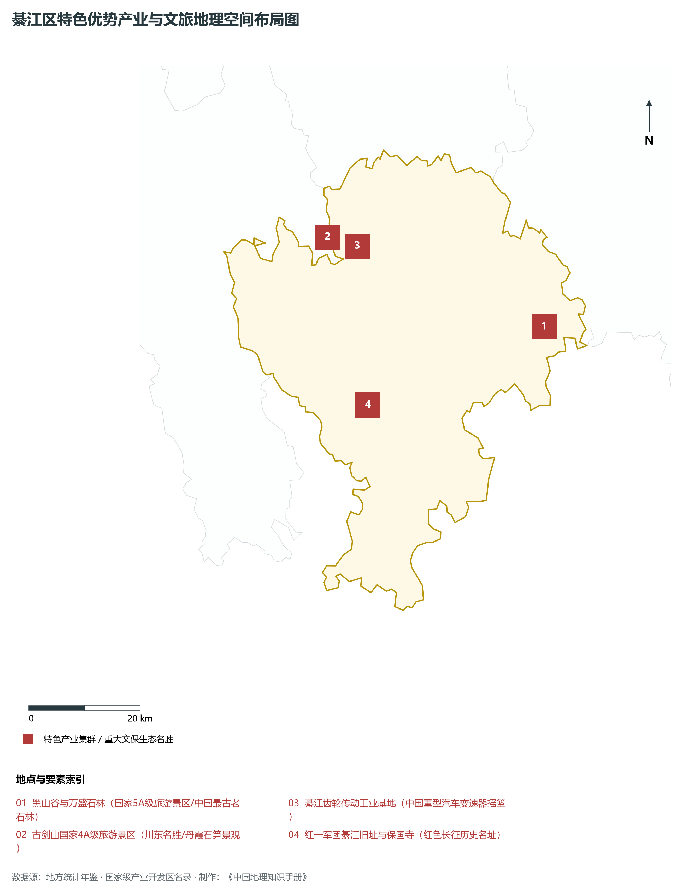
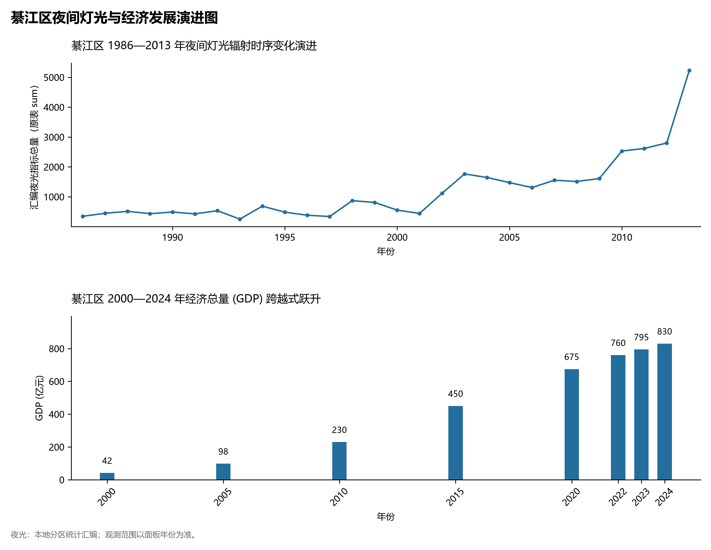

# 21.11 綦江区

## 一、宏观区位、行政沿革与国土空间格局

綦江区，行政区划代码 `500110`，是重庆市直辖的重要行政组成部分，定位为**渝南门户·大娄山生态屏障·中国齿轮之城·万盛石林黑山谷·红一方面军过綦江红色圣地**。辖区地理位置处于重庆市域重要承载板块，地理空间坐标介于东经 106.50° ～ 107.13°、北纬 28.63° ～ 29.17° 之间，辖区国土总面积达 **2182.0 km²**。截至 2024 年末，全区/县常住人口为 **82.0 万人**，常住人口城镇化率达到 **65.5%**。

在历史建制沿革方面，綦江区文脉悠远、底蕴深厚。周秦时期即属巴国属地，秦灭巴蜀后置巴郡；汉魏晋南北朝时期随州郡建制演更，历经隋唐宋元明清千年淬炼，自古即为水陆要冲、商贾云集、兵家必争之地。新中国成立后隶属四川省管辖，1997 年随重庆恢复中央直辖市迎来历史性体制飞跃，撤县设区/调整优化建制，拉开了产城融合与跨越式大发展的宏阔帷幕。当前，綦江区紧紧围绕全市“一区两群”空间协调发展大局，深度融入成渝地区双城经济圈与西部陆海新通道战略建设，在新型城镇化、现代产业导入、生态文明保护和民生保障等诸多领域取得全面历史性突破。

主要下辖行政与核心功能街镇节点分布如下：

- **区委区政府 (古南街道)**：坐标 (106.65°E, 29.025°N)，功能定位：gov；
- **万盛街道 (万盛经开区核心商住区)**：坐标 (106.93°E, 28.955°N)，功能定位：subdistrict；
- **东溪镇 (中国历史文化名镇/川黔盐茶古道重镇)**：坐标 (106.66°E, 28.78°N)，功能定位：town；
- **黑山镇 (黑山谷风景区/高山康养胜境)**：坐标 (106.98°E, 28.88°N)，功能定位：town；

---

## 二、地质地貌、山川骨架与水文水利系统

綦江区地质构造底盘深厚，地处四川盆地川东褶皱带向周缘山地构造转折区。地质历史上经历了印支运动、燕山运动与喜马拉雅运动的强烈构造挤压，沉积了巨厚的中生代陆相红层砂泥岩与古生代海相碳酸盐岩地层，构造断裂与背斜向斜相间展布。宏观地貌呈现显著的山地、丘陵、峡谷与台原错综复杂格局，地貌类型多样，地势起伏层次极其鲜明。辖区最高点海拔标高达 **1973.0 m**，最低标高为 **188 m**，相对垂直高差达 **1785.0 m**。

骨干山峰与地貌制高点构筑起辖区生态绿色屏障：

- **狮子槽主峰 (1973.0m 綦江区最高峰/大娄山余脉)**：海拔标高 **1973.0 m**，空间坐标 (107.01°E, 28.85°N)；
- **古剑山阳桥 (1150.0m 重庆名山/净音寺禅修圣地)**：海拔标高 **1150.0 m**，空间坐标 (106.58°E, 29.05°N)；

在水网水文水利方面，辖区水资源充沛，骨干水系穿境而过，水质常年保持优良：

- **綦江干流 (发源贵州乌蒙北注长江江津段)**：标定坐标 (106.655°E, 29.02°N)；
- **蒲河 (綦江主要支流清幽峡谷)**：标定坐标 (106.72°E, 28.98°N)；
- **万盛黑山谷幽潭飞瀑水系**：标定坐标 (106.985°E, 28.9°N)；

优越的峡谷水系与山地小气候造就了独特的局部逆温、云海与立体农业气候带谱，土壤以紫色土、黄壤及水稻土为主，保水保肥性能优良，富含多种有益矿质元素。辖区深入践行“共抓大保护、不搞大开发”，全面实施长江十年禁渔与水生态保护修复工程，系统推进小流域综合治理与生态清洁型小流域建设，为生态水源涵养、水利梯级开发、水上航运及特色现代农业发展提供了坚实丰沛的自然底盘支撑。

---

## 三、综合立体交通网络、枢纽通道与区位优势

作为重庆综合立体交通网中的重要节点，綦江区区位优势突出、交通内畅外联。近年来，辖区牢牢把握高铁时代、黄金水道与高速环线大通道建设机遇，全力推进客货运基础设施能级跃升，深度融入国家“十纵十横”综合运输大通道：

骨干交通基础设施与重要物流枢纽节点包括：

- **綦江东站 (渝贵铁路高铁站)**：空间标定 (106.66°E, 29.015°N)，设施类型：rail；
- **渝黔高速公路与万正高速立交**：空间标定 (106.67°E, 29.005°N)，设施类型：highway；

通过高速铁路、城际铁路大动脉、高等级公路网络与过江大桥、港口水运的立体咬合，綦江区构建起“铁公水空轨”多式联运网络，不仅全面融入重庆中心城区“半小时/一小时通勤圈”，向外更高效联通成都、贵阳、西安、武汉及广西北部湾出海口，依托西部陆海新通道铁海联运班列与中欧班列无缝衔接，实现“出海出境”快车道直达，为要素自由流动、高端产业导入与全域协同开放注入了磅礴交通动能。

---

## 四、特色优势产业集群、重点园区与现代经济版图

綦江区立足资源禀赋与功能定位，坚定不移走生态优先、绿色低碳的高质量发展新路，主动融入重庆市“33618”现代制造业集群体系。2024 年，全区/县实现地区生产总值（GDP）达 **830.0 亿元**，人均 GDP 达到 **101,220 元**，三次产业结构比为 **8.5 : 44.5 : 47.0**，现代化经济韧性与抗风险能力显著增强。

辖区重点园区与核心特色产业平台展示如下：

- **黑山谷与万盛石林 (国家5A级旅游景区/中国最古老石林)**：空间坐标 (106.98°E, 28.9°N)，核心功能：幽峡飞瀑、古石林与奥陶纪悬崖高空极限体验；
- **古剑山国家4A级旅游景区 (川东名胜/丹霞石笋景观)**：空间坐标 (106.58°E, 29.05°N)，核心功能：黔蜀门屏与佛教净音名刹人文古迹；
- **綦江齿轮传动工业基地 (中国重型汽车变速器摇篮)**：空间坐标 (106.635°E, 29.035°N)，核心功能：国家火炬计划重型汽车传动机械产业基地；
- **红一军团綦江旧址与保国寺 (红色长征历史名址)**：空间坐标 (106.65°E, 28.78°N)，核心功能：中央红军长征过綦江战略转折与红军桥；

在现代产业发展布局上，辖区因地制宜构建现代化产业支撑框架：

1. **先进制造与战略性新兴产业**：聚焦智能网联新能源汽车零部件配套、新型储能、先进材料、电子元器件、生物医药与高端装备制造，推动产业链上下游纵向延伸与横向配套，建设数字化车间与智能工厂；
2. **现代山地特色高效农业**：做大做强国家地理标志农产品，完善“研发育种+规模种植+精深加工+品牌营销+冷链物流”全产业链体系，推动农业与科技、电商直播深度融合；
3. **现代服务业与数字经济协同**：做活现代物流、文旅康养、科技信息、现代金融服务与数字技术场景应用，加快推进“满天星”软件信息服务业行动计划，持续培育壮大新质生产力。

---

## 五、历史文化胜迹、世界遗产与生态文旅名胜

綦江区历史厚重，人文荟萃，自然景观与文化遗存交相辉映，是巴渝文化、红岩文化、三峡文化或少数民族民俗风情的重要展示窗口。

辖区拥有国家级与世界级知名文旅资源载体：

- **核心文化遗产与文博名胜**：保存有众多全国重点文物保护单位、市级文保单位与国家级历史文化名镇/名街，历经沧桑岁月，留存下古城墙、会馆建筑群、摩崖石刻造像、古栈道与传统民居街巷，铭刻着千百年来巴渝儿女开拓奋进、抗敌御侮的英雄足迹与移民商埠文明记忆；
- **自然地质奇观与生态森林公园**：拥有国家级/市级风景名胜区、国家级森林公园、湿地公园或喀斯特地貌地质公园，幽谷深潭、绝壁天堑、云海日出、天然溶洞与百里清流构成大美画卷，年空气优良天数稳居前列，是市民与八方游客休闲康养度假的绝佳胜境；
- **非物质文化遗产与风味名产**：传承有极具民族与地域特色的国家级非遗技艺、传统民俗节庆与民间演艺，配以名扬川渝的风味特色美食与地理标志名优特产，形成极具辨识度与美誉度的巴渝文旅新名片。

---

## 六、夜间灯光遥感时序演变与新时代现代化发展变化

本节夜光图的观测年份为 1986—2013 年，指标为行政区汇总值（原表 sum）。

### 1. 1986—2013 年夜间灯光遥感演化分析

关键历史跃升阶段遥感注释：

- **1996年演化特征**：綦江老县城与万盛煤电矿区初现灯火；
- **2005年演化特征**：綦万高速通车·齿轮工业基地成形；
- **2013年演化特征**：黑山谷5A景区引爆避暑旅游热潮；
- **2023年演化特征**：渝贵高铁过境·万盛转型示范区与綦江高新区并进；

### 2. 2000—2024 年经济跨越式发展时序汇总
下表系统记录了 綦江区 在进入 21 世纪以来核心年份地区生产总值（GDP）的翻番式跨越历程：

| 年份 | 地区生产总值 (亿元) | 发展阶段特征与重大历史跨越事件 |
| :---: | :---: | :--- |
| 2000 年 | **42.0** | 直辖初启阶段，传统农工业筑基蓄力 |
| 2005 年 | **98.0** | 直辖初启阶段，传统农工业筑基蓄力 |
| 2010 年 | **230.0** | 工业化与城市化加速推进，现代产业集群迅速崛起 |
| 2015 年 | **450.0** | 工业化与城市化加速推进，现代产业集群迅速崛起 |
| 2020 年 | **675.0** | 综合经济实力实现千亿/数百亿突破，转型升级全面提速 |
| 2022 年 | **760.0** | 深度融入成渝双城经济圈与现代化新重庆建设，高质量跃进 |
| 2023 年 | **795.0** | 深度融入成渝双城经济圈与现代化新重庆建设，高质量跃进 |
| 2024 年 | **830.0** | 深度融入成渝双城经济圈与现代化新重庆建设，高质量跃进 |

### 3. 新征程高质量跨越式发展愿景
面向现代化新重庆建设的新宏图，綦江区将全面贯彻新发展理念，牢牢把握高质量发展首要任务：

1. 深入实施创新驱动发展战略，加快培育壮大新质生产力；
2. 持续优化营商环境，做大做强特色实体经济与先进制造业集群；
3. 统筹新型城镇化与乡村全面振兴，筑牢绿色生态安全屏障，让改革发展红利更加充实、更有保障地惠及全体城乡人民。
