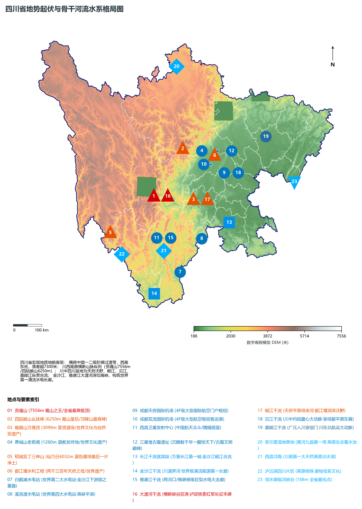
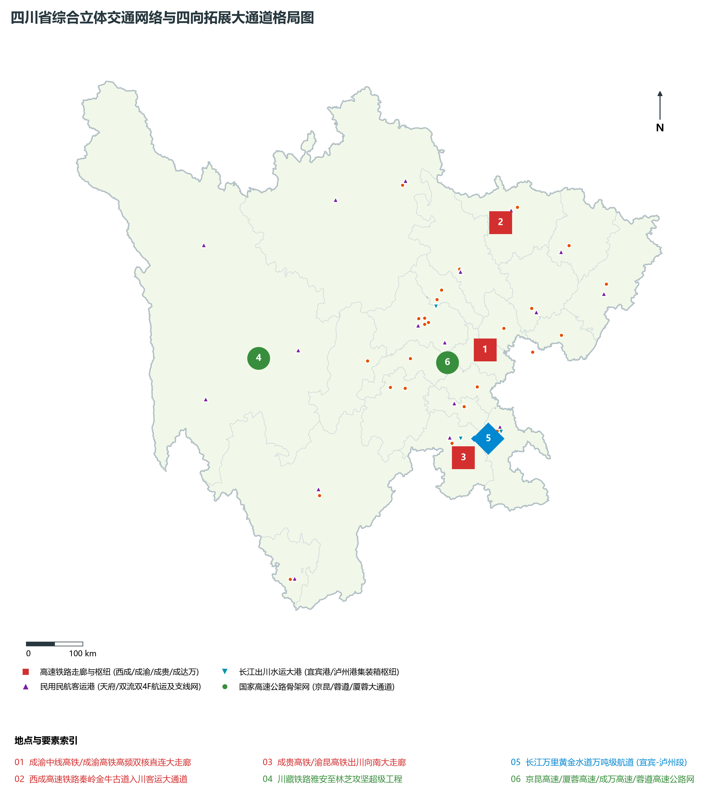
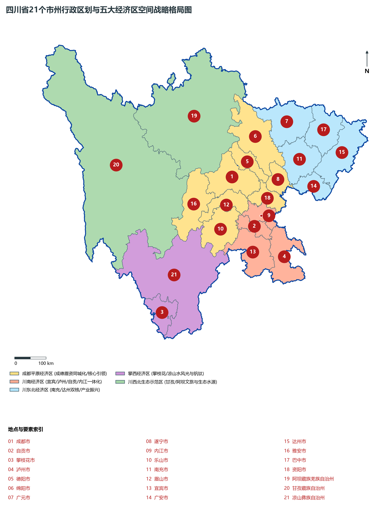
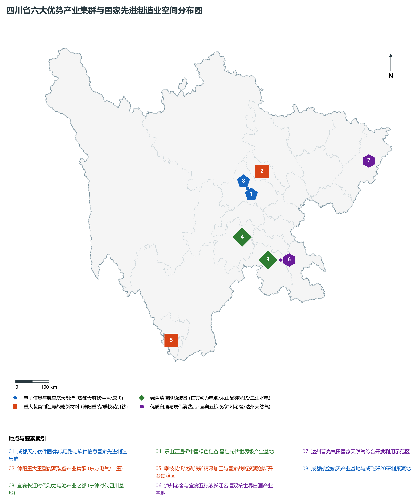
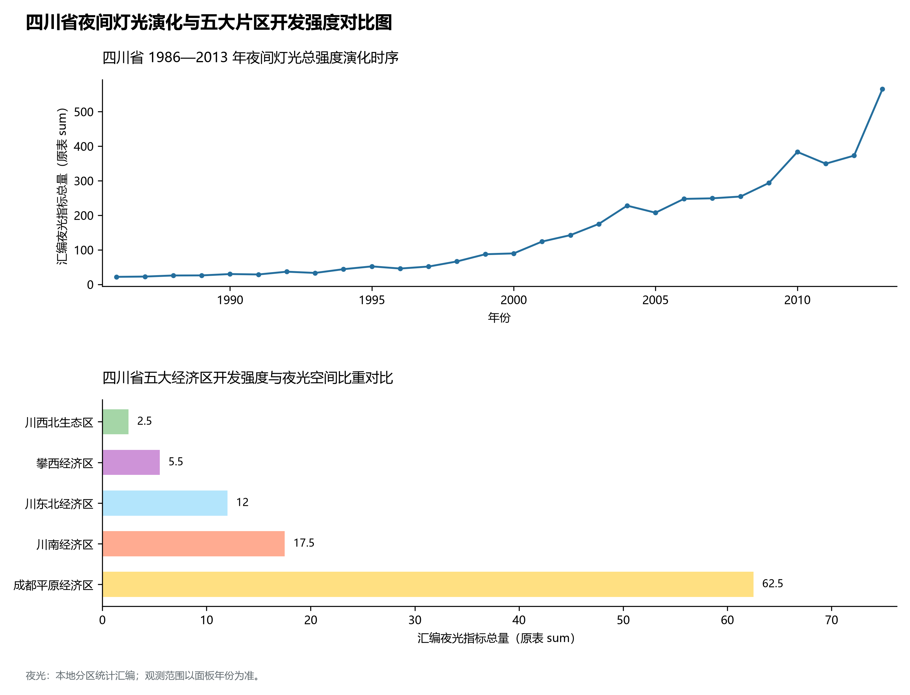

# 22.0 四川省地理统揽

四川省，简称“川”或“蜀”，省会成都市，别称“天府之国”、“千河之省”，地处中国西南腹地、长江上游，介于东经 97° 21' ～ 108° 33'、北纬 26° 03' ～ 34° 19' 之间，东西长约 1075 km，南北宽约 921 km，幅员陆地总面积达 **48.6 × 10⁴ km²**，位居全国第 5 位。四川北连陕西、甘肃、青海，西接西藏，南界云南、贵州，东邻重庆，不仅是连接我国西南、西北、华中和通往青藏高原的宏观枢纽，更是国家战略腹地建设的核心承载地、长江上游关键生态屏障与成渝地区双城经济圈的核心引擎。

截至 2024 年末，全省常住人口达 **8,368.0 万人**，常住人口城镇化率达 **59.40%**；2024 年全省地区生产总值（GDP）历史性跨越突破 6 万亿元大关，达到 **60,132.9 亿元**（按不变价格计算比上年增长 5.7%），稳居全国第 5 位、西部第 1 位；人均 GDP 跃升至 **71,860 元**；三次产业结构比优化为 **10.1 : 35.8 : 54.1**。全省现辖 18 个地级市、3 个自治州（共 21 个市州、183 个县级行政区），在全省国土空间格局上确立并纵深推进“五大经济区”（成都平原经济区、川南经济区、川东北经济区、攀西经济区、川西北生态示范区）协同联动高质量发展新战略。

---

## 一、大地构造、地势三级阶梯与“西高东低·蜀山千重”宏观自然地理底盘

四川地处欧亚板块与印度洋板块碰撞挤压形成的青藏高原东缘碰撞造褶带，地质构造极其复杂，新构造运动与现代构造地震活动活跃。全省地势西高东低、落差极为悬殊，横跨中国地势第一级阶梯与第二级阶梯：

1. **西部高原山地（第一级阶梯·横断山系与青藏高原东南缘）**：
   - 海拔普遍在 3000 ～ 5000 m 以上，由北向南纵列分布着岷山、邛崃山、大雪山、沙鲁里山等一系列南北走向的高大褶皱断块山脉；
   - **贡嘎山主峰（海拔 7556.0 m）**巍然耸立于大雪山脉，被誉为“蜀山之王”，发育有壮观的现代海洋性高山冰川（海螺沟冰川等）；
   - 川西北高原分布着广袤的高寒草原与高位沼泽泥炭湿地（若尔盖湿地、红原草原），地势相对平坦开阔，是黄河上游极其关键的“蓄水池”；
2. **东部四川盆地（第二级阶梯·红色沉积岩深厚盆地）**：
   - 面积达 16.5 × 10⁴ km²，海拔在 250 ～ 750 m 之间，地表广布中生代侏罗纪、白垩纪红色砂岩和泥岩，素有“红色盆地”或“紫色盆地”之称；
   - 盆地内部可进一步分为西部的**成都平原**（面积约 9000 km²，由岷江、沱江等冲积扇重叠而成的富庶扇形平原，自古享有“天府之国”美誉）、中部的**川中丘陵**（方山丘陵遍布）以及东部的**川东平行岭谷**（华蓥山、铜锣山、明月山等长条状背斜平行排列）；
3. **盆周边缘褶皱山系**：
   - 北面耸立着大巴山、米仓山、龙门山，阻挡冷空气南侵；南面为大娄山、凉山山地，紧锁金沙江大峡谷。

全省极值相对高差达到惊人的 **7368.0 m**：

- **全省最高峰**：甘孜藏族自治州康定市与泸定县交界的**贡嘎山主峰（海拔 7556.0 m）**；
- **全省次高与著名极顶**：甘孜州**格聂神山（6204.0 m）**、阿坝州**四姑娘山幺妹峰（6250.0 m）**、阿坝州**雪宝顶（5588.0 m）**、凉山州**狮子山主峰（4076.0 m）**、乐山市**峨眉山万佛顶（3099.0 m）**；
- **全省陆域最低点**：广安市邻水县御临镇大洪河出境水面（**海拔 188.0 m**）。

**四川省“青藏高原东南缘—横断山—四川盆地”宏观立体地貌剖面图**

| 若尔盖泥炭高位沼泽 | 贡嘎山7556m/格聂6204m | 龙门山断裂带·逆冲顶推 | 成都平原天府腹心/都江堰 |
| --- | --- | --- | --- |
| 黄河首曲大拐弯174km；高寒草甸·黑颈鹤家园 | 海螺沟现代大冰川发育；金沙江/大渡河千米深谷 | 青城山/四姑娘山幺妹峰；阶梯边缘暴雨云雾激增 | 冲积扇绿野·紫色土丘陵；千里沃野·天府之国粮仓 |

川西北高寒草原 · → 横断山高山峡谷 · → 龙门山/邛崃山突变带 · → 成都平原与川中丘陵

---

## 二、气候水热垂直分异、“千河之省”与国家清洁能源大基地水文底盘

四川省气候深受青藏高原动力与热力阻滞以及东亚季风和南亚季风共同调制，呈现出“东暖西凉、干湿分明、垂直带谱完备”的三大基本特征：

- **四川盆地中亚热带湿润气候区**：终年温暖湿润，年平均气温 16°C ～ 18°C，无霜期达 280~350 天；冬季受北部秦巴山地有效屏障阻隔，比同纬度的长江中下游平原气温高出 2°C ～ 4°C；年降水量 900 ～ 1300 mm，龙门山前、峨眉山迎风坡年降雨量甚至超 2000 mm，素有“华西雨屏”与“峨眉夜雨”之称；盆地内云雾多、日照少，素有“蜀犬吠日”之古谚；
- **川西南山地亚热带半湿润气候区**：安宁河谷与攀西高原日照充沛（年日照 2300~2700 小时），冬暖夏凉，干湿季极其分明，干热河谷适宜热带水果常年种植；
- **川西北高山高原高寒气候区**：严寒期长，年平均气温 0°C ～ 5°C，热量不足但日照充足、紫外线强烈，气温日较差大而年较差小。

在水系水文方面，四川素有“千河之省”之美誉，全省流域面积大于 100 km² 的河流有 1400 余条：

1. **长江水系（覆盖全省 96.6% 面积）**：
   - 长江上游干流金沙江与岷江在宜宾合流后始称“长江”（川江段），贯穿泸州出川入渝；
   - 雅砻江、大渡河、岷江、沱江、嘉陵江（汇涪江、渠江）自西向东排列，水量极为丰沛，落差巨大；
2. **黄河水系（覆盖全省 3.4% 面积）**：
   - 黄河自青海入境，流经若尔盖、阿坝两县，形成壮美的黄河九曲第一大拐弯，在四川境内流程达 **174 km**，为黄河干流补给了枯水期高达 30% 以上的水量；
3. **世界级清洁能源基地与超级水利枢纽**：
   - 全省水能资源理论蕴藏量达 **1.5 亿千瓦**，技术可开发量超 **1.2 亿千瓦**，居全国第一位；
   - 金沙江下游崛起乌东德（1020万千瓦）、白鹤滩（1600万千瓦）、溪洛渡（1260万千瓦）、向家坝（640万千瓦）四大世界级巨型水电站，连同雅砻江锦屏一级二级、两河口，大渡河瀑布沟等，构建起世界最大的清洁能源走廊；
   - 千年都江堰无坝引水水利工程历经 2280 余年岁月的淘洗，至今仍灌溉着成都平原 1130 余万亩良田，造就了不知饥馑的“天府之国”。

---

## 三、“五大经济区”战略国土空间格局与成渝地区双城经济圈极核

四川省严格按照国土空间总体规划与高质量协调发展战略，统筹构筑起“五大经济区”与“四向拓展、全域开放”战略空间格局：

1. **成都平原经济区（8 市·高质量发展主引擎）**：
   - 包括成都市、德阳市、绵阳市、遂宁市、乐山市、眉山市、雅安市、资阳市；
   - 面积占全省 28.9%，集中了全省 53% 的人口与超过 60% 的经济总量；
   - 以成都市为核心极核，推动成德眉资同城化发展，做强中国科技城绵阳与重装之都德阳，建设具有全国影响力的重要经济中心与科技创新中心；
2. **川南经济区（4 市·全省经济第二增长极）**：
   - 包括自贡市、泸州市、内江市、宜宾市；
   - 依托长江黄金水道与成自宜高铁，建设国家优质白酒产业金三角、动力电池之都（宜宾三江新区）、现代化工新材料与川南渝西融合发展试验区；
3. **川东北经济区（5 市·东向北向开放与能源化工基地）**：
   - 包括广元市、南充市、广安市、达州市、巴中市；
   - 依托嘉陵江与渠江流域，重点布局天然气与锂钾综合开发利用、优质农产品加工、红色旅游文化与区域物流枢纽；
4. **攀西经济区（1 市 1 州·国家战略资源创新开发试验区）**：
   - 包括攀枝花市、凉山彝族自治州；
   - 蕴藏世界第二大钒钛磁铁矿与全国第一大稀土矿，聚力建设世界级钒钛产业基地、中国“阳光花城”与南向出川战略桥头堡；
5. **川西北生态示范区（2 州·国家重要生态安全屏障与文旅典范）**：
   - 包括阿坝藏族羌族自治州、甘孜藏族自治州；
   - 面积占全省 51.7%，是黄河长江源头生态屏障与世界级高原生态文化旅游走廊（九寨沟、黄龙、四姑娘山、稻城亚丁、大熊猫栖息地）。

---

## 四、综合立体交通网络、四向拓展大通道与国际门户枢纽

四川彻底改变了“蜀道难”的千年历史地理意象，全面构建起空前通达的“铁公水空”综合立体交通大格局：

- **“四向拓展、全域开放”交通战略走廊**：
  - **东向**：沿江达海，沪汉蓉高铁、成渝中线高铁、沿江高铁直达长三角；
  - **南向**：经宜宾、泸州、攀枝花连通滇黔，无缝衔接西部陆海新通道直达北部湾与东盟；
  - **西向**：川藏铁路（成雅段已运营，雅林段全线攻坚）、雅康高速、汶马高速穿越崇山峻岭横跨第一级阶梯直通西藏；
  - **北向**：西成高铁、兰渝铁路穿破秦巴天堑直达关中平原与大西北；
- **全国第三个“双国际枢纽机场”城市与航线网络**：
  - **成都双流国际机场 + 成都天府国际机场（4F级）**双枢纽年旅客吞吐量突破 8000 万人次，国际客货运航线网络辐射五大洲；
  - 绵阳南郊、宜宾五粮液、泸州云龙、达州金垭、九寨黄龙、稻城亚丁等 15 个支线机场织就全国领先的支线航空网；
- **长江黄金水道上游首港**：
  - 宜宾港、泸州港常年通行千吨级以上集装箱船队，构建铁水联运出海通道。

---

## 五、六大优势产业集群、大国重器与现代化新质生产力版图

四川坚定推进新型工业化，着力打造富有四川特色和优势的现代产业体系，挺起国家战略腹地的工业脊梁：

1. **电子信息（第一大支柱产业·万亿级）**：
   - 形成了从芯片设计、晶圆制造、封装测试到整机终端的完整链条，成都高新区英特尔、京东方高端柔性显示屏、富士康笔电制造，全球每两台笔记本电脑和三分之二的平板电脑使用四川制造的芯片或部件；
2. **装备制造（大国重器集聚地）**：
   - 德阳东方电气发电设备（全球最大发电设备制造基地之一）、国机重装万吨模锻水压机、中航工业成都飞机工业（歼-20等大国空天卫士）、中国航发涡轮院、中国商飞大飞机零部件；
3. **食品轻纺（名酒之乡与天府之味）**：
   - 五粮液、泸州老窖、剑南春、郎酒、舍得、水井坊“六朵金花”齐放，白酒产量和营收占全国半壁江山；
4. **先进材料（锂电光伏与钒钛战略资源高地）**：
   - 宜宾“中国动力电池之都”（宁德时代四川时代超级工厂）、乐山“中国绿色硅谷”（通威股份高纯晶硅）、攀枝花世界级钒钛新材料基地；
5. **能源化工**：
   - 普光气田、元坝气田与川南百亿方页岩气国家试验区，绿色氢能走廊与特高压直流输电换流工程；
6. **医药健康**：
   - 成都天府国际生物城、科伦药业、倍特药业及川芎、黄连、川贝母地道川药现代化全链条。

---

## 六、1986—2013年夜间灯光遥感时序演化与全省空间开发巨变

本节夜光图的观测年份为 1986—2013 年，指标为行政区汇总值（原表 sum）。

1. **1986—1995 年（单核孤岛与点状微光期）**：
2. **1996—2008 年（双流绕城拓进与区域中心萌发期）**：
3. **2009—2019 年（天府新区战略确立与多极迸发狂飙期）**：
4. **2020—2024 年（双城经济圈驱动与巨型连绵都市光带成形期）**：
