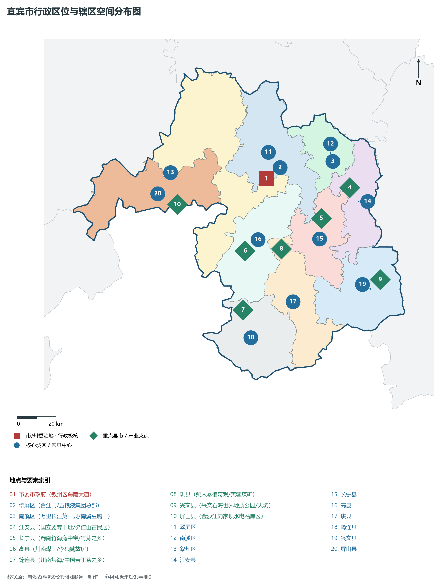
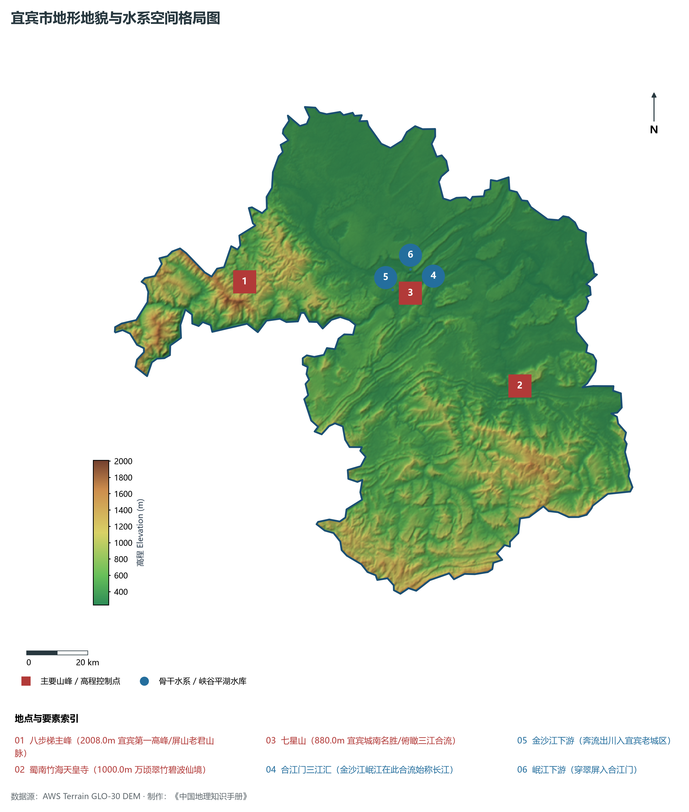
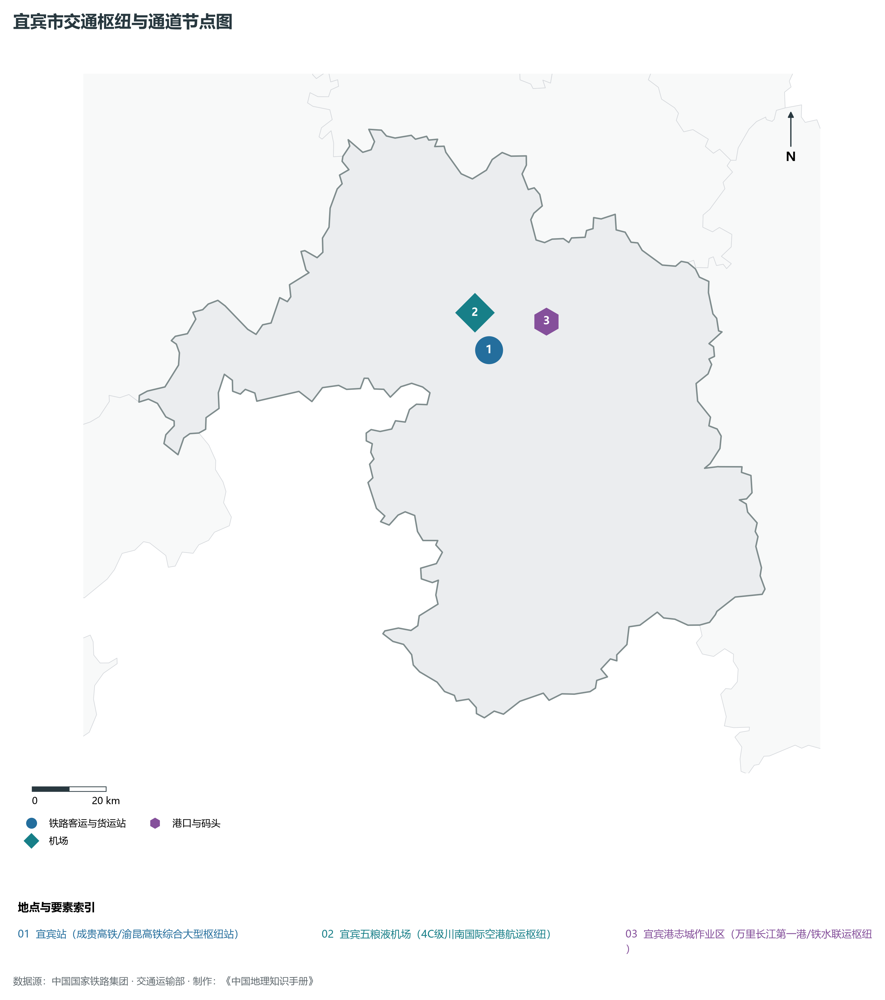
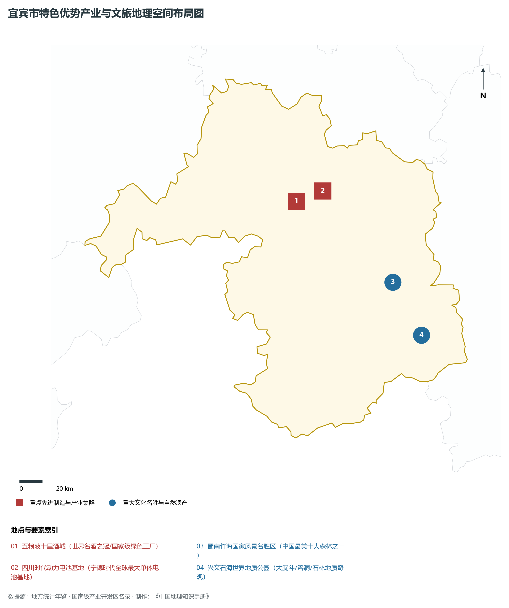
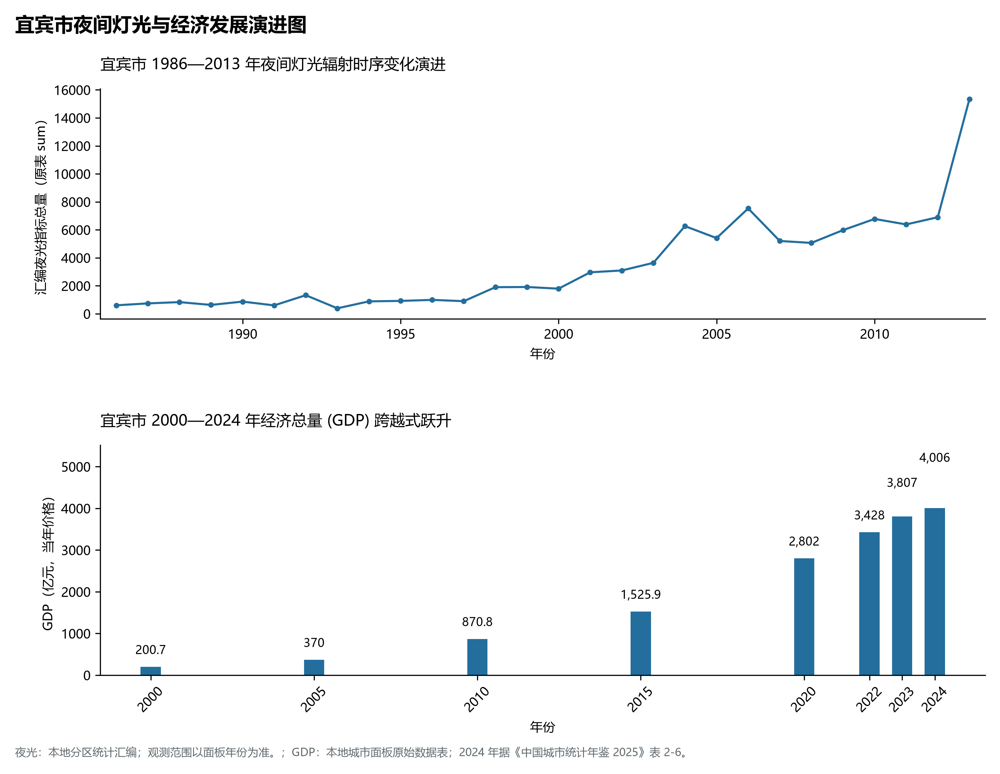

# 22.13 宜宾市

## 一、宏观区位、行政沿革与国土空间格局

宜宾市，行政区划代码 `511500`，是四川省重要的行政与经济组成板块，战略定位为**万里长江第一城·中国动力电池之都·中国酒都五粮液·川南省域副中心·长江绿色生态首城**。辖区地理空间位置介于东经 104.01° ～ 105.38°、北纬 28.01° ～ 28.99° 之间，辖区国土。2024 年常住人口 **461 万人**，常住人口城镇化率 **55.15%**，地区生产总值 **4,006 亿元**（当年价格），人均地区生产总值 **86,705 元**，三次产业构成为 **9.13 : 48.53 : 42.35**。

在建置历史沿革方面，宜宾市源远流长、底蕴厚重。早在先秦古蜀国或巴蜀交融时期即有人类繁衍生息与城邑萌芽；秦并巴蜀后置郡县；两汉魏晋以降历经州、路、府、道、专区多轮沿更，自古为西南重镇、要冲关隘、商贸咽喉与人文渊薮。新中国成立后，历经行政区划科学调整与撤地设市（设州），全域生产力布局迎来历史性大跨越。进入新时代，宜宾市紧紧围绕四川省“五大经济区”协调发展总体布局，深度融入成渝地区双城经济圈、国家战略腹地核心承载区与西部陆海新通道建设，在产业升级、城市提质、乡村振兴和生态屏障筑牢等方面取得历史性突破。

主要下辖行政与核心功能城区/区县分布如下：

- **市委市政府 (叙州区蜀南大道)**：坐标 (104.63°E, 28.76°N)，功能定位：gov；
- **翠屏区 (合江门/五粮液集团总部)**：坐标 (104.62°E, 28.77°N)，功能定位：subdistrict；
- **南溪区 (万里长江第一县/南溪豆腐干)**：坐标 (104.98°E, 28.84°N)，功能定位：subdistrict；
- **江安县 (国立剧专旧址/夕佳山古民居)**：坐标 (105.07°E, 28.72°N)，功能定位：town；
- **长宁县 (蜀南竹海海中宝/竹荪之乡)**：坐标 (104.92°E, 28.58°N)，功能定位：town；
- **高县 (川南煤田/李硕勋故居)**：坐标 (104.52°E, 28.43°N)，功能定位：town；
- **筠连县 (川南煤海/中国苦丁茶之乡)**：坐标 (104.51°E, 28.16°N)，功能定位：town；
- **珙县 (僰人悬棺奇观/芙蓉煤矿)**：坐标 (104.71°E, 28.44°N)，功能定位：town；
- **兴文县 (兴文石海世界地质公园/天坑)**：坐标 (105.23°E, 28.3°N)，功能定位：town；
- **屏山县 (金沙江向家坝水电站库区)**：坐标 (104.16°E, 28.64°N)，功能定位：town；

---

## 二、地质地貌、山川骨架与水文水利系统

宜宾市地质构造格局复杂雄奇，位于四川盆地及其周缘断褶带或青藏高原东缘横断山脉重要构造过渡地带。区域内地壳运动强烈，沉积建造与变质结晶岩层深厚，断裂发育，构造形迹分明。宏观地貌呈现显著的山水切割、高耸峰丛、丘陵台原或冲积平原立体叠合特征，地貌单元起伏剧烈、层次极为鲜明。辖区最高点海拔标高达 **2008.0 m**，最低处标高为 **236 m**，相对垂直落差达 **1772.0 m**。

骨干山峰与地质地貌制高点构筑起辖区生态屏障与自然脊梁：

- **八步梯主峰 (2008.0m 宜宾第一高峰/屏山老君山脉)**：海拔标高 **2008.0 m**，空间坐标 (104.05°E, 28.75°N)；
- **蜀南竹海天皇寺 (1000.0m 万顷翠竹碧波仙境)**：海拔标高 **1000.0 m**，空间坐标 (104.98°E, 28.45°N)；
- **七星山 (880.0m 宜宾城南名胜/俯瞰三江合流)**：海拔标高 **880.0 m**，空间坐标 (104.61°E, 28.72°N)；

在水网水系与水利控制方面，辖区水资源极为丰沛，干流巨川穿山劈谷，纵贯全境：

- **合江门三江汇 (金沙江岷江在此合流始称长江)**：标定坐标 (104.64°E, 28.77°N)；
- **金沙江下游 (奔流出川入宜宾老城区)**：标定坐标 (104.55°E, 28.73°N)；
- **岷江下游 (穿翠屏入合江门)**：标定坐标 (104.61°E, 28.79°N)；

充沛的地表径流与独特的立体山地气候造就了富集的水能水利、湿地森林与优越的多样性生物圈。辖区严格落实长江上游“共抓大保护、不搞大开发”，扎实推进小流域综合治理、退耕还林还湿与长江黄河十年禁渔，维系了全域水生态环境安全与绿水青山的大美底色。

---

## 三、综合立体交通网络、枢纽通道与区位优势

作为四川综合立体交通走廊的重要战略枢纽节点，宜宾市区位得天独厚、内联外通网络日益完善。近年来，辖区全方位抢抓国家高速铁路网、高速公路加密扩能与国际物流大通道建设机遇，客货运输能级跨越式跃升：

骨干交通基础设施与重要立体物流枢纽节点包括：

- **宜宾站 (成贵高铁/渝昆高铁综合大型枢纽站)**：空间标定 (104.59°E, 28.73°N)，设施类型：station；
- **宜宾五粮液机场 (4C级川南国际空港航运枢纽)**：空间标定 (104.55°E, 28.82°N)，设施类型：airport；
- **宜宾港志城作业区 (万里长江第一港/铁水联运枢纽)**：空间标定 (104.75°E, 28.8°N)，设施类型：port；

通过高铁、普铁、高速公路环线与支线航空、内河深水航道的紧密咬合，宜宾市全方位融入成都平原“1小时通勤圈”与成渝双核快速通道，向外深度衔接长江经济带、西部陆海新通道铁海联运与中欧班列，构筑起东西双向互济、陆海内外联动的现代化开放格局。

---

## 四、特色优势产业集群、重点园区与现代经济版图

2024 年宜宾市全市地区生产总值为 4,006 亿元（当年价格）。

辖区核心产业平台、重大战略工程与重点开发区展示如下：

- **五粮液十里酒城 (世界名酒之冠/国家级绿色工厂)**：空间坐标 (104.58°E, 28.78°N)，核心功能：全球白酒领航工业旅游景区；
- **四川时代动力电池基地 (宁德时代全球最大单体电池基地)**：空间坐标 (104.7°E, 28.82°N)，核心功能：国家级动力电池先进制造业集群；
- **蜀南竹海国家风景名胜区 (中国最美十大森林之一)**：空间坐标 (105.02°E, 28.46°N)，核心功能：国家5A级景区与翠竹海波；
- **兴文石海世界地质公园 (大漏斗/溶洞/石林地质奇观)**：空间坐标 (105.15°E, 28.25°N)，核心功能：世界地质公园与古僰人文化遗迹；

在现代化产业布局与建圈强链战略中，辖区因地制宜打造特色产业生态圈：

1. **优势先进制造业与战略性新兴产业**：聚焦电子信息、高端装备制造、锂电与晶硅光伏、先进材料、绿色能源与航空航天核心零部件，培育一批国家级专精特新“小巨人”与高新技术领军企业；
2. **现代特色高效农牧业与食品精深加工**：依托天府良田、高山生态草场或河谷特色热作，做强国家地理标志保护产品，建设现代农业产业园与百亿级绿色食品工业集群；
3. **现代服务业、物流与数字经济赋能**：加快发展现代现代现代供应链金融、科技成果就地转化、数字文旅与大数据应用场景，培育新质生产力源头活水。

---

## 五、历史文化胜迹、世界遗产与生态文旅名胜

宜宾市山川形胜，人文鼎盛，自然奇观与厚重文明在这里水乳交融，是巴蜀文化体系中绚丽夺目的璀璨明珠。

辖区拥有享誉海内外的顶级文旅资源与历史丰碑：

- **世界遗产与国家级文物古迹**：拥有联合国教科文组织世界自然或文化遗产、世界灌溉工程遗产、全国重点文物保护单位与中国历史文化名城名镇，千百年来留下的摩崖石刻、古栈道关隘、古水利工程、红色长征遗址与古代名人故居，历久弥新，是中华民族坚韧不拔精神的历史见证；
- **国家公园、5A级名胜与自然保护区**：大自然赋予辖区高山雪原、飞瀑温泉、幽深峡谷、高山湖泊与广袤森林，负氧离子充沛，是全球首屈一指的大熊猫家园、生物基因宝库与避暑休闲康养度假胜地；
- **多民族民俗瑰宝与非遗技艺**：汉族、藏族、彝族、羌族等多民族在这片热土世代交融共生，锅庄舞、火把节、刺绣、传统酿造与精湛非遗代代相传，形成了独具一格、极富地域风情的多元文旅盛宴。

---

## 六、夜间灯光遥感时序演变与新时代现代化发展变化

本节夜光图的观测年份为 1986—2013 年，指标为行政区汇总值（原表 sum）。

### 1. 1986—2013 年夜间灯光遥感演化分析

- **1996年演化特征**：三江口合江门老城老工业初展；
- **2005年演化特征**：五粮液十里酒城恢弘·临港片区破土；
- **2013年演化特征**：成贵高铁开工·向家坝库区移民新城成形；
- **2023年演化特征**：宁德时代四川时代万亿电池产业之都璀璨；

### 2. 2000—2024 年经济跨越式发展时序汇总
下表记录了 宜宾市 自 2000 年以来核心年份地区生产总值（GDP）的翻番跨越历程：

| 年份 | 地区生产总值（亿元，当年价格） |
|:---|---:|
| 2000 年 | 200.7 |
| 2005 年 | 370 |
| 2010 年 | 870.8 |
| 2015 年 | 1,525.9 |
| 2020 年 | 2,802 |
| 2022 年 | 3,428 |
| 2023 年 | 3,807 |
| 2024 年 | 4,006 |

### 3. 新征程高质量跨越式发展愿景
迈向中国式现代化新征程，宜宾市将全面贯彻新发展理念，主动服务和融入国家重大战略：

1. 坚定不移推进新型工业化，持续做强特色优势产业集群，发展新质生产力；
2. 协同推进高水平保护与高质量发展，筑牢长江黄河上游生态屏障；
3. 全面推进乡村振兴与新型城镇化相融合，促进各族群众共同富裕，谱写巴蜀锦绣新篇章。

2024 年统计来源：《中国城市统计年鉴 2025》表 2-1、2-6、2-7（2024 年，全市）。其他年份 GDP 据本地城市面板“原始数据”表，单位为亿元、当年价格。
