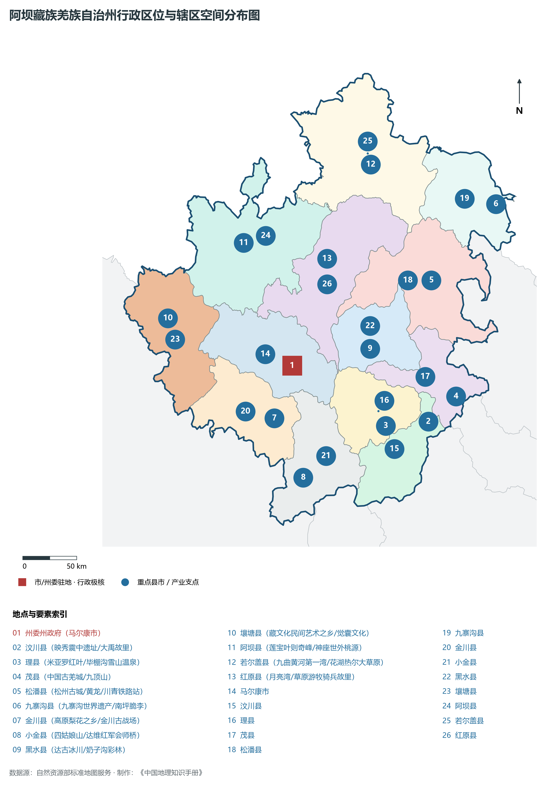
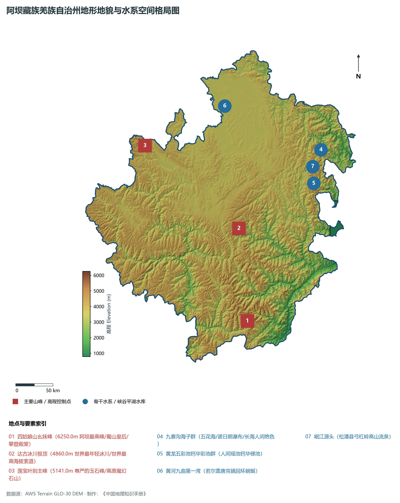
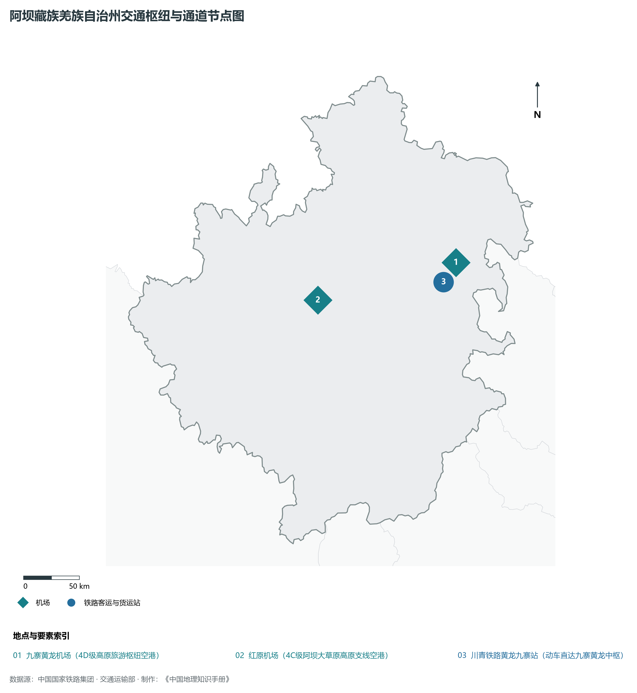
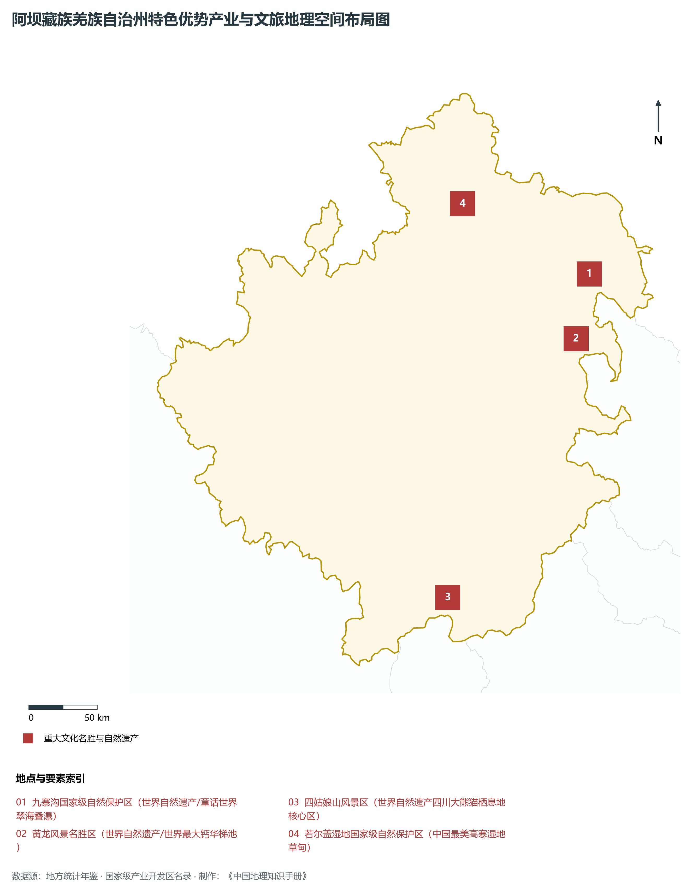
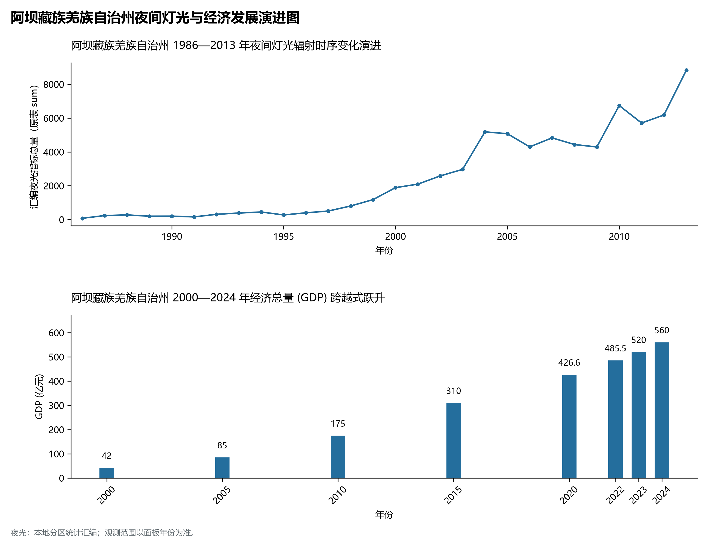

# 22.19 阿坝藏族羌族自治州

## 一、宏观区位、行政沿革与国土空间格局

阿坝藏族羌族自治州，行政区划代码 `513200`，是四川省重要的行政与经济组成板块，战略定位为**高原净土·童话世界九寨沟·黄龙人间瑶池·若尔盖黄河水塔·阿坝生态屏障**。辖区地理空间位置介于东经 100.82° ～ 104.38°、北纬 30.84° ～ 33.72° 之间，辖区国土总面积达 **84242.0 km²**。截至 2024 年末，全区/市/州常住人口为 **82.5 万人**，常住人口城镇化率达到 **42.8%**。

在建置历史沿革方面，阿坝藏族羌族自治州源远流长、底蕴厚重。早在先秦古蜀国或巴蜀交融时期即有人类繁衍生息与城邑萌芽；秦并巴蜀后置郡县；两汉魏晋以降历经州、路、府、道、专区多轮沿更，自古为西南重镇、要冲关隘、商贸咽喉与人文渊薮。新中国成立后，历经行政区划科学调整与撤地设市（设州），全域生产力布局迎来历史性大跨越。进入新时代，阿坝藏族羌族自治州紧紧围绕四川省“五大经济区”协调发展总体布局，深度融入成渝地区双城经济圈、国家战略腹地核心承载区与西部陆海新通道建设，在产业升级、城市提质、乡村振兴和生态屏障筑牢等方面取得历史性突破。

主要下辖行政与核心功能城区/区县分布如下：

- **州委州政府 (马尔康市)**：坐标 (102.221°E, 31.905°N)，功能定位：gov；
- **汶川县 (映秀震中遗址/大禹故里)**：坐标 (103.58°E, 31.47°N)，功能定位：town；
- **理县 (米亚罗红叶/毕棚沟雪山温泉)**：坐标 (103.16°E, 31.43°N)，功能定位：town；
- **茂县 (中国古羌城/九顶山)**：坐标 (103.85°E, 31.68°N)，功能定位：town；
- **松潘县 (松州古城/黄龙/川青铁路站)**：坐标 (103.59°E, 32.63°N)，功能定位：town；
- **九寨沟县 (九寨沟世界遗产/南坪脆李)**：坐标 (104.23°E, 33.26°N)，功能定位：town；
- **金川县 (高原梨花之乡/金川古战场)**：坐标 (102.06°E, 31.47°N)，功能定位：town；
- **小金县 (四姑娘山/达维红军会师桥)**：坐标 (102.36°E, 30.99°N)，功能定位：town；
- **黑水县 (达古冰川/奶子沟彩林)**：坐标 (102.99°E, 32.06°N)，功能定位：town；
- **壤塘县 (藏文化民间艺术之乡/觉囊文化)**：坐标 (100.97°E, 32.26°N)，功能定位：town；
- **阿坝县 (莲宝叶则奇峰/神座世外桃源)**：坐标 (101.7°E, 32.9°N)，功能定位：town；
- **若尔盖县 (九曲黄河第一湾/花湖热尔大草原)**：坐标 (102.96°E, 33.57°N)，功能定位：town；
- **红原县 (月亮湾/草原游牧骑兵故里)**：坐标 (102.54°E, 32.79°N)，功能定位：town；

---

## 二、地质地貌、山川骨架与水文水利系统

阿坝藏族羌族自治州地质构造格局复杂雄奇，位于四川盆地及其周缘断褶带或青藏高原东缘横断山脉重要构造过渡地带。区域内地壳运动强烈，沉积建造与变质结晶岩层深厚，断裂发育，构造形迹分明。宏观地貌呈现显著的山水切割、高耸峰丛、丘陵台原或冲积平原立体叠合特征，地貌单元起伏剧烈、层次极为鲜明。辖区最高点海拔标高达 **6250.0 m**，最低处标高为 **780 m**，相对垂直落差达 **5470.0 m**。

骨干山峰与地质地貌制高点构筑起辖区生态屏障与自然脊梁：

- **四姑娘山幺妹峰 (6250.0m 阿坝最高峰/蜀山皇后/攀登殿堂)**：海拔标高 **6250.0 m**，空间坐标 (102.9°E, 31.1°N)；
- **达古冰川极顶 (4860.0m 世界最年轻冰川/世界最高海拔索道)**：海拔标高 **4860.0 m**，空间坐标 (102.75°E, 32.2°N)；
- **莲宝叶则主峰 (5141.0m 尊严的玉石峰/高原魔幻石山)**：海拔标高 **5141.0 m**，空间坐标 (101.35°E, 33.15°N)；

在水网水系与水利控制方面，辖区水资源极为丰沛，干流巨川穿山劈谷，纵贯全境：

- **九寨沟海子群 (五花海/诺日朗瀑布/长海人间绝色)**：标定坐标 (103.92°E, 33.15°N)；
- **黄龙五彩池钙华彩池群 (人间瑶池钙华梯池)**：标定坐标 (103.82°E, 32.75°N)；
- **黄河九曲第一湾 (若尔盖唐克镇回环蜿蜒)**：标定坐标 (102.5°E, 33.65°N)；
- **岷江源头 (松潘县弓杠岭高山流泉)**：标定坐标 (103.7°E, 32.9°N)；

充沛的地表径流与独特的立体山地气候造就了富集的水能水利、湿地森林与优越的多样性生物圈。辖区严格落实长江上游“共抓大保护、不搞大开发”，扎实推进小流域综合治理、退耕还林还湿与长江黄河十年禁渔，维系了全域水生态环境安全与绿水青山的大美底色。

---

## 三、综合立体交通网络、枢纽通道与区位优势

作为四川综合立体交通走廊的重要战略枢纽节点，阿坝藏族羌族自治州区位得天独厚、内联外通网络日益完善。近年来，辖区全方位抢抓国家高速铁路网、高速公路加密扩能与国际物流大通道建设机遇，客货运输能级跨越式跃升：

骨干交通基础设施与重要立体物流枢纽节点包括：

- **九寨黄龙机场 (4D级高原旅游枢纽空港)**：空间标定 (103.68°E, 32.85°N)，设施类型：airport；
- **红原机场 (4C级阿坝大草原高原支线空港)**：空间标定 (102.35°E, 32.53°N)，设施类型：airport；
- **川青铁路黄龙九寨站 (动车直达九寨黄龙中枢)**：空间标定 (103.62°E, 32.78°N)，设施类型：station；

通过高铁、普铁、高速公路环线与支线航空、内河深水航道的紧密咬合，阿坝藏族羌族自治州全方位融入成都平原“1小时通勤圈”与成渝双核快速通道，向外深度衔接长江经济带、西部陆海新通道铁海联运与中欧班列，构筑起东西双向互济、陆海内外联动的现代化开放格局。

---

## 四、特色优势产业集群、重点园区与现代经济版图

阿坝藏族羌族自治州立足优越的资源禀赋、产业积淀与空间战略定位，坚定不移走新型工业化与高质量发展之路，深度融入四川省“六大优势产业”集群建设。2024 年，全市/州实现地区生产总值（GDP）达 **560.0 亿元**，人均 GDP 达到 **67,880 元**，三次产业结构比稳健优化为 **19.5 : 25.5 : 55.0**，现代化经济体系抗风险韧性持续提升。

辖区核心产业平台、重大战略工程与重点开发区展示如下：

- **九寨沟国家级自然保护区 (世界自然遗产/童话世界翠海叠瀑)**：空间坐标 (103.92°E, 33.16°N)，核心功能：联合国世界自然遗产与国家5A级景区；
- **黄龙风景名胜区 (世界自然遗产/世界最大钙华梯池)**：空间坐标 (103.82°E, 32.74°N)，核心功能：联合国世界自然遗产与高山峡谷奇观；
- **四姑娘山风景区 (世界自然遗产四川大熊猫栖息地核心区)**：空间坐标 (102.85°E, 31.05°N)，核心功能：国家5A级景区与户外运动天堂；
- **若尔盖湿地国家级自然保护区 (中国最美高寒湿地草甸)**：空间坐标 (102.9°E, 33.6°N)，核心功能：国际重要湿地与高原蓄水库；

在现代化产业布局与建圈强链战略中，辖区因地制宜打造特色产业生态圈：

1. **优势先进制造业与战略性新兴产业**：聚焦电子信息、高端装备制造、锂电与晶硅光伏、先进材料、绿色能源与航空航天核心零部件，培育一批国家级专精特新“小巨人”与高新技术领军企业；
2. **现代特色高效农牧业与食品精深加工**：依托天府良田、高山生态草场或河谷特色热作，做强国家地理标志保护产品，建设现代农业产业园与百亿级绿色食品工业集群；
3. **现代服务业、物流与数字经济赋能**：加快发展现代现代现代供应链金融、科技成果就地转化、数字文旅与大数据应用场景，培育新质生产力源头活水。

---

## 五、历史文化胜迹、世界遗产与生态文旅名胜

阿坝藏族羌族自治州山川形胜，人文鼎盛，自然奇观与厚重文明在这里水乳交融，是巴蜀文化体系中绚丽夺目的璀璨明珠。

辖区拥有享誉海内外的顶级文旅资源与历史丰碑：

- **世界遗产与国家级文物古迹**：拥有联合国教科文组织世界自然或文化遗产、世界灌溉工程遗产、全国重点文物保护单位与中国历史文化名城名镇，千百年来留下的摩崖石刻、古栈道关隘、古水利工程、红色长征遗址与古代名人故居，历久弥新，是中华民族坚韧不拔精神的历史见证；
- **国家公园、5A级名胜与自然保护区**：大自然赋予辖区高山雪原、飞瀑温泉、幽深峡谷、高山湖泊与广袤森林，负氧离子充沛，是全球首屈一指的大熊猫家园、生物基因宝库与避暑休闲康养度假胜地；
- **多民族民俗瑰宝与非遗技艺**：汉族、藏族、彝族、羌族等多民族在这片热土世代交融共生，锅庄舞、火把节、刺绣、传统酿造与精湛非遗代代相传，形成了独具一格、极富地域风情的多元文旅盛宴。

---

## 六、夜间灯光遥感时序演变与新时代现代化发展变化

本节夜光图的观测年份为 1986—2013 年，指标为行政区汇总值（原表 sum）。

### 1. 1986—2013 年夜间灯光遥感演化分析

- **1996年演化特征**：马尔康梭磨河谷老州府宁静安详；
- **2005年演化特征**：九寨黄龙机场通航·高原旅游引爆；
- **2013年演化特征**：汶川地震十年重建奇迹·川汶线贯通；
- **2023年演化特征**：川青铁路镇江关通车·高原绿电光伏崛起；

### 2. 2000—2024 年经济跨越式发展时序汇总
下表记录了 阿坝藏族羌族自治州 自 2000 年以来核心年份地区生产总值（GDP）的翻番跨越历程：

| 年份 | 地区生产总值 (亿元) | 发展阶段特征与重大历史跨越事件 |
| :---: | :---: | :--- |
| 2000 年 | **42.0** | 新世纪开局筑基阶段，特色资源与农工业基础稳步拓展 |
| 2005 年 | **85.0** | 新世纪开局筑基阶段，特色资源与农工业基础稳步拓展 |
| 2010 年 | **175.0** | 工业化与城市化全面提速，现代产业与基础设施建设突飞猛进 |
| 2015 年 | **310.0** | 工业化与城市化全面提速，现代产业与基础设施建设突飞猛进 |
| 2020 年 | **426.6** | 综合经济实力实现千亿/数百亿历史性跨越，绿色转型全面深化 |
| 2022 年 | **485.5** | 深度融入成渝双城经济圈与国家战略腹地建设，高质量发展跃上新台阶 |
| 2023 年 | **520.0** | 深度融入成渝双城经济圈与国家战略腹地建设，高质量发展跃上新台阶 |
| 2024 年 | **560.0** | 深度融入成渝双城经济圈与国家战略腹地建设，高质量发展跃上新台阶 |

### 3. 新征程高质量跨越式发展愿景
迈向中国式现代化新征程，阿坝藏族羌族自治州将全面贯彻新发展理念，主动服务和融入国家重大战略：

1. 坚定不移推进新型工业化，持续做强特色优势产业集群，发展新质生产力；
2. 协同推进高水平保护与高质量发展，筑牢长江黄河上游生态屏障；
3. 全面推进乡村振兴与新型城镇化相融合，促进各族群众共同富裕，谱写巴蜀锦绣新篇章。
