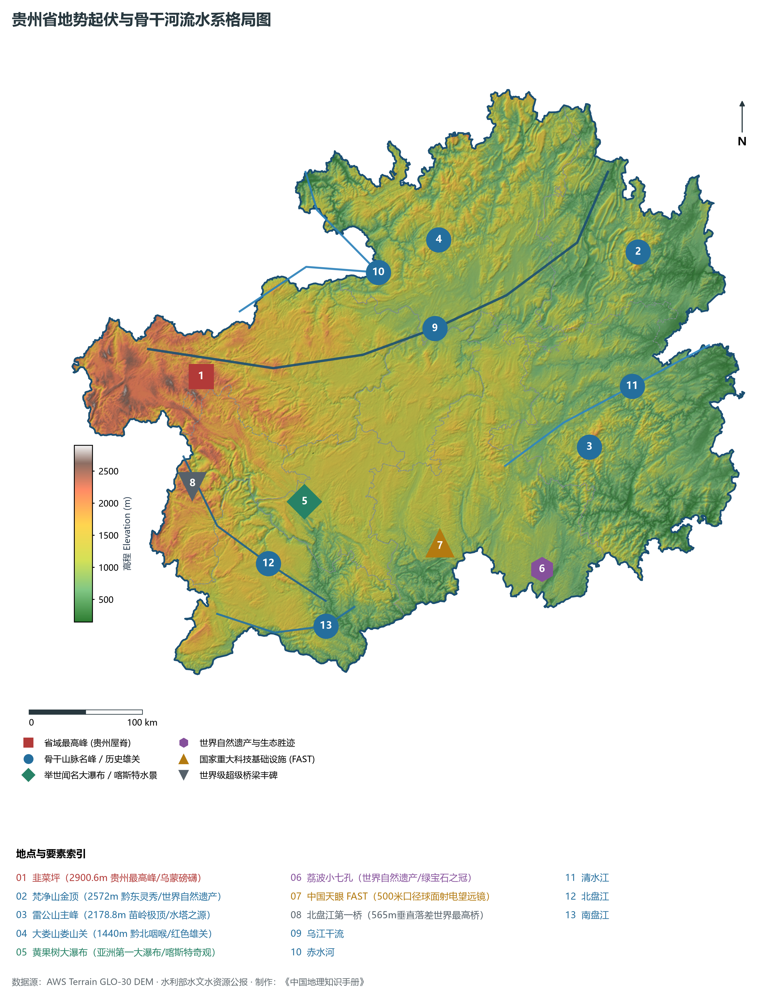
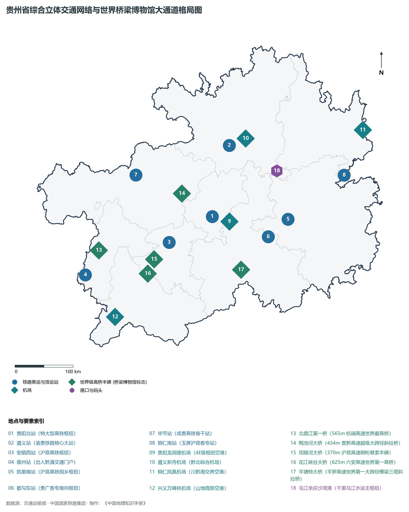
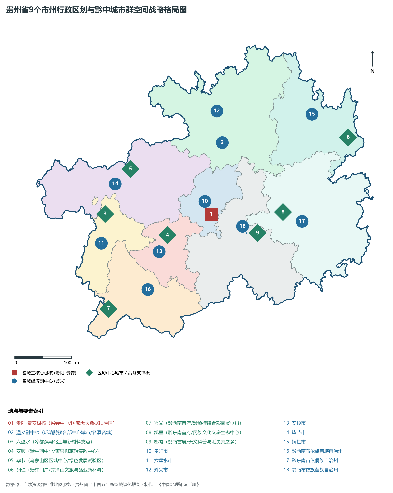
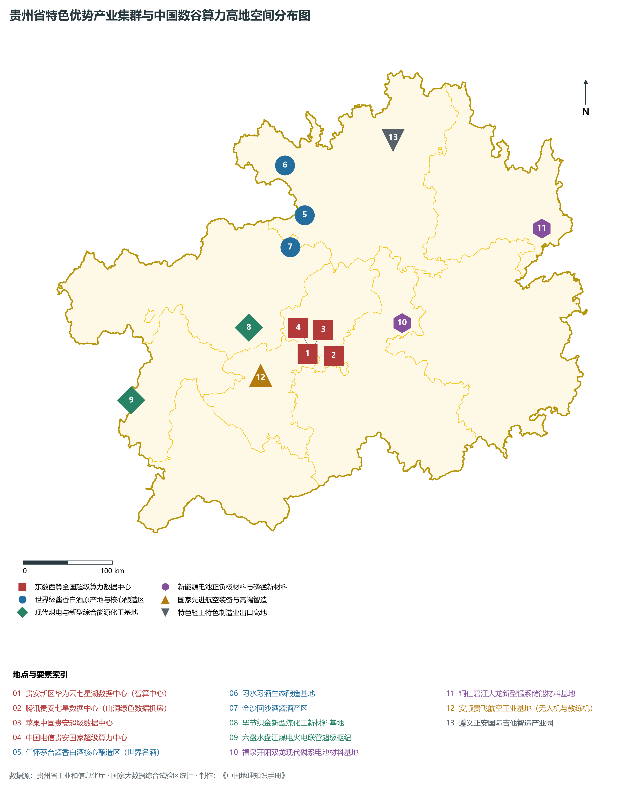
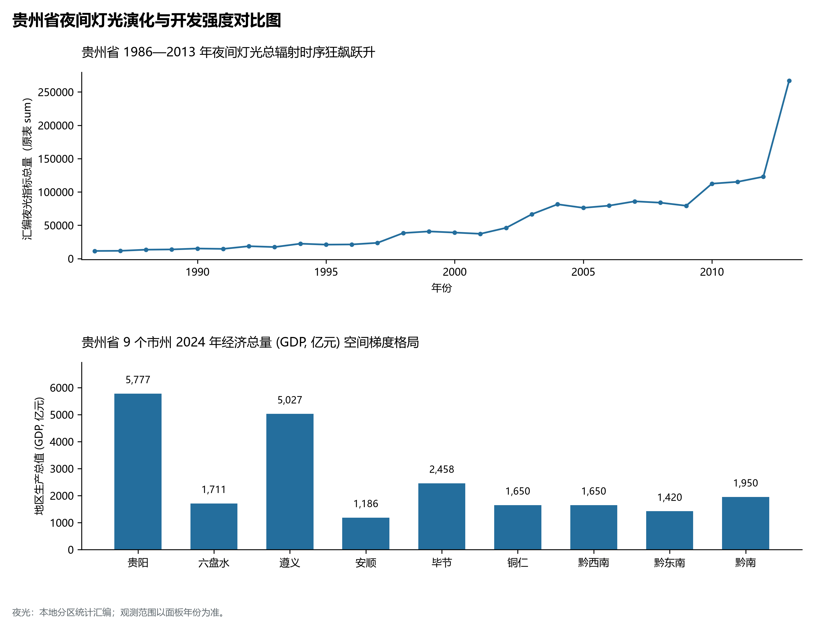

# 23.0 贵州省地理统揽

贵州省，简称“黔”或“贵”，省会贵阳市，地处中国西南内陆腹地、云贵高原东部斜坡地带，介于东经 103° 36' ～ 109° 35'、北纬 24° 37' ～ 29° 13' 之间，东西长约 595 km，南北宽约 509 km，幅员陆地总面积达 **17.6167 × 10⁴ km²**，占全国国土总面积的 1.8%。贵州北接四川、重庆，西界云南，南界广西，东临湖南，是西南地区连接华南、华中陆路交通大动脉的重要十字路口，更是西部陆海新通道战略枢纽、国家大数据综合试验区、首批国家生态文明试验区与“东数西算”全国八大算力节点之一。

截至 2024 年末，全省常住人口达 **3,865.0 万人**，常住人口城镇化率达 **56.10%**；2024 年全省地区生产总值（GDP）达到 **22,100.0 亿元**（按不变价格计算比上年增长 5.2%），人均 GDP 跃升至 **57,180 元**；三次产业结构比稳健优化为 **13.5 : 36.2 : 50.3**。全省现辖 6 个地级市、3 个自治州（共 9 个地州市级行政单元、88 个县级行政区），在全省战略空间上构建起以贵阳-贵安为核心极核、遵义为副中心、联动各节点协同跨越的“黔中城市群”空间高质量协调发展新格局。作为全国唯一没有平原支撑的省份，贵州依托坚韧顽强的拼搏意志，彻底撕掉了千年贫困与“地无三里平”的历史标签，跃升为举世瞩目的“世界桥梁博物馆”与“中国数谷算力高地”。

---

## 一、大地构造、云贵高原东斜坡与“喀斯特王国·万峰叠嶂”宏观自然地理底盘

贵州地处扬子陆块西南缘，大地构造经历了震旦纪以来的多次强烈构造运动与多期海侵海退沉积。全省碳酸盐岩广泛出露，分布面积占全省国土总面积的 61.9%，是全球热带、亚热带岩溶喀斯特发育最典型、类型最复杂、景观最宏伟的核心分布区：

1. **三级地貌阶梯西高东低倾斜总势**：
   - 全省地势自西向东、自中部向南北三个方向倾斜，平均海拔在 1100 m 左右；
   - 第一级阶梯（西部乌蒙高原区）：海拔普遍在 1500 ～ 2800 m，山峦起伏、河谷深切；**赫章小韭菜坪峰（海拔 2900.6 m）**巍然耸立，号称“贵州屋脊”；
   - 第二级阶梯（中部中山原与丘陵盆地）：海拔在 800 ～ 1500 m，苗岭自西向东横亘中部，构成长江与珠江水系宏观天然分水岭；
   - 第三级阶梯（东部低山峡谷区）：海拔逐渐降至 500 m 以下，沅江水系与都柳江深切其间；
2. **世界级喀斯特地貌自然奇观群**：
   - 溶洞、暗河、天坑、地缝、峰林、石林、盲谷与峰丛洼地在全省星罗棋布：
     - **黄果树大瀑布**（亚洲第一大瀑布，白水河切穿喀斯特断崖）；
     - **荔波喀斯特**与**施秉云台山喀斯特**（联合国教科文组织世界自然遗产“中国南方喀斯特”代表地）；
     - **兴义万峰林**（徐霞客赞誉“天下山峰何其多，唯有此处峰成林”）；
     - **织金洞**（世界地质公园，被誉为“中国溶洞之王”）；
     - **平塘大窝凼天坑群**（天然喀斯特大洼坑，造就中国天眼 FAST 选址圣地）；
3. **武陵山脉孤峰与梵净山世界遗产**：
   - 东北部梵净山（主峰海拔 **2572.0 m**）是武陵山脉主峰，古老变质岩核部出露，被誉为“梵天净土”，保存有全球唯一的黔金丝猴与古老珙桐群落，被列入世界自然遗产名录。

全省相对地势极差达到 **2752.8 m**：

- **全省最高峰（贵州屋脊）**：毕节市赫章县与六盘水市水城区交界的**小韭菜坪峰（海拔 2900.6 m）**；
- **全省次高与著名名山**：水城区牛棚梁子（2845.7 m）、赫章大韭菜坪（2777.0 m）、铜仁江口**梵净山金顶（2572.0 m）**、桐梓大山（2227.0 m）、雷山**雷公山主峰（2178.8 m）**；
- **全省陆域最低点**：黔东南州黎平县地坪镇水口河出境水面（**海拔 147.8 m**）。

**贵州省“乌蒙高原—苗岭分水岭—黔东低山”喀斯特立体地貌剖面图**

| 韭菜坪极顶 2900.6m | 苗岭横亘·雷公山2179m | 北盘江第一桥·高差565m | 黎平地坪水口河148m |
| --- | --- | --- | --- |
| 磅礴乌蒙·牛棚梁子；高原冷凉·万亩野韭花 | 贵阳花溪高坡云顶草场；分隔长江乌江与珠江水系 | 坝陵河大桥/花江峡谷桥；万峰林峰丛·黄果树瀑布 | 都柳江注入珠江柳江；侗寨花桥·鼓楼相映 |

乌蒙山贵州屋脊 · → 苗岭分水岭中枢 · → 喀斯特峡谷与超级天堑 · → 黔东低山峡谷出境

---

## 二、亚热带湿润季风气候、“两江分流·千瀑齐发”与生态水源涵养底盘

贵州省属亚热带高原湿润季风气候区，因受高原地形强烈抬升与阻滞，呈现出“冬无严寒、夏无酷暑、雨热同期、立体多变”的气候特征：

- **“爽爽贵阳·中国凉都”的宜人气温**：年平均气温在 **14.0°C ～ 16.5°C** 之间。盛夏 7~8 月最热月均温仅 22°C ～ 25°C，全省拥有极佳的高原夏季避暑气候资源；冬季受云贵准静止锋控制，冷暖气团在贵州中部长期对峙，形成阴雨绵绵与“天无三日晴”的湿润多云特征；
- **充沛水汽与华南暖湿气流滋润**：全省年降水量达 **1000 ～ 1400 mm**，雨量丰沛，水热资源同步；
- **立体农业气候带谱极其鲜明**：由于河谷与山原高差悬殊，自下而上发育南亚热带河谷（如罗甸、册亨、榕江）、中亚热带、北亚热带及温带高原气候，“一山分四季，十里不同天”，为茶叶、刺梨、火龙果、猕猴桃及中药材特色高效农业提供了天然温床。

在水网水文方面，贵州是长江与珠江两大流域的重要生态屏障与水源涵养高地，河流呈现以苗岭为脊梁、南北分流注入两江的宏伟骨架：

1. **长江水系（北部与东部·流域占全省 65.7%）**：
   - **乌江（全省第一大河·贵州母亲河）**：发源于威宁乌蒙山东麓，流经六盘水、毕节、贵阳、遵义、铜仁，沿途接纳六冲河、三岔河，出境入渝汇入长江。全省流长 **889 km**，落差达 2124 米，水能充沛，构皮滩、索风营、东风、思林、沙沱等梯级电站形成壮观的高峡平湖；
   - **赤水河（红军四渡赤水与中国美酒河）**：发源云南镇雄，流经金沙、仁怀、习水、赤水出境入川注入长江，滋养了茅台、习酒、国台等世界顶级酱香白酒产区；
   - **沅江水系（清水江、㵲阳河、锦江）**：向东流出湖南汇入洞庭湖，水质清澈，穿行于苗岭苗侗聚居区；
2. **珠江水系（南部与西南部·流域占全省 34.3%）**：
   - **北盘江**：发源云南，流贯六盘水、安顺、黔西南，两岸悬崖千仞，切削出深逾千米的花江大峡谷；
   - **南盘江**：黔桂界河，下游在望谟蔗香合流后称红水河，天生桥水利枢纽在此筑坝拦截形成万峰湖；
   - **都柳江**：流经黔南、黔东南，流出从江进入广西汇入融江（柳江水系）。

---

## 三、“黔中城市群”空间战略格局与四向开放大通道

按照国家赋予的发展定位与贵州省国土空间总体规划，全省着力构筑“一核两极多点”的**黔中城市群**区域高质量发展格局：

1. **贵阳-贵安极核（全省高质量发展创新主引擎）**：
   - 面积覆盖贵阳市区与国家级贵安新区核心区，聚集全省约 16% 的人口和近 25% 的经济总量；
   - 重点打造“中国数谷”、全球大数据算力枢纽节点与先进制造业集聚区，引领带动全省新型工业化与城镇化；
2. **遵义副中心（成渝黔接合部综合支点）**：
   - 黔北区域中心城市，依托遵义会议革命历史底蕴、茅台千亿级酱香白酒走廊与成渝双城经济圈紧密对接，GDP 稳居全省第二位，打造国家级白酒产业高质量发展示范区；
3. **“黔中一小时经济圈”与特色功能节点**：
   - **安顺市**：与贵阳平坝接壤同城化，推进黄果树世界级旅游景区建设与安顺贵飞航空工业基地崛起；
   - **毕节与六盘水（乌蒙能源化工带）**：国家级毕节试验区与中国凉都六盘水，发挥“西南煤海”资源，推进现代煤化工、新型能源与锂电负极新材料基地建设；
   - **铜仁市（武陵绿色生态门户）**：依托梵净山世界遗产与中国锰都储能新材料基地，打造黔东大开放走廊；
   - **黔西南、黔东南、黔南（苗侗民族风情与南向开放试验区）**：兴义万峰林山地旅游度假区、凯里千户苗寨与村超村BA出圈爆火、都匀中国天眼与荔波世遗绿宝石，构成世界一流的生态文化旅游目的地。

---

## 四、综合立体交通网络、“县县通高速”与“世界桥梁博物馆”

贵州以惊天动地的基建气魄，攻克喀斯特破碎地貌与崇山峻岭天堑，创造了中国交通建设史上的旷世奇迹：

- **率先在西部实现“县县通高速”与“市市通高铁”**：
  - 全省高速公路通车总里程已突破 **8800 km**，综合密度居全国前列；
  - 沪昆高铁、贵广高铁、渝贵铁路、成贵高铁、贵南高铁（时速350公里直达北部湾）全方位交织，实现贵阳至成渝、长株潭、粤港澳大湾区 2~4 小时通达；
- **名副其实的“世界桥梁博物馆”**：
  - 世界高桥排名前 100 座中，近一半位于贵州；
  - **北盘江第一桥**：桥面至江面垂直高差达 **565 m**，保持世界第一高桥吉尼斯纪录；
  - **花江峡谷大桥**：桥面垂直高差达 **625 m**，成为新一代世界最高桥梁；
  - **鸭池河大桥**（高差434m）、**坝陵河大桥**（高差370m）、**平塘特大桥**（三塔双索面斜拉桥巨作），将千山万壑彻底缝合为坦荡通衢；
- **“一干十支”民用航空港体系**：
  - **贵阳龙洞堡国际机场（4E级）**：已建成双跑道，年旅客保障能力超 3000 万人次；
  - 遵义新舟、茅台、铜仁凤凰、兴义万峰林、毕节飞雄、六盘水月照、安顺黄果树、凯里黄平、黎平、荔波织就密集的支线航网。

---

## 五、“中国数谷”、东数西算全国算力枢纽与现代优势产业体系

贵州立足冷凉气候、地质稳定与丰沛清洁水火电能源禀赋，抢占先机、无中生有，走出了一条别具特色的大数据与新兴产业高质量跃迁之路：

1. **大数据电子信息（全国八大一体化算力网络国家枢纽节点）**：
   - 贵安新区集聚了华为云全球总部数据中心、腾讯七星数据中心、苹果中国数据中心、中国电信、中国移动、中国联通超级数据中心等 20 余个特大型数据中心，服务器承载能力超 400 万台，打造全国算力最安全、成本最低、速度最快的最强算力底座；
2. **世界级酱香型白酒产业集群**：
   - 以茅台集团为引领，仁怀茅台镇为核心，赤水河流域串联习水、金沙、汇川，构建世界级优质白酒产业集群，白酒产业工业增加值与利税在全国名列前茅；
3. **新型功能储能材料与“富矿精开”现代化工**：
   - 依托开阳、福泉、瓮安千亿级磷矿，打造亚洲最大磷酸铁锂新能源电池正极材料基地；
   - 铜仁大龙崛起全球重要的锰基锂电池正极材料生产集群；
4. **大国空天装备与国之重器**：
   - 安顺贵飞航空工业基地打造国家级教练机、无人机产业基地；
   - **平塘中国天眼 FAST**（500 米口径球面射电望远镜）：全球最大单口径望远镜，累计发现脉冲星突破 900 颗，代表人类探索宇宙前沿空间。

---

## 六、1986—2013 年夜间灯光遥感时序变化与生态绿色现代化狂飙

本节夜光图的观测年份为 1986—2013 年，指标为行政区汇总值（原表 sum）。

1. **1986—1995 年（孤立光斑与闭塞局狭期）**：
2. **1996—2005 年（骨干大通道铺开与中心城区拓容期）**：
   - 随着贵黄高等级公路、湘黔与黔桂铁路扩能改造，贵阳老城向南明、云岩周边扩散，遵义、六盘水建成区灯火逐步扩大；
3. **2006—2015 年（大基建攻坚与“县县通高速”跨越期）**：
4. **2016—2024 年（中国数谷崛起与世界级文旅璀璨期）**：
