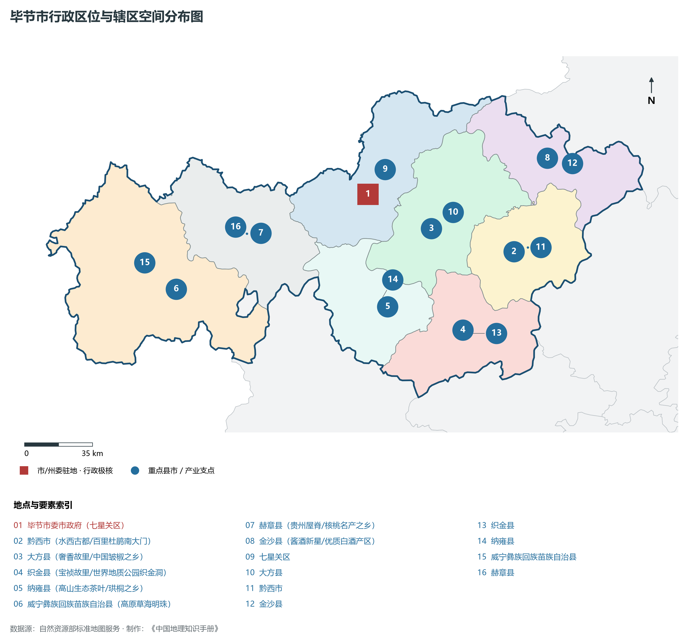
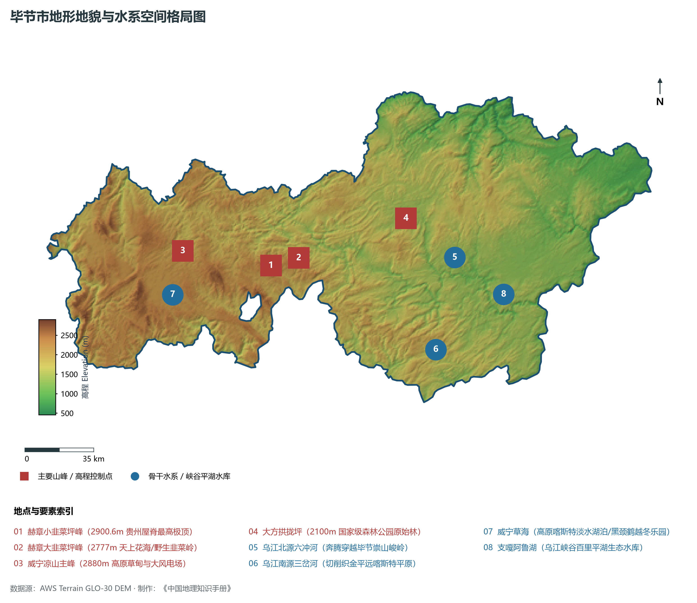
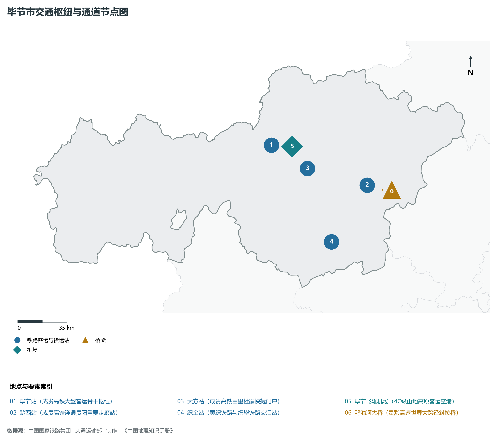
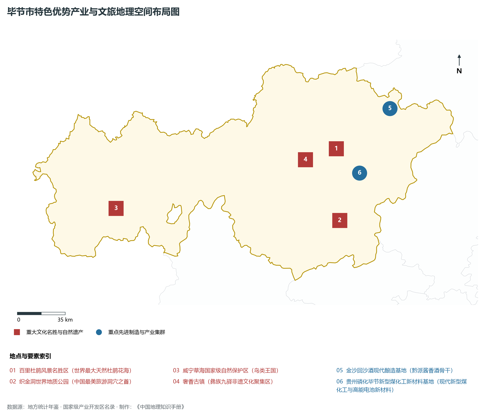
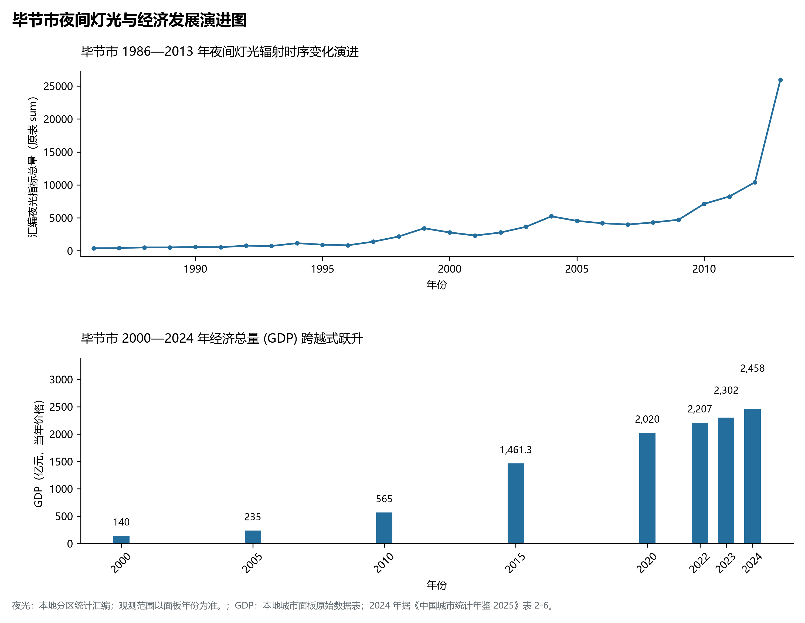

# 23.5 毕节市

## 一、宏观区位、行政沿革与国土空间格局

毕节市，行政区划代码 `520500`，是贵州省重要的行政与经济组成板块，战略定位为**川滇黔锁钥·磅礴乌蒙核心·洞天福地花海毕节·绿色发展试验区·重要清洁能源基地**。辖区地理空间位置介于东经 104.13° ～ 106.37°、北纬 26.52° ～ 27.61° 之间，辖区国土。2024 年常住人口 **662 万人**，常住人口城镇化率 **45.72%**，地区生产总值 **2,458 亿元**（当年价格），人均地区生产总值 **36,809 元**，三次产业构成为 **23.05 : 26.36 : 50.59**。

在建制历史沿革方面，毕节市文脉绵长、积淀厚重。早在先秦夜郎古国或且兰、牂牁交融时期即有城邑雏形；秦汉开辟五尺道、置郡设县；唐宋以降羁縻州与土司制度交织演替；明清实行“改土归流”，修筑驿道关隘、设府置县，自古为西南战略要地、商贸通衢与多民族交汇之所。新中国成立后，历经行政区划合理调整与撤地设市（设州），全域生产力空间迎来了天翻地覆的沧桑巨变。新时代以来，毕节市紧扣贵州省围绕“四新”主攻“四化”主战略，深度融入黔中城市群、西部陆海新通道与数字经济新高地建设，在产业转型升级、城镇提质扩能、生态绿色屏障筑牢与共同富裕上取得一系列历史性突破。

主要下辖行政与核心功能城区/区县分布如下：

- **毕节市委市政府 (七星关区)**：坐标 (105.28°E, 27.3°N)，功能定位：gov；
- **黔西市 (水西古都/百里杜鹃南大门)**：坐标 (106.04°E, 27.03°N)，功能定位：town；
- **大方县 (奢香故里/中国皱椒之乡)**：坐标 (105.61°E, 27.14°N)，功能定位：town；
- **织金县 (宝祯故里/世界地质公园织金洞)**：坐标 (105.77°E, 26.67°N)，功能定位：town；
- **纳雍县 (高山生态茶叶/珙桐之乡)**：坐标 (105.38°E, 26.78°N)，功能定位：town；
- **威宁彝族回族苗族自治县 (高原草海明珠)**：坐标 (104.28°E, 26.86°N)，功能定位：town；
- **赫章县 (贵州屋脊/核桃名产之乡)**：坐标 (104.72°E, 27.12°N)，功能定位：town；
- **金沙县 (酱酒新星/优质白酒产区)**：坐标 (106.22°E, 27.46°N)，功能定位：town；

---

## 二、地质地貌、山川骨架与水文水利系统

毕节市地质构造复杂奇崛，处于云贵高原东部斜坡向喀斯特丘陵盆地过渡的核心构造带。区域内地壳隆升剧烈，古生代海相碳酸盐岩地层极为深厚，构造断裂纵横，溶蚀侵蚀作用极其强烈。宏观地貌呈现显著的山地喀斯特、深切峡谷、峰丛洼地、石林溶洞与山间坝子立体叠合特征，地貌单元起伏剧烈、雄奇壮美。辖区最高点海拔标高达 **2900.6 m**，最低处标高为 **457 m**，相对垂直落差达 **2443.6 m**。

骨干山峰与地貌高程制高点构筑起辖区生态屏障与自然脊梁：

- **赫章小韭菜坪峰 (2900.6m 贵州屋脊最高极顶)**：海拔标高 **2900.6 m**，空间坐标 (104.755°E, 26.985°N)；
- **赫章大韭菜坪峰 (2777m 天上花海/野生韭菜岭)**：海拔标高 **2777.0 m**，空间坐标 (104.83°E, 27.02°N)；
- **威宁凉山主峰 (2880m 高原草甸与大风电场)**：海拔标高 **2880.0 m**，空间坐标 (104.3°E, 27.05°N)；
- **大方拱拢坪 (2100m 国家级森林公园原始林)**：海拔标高 **2100.0 m**，空间坐标 (105.45°E, 27.2°N)；

在水网水系与水利控制方面，辖区水资源极为丰富，高山流水穿崖过谷，滋养全境：

- **乌江北源六冲河 (奔腾穿越毕节崇山峻岭)**：标定坐标 (105.7°E, 27.02°N)；
- **乌江南源三岔河 (切削织金平远喀斯特平原)**：标定坐标 (105.6°E, 26.6°N)；
- **威宁草海 (高原喀斯特淡水湖泊/黑颈鹤越冬乐园)**：标定坐标 (104.25°E, 26.85°N)；
- **支嘎阿鲁湖 (乌江峡谷百里平湖生态水库)**：标定坐标 (105.95°E, 26.85°N)；

优越的森林植被与喀斯特独特山水造就了绝佳的高原夏季避暑温润气候，年平均气温适中，负氧离子充沛。辖区坚定践行“绿水青山就是金山银山”，全方位推进石漠化综合治理、退耕还林还湿、水库水源保护与流域十年禁渔，维系了全域水生态环境安全与绿水青山的大美底色。

---

## 三、综合立体交通网络、枢纽通道与区位优势

作为西南立体交通网与西部陆海新通道上的重要战略枢纽，毕节市区位优势显著、内畅外通网络日臻完善。近年来，辖区全方位抢抓国家高速铁路网、高速公路加密扩能与国际物流大通道建设机遇，客货运输保障能级实现历史性跨越：

骨干交通基础设施与重要立体物流枢纽节点包括：

- **毕节站 (成贵高铁大型客运骨干枢纽)**：空间标定 (105.32°E, 27.27°N)，设施类型：rail；
- **黔西站 (成贵高铁连通贵阳重要走廊站)**：空间标定 (106.01°E, 27.01°N)，设施类型：rail；
- **大方站 (成贵高铁百里杜鹃快捷门户)**：空间标定 (105.58°E, 27.12°N)，设施类型：rail；
- **织金站 (黄织铁路与织毕铁路交汇站)**：空间标定 (105.75°E, 26.65°N)，设施类型：rail；
- **毕节飞雄机场 (4C级山地高原客运空港)**：空间标定 (105.47°E, 27.26°N)，设施类型：airport；
- **鸭池河大桥 (贵黔高速世界大跨径斜拉桥)**：空间标定 (106.12°E, 26.98°N)，设施类型：bridge；

通过高铁、普铁、高速公路环线与支线民航空港、高架超级桥梁的紧密咬合，毕节市全方位融入贵阳“1小时通勤圈”与成渝双核、粤港澳大湾区快速通道，向外深度衔接长江经济带与北部湾出海口，构筑起山海相连、要素高效流动的现代化开放格局。

---

## 四、特色优势产业集群、重点园区与现代经济版图

2024 年毕节市全市地区生产总值为 2,458 亿元（当年价格）。

辖区核心产业平台、重大战略工程与重点开发区展示如下：

- **百里杜鹃风景名胜区 (世界最大天然杜鹃花海)**：空间坐标 (105.85°E, 27.22°N)，核心功能：国家5A级地球彩带·生态奇迹；
- **织金洞世界地质公园 (中国最美旅游洞穴之首)**：空间坐标 (105.87°E, 26.75°N)，核心功能：世界地质公园/国家5A级溶洞地下天宫；
- **威宁草海国家级自然保护区 (鸟类王国)**：空间坐标 (104.22°E, 26.83°N)，核心功能：全球重要高原湿地保护样板；
- **金沙回沙酒现代酿造基地 (黔派酱香酒骨干)**：空间坐标 (106.25°E, 27.48°N)，核心功能：赤水河上游千亿级酱香白酒新极核；
- **贵州磷化毕节新型煤化工新材料基地**：空间坐标 (106.02°E, 27.06°N)，核心功能：现代新型煤化工与高能电池新材料；
- **奢香古镇 (彝族九驿非遗文化聚集区)**：空间坐标 (105.62°E, 27.15°N)，核心功能：梯田锦绣与民族传统古建小镇；

在现代化产业布局与建圈强链战略中，辖区因地制宜打造特色优势产业生态圈：

1. **优势先进制造业与战略性新兴产业**：聚焦大数据智算服务、新型动力储能电池材料、先进轻工装备制造、现代绿色煤电化工与航空零部件，培育壮大高新技术企业与专精特新企业；
2. **现代山地特色高效农业**：做大做强国家地理标志保护农产品，深耕生态茶叶、刺梨、精品果蔬、特色中药材与生态畜禽养殖，打造从田间到车间的全产业链绿色食品名牌；
3. **现代服务业、物流与数字经济赋能**：加快发展现代冷链物流、供应链金融、山地户外运动、避暑旅居康养与数字文旅场景，培育新质生产力源头活水。

---

## 五、历史文化胜迹、世界遗产与生态文旅名胜

毕节市人文璀璨，自然雄奇，多元一体的民族文化与厚重革命历史交相辉映，是多彩贵州文化大系中极其耀眼的璀璨明珠。

辖区拥有享誉海内外的顶级文旅资源与文化丰碑：

- **世界自然/文化遗产与国家级文物古迹**：拥有联合国教科文组织世界自然遗产、世界地质公园、全国重点文物保护单位与国家历史文化名城，摩崖石刻、红色长征转折遗迹、土司军事城堡与明清屯堡古村落保存完好，是中华文明开拓进取与红色革命转折的伟大见证；
- **国家级风景名胜区与避暑度假名城**：天工造物赐予辖区世界级大瀑布、幽深喀斯特盲谷、地下天宫水溶洞、万亩高山峰林与浩瀚云海森林，夏季凉爽怡人，是全国首屈一指的避暑度假胜地与天然大氧吧；
- **多民族民俗瑰宝与火热非遗狂欢**：汉族、苗族、布依族、侗族、水族、仡佬族等多民族在这片热土依山而居、和睦共生，芦笙舞、火把节、跳花节、侗族大歌、蜡染刺绣代代相传，更有近年来火爆出圈的“村超”“村BA”民族体育文化狂欢，吸引了全球目光。

---

## 六、夜间灯光遥感时序演变与新时代现代化发展变化

本节夜光图的观测年份为 1986—2013 年，指标为行政区汇总值（原表 sum）。

### 1. 1986—2013 年夜间灯光遥感演化分析

- **1996年演化特征**：倒天河畔老毕节城区孤岛式弱光；
- **2006年演化特征**：毕节试验区扶贫开发深化·金海湖破土；
- **2015年演化特征**：撤地设市·成贵高铁开工·织金黔西崛起；
- **2023年演化特征**：乌蒙腹地大贯通·绿色新材料与新能源集群；

### 2. 2000—2024 年经济跨越式发展时序汇总
下表记录了 毕节市 自 2000 年以来核心年份地区生产总值（GDP）的翻番跨越历程：

| 年份 | 地区生产总值（亿元，当年价格） |
|:---|---:|
| 2000 年 | — |
| 2005 年 | — |
| 2010 年 | — |
| 2015 年 | 1,461.3 |
| 2020 年 | 2,020 |
| 2022 年 | 2,207 |
| 2023 年 | 2,302 |
| 2024 年 | 2,458 |

### 3. 新征程高质量跨越式发展愿景
迈向中国式现代化新征程，毕节市将全面贯彻新发展理念，主动融入国家区域重大战略：

1. 深入推进新型工业化与新型城镇化，做大做强特色实体经济，持续壮大新质生产力；
2. 协同推进高水平生态保护与高质量发展，筑牢长江珠江上游生态屏障；
3. 扎实推进乡村全面振兴与各族群众共同富裕，奋力书写多彩贵州现代化建设的崭新篇章。

2024 年统计来源：《中国城市统计年鉴 2025》表 2-1、2-6、2-7（2024 年，全市）。其他年份 GDP 据本地城市面板“原始数据”表，单位为亿元、当年价格。
