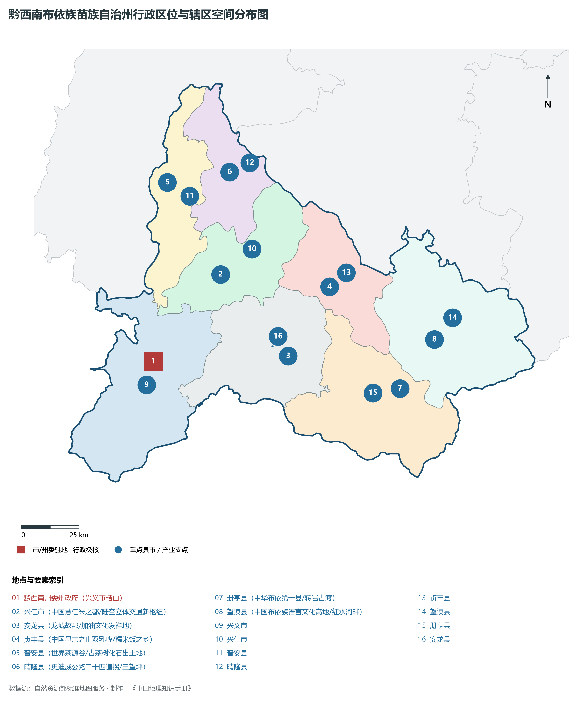
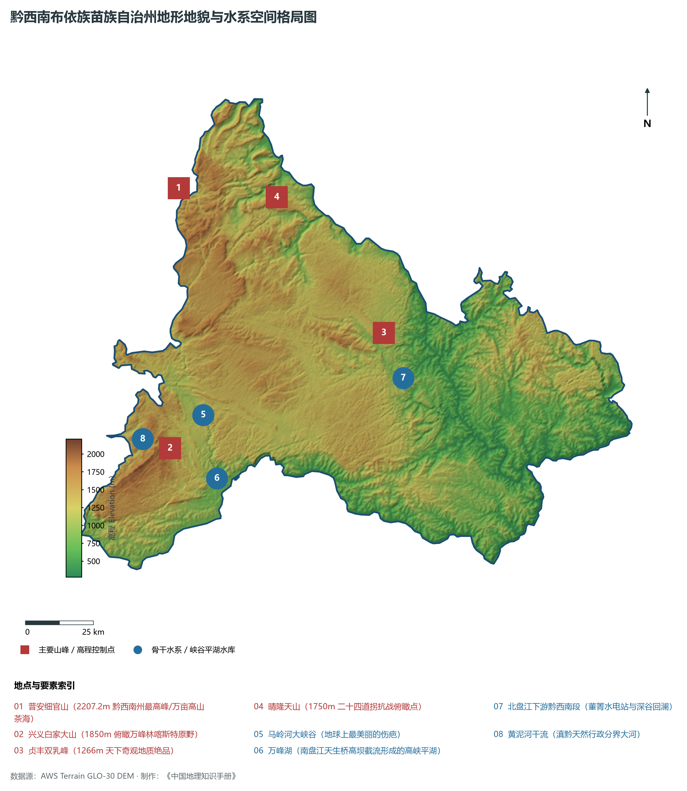
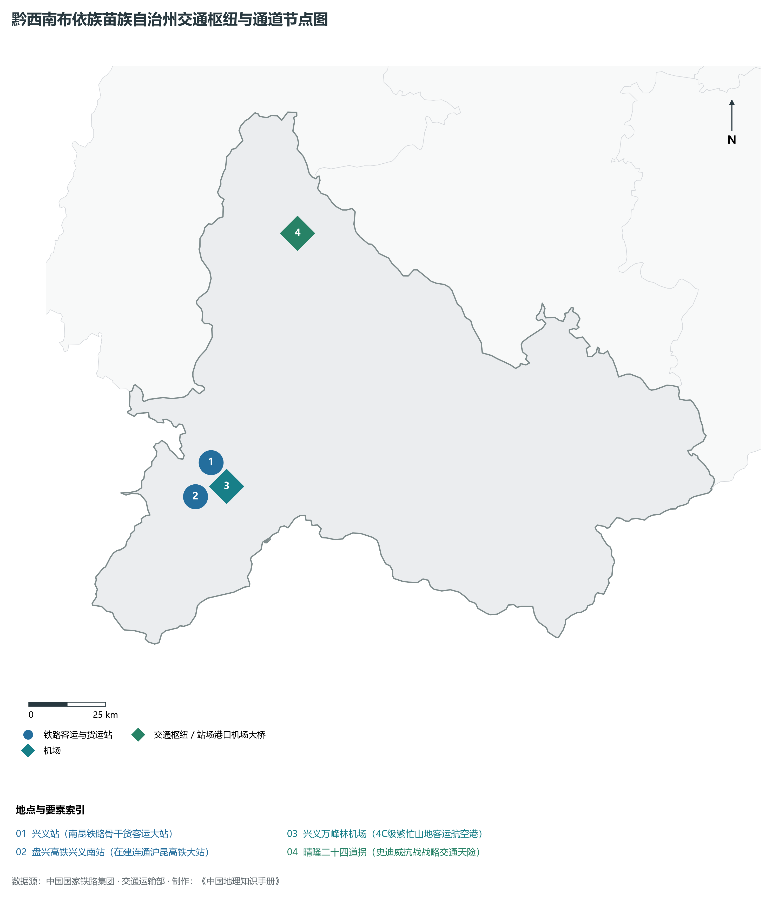
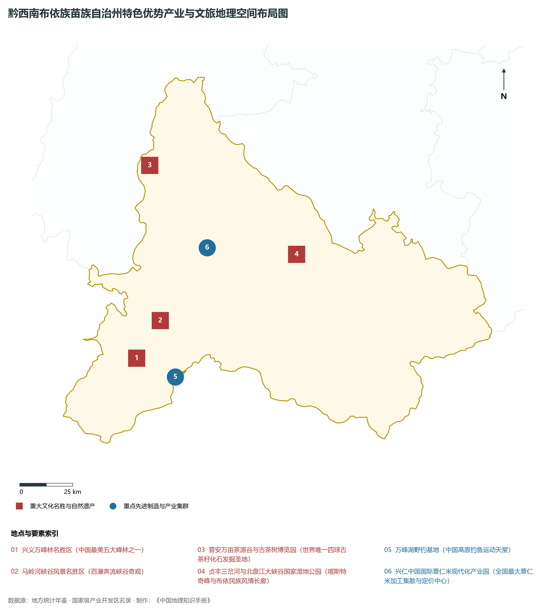
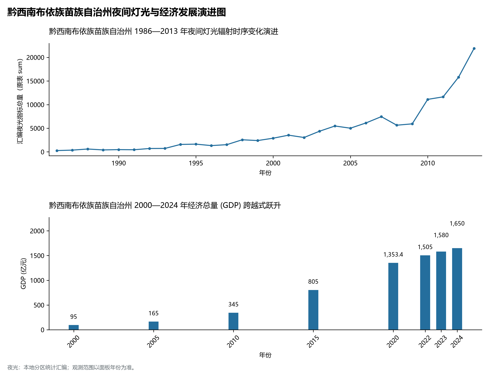

# 23.7 黔西南布依族苗族自治州

## 一、宏观区位、行政沿革与国土空间格局

黔西南布依族苗族自治州，行政区划代码 `522300`，是贵州省重要的行政与经济组成板块，战略定位为**滇黔桂结合部区域中心·中国金州·天下第一奇观万峰林·国际山地旅游康养名城**。辖区地理空间位置介于东经 104.74° ～ 106.25°、北纬 24.83° ～ 25.98° 之间，辖区国土总面积达 **16805.0 km²**。截至 2024 年末，全区/市/州常住人口为 **295.0 万人**，常住人口城镇化率达到 **57.5%**。

在建制历史沿革方面，黔西南布依族苗族自治州文脉绵长、积淀厚重。早在先秦夜郎古国或且兰、牂牁交融时期即有城邑雏形；秦汉开辟五尺道、置郡设县；唐宋以降羁縻州与土司制度交织演替；明清实行“改土归流”，修筑驿道关隘、设府置县，自古为西南战略要地、商贸通衢与多民族交汇之所。新中国成立后，历经行政区划合理调整与撤地设市（设州），全域生产力空间迎来了天翻地覆的沧桑巨变。新时代以来，黔西南布依族苗族自治州紧扣贵州省围绕“四新”主攻“四化”主战略，深度融入黔中城市群、西部陆海新通道与数字经济新高地建设，在产业转型升级、城镇提质扩能、生态绿色屏障筑牢与共同富裕上取得一系列历史性突破。

主要下辖行政与核心功能城区/区县分布如下：

- **黔西南州委州政府 (兴义市桔山)**：坐标 (104.89°E, 25.09°N)，功能定位：gov；
- **兴仁市 (中国薏仁米之都/陆空立体交通新枢纽)**：坐标 (105.18°E, 25.43°N)，功能定位：town；
- **安龙县 (龙城故郡/加油文化发祥地)**：坐标 (105.47°E, 25.11°N)，功能定位：town；
- **贞丰县 (中国母亲之山双乳峰/糯米饭之乡)**：坐标 (105.65°E, 25.38°N)，功能定位：town；
- **普安县 (世界茶源谷/古茶树化石出土地)**：坐标 (104.95°E, 25.79°N)，功能定位：town；
- **晴隆县 (史迪威公路二十四道拐/三望坪)**：坐标 (105.22°E, 25.83°N)，功能定位：town；
- **册亨县 (中华布依第一县/转岩古渡)**：坐标 (105.95°E, 24.98°N)，功能定位：town；
- **望谟县 (中国布依族语言文化高地/红水河畔)**：坐标 (106.1°E, 25.17°N)，功能定位：town；

---

## 二、地质地貌、山川骨架与水文水利系统

黔西南布依族苗族自治州地质构造复杂奇崛，处于云贵高原东部斜坡向喀斯特丘陵盆地过渡的核心构造带。区域内地壳隆升剧烈，古生代海相碳酸盐岩地层极为深厚，构造断裂纵横，溶蚀侵蚀作用极其强烈。宏观地貌呈现显著的山地喀斯特、深切峡谷、峰丛洼地、石林溶洞与山间坝子立体叠合特征，地貌单元起伏剧烈、雄奇壮美。辖区最高点海拔标高达 **2207.2 m**，最低处标高为 **275 m**，相对垂直落差达 **1932.2 m**。

骨干山峰与地貌高程制高点构筑起辖区生态屏障与自然脊梁：

- **普安细官山 (2207.2m 黔西南州最高峰/万亩高山茶海)**：海拔标高 **2207.2 m**，空间坐标 (104.88°E, 25.88°N)；
- **兴义白家大山 (1850m 俯瞰万峰林喀斯特原野)**：海拔标高 **1850.0 m**，空间坐标 (104.85°E, 25.02°N)；
- **贞丰双乳峰 (1266m 天下奇观地质绝品)**：海拔标高 **1266.0 m**，空间坐标 (105.63°E, 25.4°N)；
- **晴隆天山 (1750m 二十四道拐抗战俯瞰点)**：海拔标高 **1750.0 m**，空间坐标 (105.24°E, 25.85°N)；

在水网水系与水利控制方面，辖区水资源极为丰富，高山流水穿崖过谷，滋养全境：

- **马岭河大峡谷 (地球上最美丽的伤疤)**：标定坐标 (104.97°E, 25.13°N)；
- **万峰湖 (南盘江天生桥高坝截流形成的高峡平湖)**：标定坐标 (105.02°E, 24.92°N)；
- **北盘江下游黔西南段 (董箐水电站与深谷回澜)**：标定坐标 (105.7°E, 25.25°N)；
- **黄泥河干流 (滇黔天然行政分界大河)**：标定坐标 (104.75°E, 25.05°N)；

优越的森林植被与喀斯特独特山水造就了绝佳的高原夏季避暑温润气候，年平均气温适中，负氧离子充沛。辖区坚定践行“绿水青山就是金山银山”，全方位推进石漠化综合治理、退耕还林还湿、水库水源保护与流域十年禁渔，维系了全域水生态环境安全与绿水青山的大美底色。

---

## 三、综合立体交通网络、枢纽通道与区位优势

作为西南立体交通网与西部陆海新通道上的重要战略枢纽，黔西南布依族苗族自治州区位优势显著、内畅外通网络日臻完善。近年来，辖区全方位抢抓国家高速铁路网、高速公路加密扩能与国际物流大通道建设机遇，客货运输保障能级实现历史性跨越：

骨干交通基础设施与重要立体物流枢纽节点包括：

- **兴义站 (南昆铁路骨干货客运大站)**：空间标定 (104.91°E, 25.15°N)，设施类型：rail；
- **兴义万峰林机场 (4C级繁忙山地客运航空港)**：空间标定 (104.96°E, 25.08°N)，设施类型：airport；
- **盘兴高铁兴义南站 (在建连通沪昆高铁大站)**：空间标定 (104.86°E, 25.05°N)，设施类型：rail；
- **晴隆二十四道拐 (史迪威抗战战略交通天险)**：空间标定 (105.19°E, 25.82°N)，设施类型：bridge；

通过高铁、普铁、高速公路环线与支线民航空港、高架超级桥梁的紧密咬合，黔西南布依族苗族自治州全方位融入贵阳“1小时通勤圈”与成渝双核、粤港澳大湾区快速通道，向外深度衔接长江经济带与北部湾出海口，构筑起山海相连、要素高效流动的现代化开放格局。

---

## 四、特色优势产业集群、重点园区与现代经济版图

黔西南布依族苗族自治州立足资源禀赋、生态承载力与战略定位，坚定不移走新型工业化与绿色低碳发展之路，深度融入贵州省“六大重大产业基地”建设。2024 年，全市/州实现地区生产总值（GDP）达 **1650.0 亿元**，人均 GDP 达到 **55,930 元**，三次产业结构比稳健优化为 **14.8 : 36.5 : 48.7**，现代化经济韧性与高质量发展动力持续增强。

辖区核心产业平台、重大战略工程与重点开发区展示如下：

- **兴义万峰林名胜区 (中国最美五大峰林之一)**：空间坐标 (104.87°E, 24.98°N)，核心功能：国家5A级喀斯特典型峰林田园胜地；
- **马岭河峡谷风景名胜区 (百瀑奔流峡谷奇观)**：空间坐标 (104.98°E, 25.14°N)，核心功能：国家重点风景名胜区/天沟地缝；
- **万峰湖野钓基地 (中国高原钓鱼运动天堂)**：空间坐标 (105.05°E, 24.9°N)，核心功能：西南最大淡水人造湖泊休闲名胜；
- **兴仁中国国际薏仁米现代化产业园**：空间坐标 (105.2°E, 25.45°N)，核心功能：全国最大薏仁米加工集散与定价中心；
- **普安万亩茶源谷与古茶树博览园**：空间坐标 (104.93°E, 25.8°N)，核心功能：世界唯一四球古茶籽化石发掘圣地；
- **贞丰三岔河与北盘江大峡谷国家湿地公园**：空间坐标 (105.62°E, 25.42°N)，核心功能：喀斯特奇峰与布依民族风情长廊；

在现代化产业布局与建圈强链战略中，辖区因地制宜打造特色优势产业生态圈：

1. **优势先进制造业与战略性新兴产业**：聚焦大数据智算服务、新型动力储能电池材料、先进轻工装备制造、现代绿色煤电化工与航空零部件，培育壮大高新技术企业与专精特新企业；
2. **现代山地特色高效农业**：做大做强国家地理标志保护农产品，深耕生态茶叶、刺梨、精品果蔬、特色中药材与生态畜禽养殖，打造从田间到车间的全产业链绿色食品名牌；
3. **现代服务业、物流与数字经济赋能**：加快发展现代冷链物流、供应链金融、山地户外运动、避暑旅居康养与数字文旅场景，培育新质生产力源头活水。

---

## 五、历史文化胜迹、世界遗产与生态文旅名胜

黔西南布依族苗族自治州人文璀璨，自然雄奇，多元一体的民族文化与厚重革命历史交相辉映，是多彩贵州文化大系中极其耀眼的璀璨明珠。

辖区拥有享誉海内外的顶级文旅资源与文化丰碑：

- **世界自然/文化遗产与国家级文物古迹**：拥有联合国教科文组织世界自然遗产、世界地质公园、全国重点文物保护单位与国家历史文化名城，摩崖石刻、红色长征转折遗迹、土司军事城堡与明清屯堡古村落保存完好，是中华文明开拓进取与红色革命转折的伟大见证；
- **国家级风景名胜区与避暑度假名城**：天工造物赐予辖区世界级大瀑布、幽深喀斯特盲谷、地下天宫水溶洞、万亩高山峰林与浩瀚云海森林，夏季凉爽怡人，是全国首屈一指的避暑度假胜地与天然大氧吧；
- **多民族民俗瑰宝与火热非遗狂欢**：汉族、苗族、布依族、侗族、水族、仡佬族等多民族在这片热土依山而居、和睦共生，芦笙舞、火把节、跳花节、侗族大歌、蜡染刺绣代代相传，更有近年来火爆出圈的“村超”“村BA”民族体育文化狂欢，吸引了全球目光。

---

## 六、夜间灯光遥感时序演变与新时代现代化发展变化

本节夜光图的观测年份为 1986—2013 年，指标为行政区汇总值（原表 sum）。

### 1. 1986—2013 年夜间灯光遥感演化分析

- **1996年演化特征**：南昆铁路建设前夕兴义黄草坝微光；
- **2005年演化特征**：南昆线通车·金州黄金采选与煤电发力；
- **2015年演化特征**：国际山地旅游大会落户·万峰林万峰湖扬名；
- **2023年演化特征**：盘兴高铁赋能·康养胜地连通滇黔桂经济圈；

### 2. 2000—2024 年经济跨越式发展时序汇总
下表记录了 黔西南布依族苗族自治州 自 2000 年以来核心年份地区生产总值（GDP）的翻番跨越历程：

| 年份 | 地区生产总值 (亿元) | 发展阶段特征与重大历史跨越事件 |
| :---: | :---: | :--- |
| 2000 年 | **95.0** | 新世纪开局筑基阶段，特色资源与矿能基础稳步拓展 |
| 2005 年 | **165.0** | 新世纪开局筑基阶段，特色资源与矿能基础稳步拓展 |
| 2010 年 | **345.0** | 工业化与交通大基建全面攻坚，高速路网与新兴产业突飞猛进 |
| 2015 年 | **805.0** | 工业化与交通大基建全面攻坚，高速路网与新兴产业突飞猛进 |
| 2020 年 | **1353.4** | 综合经济实力实现千亿/数百亿历史性跨越，数字经济与文旅全面爆发 |
| 2022 年 | **1505.0** | 深度融入黔中城市群与东数西算国家战略枢纽，高质量发展迈上新台阶 |
| 2023 年 | **1580.0** | 深度融入黔中城市群与东数西算国家战略枢纽，高质量发展迈上新台阶 |
| 2024 年 | **1650.0** | 深度融入黔中城市群与东数西算国家战略枢纽，高质量发展迈上新台阶 |

### 3. 新征程高质量跨越式发展愿景
迈向中国式现代化新征程，黔西南布依族苗族自治州将全面贯彻新发展理念，主动融入国家区域重大战略：

1. 深入推进新型工业化与新型城镇化，做大做强特色实体经济，持续壮大新质生产力；
2. 协同推进高水平生态保护与高质量发展，筑牢长江珠江上游生态屏障；
3. 扎实推进乡村全面振兴与各族群众共同富裕，奋力书写多彩贵州现代化建设的崭新篇章。
