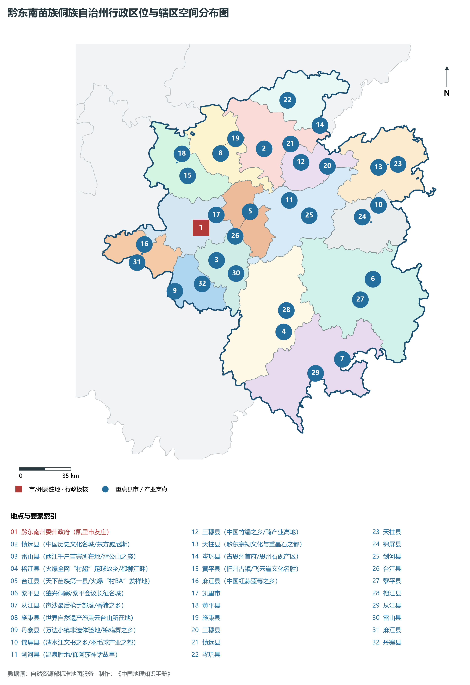
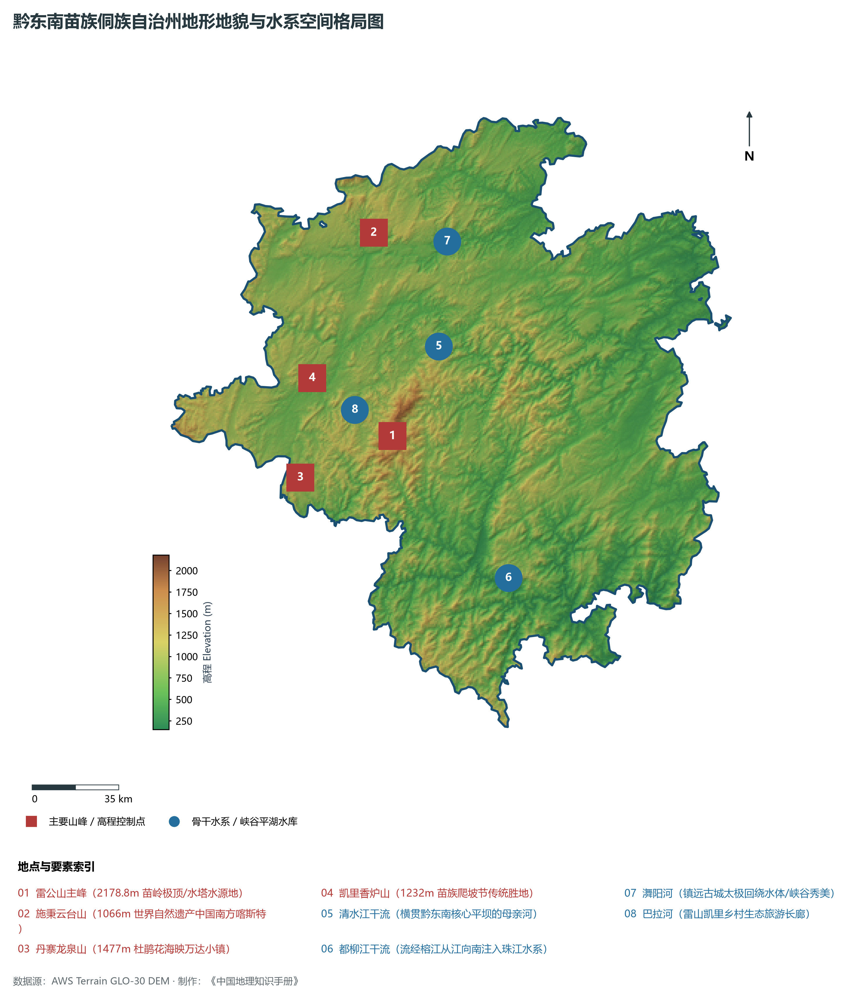
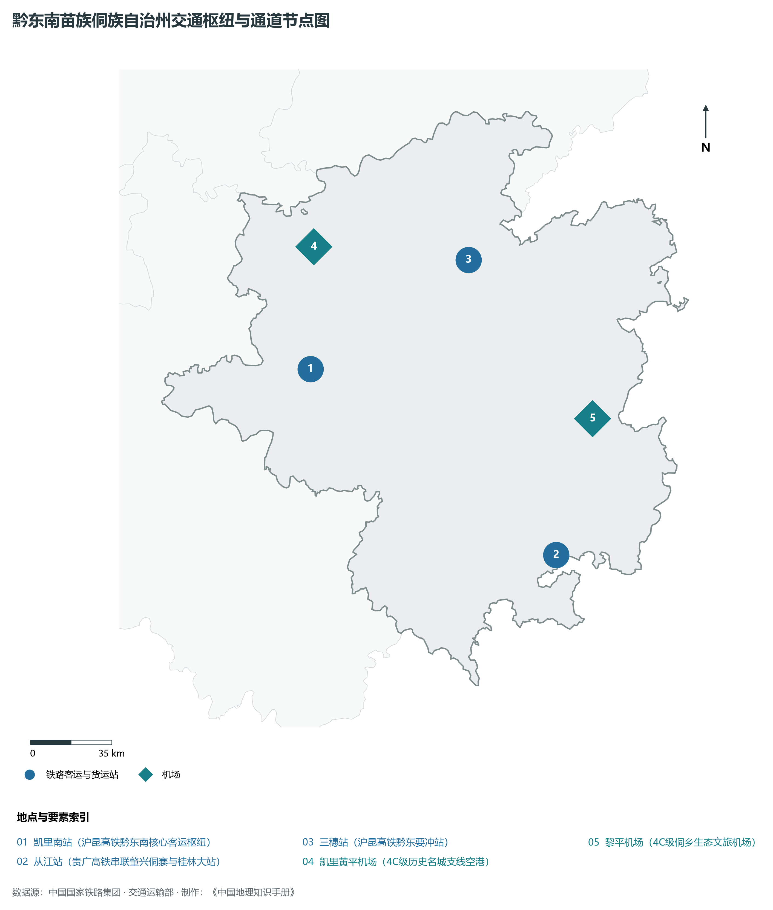
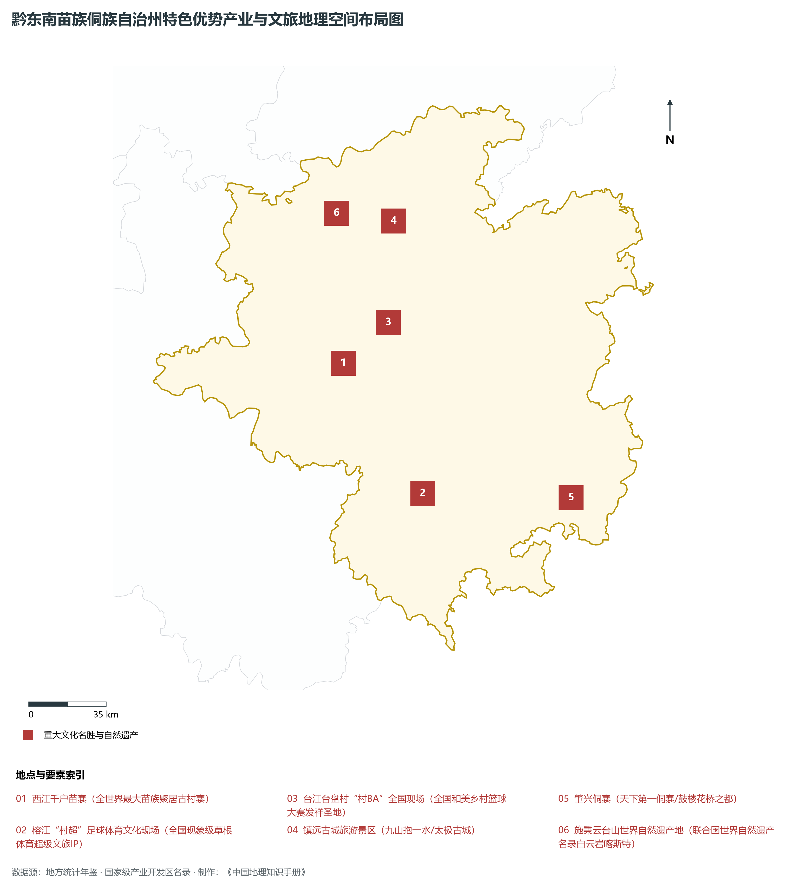
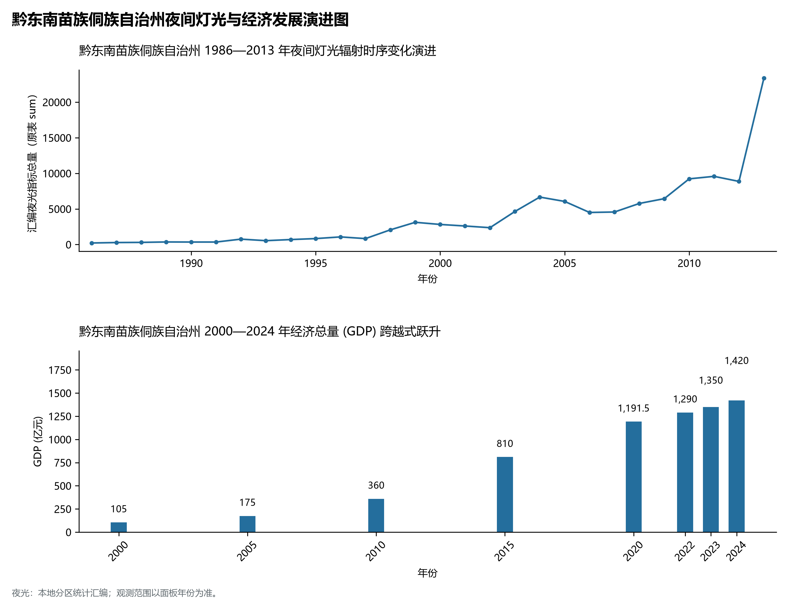

# 23.8 黔东南苗族侗族自治州

## 一、宏观区位、行政沿革与国土空间格局

黔东南苗族侗族自治州，行政区划代码 `522600`，是贵州省重要的行政与经济组成板块，战略定位为**歌舞之州·森林之州·西江千户苗寨·侗族大歌·村超村BA火爆出圈·世界民族文化博物馆**。辖区地理空间位置介于东经 107.44° ～ 109.36°、北纬 25.60° ～ 27.33° 之间，辖区国土总面积达 **30282.0 km²**。截至 2024 年末，全区/市/州常住人口为 **375.0 万人**，常住人口城镇化率达到 **52.8%**。

在建制历史沿革方面，黔东南苗族侗族自治州文脉绵长、积淀厚重。早在先秦夜郎古国或且兰、牂牁交融时期即有城邑雏形；秦汉开辟五尺道、置郡设县；唐宋以降羁縻州与土司制度交织演替；明清实行“改土归流”，修筑驿道关隘、设府置县，自古为西南战略要地、商贸通衢与多民族交汇之所。新中国成立后，历经行政区划合理调整与撤地设市（设州），全域生产力空间迎来了天翻地覆的沧桑巨变。新时代以来，黔东南苗族侗族自治州紧扣贵州省围绕“四新”主攻“四化”主战略，深度融入黔中城市群、西部陆海新通道与数字经济新高地建设，在产业转型升级、城镇提质扩能、生态绿色屏障筑牢与共同富裕上取得一系列历史性突破。

主要下辖行政与核心功能城区/区县分布如下：

- **黔东南州委州政府 (凯里市友庄)**：坐标 (107.98°E, 26.58°N)，功能定位：gov；
- **镇远县 (中国历史文化名城/东方威尼斯)**：坐标 (108.43°E, 27.05°N)，功能定位：town；
- **雷山县 (西江千户苗寨所在地/雷公山之巅)**：坐标 (108.08°E, 26.38°N)，功能定位：town；
- **榕江县 (火爆全网“村超”足球故乡/都柳江畔)**：坐标 (108.52°E, 25.93°N)，功能定位：town；
- **台江县 (天下苗族第一县/火爆“村BA”发祥地)**：坐标 (108.32°E, 26.67°N)，功能定位：town；
- **黎平县 (肇兴侗寨/黎平会议长征名城)**：坐标 (109.14°E, 26.23°N)，功能定位：town；
- **从江县 (岜沙最后枪手部落/香猪之乡)**：坐标 (108.91°E, 25.75°N)，功能定位：town；
- **施秉县 (世界自然遗产施秉云台山所在地)**：坐标 (108.13°E, 27.03°N)，功能定位：town；
- **丹寨县 (万达小镇非遗体验地/锦鸡舞之乡)**：坐标 (107.79°E, 26.2°N)，功能定位：town；
- **锦屏县 (清水江文书之乡/羽毛球产业之都)**：坐标 (109.2°E, 26.68°N)，功能定位：town；
- **剑河县 (温泉胜地/仰阿莎神话故里)**：坐标 (108.59°E, 26.73°N)，功能定位：town；
- **三穗县 (中国竹编之乡/鸭产业高地)**：坐标 (108.68°E, 26.96°N)，功能定位：town；
- **天柱县 (黔东宗祠文化与重晶石之都)**：坐标 (109.21°E, 26.91°N)，功能定位：town；
- **岑巩县 (古思州首府/思州石砚产区)**：坐标 (108.82°E, 27.18°N)，功能定位：town；
- **黄平县 (旧州古镇/飞云崖文化名胜)**：坐标 (107.9°E, 26.9°N)，功能定位：town；
- **麻江县 (中国红蒜蓝莓之乡)**：坐标 (107.59°E, 26.49°N)，功能定位：town；

---

## 二、地质地貌、山川骨架与水文水利系统

黔东南苗族侗族自治州地质构造复杂奇崛，处于云贵高原东部斜坡向喀斯特丘陵盆地过渡的核心构造带。区域内地壳隆升剧烈，古生代海相碳酸盐岩地层极为深厚，构造断裂纵横，溶蚀侵蚀作用极其强烈。宏观地貌呈现显著的山地喀斯特、深切峡谷、峰丛洼地、石林溶洞与山间坝子立体叠合特征，地貌单元起伏剧烈、雄奇壮美。辖区最高点海拔标高达 **2178.8 m**，最低处标高为 **148 m**，相对垂直落差达 **2031.0 m**。

骨干山峰与地貌高程制高点构筑起辖区生态屏障与自然脊梁：

- **雷公山主峰 (2178.8m 苗岭极顶/水塔水源地)**：海拔标高 **2178.8 m**，空间坐标 (108.2°E, 26.38°N)；
- **施秉云台山 (1066m 世界自然遗产中国南方喀斯特)**：海拔标高 **1066.0 m**，空间坐标 (108.15°E, 27.12°N)；
- **丹寨龙泉山 (1477m 杜鹃花海映万达小镇)**：海拔标高 **1477.0 m**，空间坐标 (107.82°E, 26.24°N)；
- **凯里香炉山 (1232m 苗族爬坡节传统胜地)**：海拔标高 **1232.0 m**，空间坐标 (107.88°E, 26.6°N)；

在水网水系与水利控制方面，辖区水资源极为丰富，高山流水穿崖过谷，滋养全境：

- **清水江干流 (横贯黔东南核心平坝的母亲河)**：标定坐标 (108.4°E, 26.7°N)；
- **都柳江干流 (流经榕江从江向南注入珠江水系)**：标定坐标 (108.65°E, 25.85°N)；
- **㵲阳河 (镇远古城太极回绕水体/峡谷秀美)**：标定坐标 (108.45°E, 27.08°N)；
- **巴拉河 (雷山凯里乡村生态旅游长廊)**：标定坐标 (108.05°E, 26.48°N)；

优越的森林植被与喀斯特独特山水造就了绝佳的高原夏季避暑温润气候，年平均气温适中，负氧离子充沛。辖区坚定践行“绿水青山就是金山银山”，全方位推进石漠化综合治理、退耕还林还湿、水库水源保护与流域十年禁渔，维系了全域水生态环境安全与绿水青山的大美底色。

---

## 三、综合立体交通网络、枢纽通道与区位优势

作为西南立体交通网与西部陆海新通道上的重要战略枢纽，黔东南苗族侗族自治州区位优势显著、内畅外通网络日臻完善。近年来，辖区全方位抢抓国家高速铁路网、高速公路加密扩能与国际物流大通道建设机遇，客货运输保障能级实现历史性跨越：

骨干交通基础设施与重要立体物流枢纽节点包括：

- **凯里南站 (沪昆高铁黔东南核心客运枢纽)**：空间标定 (107.95°E, 26.55°N)，设施类型：rail；
- **从江站 (贵广高铁串联肇兴侗寨与桂林大站)**：空间标定 (108.98°E, 25.8°N)，设施类型：rail；
- **三穗站 (沪昆高铁黔东要冲站)**：空间标定 (108.65°E, 26.95°N)，设施类型：rail；
- **凯里黄平机场 (4C级历史名城支线空港)**：空间标定 (107.98°E, 27.02°N)，设施类型：airport；
- **黎平机场 (4C级侗乡生态文旅机场)**：空间标定 (109.16°E, 26.32°N)，设施类型：airport；

通过高铁、普铁、高速公路环线与支线民航空港、高架超级桥梁的紧密咬合，黔东南苗族侗族自治州全方位融入贵阳“1小时通勤圈”与成渝双核、粤港澳大湾区快速通道，向外深度衔接长江经济带与北部湾出海口，构筑起山海相连、要素高效流动的现代化开放格局。

---

## 四、特色优势产业集群、重点园区与现代经济版图

黔东南苗族侗族自治州立足资源禀赋、生态承载力与战略定位，坚定不移走新型工业化与绿色低碳发展之路，深度融入贵州省“六大重大产业基地”建设。2024 年，全市/州实现地区生产总值（GDP）达 **1420.0 亿元**，人均 GDP 达到 **37,860 元**，三次产业结构比稳健优化为 **18.2 : 23.5 : 58.3**，现代化经济韧性与高质量发展动力持续增强。

辖区核心产业平台、重大战略工程与重点开发区展示如下：

- **西江千户苗寨 (全世界最大苗族聚居古村寨)**：空间坐标 (108.17°E, 26.49°N)，核心功能：国家4A级苗族活态文化与夜景观景台；
- **榕江“村超”足球体育文化现场**：空间坐标 (108.51°E, 25.95°N)，核心功能：全国现象级草根体育超级文旅IP；
- **台江台盘村“村BA”全国现场**：空间坐标 (108.38°E, 26.65°N)，核心功能：全国和美乡村篮球大赛发祥圣地；
- **镇远古城旅游景区 (九山抱一水/太极古城)**：空间坐标 (108.42°E, 27.06°N)，核心功能：国家5A级历史名胜与青龙洞明清古建；
- **肇兴侗寨 (天下第一侗寨/鼓楼花桥之都)**：空间坐标 (109.18°E, 25.91°N)，核心功能：侗族大歌与千户侗族原生态聚落；
- **施秉云台山世界自然遗产地**：空间坐标 (108.16°E, 27.1°N)，核心功能：联合国世界自然遗产名录白云岩喀斯特；

在现代化产业布局与建圈强链战略中，辖区因地制宜打造特色优势产业生态圈：

1. **优势先进制造业与战略性新兴产业**：聚焦大数据智算服务、新型动力储能电池材料、先进轻工装备制造、现代绿色煤电化工与航空零部件，培育壮大高新技术企业与专精特新企业；
2. **现代山地特色高效农业**：做大做强国家地理标志保护农产品，深耕生态茶叶、刺梨、精品果蔬、特色中药材与生态畜禽养殖，打造从田间到车间的全产业链绿色食品名牌；
3. **现代服务业、物流与数字经济赋能**：加快发展现代冷链物流、供应链金融、山地户外运动、避暑旅居康养与数字文旅场景，培育新质生产力源头活水。

---

## 五、历史文化胜迹、世界遗产与生态文旅名胜

黔东南苗族侗族自治州人文璀璨，自然雄奇，多元一体的民族文化与厚重革命历史交相辉映，是多彩贵州文化大系中极其耀眼的璀璨明珠。

辖区拥有享誉海内外的顶级文旅资源与文化丰碑：

- **世界自然/文化遗产与国家级文物古迹**：拥有联合国教科文组织世界自然遗产、世界地质公园、全国重点文物保护单位与国家历史文化名城，摩崖石刻、红色长征转折遗迹、土司军事城堡与明清屯堡古村落保存完好，是中华文明开拓进取与红色革命转折的伟大见证；
- **国家级风景名胜区与避暑度假名城**：天工造物赐予辖区世界级大瀑布、幽深喀斯特盲谷、地下天宫水溶洞、万亩高山峰林与浩瀚云海森林，夏季凉爽怡人，是全国首屈一指的避暑度假胜地与天然大氧吧；
- **多民族民俗瑰宝与火热非遗狂欢**：汉族、苗族、布依族、侗族、水族、仡佬族等多民族在这片热土依山而居、和睦共生，芦笙舞、火把节、跳花节、侗族大歌、蜡染刺绣代代相传，更有近年来火爆出圈的“村超”“村BA”民族体育文化狂欢，吸引了全球目光。

---

## 六、夜间灯光遥感时序演变与新时代现代化发展变化

本节夜光图的观测年份为 1986—2013 年，指标为行政区汇总值（原表 sum）。

### 1. 1986—2013 年夜间灯光遥感演化分析

- **1996年演化特征**：清水江畔凯里老城与火车站点状火光；
- **2005年演化特征**：湘黔铁路线繁盛·西江千户苗寨文旅初现；
- **2015年演化特征**：沪昆高铁与贵广高铁贯通·民族文旅大爆发；
- **2023年演化特征**：“村超”“村BA”现象级破圈·全民狂欢闪耀世界；

### 2. 2000—2024 年经济跨越式发展时序汇总
下表记录了 黔东南苗族侗族自治州 自 2000 年以来核心年份地区生产总值（GDP）的翻番跨越历程：

| 年份 | 地区生产总值 (亿元) | 发展阶段特征与重大历史跨越事件 |
| :---: | :---: | :--- |
| 2000 年 | **105.0** | 新世纪开局筑基阶段，特色资源与矿能基础稳步拓展 |
| 2005 年 | **175.0** | 新世纪开局筑基阶段，特色资源与矿能基础稳步拓展 |
| 2010 年 | **360.0** | 工业化与交通大基建全面攻坚，高速路网与新兴产业突飞猛进 |
| 2015 年 | **810.0** | 工业化与交通大基建全面攻坚，高速路网与新兴产业突飞猛进 |
| 2020 年 | **1191.5** | 综合经济实力实现千亿/数百亿历史性跨越，数字经济与文旅全面爆发 |
| 2022 年 | **1290.0** | 深度融入黔中城市群与东数西算国家战略枢纽，高质量发展迈上新台阶 |
| 2023 年 | **1350.0** | 深度融入黔中城市群与东数西算国家战略枢纽，高质量发展迈上新台阶 |
| 2024 年 | **1420.0** | 深度融入黔中城市群与东数西算国家战略枢纽，高质量发展迈上新台阶 |

### 3. 新征程高质量跨越式发展愿景
迈向中国式现代化新征程，黔东南苗族侗族自治州将全面贯彻新发展理念，主动融入国家区域重大战略：

1. 深入推进新型工业化与新型城镇化，做大做强特色实体经济，持续壮大新质生产力；
2. 协同推进高水平生态保护与高质量发展，筑牢长江珠江上游生态屏障；
3. 扎实推进乡村全面振兴与各族群众共同富裕，奋力书写多彩贵州现代化建设的崭新篇章。
