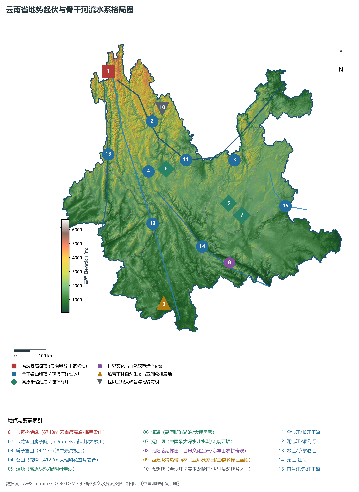
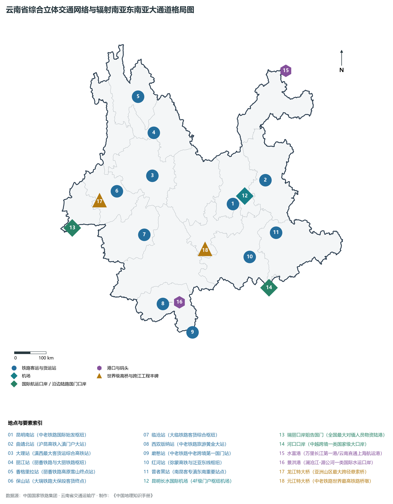
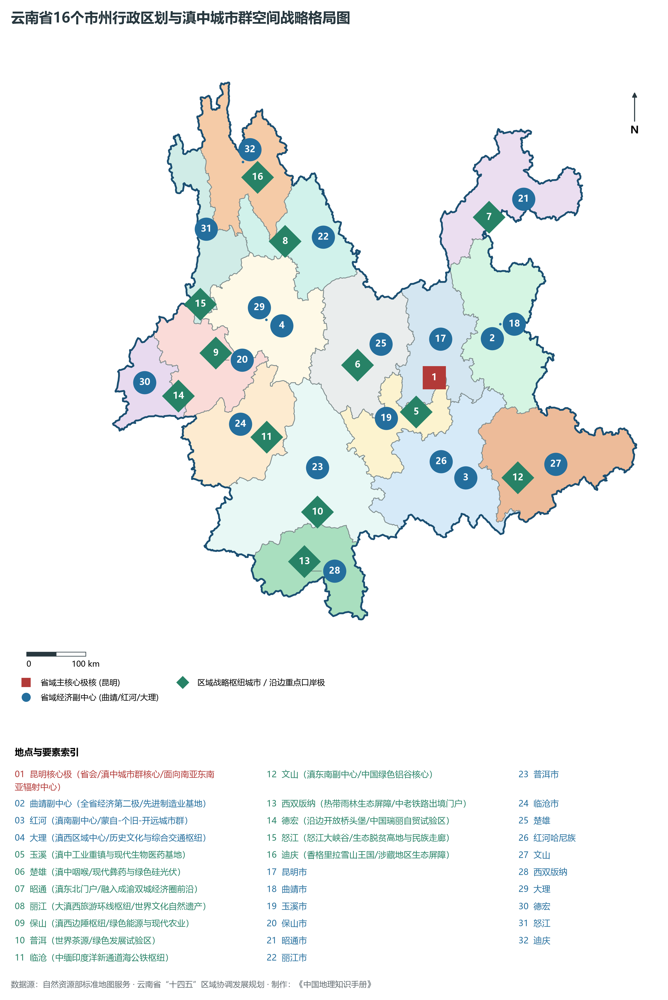
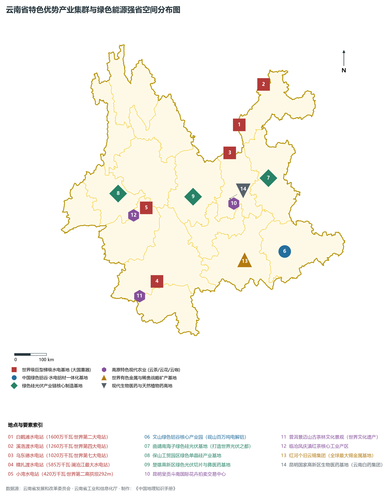
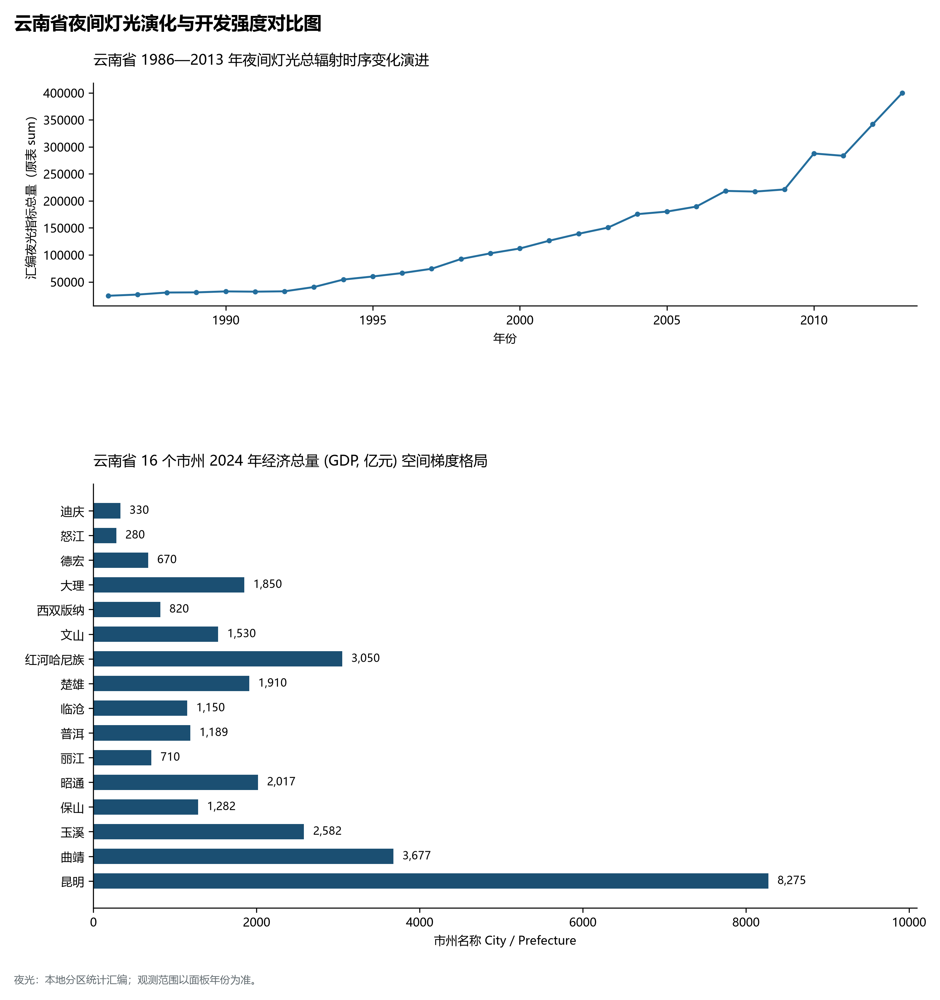

# 24.0 云南省地理统揽

云南省，简称“滇”或“云”，省会昆明市，地处中国西南边陲、云贵高原西南部，介于东经 97° 31' ～ 106° 11'、北纬 21° 08' ～ 29° 15' 之间，东西横跨 864.9 km，南北纵贯 990 km，幅员陆地总面积达 **39.41 × 10⁴ km²**，占全国国土总面积的 4.11%，居全国第 8 位。云南东连贵州、广西，北邻四川，西北紧贴西藏自治区，西南与缅甸毗连，南与老挝、越南接壤，拥有长达 **4,060 km** 的漫长国境线（其中中缅边界 1,997 km、中老边界 710 km、中越边界 1,353 km），是中国面向南亚、东南亚和印度洋周边区域开放的陆路大通道核心枢纽与前沿辐射中心。

截至 2024 年末，全省常住人口达 **4,673.0 万人**，常住人口城镇化率达 **52.80%**；2024 年全省地区生产总值（GDP）跨越 **30,600.0 亿元**（按不变价格计算比上年增长 4.8%），人均 GDP 跃升至 **65,480 元**；三次产业结构比稳健优化为 **13.8 : 34.6 : 51.6**。全省现辖 8 个地级市、8 个自治州（共 16 个地州市级行政单元、129 个县级行政区），在全省战略空间上构建起以昆明为中心极核、曲靖与大理及蒙自为副中心、联动“一体两翼四极”面向南亚东南亚辐射中心的现代化高质量协同发展格局。作为全国动植物多样性最丰富、生态地位最关键的生态安全屏障，云南集世界级巨型水电集群、中国绿色铝谷、世界光伏之都、高原特色现代农业与世界级文旅康养胜地于一身，书写了从边陲末梢向开放前沿的伟大历史蝶变。

---

## 一、板块碰撞、青藏高原南延与“三江并流·千峰壁立”宏观自然地理底盘

云南地处青藏高原东南缘与横断山脉纵谷区，大地构造横跨特提斯-喜马拉雅构造域与扬子准地台两大构造单元。印度板块与欧亚板块自新生代以来的剧烈俯冲挤压碰撞，促使横断山系强烈褶皱隆升与深切剥蚀，塑造了全省梯级递降、起伏磅礴、雄伟峻拔的大地骨架：

1. **三级台阶自西北向东南倾斜的总态势**：
   - 第一级阶梯（滇西北横断山高山峡谷区）：平均海拔在 3000 ～ 4000 m 以上，山高谷深、极顶覆雪。**德钦县梅里雪山卡瓦格博峰（海拔 6740.0 m）**为全省最高峰，山体高拔险峻、现代冰川悬垂，至今保持未被人类登顶的原始神圣；
   - 第二级阶梯（滇中滇东岩溶高原与滇西中高山区）：平均海拔在 1500 ～ 2200 m，分布有广泛的断陷盆地（坝子）、熔岩石林（石林世界遗产）与深水断陷湖泊（滇池、抚仙湖、洱海）；
   - 第三级阶梯（滇南与滇西南低中山宽谷盆地）：平均海拔降至 800 ～ 1200 m，哀牢山、无量山向南延展渐变为热带河谷与低山雨林盆地；
2. **“三江并流”世界自然奇观**：
   - 金沙江（长江上游）、澜沧江（湄公河上游）与怒江（萨尔温江上游）自北向南平行并流穿行于高黎贡山、碧罗雪山、云岭等南北走向巨型山脉之间，直线距离最近处仅数十公里而不汇合，被联合国教科文组织列入世界自然遗产名录；
3. **极深大峡谷与陆域极值反差**：
   - **虎跳峡**（金沙江穿切玉龙雪山与哈巴雪山之间，江面海拔 1800 m，两侧雪峰耸峙超 5300 m，垂直相对高差达 **3900 m**，为全球最深大峡谷之一）；
   - **全省最高点与最低点**：全省垂直相对极差高达 **6,663.6 m**！
     - 最高极顶：迪庆藏族自治州德钦县**梅里雪山卡瓦格博峰（6740.0 m）**；
     - 最低出境点：红河哈尼族彝族自治州河口县南溪河与元江-红河交汇处（**海拔 76.4 m**）。

**云南省“雪山极顶—高原断陷湖盆—热带河谷”立体大断面剖面图**

| 梅里雪山卡瓦格博 6740m | 轿子雪山 4247m | 哀牢山主脊 3100m | 河口红河交汇点 76.4m |
| --- | --- | --- | --- |
| 玉龙雪山扇子陡 5596m；三江并流·虎跳峡天堑 | 昆明坝子·滇池 1886m；抚仙湖深水琉璃万顷 | 元阳哈尼梯田 1800m；元江红河干流深切谷底 | 西双版纳雨林 500m；芭蕉香蕉热区·橡胶林 |

滇西北横断山极顶 · → 滇中高原断陷湖盆 · → 哀牢山深切割峡谷 · → 滇南热带河谷出境

---

## 二、“一山分四季·十里不同天”立体气候与“六大水系纵贯三大洋”水网格局

云南气候集低纬度、高海拔、季风环流强盛与地形破碎复杂于一体，呈现出“寒、温、亚热、热”全谱系垂直气候带，是全球难得一见的“立体气候大观园”：

- **低纬高原与温润四季**：全省大部分区域受西南季风与高原平缓下沉气流控制，冬无严寒、夏无酷暑，“四季如春”，年均温多在 15°C ～ 18°C；
- **干湿分明的季风雨热同季**：雨季（5~10 月）受孟加拉湾暖湿西南季风控制，降水量占全年 85% 以上；干季（11 月至次年 4 月）晴朗少云、光照充足；
- **立体气候造就世界物种基因库**：从南至北、从谷底至峰顶依次更迭热带雨林、南亚热带季风常绿阔叶林、中亚热带常绿阔叶林、硬叶常绿阔叶林、寒温性针叶林、高山灌丛草甸直至高山流石滩稀疏植被，高等植物种类占全国一半以上，脊椎动物种类占全国 51.4%，被誉为“动物王国”“植物王国”和“世界花园”。

在水网水文方面，全省地跨六大水系，分别注入太平洋、印度洋与北部湾，水能资源技术可开发量突破 **1 亿千瓦**，位居全国第二位：

1. **长江水系（金沙江）**：全省最大河流，在丽江石鼓形成“万里长江第一湾”，流经迪庆、丽江、大理、楚雄、昆明、昭通，汇聚了白鹤滩（1600万千瓦）、溪洛渡（1260万千瓦）、乌东德（1020万千瓦）、向家坝（775万千瓦）四大世界级巨型梯级电站，形成国家“西电东送”最核心战略基地；
2. **澜沧江-湄公河水系**：一江连六国（中国、缅甸、老挝、泰国、柬埔寨、越南），在云南境内流长 1,227 km，建有小湾（420万千瓦/拱坝高292米）、糯扎渡（585万千瓦）等超级龙头电站，下游景洪港为国家一类水运口岸，是连接东盟的黄金国际水道；
3. **怒江-萨尔温江水系**：发源唐古拉山，奔腾于高黎贡山与碧罗雪山之间，深切形成举世闻名的怒江大峡谷，流经贡山、福贡、泸水、保山、临沧进入缅甸注入安达曼海；
4. **元江-红河水系**：发源大理巍山，斜穿云南中南部，切削出红河大峡谷，经河口出境注入越南北部湾；
5. **珠江水系（南盘江）**：发源曲靖沾益马雄山，向南汇流北盘江后成为西江主干，是粤港澳大湾区的源头活水；
6. **伊洛瓦底江水系（独龙江、大盈江、瑞丽江）**：流经滇西北与滇西边境，向西南流入缅甸汇入伊洛瓦底江。

---

## 三、“滇中城市群”一体化与“面向南亚东南亚辐射中心”开放大格局

云南打破地缘闭塞阻隔，积极构建“滇中崛起、沿边繁荣、全域协同”的新型城镇化空间战略体系：

1. **“一核”：滇中城市群核心极核（昆明）**：
   - 昆明市作为省会特大城市，辐射带动曲靖、玉溪、楚雄三市州，以全省 29% 的国土面积，集聚了全省近 47% 的常住人口和超过 **60%** 的经济总量，是全省高新技术产业、金融贸易、高等教育、国际交流的战略发动机；
2. **“三极”：省域副中心支撑极**：
   - **曲靖副中心**：全省第二大经济体，打造“先进制造业基地”与“世界光伏之都”；
   - **红河滇南副中心**：蒙自-个旧-开远城镇群，沿边开放与绿色铝锡新材料枢纽；
   - **大理滇西副中心**：连接滇西北、滇西南的区域综合交通枢纽与国际文旅商贸中心；
3. **“沿边开放沿线辐射走廊”**：
   - **中老铁路国际经济走廊**：自昆明出发，串联玉溪、普洱、西双版纳，直抵老挝万象，实现中国-东盟物流客流黄金互通；
   - **中缅新通道**：以保山、临沧、德宏瑞丽为桥头堡，海公铁联运直抵印度洋孟加拉湾；
   - **中越跨境经济合作走廊**：以红河蒙自、河口与文山天保为依托，融入中国-中南半岛经济走廊。

---

## 四、综合立体交通跨越：中老铁路黄金通道、大滇西环线与民航强省

云南全面推进“七出省五出境”高速铁路通道与“九出省五出境”高速公路通道建设，破解千山万壑阻隔：

- **国际高铁与铁路骨干网**：
  - **中老铁路**（全长 1,035 km，2021年底全线开通运营，旅客发送量超数千万人次，进出口货物货运覆盖东盟多国，成为“一带一路”高质量共建标志性工程）；
  - **沪昆高铁与南昆客专**（直通上海、杭州、广州、深圳、南宁）；
  - **新成昆铁路、渝昆高铁、大理-丽江-香格里拉铁路（丽香铁路）**（滇藏通道关键段，结束了迪庆不通火车的历史）；
  - **大理-保山-瑞丽铁路（大瑞铁路）**（跨越怒江澜沧江，直通中缅边境瑞丽口岸）；
- **高速公路“县县通”与世界级桥梁隧道工程**：
  - 全省高速公路通车里程突破 **10,500 km**，居全国前列；龙江特大桥、元江特大桥、虎跳峡金沙江特大桥等天堑通道刷新世界桥梁建设纪录；
- **全国领先的高原民用航空枢纽网（民航强省）**：
  - 拥有昆明长水国际机场（全国大型国际航空枢纽、4F级）、丽江三义国际机场、西双版纳嘎洒国际机场、芒市、大理、腾冲、香格里拉、普洱等 15 座通航民用运输机场，形成干支结合、辐射东盟南亚的密集空中丝绸之路。

---

## 五、现代产业体系：绿色能源强省、绿色铝硅、高原特色现代农业与世界文旅

云南将绿色生态资源优势转化为现代化先进产业优势，形成支撑现代化新云南的“支柱产业矩阵”：

1. **绿色能源强省与清洁电力外送**：
   - 全省绿色能源电力装机占比突破 **90%**，绿色发电量占比超 85%，全国第一；“西电东送”累计送电量超万亿千瓦时，成为支撑粤港澳大湾区与华东高质量发展的绿色能源大动脉；
2. **中国绿色铝谷与世界光伏之都**：
   - 依托充沛清洁绿电，在文山、昭通、红河、曲靖打造全产业链绿电铝集群；在曲靖、保山、楚雄集聚隆基绿能、晶澳、通威、晶科等光伏龙头，形成单晶硅棒、硅片、电池片与组件全产业链；
3. **世界一流“绿色食品牌”（高原特色现代农业）**：
   - **云茶**：普洱茶、滇红茶名扬世界，普洱景迈山古茶林被列入世界文化遗产；
   - **云咖**：保山、普洱、临沧小粒咖啡产量占全国 98% 以上，远销欧美；
   - **云花**：昆明斗南花卉市场成为“亚洲第一花都”，鲜切花产销量连续数十年全国第一；
   - **云果与云菜**：高山晚熟芒果、通海绿色蔬菜、高海拔苹果、蓝莓草莓行销海内外；
4. **卷烟工业与现代生物医药大健康**：
   - 红塔集团、红云红河烟草工业领跑全国卷烟制造；云南白药、沃森生物（新型疫苗）、现代彝医药（楚雄）崛起为生物医药领军龙头；
5. **世界级文旅康养胜地与大滇西旅游环线**：
   - 丽江古城、哈尼梯田、澄江化石地、三江并流、普洱景迈山等 6 项世界遗产；大理苍洱、西双版纳热带雨林、香格里拉普达措、玉龙雪山等世界级景观带，推动云南迈向世界一流生态文化旅游目的地。

---

## 六、1986—2013 年夜间灯光时序演变与跨越式变化特征

本节夜光图的观测年份为 1986—2013 年，指标为行政区汇总值（原表 sum）。

1. **时序演进宏观轨迹**：
2. **经济总量（GDP）翻番跨越**：
   - 全省地区生产总值由 2000 年的 **1,957 亿元**，跃升至 2010 年的 **7,220 亿元**，再到 2020 年的 **24,521.9 亿元**，2024 年成功迈过 **30,600.0 亿元** 历史性大关，人均 GDP 跃过 6.5 万元，经济综合实力与现代化发展水平实现划时代的历史跨越。
