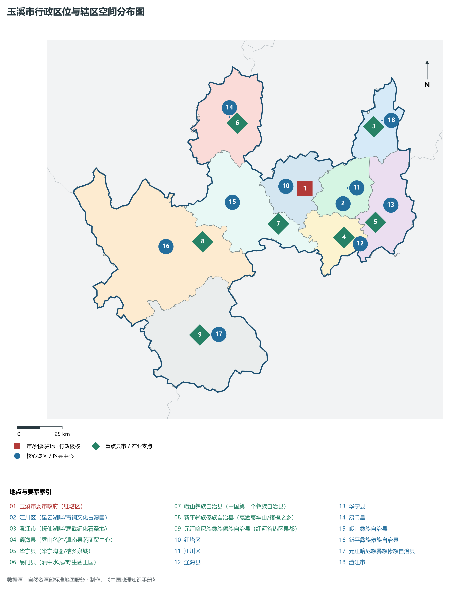
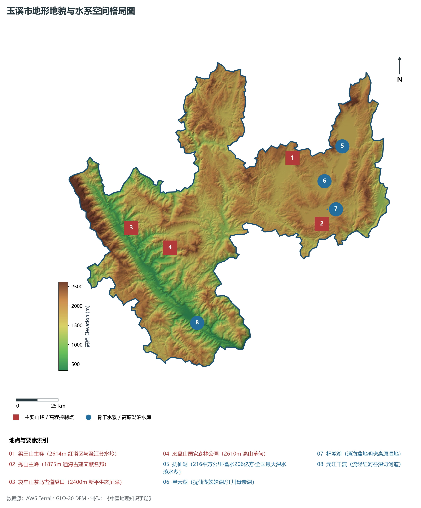
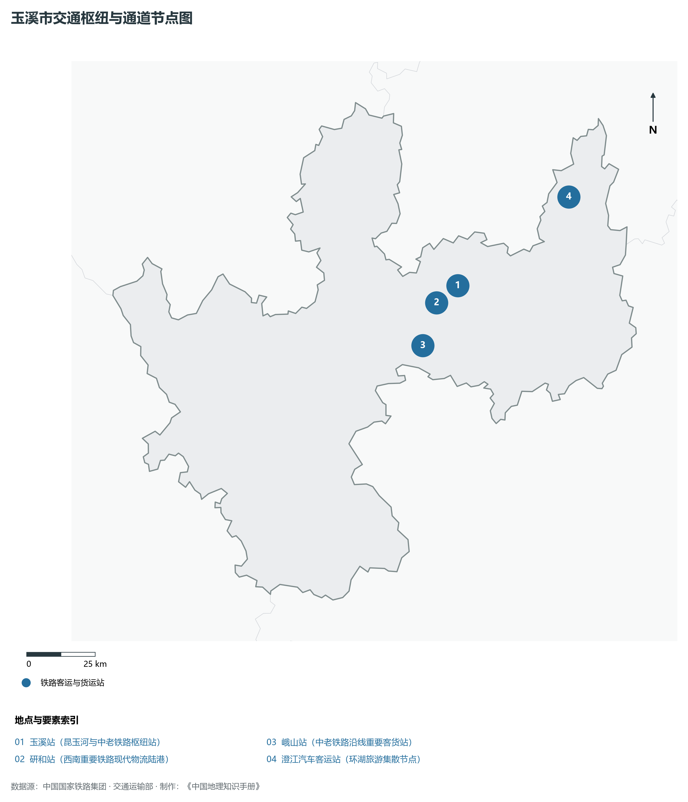
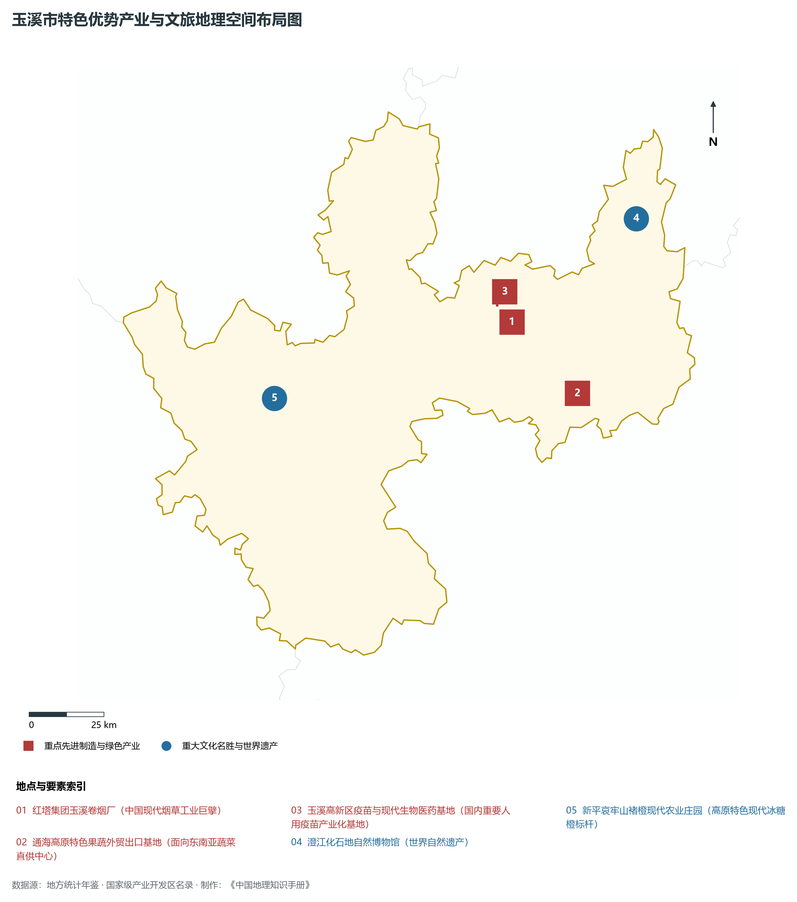
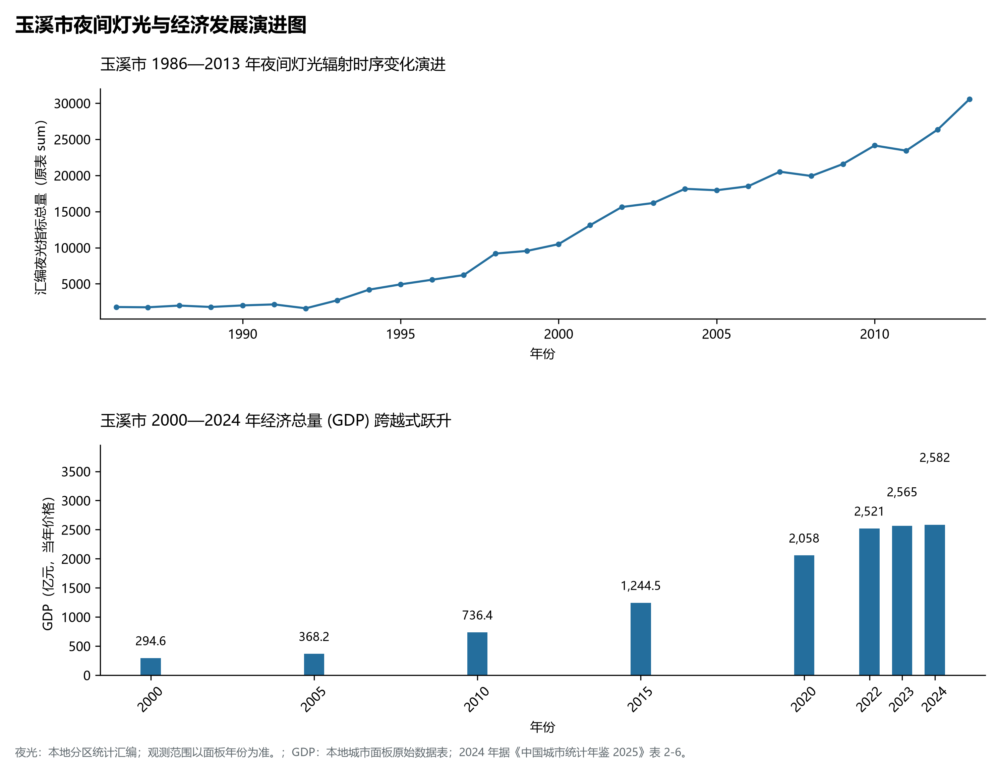

# 24.3 玉溪市

## 一、宏观地位、行政区划与空间发展骨架

玉溪市，地理区位得天独厚，地处云贵高原与青藏高原东南缘过渡带，介于东经 101.84° ～ 103.08°、北纬 23.45° ～ 24.82° 之间，是云南省国土空间开发保护格局中的战略重要支点。辖区土地总面积达 **15285.0 km²**，全域涵盖山地、高原峡谷、断陷盆地（坝子）与深切河谷，行政区划代码为 `530400`。

截至 2024 年底，玉溪市常住总人口为 **226.0 万人**，常住人口城镇化率稳健提升至 **56.5%**。在全省生产力布局中，玉溪市定位为“**高原水乡·中国烟草之都·绿色食品名城·抚仙湖生态高地·澄江化石圣地**”。辖区构建起以中心主城为核心、多组团协同支撑、县域与特色小镇深度联动的现代化城乡空间格局：

2024 年全市统计：常住人口 227 万人，常住人口城镇化率 58.12 %，地区生产总值 2,582 亿元，人均地区生产总值 113,973 元，三次产业构成 9.65 : 42 : 48.35。

2024 年全市统计：常住人口 227 万人，常住人口城镇化率 58.12 %，地区生产总值 2,582 亿元，人均地区生产总值 113,973 元，三次产业构成 9.65 : 42 : 48.35。

2024 年全市统计：常住人口 227 万人，常住人口城镇化率 58.12 %，地区生产总值 2,582 亿元，人均地区生产总值 113,973 元，三次产业构成 9.65 : 42 : 48.35。

骨干辖区板块与核心功能节点包括：

- **玉溪市委市政府 (红塔区)**：坐标 (102.54°E, 24.35°N)，功能定位：gov；
- **江川区 (星云湖畔/青铜文化古滇国)**：坐标 (102.75°E, 24.28°N)，功能定位：subdistrict；
- **澄江市 (抚仙湖畔/寒武纪化石圣地)**：坐标 (102.91°E, 24.67°N)，功能定位：town；
- **通海县 (秀山名胜/滇南果蔬商贸中心)**：坐标 (102.76°E, 24.11°N)，功能定位：town；
- **华宁县 (华宁陶器/桔乡泉城)**：坐标 (102.93°E, 24.19°N)，功能定位：town；
- **易门县 (滇中水城/野生菌王国)**：坐标 (102.16°E, 24.67°N)，功能定位：town；
- **峨山彝族自治县 (中国第一个彝族自治县)**：坐标 (102.4°E, 24.17°N)，功能定位：town；
- **新平彝族傣族自治县 (戛洒哀牢山/褚橙之乡)**：坐标 (101.99°E, 24.07°N)，功能定位：town；
- **元江哈尼族彝族傣族自治县 (红河谷热区果都)**：坐标 (101.99°E, 23.6°N)，功能定位：town；

辖区坚持走集约高效、绿色低碳、产城融合的新型城镇化道路，基础设施综合承载能级不断跃升，生态宜居品质持续彰显。

---

## 二、地质地貌、山川骨架与水文水利系统

玉溪市地质构造复杂奇崛，处于青藏高原抬升与横断山脉纵深侵蚀的强烈活动带。深大断裂纵横交错，古生代变质岩与海相碳酸盐岩、中生代红色砂岩广布，构造隆升与河流深切塑造了壮丽的横断高山、河谷峡谷、高原深水断陷湖泊或喀斯特峰林地貌。辖区最高点海拔标高达 **2614.0 m**，最低处标高为 **328 m**，相对垂直落差达 **2286.0 m**，形成了极其丰富多样的立体垂直自然地貌带。

骨干山峰与地貌高程制高点构筑起辖区生态屏障与自然脊梁：

- **梁王山主峰 (2614m 红塔区与澄江分水岭)**：海拔标高 **2614.0 m**，空间坐标 (102.58°E, 24.45°N)；
- **秀山主峰 (1875m 通海古建文献名邦)**：海拔标高 **1875.0 m**，空间坐标 (102.76°E, 24.1°N)；
- **哀牢山茶马古道隘口 (2400m 新平生态屏障)**：海拔标高 **2400.0 m**，空间坐标 (101.65°E, 24.05°N)；
- **磨盘山国家森林公园 (2610m 高山草甸)**：海拔标高 **2610.0 m**，空间坐标 (101.88°E, 23.95°N)；

在水网水系与水利控制方面，辖区水资源充沛，大江大河穿崖切谷、奔流不息，滋养广袤沃野：

- **抚仙湖 (216平方公里·蓄水206亿方·全国最大深水淡水湖)**：标定坐标 (102.87°E, 24.52°N)；
- **星云湖 (抚仙湖姊妹湖/江川母亲湖)**：标定坐标 (102.77°E, 24.33°N)；
- **杞麓湖 (通海盆地明珠高原湿地)**：标定坐标 (102.79°E, 24.18°N)；
- **元江干流 (流经红河谷深切河道)**：标定坐标 (102.05°E, 23.55°N)；

充沛的水热资源与立体高原气候赋予了辖区无可比拟的生态本底，“一山分四季，十里不同天”，生物多样性极其丰富。辖区坚决扛牢生态文明建设政治责任，统筹山水林田湖草沙一体化保护和系统治理，严格落实河湖长制与长江十年禁渔，筑牢西南生态安全屏障。

---

## 三、综合立体交通网络、枢纽通道与区位优势

作为云南省综合立体交通网与面向南亚东南亚辐射大通道上的重要战略枢纽，玉溪市区位优势得天独厚、内联外通网络日臻完备。近年来，辖区全方位抢抓高质量共建“一带一路”、中老铁路国际走廊与新一轮综合交通大投资机遇，客货综合保障能级实现历史性跨越：

骨干交通基础设施与重要立体物流枢纽节点包括：

- **玉溪站 (昆玉河与中老铁路枢纽站)**：空间标定 (102.51°E, 24.36°N)，设施类型：rail；
- **研和站 (西南重要铁路现代物流陆港)**：空间标定 (102.48°E, 24.28°N)，设施类型：port；
- **峨山站 (中老铁路沿线重要客货站)**：空间标定 (102.39°E, 24.16°N)，设施类型：station；
- **澄江汽车客运站 (环湖旅游集散节点)**：空间标定 (102.9°E, 24.66°N)，设施类型：station；

通过高铁、普铁、高速公路环线与现代化航空港、沿边口岸无缝咬合，玉溪市全面融入全省“1-2小时交通圈”与成渝双城、粤港澳大湾区高速通达网，深度嵌入中国-中南半岛经济走廊与孟中印缅经济走廊，实现国内大循环与国际双循环相互促进的大开放格局。

---

## 四、特色优势产业集群、重点园区与现代经济版图

2024 年玉溪市全市地区生产总值为 2,582 亿元（当年价格）。

辖区核心产业平台、重大战略工程与重点开发区展示如下：

- **红塔集团玉溪卷烟厂 (中国现代烟草工业巨擘)**：空间坐标 (102.55°E, 24.33°N)，核心功能：红塔山下的工业传奇；
- **澄江化石地自然博物馆 (世界自然遗产)**：空间坐标 (102.95°E, 24.65°N)，核心功能：生命大爆发5.3亿年前见证；
- **新平哀牢山褚橙现代农业庄园**：空间坐标 (101.78°E, 24.08°N)，核心功能：高原特色现代冰糖橙标杆；
- **通海高原特色果蔬外贸出口基地**：空间坐标 (102.77°E, 24.12°N)，核心功能：面向东南亚蔬菜直供中心；
- **玉溪高新区疫苗与现代生物医药基地**：空间坐标 (102.5°E, 24.38°N)，核心功能：国内重要人用疫苗产业化基地；

在现代化产业布局与建圈强链战略中，辖区因地制宜打造特色优势产业生态圈：

1. **优势先进制造业与战略性新兴产业**：聚焦清洁能源发供用一体化、绿色硅光伏全产业链、先进装备制造、精细化工与新能源电池材料，培育高新技术企业与专精特新“小巨人”企业；
2. **高原特色现代农业世界一流名牌**：持续擦亮“绿色食品牌”，深耕云茶、云咖、云花、高原果蔬与特色生物资源精深加工，打造全球优质绿色农产品供给基地；
3. **现代服务业、物流与数字经济赋能**：加快布局智慧口岸、跨境电商、冷链物流、康养旅居与数字文旅新业态，激发新质生产力澎湃活力。

---

## 五、历史文化胜迹、世界遗产与生态文旅名胜

玉溪市历史厚重，人文荟萃，多元一体的世居民族文化与壮阔秀美的大美山水交相辉映，是多彩中华文化大系中璀璨夺目的西南明珠。

辖区拥有享誉海内外的顶级文旅资源与文化丰碑：

- **世界自然/文化遗产与国家级重点文保**：拥有联合国教科文组织世界自然遗产、世界文化遗产、国家历史文化名城与全国重点文物保护单位，古遗址、古村落、摩崖石刻与茶马古道遗址完好保存，记录了千百年西南丝路交融互鉴与人类文明演进的壮丽史诗；
- **国家级风景名胜区与世界级生态秘境**：大自然造化赐予辖区皑皑雪山、高原明珠湖泊、原始热带雨林、深切大峡谷与地热地质奇观，空气清冽纯净，是享誉全球的生态康养避暑度假与户外徒步探险胜地；
- **多元民族非遗与和谐相处长卷**：世居少数民族在这片热土繁衍生息、休戚与共，泼水节、火把节、目瑙纵歌节、阔时节、东巴文化等非遗瑰宝代代传承，展现出休戚与共、荣辱与共、生死与共、命运与共的中华民族共同体壮美画卷。

---

## 六、夜间灯光遥感时序演变与新时代现代化发展变化

本节夜光图的观测年份为 1986—2013 年，指标为行政区汇总值（原表 sum）。

### 1. 1986—2013 年夜间灯光遥感演化分析

- **1996年演化特征**：红塔山脚工业初兴·烟草强光；
- **2006年演化特征**：抚仙湖北岸与玉溪中心城区联动拓展；
- **2014年演化特征**：中老铁路玉溪段启动·绿色食品集聚；
- **2023年演化特征**：数智赋能新型工业化·琉璃万顷生辉；

### 2. 2000—2024 年经济跨越式发展时序汇总
下表记录了 玉溪市 自 2000 年以来核心年份地区生产总值（GDP）的翻番跨越历程：

| 年份 | 地区生产总值（亿元，当年价格） |
|:---|---:|
| 2000 年 | 294.6 |
| 2005 年 | 368.2 |
| 2010 年 | 736.4 |
| 2015 年 | 1,244.5 |
| 2020 年 | 2,058 |
| 2022 年 | 2,521 |
| 2023 年 | 2,565 |
| 2024 年 | 2,582 |

### 3. 新征程高质量跨越式发展愿景
迈向中国式现代化新征程，玉溪市将全面贯彻新发展理念，主动融入和服务国家重大发展战略：

1. 深入推进新型工业化与新型城镇化，做大做强优势实体经济，持续发展新质生产力；
2. 协同推进高水平生态环境保护与绿色低碳转型，筑牢我国西南生态安全屏障；
3. 扎实推进沿边开放繁荣、民族团结进步示范区建设与乡村全面振兴，奋力谱写中国式现代化的云南新篇章。

2024 年统计来源：《中国城市统计年鉴 2025》表 2-1、2-6、2-7（2024 年，全市）。其他年份 GDP 据本地城市面板“原始数据”表，单位为亿元、当年价格。
