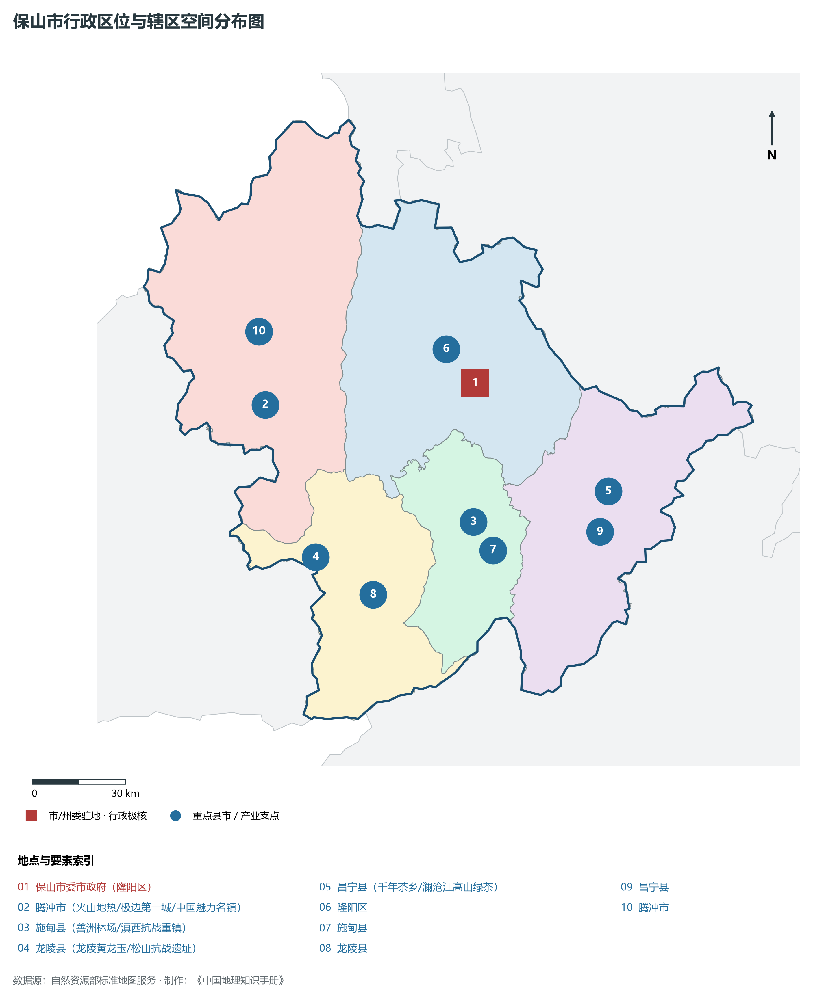
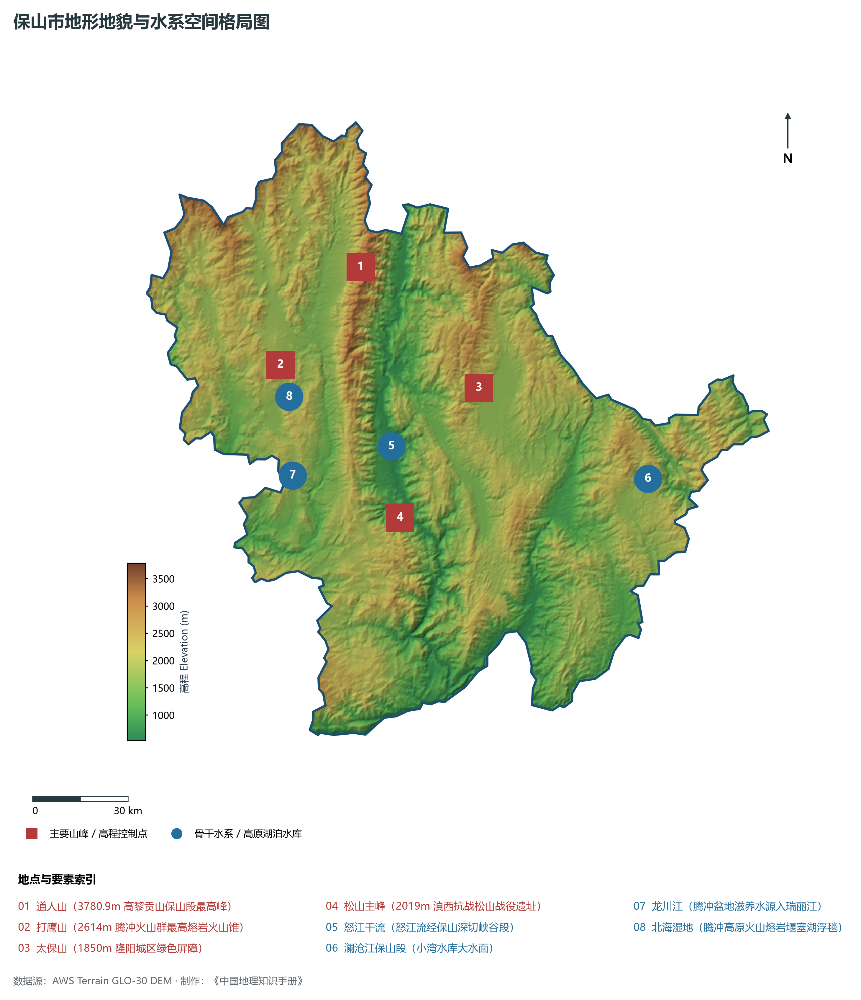
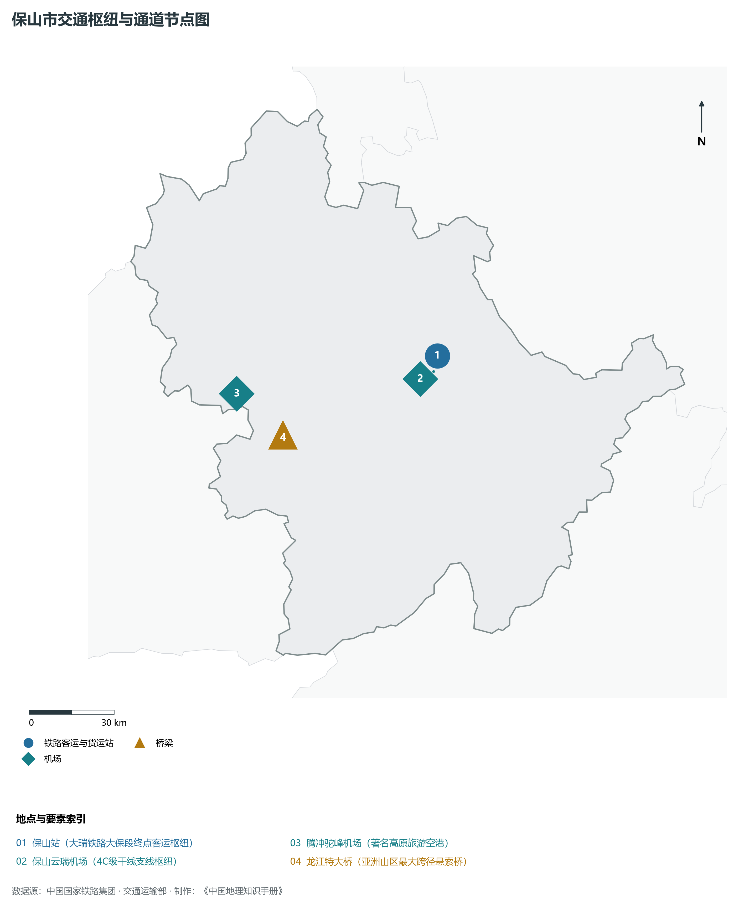
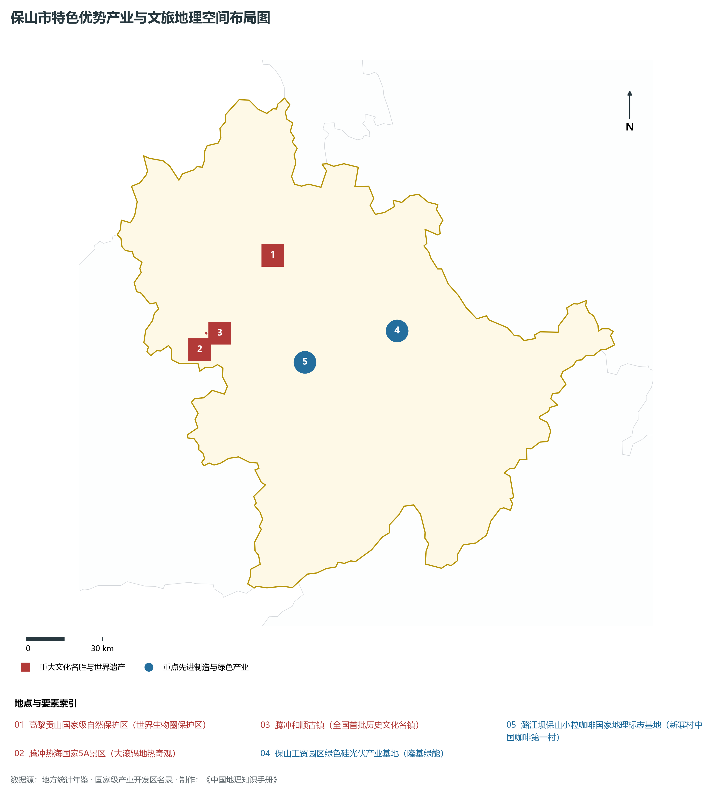
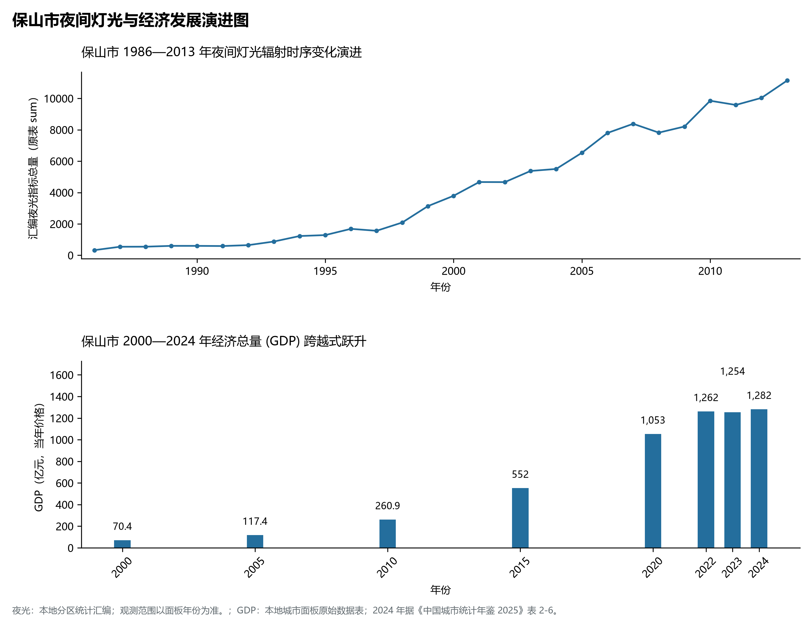

# 24.4 保山市

## 一、宏观地位、行政区划与空间发展骨架

保山市，地理区位得天独厚，地处云贵高原与青藏高原东南缘过渡带，介于东经 98.35° ～ 99.75°、北纬 24.44° ～ 25.27° 之间，是云南省国土空间开发保护格局中的战略重要支点。辖区土地总面积达 **19637.0 km²**，全域涵盖山地、高原峡谷、断陷盆地（坝子）与深切河谷，行政区划代码为 `530500`。

截至 2024 年底，保山市常住总人口为 **243.0 万人**，常住人口城镇化率稳健提升至 **44.5%**。在全省生产力布局中，保山市定位为“**滇西枢纽·高黎贡山物种基因库·世界温泉之都·腾冲火山热海·保山小粒咖啡名邦**”。辖区构建起以中心主城为核心、多组团协同支撑、县域与特色小镇深度联动的现代化城乡空间格局：

2024 年全市统计：常住人口 240 万人，常住人口城镇化率 38.81 %，地区生产总值 1,282 亿元，人均地区生产总值 53,346 元，三次产业构成 22.77 : 32.25 : 44.98。

2024 年全市统计：常住人口 240 万人，常住人口城镇化率 38.81 %，地区生产总值 1,282 亿元，人均地区生产总值 53,346 元，三次产业构成 22.77 : 32.25 : 44.98。

2024 年全市统计：常住人口 240 万人，常住人口城镇化率 38.81 %，地区生产总值 1,282 亿元，人均地区生产总值 53,346 元，三次产业构成 22.77 : 32.25 : 44.98。

骨干辖区板块与核心功能节点包括：

- **保山市委市政府 (隆阳区)**：坐标 (99.16°E, 25.12°N)，功能定位：gov；
- **腾冲市 (火山地热/极边第一城/中国魅力名镇)**：坐标 (98.5°E, 25.02°N)，功能定位：town；
- **施甸县 (善洲林场/滇西抗战重镇)**：坐标 (99.18°E, 24.72°N)，功能定位：town；
- **龙陵县 (龙陵黄龙玉/松山抗战遗址)**：坐标 (98.69°E, 24.59°N)，功能定位：town；
- **昌宁县 (千年茶乡/澜沧江高山绿茶)**：坐标 (99.6°E, 24.83°N)，功能定位：town；

辖区坚持走集约高效、绿色低碳、产城融合的新型城镇化道路，基础设施综合承载能级不断跃升，生态宜居品质持续彰显。

---

## 二、地质地貌、山川骨架与水文水利系统

保山市地质构造复杂奇崛，处于青藏高原抬升与横断山脉纵深侵蚀的强烈活动带。深大断裂纵横交错，古生代变质岩与海相碳酸盐岩、中生代红色砂岩广布，构造隆升与河流深切塑造了壮丽的横断高山、河谷峡谷、高原深水断陷湖泊或喀斯特峰林地貌。辖区最高点海拔标高达 **3780.9 m**，最低处标高为 **535 m**，相对垂直落差达 **3245.9 m**，形成了极其丰富多样的立体垂直自然地貌带。

骨干山峰与地貌高程制高点构筑起辖区生态屏障与自然脊梁：

- **道人山 (3780.9m 高黎贡山保山段最高峰)**：海拔标高 **3780.9 m**，空间坐标 (98.75°E, 25.45°N)；
- **打鹰山 (2614m 腾冲火山群最高熔岩火山锥)**：海拔标高 **2614.0 m**，空间坐标 (98.52°E, 25.16°N)；
- **太保山 (1850m 隆阳城区绿色屏障)**：海拔标高 **1850.0 m**，空间坐标 (99.14°E, 25.13°N)；
- **松山主峰 (2019m 滇西抗战松山战役遗址)**：海拔标高 **2019.0 m**，空间坐标 (98.92°E, 24.75°N)；

在水网水系与水利控制方面，辖区水资源充沛，大江大河穿崖切谷、奔流不息，滋养广袤沃野：

- **怒江干流 (怒江流经保山深切峡谷段)**：标定坐标 (98.88°E, 24.95°N)；
- **澜沧江保山段 (小湾水库大水面)**：标定坐标 (99.68°E, 24.9°N)；
- **龙川江 (腾冲盆地滋养水源入瑞丽江)**：标定坐标 (98.58°E, 24.85°N)；
- **北海湿地 (腾冲高原火山熔岩堰塞湖浮毯)**：标定坐标 (98.55°E, 25.12°N)；

充沛的水热资源与立体高原气候赋予了辖区无可比拟的生态本底，“一山分四季，十里不同天”，生物多样性极其丰富。辖区坚决扛牢生态文明建设政治责任，统筹山水林田湖草沙一体化保护和系统治理，严格落实河湖长制与长江十年禁渔，筑牢西南生态安全屏障。

---

## 三、综合立体交通网络、枢纽通道与区位优势

作为云南省综合立体交通网与面向南亚东南亚辐射大通道上的重要战略枢纽，保山市区位优势得天独厚、内联外通网络日臻完备。近年来，辖区全方位抢抓高质量共建“一带一路”、中老铁路国际走廊与新一轮综合交通大投资机遇，客货综合保障能级实现历史性跨越：

骨干交通基础设施与重要立体物流枢纽节点包括：

- **保山站 (大瑞铁路大保段终点客运枢纽)**：空间标定 (99.18°E, 25.1°N)，设施类型：rail；
- **保山云瑞机场 (4C级干线支线枢纽)**：空间标定 (99.17°E, 25.05°N)，设施类型：airport；
- **腾冲驼峰机场 (著名高原旅游空港)**：空间标定 (98.49°E, 24.94°N)，设施类型：airport；
- **龙江特大桥 (亚洲山区最大跨径悬索桥)**：空间标定 (98.66°E, 24.82°N)，设施类型：bridge；

通过高铁、普铁、高速公路环线与现代化航空港、沿边口岸无缝咬合，保山市全面融入全省“1-2小时交通圈”与成渝双城、粤港澳大湾区高速通达网，深度嵌入中国-中南半岛经济走廊与孟中印缅经济走廊，实现国内大循环与国际双循环相互促进的大开放格局。

---

## 四、特色优势产业集群、重点园区与现代经济版图

2024 年保山市全市地区生产总值为 1,282 亿元（当年价格）。

辖区核心产业平台、重大战略工程与重点开发区展示如下：

- **高黎贡山国家级自然保护区 (世界生物圈保护区)**：空间坐标 (98.7°E, 25.3°N)，核心功能：人类双面神/物种基因库；
- **腾冲热海国家5A景区 (大滚锅地热奇观)**：空间坐标 (98.44°E, 24.95°N)，核心功能：全国最密集地热温泉水汽群；
- **保山工贸园区绿色硅光伏产业基地 (隆基绿能)**：空间坐标 (99.2°E, 25.06°N)，核心功能：单晶硅拉棒切片全产业链；
- **潞江坝保山小粒咖啡国家地理标志基地**：空间坐标 (98.85°E, 24.93°N)，核心功能：新寨村中国咖啡第一村；
- **腾冲和顺古镇 (全国首批历史文化名镇)**：空间坐标 (98.46°E, 25.01°N)，核心功能：中国第一魅力名镇；

在现代化产业布局与建圈强链战略中，辖区因地制宜打造特色优势产业生态圈：

1. **优势先进制造业与战略性新兴产业**：聚焦清洁能源发供用一体化、绿色硅光伏全产业链、先进装备制造、精细化工与新能源电池材料，培育高新技术企业与专精特新“小巨人”企业；
2. **高原特色现代农业世界一流名牌**：持续擦亮“绿色食品牌”，深耕云茶、云咖、云花、高原果蔬与特色生物资源精深加工，打造全球优质绿色农产品供给基地；
3. **现代服务业、物流与数字经济赋能**：加快布局智慧口岸、跨境电商、冷链物流、康养旅居与数字文旅新业态，激发新质生产力澎湃活力。

---

## 五、历史文化胜迹、世界遗产与生态文旅名胜

保山市历史厚重，人文荟萃，多元一体的世居民族文化与壮阔秀美的大美山水交相辉映，是多彩中华文化大系中璀璨夺目的西南明珠。

辖区拥有享誉海内外的顶级文旅资源与文化丰碑：

- **世界自然/文化遗产与国家级重点文保**：拥有联合国教科文组织世界自然遗产、世界文化遗产、国家历史文化名城与全国重点文物保护单位，古遗址、古村落、摩崖石刻与茶马古道遗址完好保存，记录了千百年西南丝路交融互鉴与人类文明演进的壮丽史诗；
- **国家级风景名胜区与世界级生态秘境**：大自然造化赐予辖区皑皑雪山、高原明珠湖泊、原始热带雨林、深切大峡谷与地热地质奇观，空气清冽纯净，是享誉全球的生态康养避暑度假与户外徒步探险胜地；
- **多元民族非遗与和谐相处长卷**：世居少数民族在这片热土繁衍生息、休戚与共，泼水节、火把节、目瑙纵歌节、阔时节、东巴文化等非遗瑰宝代代传承，展现出休戚与共、荣辱与共、生死与共、命运与共的中华民族共同体壮美画卷。

---

## 六、夜间灯光遥感时序演变与新时代现代化发展变化

本节夜光图的观测年份为 1986—2013 年，指标为行政区汇总值（原表 sum）。

### 1. 1986—2013 年夜间灯光遥感演化分析

- **1996年演化特征**：保山盆地与腾冲城关微光起步；
- **2006年演化特征**：保腾高速与腾冲驼峰机场建成；
- **2014年演化特征**：龙江特大桥贯通·大保铁路建设；
- **2023年演化特征**：大瑞铁路保山段通车·硅光伏与咖啡产业生辉；

### 2. 2000—2024 年经济跨越式发展时序汇总
下表记录了 保山市 自 2000 年以来核心年份地区生产总值（GDP）的翻番跨越历程：

| 年份 | 地区生产总值（亿元，当年价格） |
|:---|---:|
| 2000 年 | 70.4 |
| 2005 年 | 117.4 |
| 2010 年 | 260.9 |
| 2015 年 | 552 |
| 2020 年 | 1,053 |
| 2022 年 | 1,262 |
| 2023 年 | 1,254 |
| 2024 年 | 1,282 |

### 3. 新征程高质量跨越式发展愿景
迈向中国式现代化新征程，保山市将全面贯彻新发展理念，主动融入和服务国家重大发展战略：

1. 深入推进新型工业化与新型城镇化，做大做强优势实体经济，持续发展新质生产力；
2. 协同推进高水平生态环境保护与绿色低碳转型，筑牢我国西南生态安全屏障；
3. 扎实推进沿边开放繁荣、民族团结进步示范区建设与乡村全面振兴，奋力谱写中国式现代化的云南新篇章。

2024 年统计来源：《中国城市统计年鉴 2025》表 2-1、2-6、2-7（2024 年，全市）。其他年份 GDP 据本地城市面板“原始数据”表，单位为亿元、当年价格。
