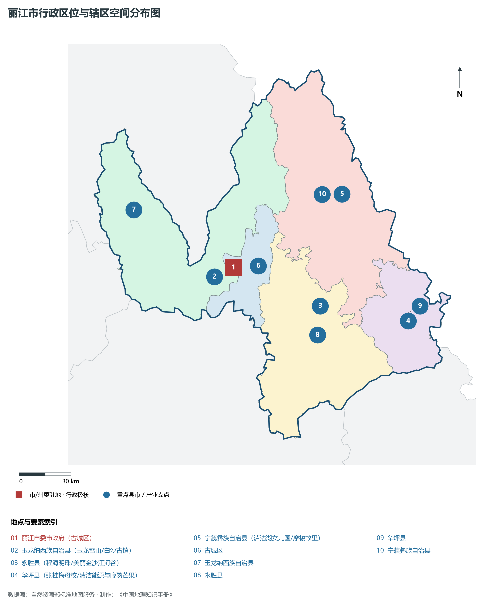
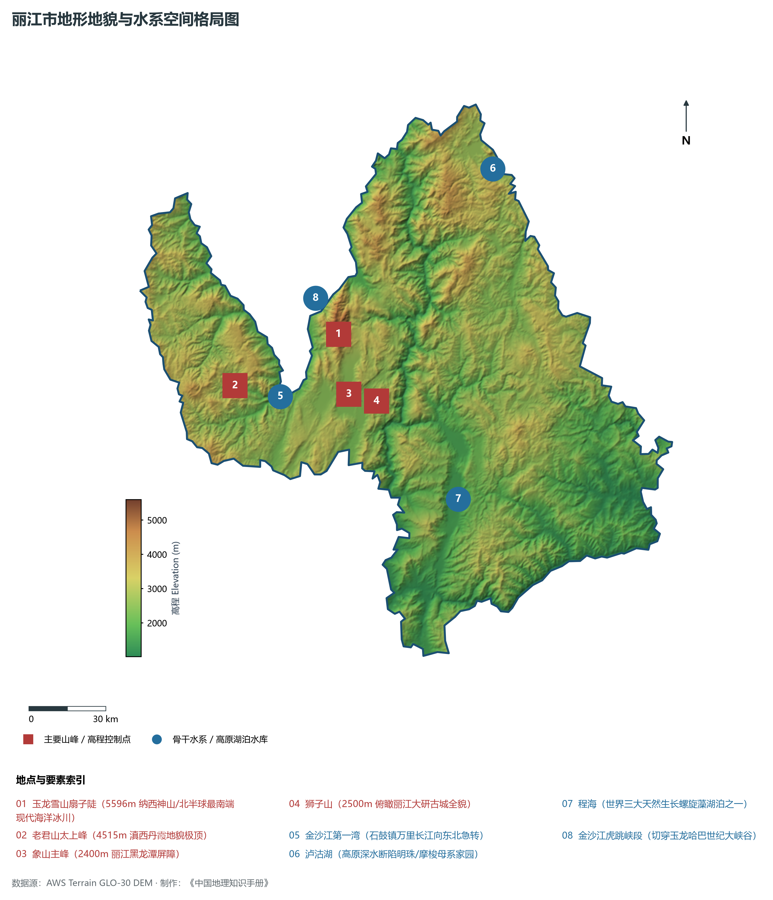
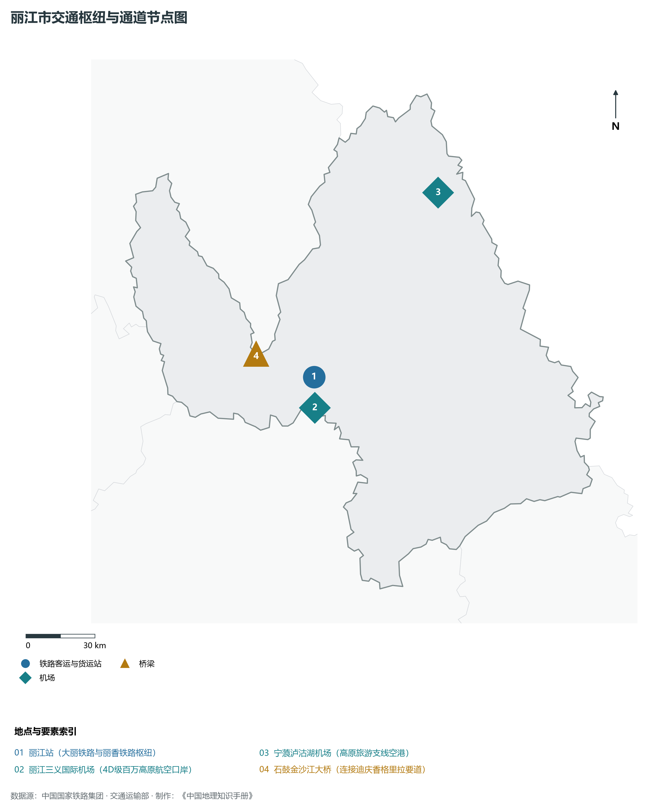
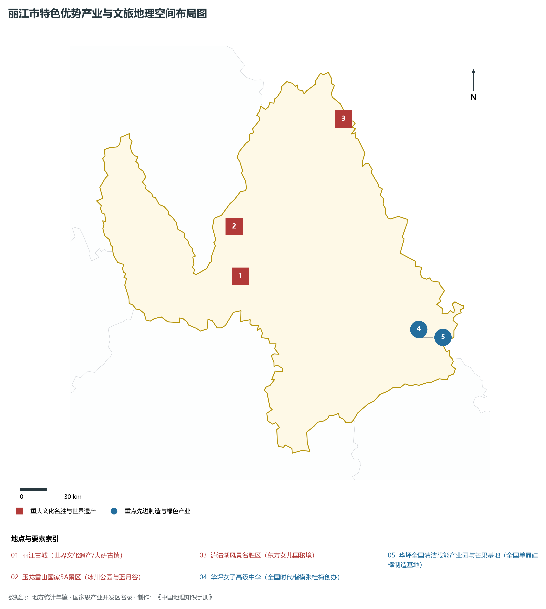
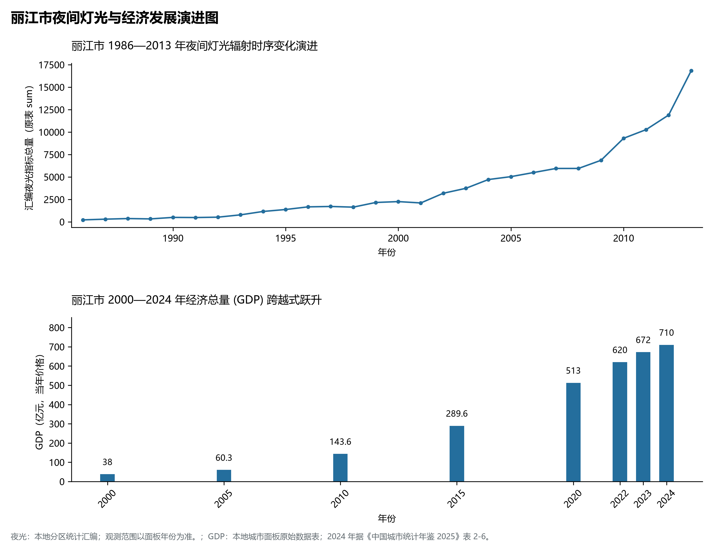

# 24.6 丽江市

## 一、宏观地位、行政区划与空间发展骨架

丽江市，地理区位得天独厚，地处云贵高原与青藏高原东南缘过渡带，介于东经 100.03° ～ 101.42°、北纬 26.48° ～ 27.43° 之间，是云南省国土空间开发保护格局中的战略重要支点。辖区土地总面积达 **20600.0 km²**，全域涵盖山地、高原峡谷、断陷盆地（坝子）与深切河谷，行政区划代码为 `530700`。

截至 2024 年底，丽江市常住总人口为 **125.0 万人**，常住人口城镇化率稳健提升至 **53.0%**。在全省生产力布局中，丽江市定位为“**世界文化与自然双遗产名城·玉龙雪山冰川圣殿·大滇西旅游环线枢纽·纳西东巴文明发祥地**”。辖区构建起以中心主城为核心、多组团协同支撑、县域与特色小镇深度联动的现代化城乡空间格局：

2024 年全市统计：常住人口 125 万人，常住人口城镇化率 51.44 %，地区生产总值 710 亿元，人均地区生产总值 56,802 元，三次产业构成 12.13 : 33.63 : 54.24。

2024 年全市统计：常住人口 125 万人，常住人口城镇化率 51.44 %，地区生产总值 710 亿元，人均地区生产总值 56,802 元，三次产业构成 12.13 : 33.63 : 54.24。

2024 年全市统计：常住人口 125 万人，常住人口城镇化率 51.44 %，地区生产总值 710 亿元，人均地区生产总值 56,802 元，三次产业构成 12.13 : 33.63 : 54.24。

骨干辖区板块与核心功能节点包括：

- **丽江市委市政府 (古城区)**：坐标 (100.23°E, 26.87°N)，功能定位：gov；
- **玉龙纳西族自治县 (玉龙雪山/白沙古镇)**：坐标 (100.18°E, 26.82°N)，功能定位：town；
- **永胜县 (程海明珠/美丽金沙江河谷)**：坐标 (100.75°E, 26.69°N)，功能定位：town；
- **华坪县 (张桂梅母校/清洁能源与晚熟芒果)**：坐标 (101.27°E, 26.63°N)，功能定位：town；
- **宁蒗彝族自治县 (泸沽湖女儿国/摩梭故里)**：坐标 (100.85°E, 27.28°N)，功能定位：town；

辖区坚持走集约高效、绿色低碳、产城融合的新型城镇化道路，基础设施综合承载能级不断跃升，生态宜居品质持续彰显。

---

## 二、地质地貌、山川骨架与水文水利系统

丽江市地质构造复杂奇崛，处于青藏高原抬升与横断山脉纵深侵蚀的强烈活动带。深大断裂纵横交错，古生代变质岩与海相碳酸盐岩、中生代红色砂岩广布，构造隆升与河流深切塑造了壮丽的横断高山、河谷峡谷、高原深水断陷湖泊或喀斯特峰林地貌。辖区最高点海拔标高达 **5596.0 m**，最低处标高为 **1015 m**，相对垂直落差达 **4581.0 m**，形成了极其丰富多样的立体垂直自然地貌带。

骨干山峰与地貌高程制高点构筑起辖区生态屏障与自然脊梁：

- **玉龙雪山扇子陡 (5596m 纳西神山/北半球最南端现代海洋冰川)**：海拔标高 **5596.0 m**，空间坐标 (100.178°E, 27.098°N)；
- **老君山太上峰 (4515m 滇西丹霞地貌极顶)**：海拔标高 **4515.0 m**，空间坐标 (99.78°E, 26.9°N)；
- **象山主峰 (2400m 丽江黑龙潭屏障)**：海拔标高 **2400.0 m**，空间坐标 (100.23°E, 26.89°N)；
- **狮子山 (2500m 俯瞰丽江大研古城全貌)**：海拔标高 **2500.0 m**，空间坐标 (100.22°E, 26.865°N)；

在水网水系与水利控制方面，辖区水资源充沛，大江大河穿崖切谷、奔流不息，滋养广袤沃野：

- **金沙江第一湾 (石鼓镇万里长江向东北急转)**：标定坐标 (99.96°E, 26.87°N)；
- **泸沽湖 (高原深水断陷明珠/摩梭母系家园)**：标定坐标 (100.76°E, 27.7°N)；
- **程海 (世界三大天然生长螺旋藻湖泊之一)**：标定坐标 (100.68°E, 26.54°N)；
- **金沙江虎跳峡段 (切穿玉龙哈巴世纪大峡谷)**：标定坐标 (100.08°E, 27.22°N)；

充沛的水热资源与立体高原气候赋予了辖区无可比拟的生态本底，“一山分四季，十里不同天”，生物多样性极其丰富。辖区坚决扛牢生态文明建设政治责任，统筹山水林田湖草沙一体化保护和系统治理，严格落实河湖长制与长江十年禁渔，筑牢西南生态安全屏障。

---

## 三、综合立体交通网络、枢纽通道与区位优势

作为云南省综合立体交通网与面向南亚东南亚辐射大通道上的重要战略枢纽，丽江市区位优势得天独厚、内联外通网络日臻完备。近年来，辖区全方位抢抓高质量共建“一带一路”、中老铁路国际走廊与新一轮综合交通大投资机遇，客货综合保障能级实现历史性跨越：

骨干交通基础设施与重要立体物流枢纽节点包括：

- **丽江站 (大丽铁路与丽香铁路枢纽)**：空间标定 (100.24°E, 26.8°N)，设施类型：rail；
- **丽江三义国际机场 (4D级百万高原航空口岸)**：空间标定 (100.25°E, 26.68°N)，设施类型：airport；
- **宁蒗泸沽湖机场 (高原旅游支线空港)**：空间标定 (100.75°E, 27.54°N)，设施类型：airport；
- **石鼓金沙江大桥 (连接迪庆香格里拉要道)**：空间标定 (99.98°E, 26.88°N)，设施类型：bridge；

通过高铁、普铁、高速公路环线与现代化航空港、沿边口岸无缝咬合，丽江市全面融入全省“1-2小时交通圈”与成渝双城、粤港澳大湾区高速通达网，深度嵌入中国-中南半岛经济走廊与孟中印缅经济走廊，实现国内大循环与国际双循环相互促进的大开放格局。

---

## 四、特色优势产业集群、重点园区与现代经济版图

2024 年丽江市全市地区生产总值为 710 亿元（当年价格）。

辖区核心产业平台、重大战略工程与重点开发区展示如下：

- **丽江古城 (世界文化遗产/大研古镇)**：空间坐标 (100.23°E, 26.87°N)，核心功能：纳西族东巴文化生活史诗；
- **玉龙雪山国家5A景区 (冰川公园与蓝月谷)**：空间坐标 (100.18°E, 27.12°N)，核心功能：现代冰川博物馆与大型实景演出；
- **泸沽湖风景名胜区 (东方女儿国秘境)**：空间坐标 (100.78°E, 27.69°N)，核心功能：高原生态保护与母系大家庭文化；
- **华坪女子高级中学 (全国时代楷模张桂梅创办)**：空间坐标 (101.26°E, 26.64°N)，核心功能：全国爱国主义教育与红色传承阵地；
- **华坪全国清洁载能产业园与芒果基地**：空间坐标 (101.28°E, 26.6°N)，核心功能：全国单晶硅棒制造基地；

在现代化产业布局与建圈强链战略中，辖区因地制宜打造特色优势产业生态圈：

1. **优势先进制造业与战略性新兴产业**：聚焦清洁能源发供用一体化、绿色硅光伏全产业链、先进装备制造、精细化工与新能源电池材料，培育高新技术企业与专精特新“小巨人”企业；
2. **高原特色现代农业世界一流名牌**：持续擦亮“绿色食品牌”，深耕云茶、云咖、云花、高原果蔬与特色生物资源精深加工，打造全球优质绿色农产品供给基地；
3. **现代服务业、物流与数字经济赋能**：加快布局智慧口岸、跨境电商、冷链物流、康养旅居与数字文旅新业态，激发新质生产力澎湃活力。

---

## 五、历史文化胜迹、世界遗产与生态文旅名胜

丽江市历史厚重，人文荟萃，多元一体的世居民族文化与壮阔秀美的大美山水交相辉映，是多彩中华文化大系中璀璨夺目的西南明珠。

辖区拥有享誉海内外的顶级文旅资源与文化丰碑：

- **世界自然/文化遗产与国家级重点文保**：拥有联合国教科文组织世界自然遗产、世界文化遗产、国家历史文化名城与全国重点文物保护单位，古遗址、古村落、摩崖石刻与茶马古道遗址完好保存，记录了千百年西南丝路交融互鉴与人类文明演进的壮丽史诗；
- **国家级风景名胜区与世界级生态秘境**：大自然造化赐予辖区皑皑雪山、高原明珠湖泊、原始热带雨林、深切大峡谷与地热地质奇观，空气清冽纯净，是享誉全球的生态康养避暑度假与户外徒步探险胜地；
- **多元民族非遗与和谐相处长卷**：世居少数民族在这片热土繁衍生息、休戚与共，泼水节、火把节、目瑙纵歌节、阔时节、东巴文化等非遗瑰宝代代传承，展现出休戚与共、荣辱与共、生死与共、命运与共的中华民族共同体壮美画卷。

---

## 六、夜间灯光遥感时序演变与新时代现代化发展变化

本节夜光图的观测年份为 1986—2013 年，指标为行政区汇总值（原表 sum）。

### 1. 1986—2013 年夜间灯光遥感演化分析

- **1996年演化特征**：丽江古城灾后重建·文旅星火点亮；
- **2006年演化特征**：世界遗产名声鹊起·束河与新城铺展；
- **2014年演化特征**：大丽铁路通车·三义机场扩建为口岸；
- **2023年演化特征**：丽香铁路贯通·大滇西世界级文旅环线跃升；

### 2. 2000—2024 年经济跨越式发展时序汇总
下表记录了 丽江市 自 2000 年以来核心年份地区生产总值（GDP）的翻番跨越历程：

| 年份 | 地区生产总值（亿元，当年价格） |
|:---|---:|
| 2000 年 | — |
| 2005 年 | 60.3 |
| 2010 年 | 143.6 |
| 2015 年 | 289.6 |
| 2020 年 | 513 |
| 2022 年 | 620 |
| 2023 年 | 672 |
| 2024 年 | 710 |

### 3. 新征程高质量跨越式发展愿景
迈向中国式现代化新征程，丽江市将全面贯彻新发展理念，主动融入和服务国家重大发展战略：

1. 深入推进新型工业化与新型城镇化，做大做强优势实体经济，持续发展新质生产力；
2. 协同推进高水平生态环境保护与绿色低碳转型，筑牢我国西南生态安全屏障；
3. 扎实推进沿边开放繁荣、民族团结进步示范区建设与乡村全面振兴，奋力谱写中国式现代化的云南新篇章。

2024 年统计来源：《中国城市统计年鉴 2025》表 2-1、2-6、2-7（2024 年，全市）。其他年份 GDP 据本地城市面板“原始数据”表，单位为亿元、当年价格。
