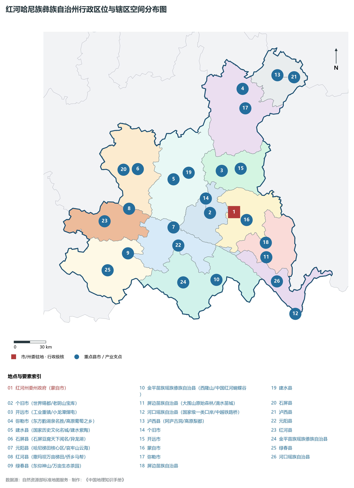
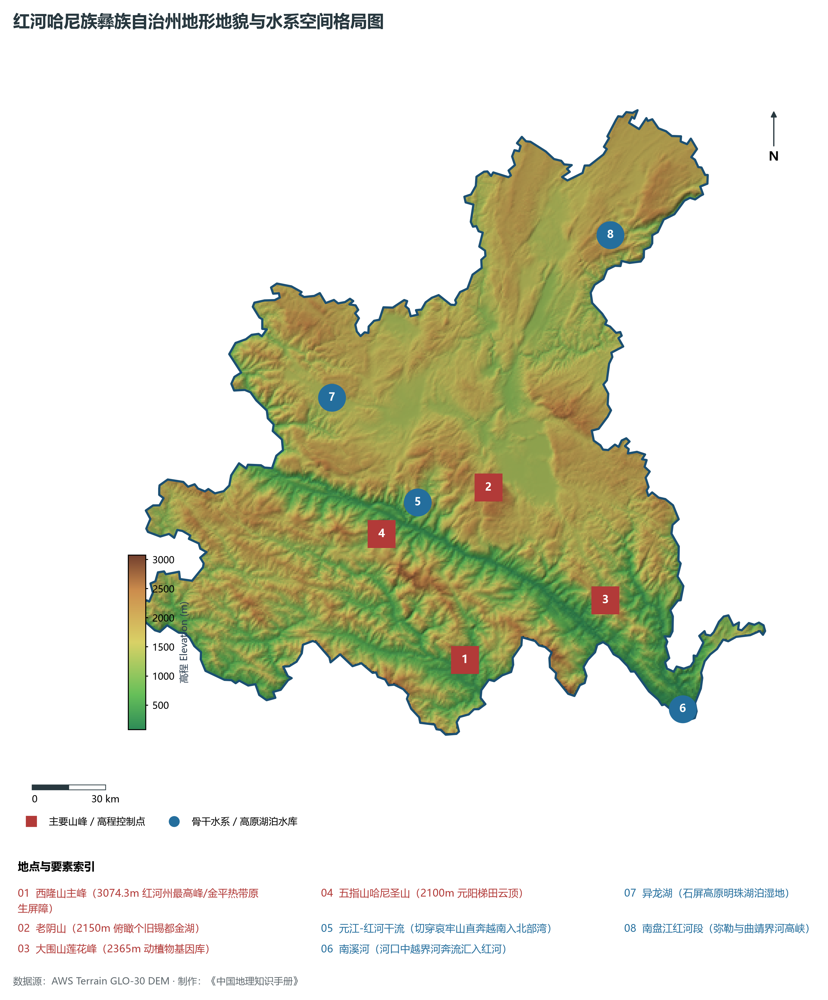
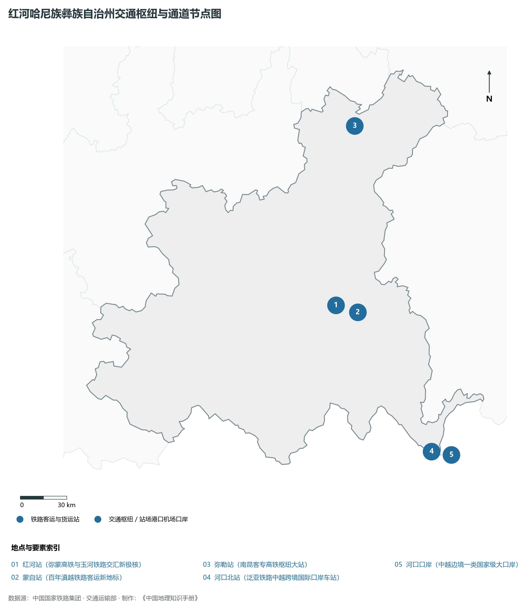
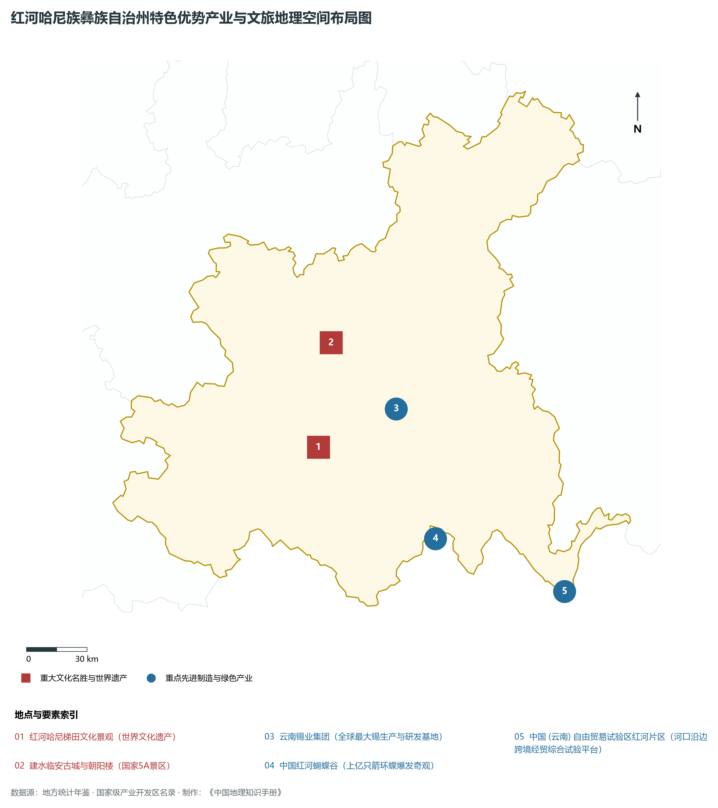
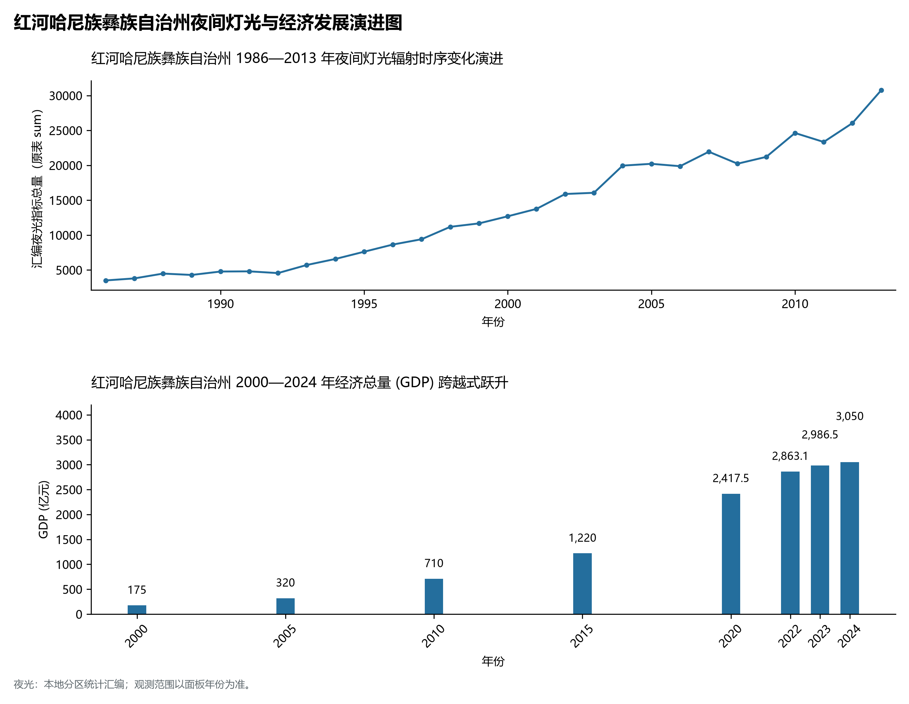

# 24.10 红河哈尼族彝族自治州

## 一、宏观地位、行政区划与空间发展骨架

红河哈尼族彝族自治州，地理区位得天独厚，地处云贵高原与青藏高原东南缘过渡带，介于东经 102.27° ～ 104.10°、北纬 22.35° ～ 24.68° 之间，是云南省国土空间开发保护格局中的战略重要支点。辖区土地总面积达 **32931.0 km²**，全域涵盖山地、高原峡谷、断陷盆地（坝子）与深切河谷，行政区划代码为 `532500`。

截至 2024 年底，红河哈尼族彝族自治州常住总人口为 **442.0 万人**，常住人口城镇化率稳健提升至 **51.0%**。在全省生产力布局中，红河哈尼族彝族自治州定位为“**滇南副中心·红河哈尼梯田世界遗产·中国锡都·蒙自百年米线之都·沿边开放新高地**”。辖区构建起以中心主城为核心、多组团协同支撑、县域与特色小镇深度联动的现代化城乡空间格局：

骨干辖区板块与核心功能节点包括：

- **红河州委州政府 (蒙自市)**：坐标 (103.38°E, 23.36°N)，功能定位：gov；
- **个旧市 (世界锡都/老阴山宝库)**：坐标 (103.16°E, 23.35°N)，功能定位：town；
- **开远市 (工业重镇/小龙潭煤电)**：坐标 (103.26°E, 23.71°N)，功能定位：town；
- **弥勒市 (东方韵湖泉名胜/高原葡萄之乡)**：坐标 (103.44°E, 24.41°N)，功能定位：town；
- **建水县 (国家历史文化名城/建水紫陶)**：坐标 (102.82°E, 23.63°N)，功能定位：town；
- **石屏县 (石屏豆腐天下闻名/异龙湖)**：坐标 (102.49°E, 23.71°N)，功能定位：town；
- **元阳县 (哈尼梯田核心区/哀牢山云海)**：坐标 (102.83°E, 23.22°N)，功能定位：town；
- **红河县 (撒玛坝万亩梯田/侨乡马帮)**：坐标 (102.42°E, 23.37°N)，功能定位：town；
- **绿春县 (东仰神山/万亩生态茶园)**：坐标 (102.42°E, 22.99°N)，功能定位：town；
- **金平苗族瑶族傣族自治县 (西隆山/中国红河蝴蝶谷)**：坐标 (103.23°E, 22.78°N)，功能定位：town；
- **屏边苗族自治县 (大围山原始森林/滴水苗城)**：坐标 (103.68°E, 22.98°N)，功能定位：town；
- **河口瑶族自治县 (国家级一类口岸/中越铁路桥)**：坐标 (103.95°E, 22.5°N)，功能定位：town；
- **泸西县 (阿庐古洞/高原梨都)**：坐标 (103.76°E, 24.53°N)，功能定位：town；

辖区坚持走集约高效、绿色低碳、产城融合的新型城镇化道路，基础设施综合承载能级不断跃升，生态宜居品质持续彰显。

---

## 二、地质地貌、山川骨架与水文水利系统

红河哈尼族彝族自治州地质构造复杂奇崛，处于青藏高原抬升与横断山脉纵深侵蚀的强烈活动带。深大断裂纵横交错，古生代变质岩与海相碳酸盐岩、中生代红色砂岩广布，构造隆升与河流深切塑造了壮丽的横断高山、河谷峡谷、高原深水断陷湖泊或喀斯特峰林地貌。辖区最高点海拔标高达 **3074.3 m**，最低处标高为 **76 m**，相对垂直落差达 **2997.9 m**，形成了极其丰富多样的立体垂直自然地貌带。

骨干山峰与地貌高程制高点构筑起辖区生态屏障与自然脊梁：

- **西隆山主峰 (3074.3m 红河州最高峰/金平热带原生屏障)**：海拔标高 **3074.3 m**，空间坐标 (103.1°E, 22.72°N)；
- **老阴山 (2150m 俯瞰个旧锡都金湖)**：海拔标高 **2150.0 m**，空间坐标 (103.18°E, 23.36°N)；
- **大围山莲花峰 (2365m 动植物基因库)**：海拔标高 **2365.0 m**，空间坐标 (103.65°E, 22.95°N)；
- **五指山哈尼圣山 (2100m 元阳梯田云顶)**：海拔标高 **2100.0 m**，空间坐标 (102.76°E, 23.18°N)；

在水网水系与水利控制方面，辖区水资源充沛，大江大河穿崖切谷、奔流不息，滋养广袤沃野：

- **元江-红河干流 (切穿哀牢山直奔越南入北部湾)**：标定坐标 (102.9°E, 23.3°N)；
- **南溪河 (河口中越界河奔流汇入红河)**：标定坐标 (103.96°E, 22.55°N)；
- **异龙湖 (石屏高原明珠湖泊湿地)**：标定坐标 (102.55°E, 23.68°N)；
- **南盘江红河段 (弥勒与曲靖界河高峡)**：标定坐标 (103.65°E, 24.3°N)；

充沛的水热资源与立体高原气候赋予了辖区无可比拟的生态本底，“一山分四季，十里不同天”，生物多样性极其丰富。辖区坚决扛牢生态文明建设政治责任，统筹山水林田湖草沙一体化保护和系统治理，严格落实河湖长制与长江十年禁渔，筑牢西南生态安全屏障。

---

## 三、综合立体交通网络、枢纽通道与区位优势

作为云南省综合立体交通网与面向南亚东南亚辐射大通道上的重要战略枢纽，红河哈尼族彝族自治州区位优势得天独厚、内联外通网络日臻完备。近年来，辖区全方位抢抓高质量共建“一带一路”、中老铁路国际走廊与新一轮综合交通大投资机遇，客货综合保障能级实现历史性跨越：

骨干交通基础设施与重要立体物流枢纽节点包括：

- **红河站 (弥蒙高铁与玉河铁路交汇新极核)**：空间标定 (103.35°E, 23.38°N)，设施类型：rail；
- **蒙自站 (百年滇越铁路客运新地标)**：空间标定 (103.42°E, 23.34°N)，设施类型：station；
- **弥勒站 (南昆客专高铁枢纽大站)**：空间标定 (103.45°E, 24.43°N)，设施类型：rail；
- **河口北站 (泛亚铁路中越跨境国际口岸车站)**：空间标定 (103.96°E, 22.53°N)，设施类型：station；
- **河口口岸 (中越边境一类国家级大口岸)**：空间标定 (103.95°E, 22.51°N)，设施类型：port；

通过高铁、普铁、高速公路环线与现代化航空港、沿边口岸无缝咬合，红河哈尼族彝族自治州全面融入全省“1-2小时交通圈”与成渝双城、粤港澳大湾区高速通达网，深度嵌入中国-中南半岛经济走廊与孟中印缅经济走廊，实现国内大循环与国际双循环相互促进的大开放格局。

---

## 四、特色优势产业集群、重点园区与现代经济版图

红河哈尼族彝族自治州立足资源禀赋、生态承载力与国家战略定位，坚定不移走新型工业化与绿色低碳发展之路，深度融入云南省“千亿级绿色能源、绿色铝硅、高原特色现代农业、现代生物医药”产业强省战略。2024 年，全市/州实现地区生产总值（GDP）达 **3050.0 亿元**，人均 GDP 达到 **69,000 元**，三次产业结构比稳健优化为 **14.5 : 39.5 : 46.0**，现代化经济韧性与高质量发展动力持续增强。

辖区核心产业平台、重大战略工程与重点开发区展示如下：

- **红河哈尼梯田文化景观 (世界文化遗产)**：空间坐标 (102.78°E, 23.15°N)，核心功能：哀牢山千米高落差农耕文明奇迹；
- **云南锡业集团 (全球最大锡生产与研发基地)**：空间坐标 (103.15°E, 23.33°N)，核心功能：百年云锡世界锡业霸主；
- **建水临安古城与朝阳楼 (国家5A景区)**：空间坐标 (102.83°E, 23.62°N)，核心功能：滇南邹鲁文献名邦与文庙古建；
- **中国红河蝴蝶谷 (上亿只箭环蝶爆发奇观)**：空间坐标 (103.35°E, 22.75°N)，核心功能：世界罕见特大型生物群聚景观；
- **中国 (云南) 自由贸易试验区红河片区**：空间坐标 (103.97°E, 22.52°N)，核心功能：河口沿边跨境经贸综合试验平台；

在现代化产业布局与建圈强链战略中，辖区因地制宜打造特色优势产业生态圈：

1. **优势先进制造业与战略性新兴产业**：聚焦清洁能源发供用一体化、绿色硅光伏全产业链、先进装备制造、精细化工与新能源电池材料，培育高新技术企业与专精特新“小巨人”企业；
2. **高原特色现代农业世界一流名牌**：持续擦亮“绿色食品牌”，深耕云茶、云咖、云花、高原果蔬与特色生物资源精深加工，打造全球优质绿色农产品供给基地；
3. **现代服务业、物流与数字经济赋能**：加快布局智慧口岸、跨境电商、冷链物流、康养旅居与数字文旅新业态，激发新质生产力澎湃活力。

---

## 五、历史文化胜迹、世界遗产与生态文旅名胜

红河哈尼族彝族自治州历史厚重，人文荟萃，多元一体的世居民族文化与壮阔秀美的大美山水交相辉映，是多彩中华文化大系中璀璨夺目的西南明珠。

辖区拥有享誉海内外的顶级文旅资源与文化丰碑：

- **世界自然/文化遗产与国家级重点文保**：拥有联合国教科文组织世界自然遗产、世界文化遗产、国家历史文化名城与全国重点文物保护单位，古遗址、古村落、摩崖石刻与茶马古道遗址完好保存，记录了千百年西南丝路交融互鉴与人类文明演进的壮丽史诗；
- **国家级风景名胜区与世界级生态秘境**：大自然造化赐予辖区皑皑雪山、高原明珠湖泊、原始热带雨林、深切大峡谷与地热地质奇观，空气清冽纯净，是享誉全球的生态康养避暑度假与户外徒步探险胜地；
- **多元民族非遗与和谐相处长卷**：世居少数民族在这片热土繁衍生息、休戚与共，泼水节、火把节、目瑙纵歌节、阔时节、东巴文化等非遗瑰宝代代传承，展现出休戚与共、荣辱与共、生死与共、命运与共的中华民族共同体壮美画卷。

---

## 六、夜间灯光遥感时序演变与新时代现代化发展变化

本节夜光图的观测年份为 1986—2013 年，指标为行政区汇总值（原表 sum）。

### 1. 1986—2013 年夜间灯光遥感演化分析

- **1996年演化特征**：个旧锡都火光与开远工业初具规模；
- **2006年演化特征**：州府迁蒙自·滇南中心城市群成形；
- **2014年演化特征**：泛亚铁路东线通车·哈尼梯田申遗成功；
- **2023年演化特征**：弥蒙高铁贯通·红河自贸片区口岸腾飞；

### 2. 2000—2024 年经济跨越式发展时序汇总
下表记录了 红河哈尼族彝族自治州 自 2000 年以来核心年份地区生产总值（GDP）的翻番跨越历程：

| 年份 | 地区生产总值 (亿元) | 发展阶段特征与重大历史跨越事件 |
| :---: | :---: | :--- |
| 2000 年 | **175.0** | 新世纪开局筑基阶段，特色资源与矿能基础稳步拓展 |
| 2005 年 | **320.0** | 新世纪开局筑基阶段，特色资源与矿能基础稳步拓展 |
| 2010 年 | **710.0** | 综合交通大基建与产业集聚攻坚，绿色能源与现代农业突飞猛进 |
| 2015 年 | **1220.0** | 综合交通大基建与产业集聚攻坚，绿色能源与现代农业突飞猛进 |
| 2020 年 | **2417.5** | 综合经济实力实现千亿/数百亿历史跨越，绿色铝硅与文旅全面爆发 |
| 2022 年 | **2863.1** | 深度融入滇中城市群与辐射南亚东南亚国家重大战略，高质量发展迈上新台阶 |
| 2023 年 | **2986.5** | 深度融入滇中城市群与辐射南亚东南亚国家重大战略，高质量发展迈上新台阶 |
| 2024 年 | **3050.0** | 深度融入滇中城市群与辐射南亚东南亚国家重大战略，高质量发展迈上新台阶 |

### 3. 新征程高质量跨越式发展愿景
迈向中国式现代化新征程，红河哈尼族彝族自治州将全面贯彻新发展理念，主动融入和服务国家重大发展战略：

1. 深入推进新型工业化与新型城镇化，做大做强优势实体经济，持续发展新质生产力；
2. 协同推进高水平生态环境保护与绿色低碳转型，筑牢我国西南生态安全屏障；
3. 扎实推进沿边开放繁荣、民族团结进步示范区建设与乡村全面振兴，奋力谱写中国式现代化的云南新篇章。
