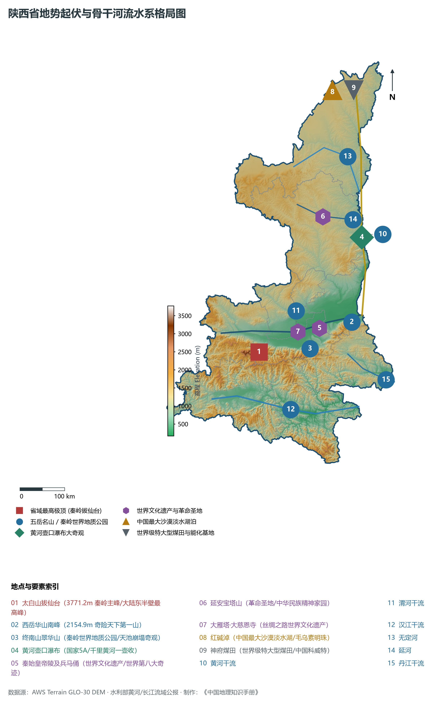
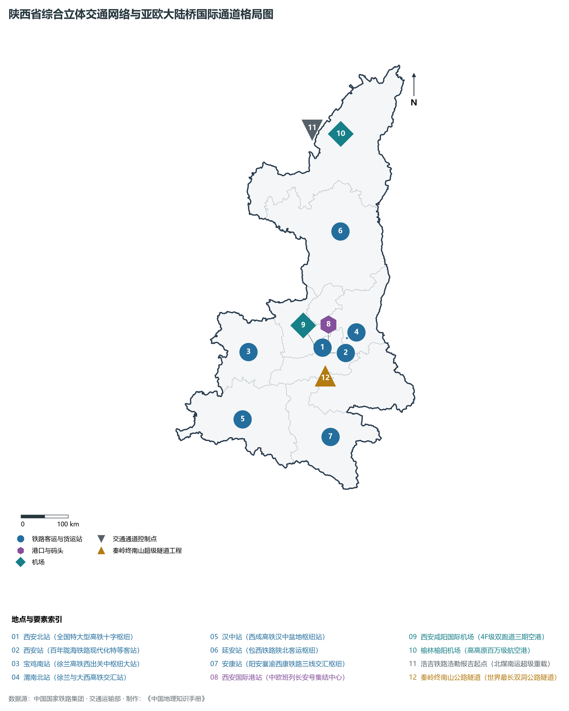
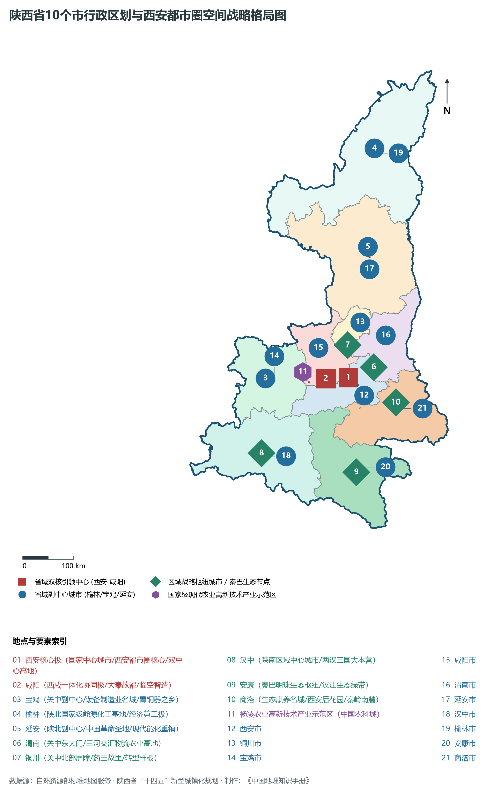
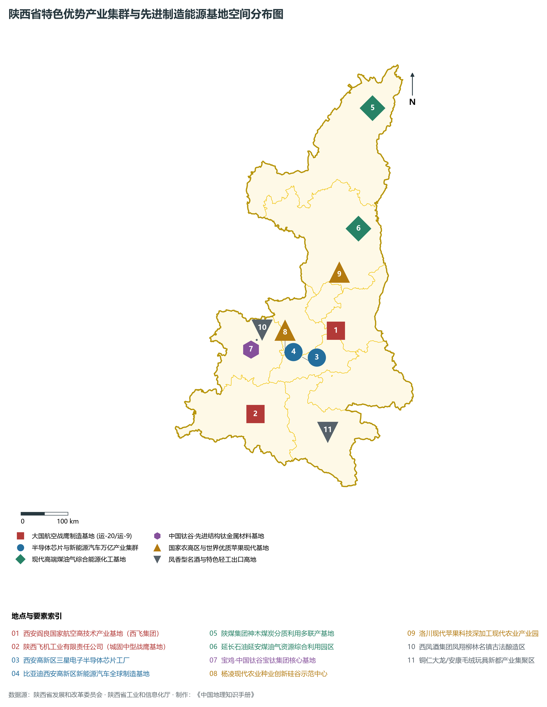
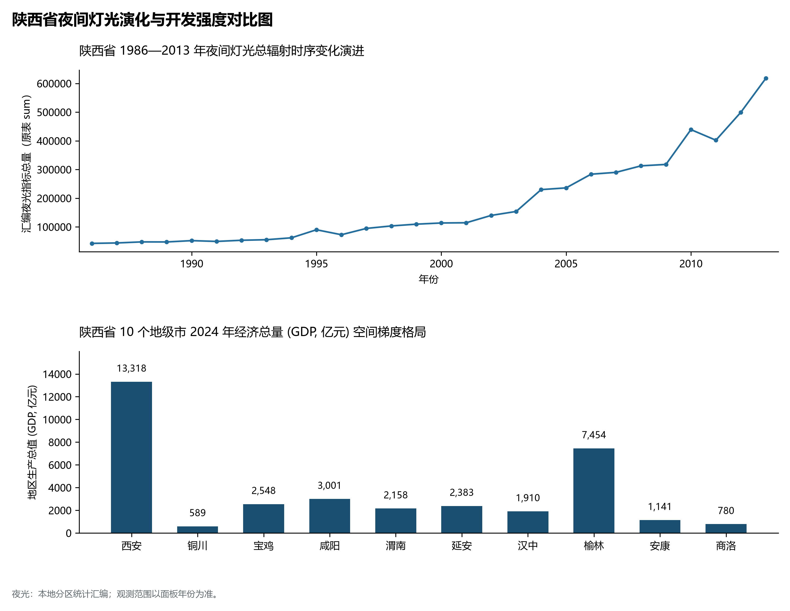

# 25.0 陕西省地理统揽

陕西省，简称“陕”或“秦”，省会西安市，位于中国内陆腹地、黄河中游与长江上游交汇地带，介于东经 105° 29' ～ 111° 15'、北纬 31° 42' ～ 39° 35' 之间。全省地势狭长，南北纵贯约 863 km，东西宽约 160 ～ 490 km，幅员陆地总面积达 **20.56 × 10⁴ km²**，占全国国土总面积的 2.14%，居全国第 11 位。陕西地理位置承东启西、连南接北，周边与山西、河南、湖北、重庆、四川、甘肃、宁夏、内蒙古等 8 个省区市接壤，是全国邻省最多的省级行政区之一，自古为“九方辐射、八省通衢”的陆权枢纽与地缘要冲。

截至 2024 年末，全省常住人口达 **3,952.0 万人**，常住人口城镇化率达 **65.20%**；2024 年全省地区生产总值（GDP）跃升至 **35,500.0 亿元**（按不变价格计算比上年增长 4.8% 左右），人均 GDP 达到 **89,830 元**；三次产业结构比稳健演进为 **7.2 : 46.8 : 46.0**。全省现辖 10 个地级市（西安市、铜川市、宝鸡市、咸阳市、渭南市、延安市、汉中市、榆林市、安康市、商洛市）以及国家级杨凌农业高新技术产业示范区，下辖 107 个县级行政区。作为华夏文明的重要发祥地、中国大地原点所在地、“一带一路”向西开放的前沿门户与国家级能源化工基地，陕西在全国区域协调发展格局中发挥着承载国家战略腹地、构筑国家生态安全屏障与引领内陆高水平对外开放的顶梁柱作用。

---

## 一、“秦岭分南北·八百里秦川·陕北黄土台塬”三大宏观自然地貌单元

陕西地跨黄河、长江两大流域，地貌格局纵跨寒温带至亚热带的过渡界面，地势总特征为“南北高、中间低”，在南北仅 800 余公里的纬度跨度上完整发育了三种地质构造、地貌形态与生态景观截然不同的宏观自然地理单元，世称“一省三貌”：

1. **陕北黄土高原与毛乌素沙地南缘（北部区）**：
   - 海拔多在 800 ～ 1400 m，北界长城沿线与毛乌素沙漠相连，向南渐次过渡为典型的黄土丘陵沟壑区与黄土残塬区。子午岭、白于山、黄龙山横亘其间；
   - 陕北是世界上黄土堆积最厚、侵蚀最剧烈的区域之一，千沟万壑、峁塬纵横。经过数十年来波澜壮阔的“退耕还林”与水土流失系统治理，陕北绿色植被覆盖度实现由黄变绿的历史性逆转；
   - 北部榆林神府煤田储量极为惊人，探明煤炭与油气资源富集，被誉为“中国科威特”与国家级高端能源化工基地核心承载区；
2. **关中平原与渭河断陷盆地（中部区，八百里秦川）**：
   - 介于秦岭山脉与北部渭北黄土旱塬之间，西起宝鸡峡、东至潼关黄河风陵渡，东西长达 360 km，海拔在 320 ～ 800 m 之间；
   - 盆地由渭河及其支流（泾河、洛河等）长期冲积堆积形成深厚肥沃的冲积平原，土地平坦、水热适中，“金城千里，天府之国”，是中华农耕文明最早成熟的沃土，也是西安特大城市与国家级关中平原城市群的承载地；
3. **陕南秦巴山地与汉江谷地（南部区）**：
   - 位于秦岭以南，包括大巴山北坡与秦岭南坡，中夹狭长的汉江谷地与安康、汉中等山间断陷盆地，海拔落差剧烈；
   - 气候完全跨入北亚热带温湿气候区，青山绿水、植被苍翠，降水丰沛，汉江、丹江水质常年保持在Ⅰ～Ⅱ类优良标准，是国家“南水北调”中线工程最为核心的“国家水塔”与纯净水源涵养区；
4. **全省最高极顶与最低出境点高程极大差**：
   - **最高峰**：宝鸡市太白县**太白山拔仙台（海拔 3771.2 m）**，高耸入云，为秦岭山脉主峰，亦是中国大陆青藏高原以东的第一高峰，“太白积雪六月天”名列关中八景；
   - **最低点**：安康市白河县**汉江出境处白石河口（海拔 168.6 m）**；
   - 全省最大垂直高差高达 **3,602.6 m**，巨大的高差梯级与过渡带造就了气象万千的立体生态系统。

**陕西省“陕北黄土高原—关中盆地—秦岭—陕南汉江谷地”南北大断面剖面图**

| 榆林红碱淖 1200m | 铜川耀州照金 1000m | 西安/渭南平原 400m | 太白山拔仙台 3771m | 汉中汉江谷地 500m |
| --- | --- | --- | --- | --- |
| 神府现代煤田·长城沿线；毛乌素绿色逆袭·白于山 | 旱塬台地·黄龙山；漆水河·沮水深切峡谷 | 渭水穿流·农耕繁盛；历史故都·高新产业 | 秦岭华山·中国气候分界；中央水塔·南水北调 | 安康白河汉江 168.6m；陕南茶山·汉水北送 |

陕北高原/毛乌素沙地 · → 渭北黄土旱塬 · → 八百里秦川渭河平原 · → 秦岭极顶 · → 陕南汉江谷地与大巴山

---

## 二、“秦岭气候中央界·一省跨南北”过渡气象与“两河七水润三秦”水系网络

陕西省是中国自然地理与气候环境最为显著的分水岭所在地，**秦岭山脉**不仅是长江水系与黄河水系的分水岭，更是中国暖温带与北亚热带、湿润区与半湿润区、南方与北方的宏观分界线：

- **温湿差异与降水梯度**：全省年降水量呈现极明显的“南丰北枯”空间梯度，陕南秦巴山区年均降水量达 800 ～ 1200 mm，关中平原在 500 ～ 700 mm 之间，而陕北北部则衰减至 350 ～ 450 mm；
- **秦岭屏障效应**：巍峨秦岭有效阻挡了冬季蒙古高原冷空气的南侵，使陕南汉中、安康盆地冬季气候温暖如春；夏季则截留来自印度洋与西太平洋的暖湿水汽，在迎风坡形成丰沛降水；
- **中央水塔与生态宝库**：秦岭森林覆盖率高，孕育了“秦岭四宝”（大熊猫、朱鹮、金丝猴、羚牛），在维系国家生态安全与跨流域调水战略中具有不可替代的全局意义。

全省水系以秦岭主脊为界，分别属于**黄河水系**（流域面积 13.33 × 10⁴ km²，占 64.8%）和**长江水系**（流域面积 7.23 × 10⁴ km²，占 35.2%）：

1. **黄河干流晋陕大峡谷**：黄河自府谷入陕，沿陕晋边界向南深切穿行于黄土高原与吕梁山脉之间，形成壮观的晋陕大峡谷与壶口瀑布、龙门天堑，至潼关汇集渭河后折向东流；
2. **渭河水系（黄河最大支流）**：全长 818 km（陕西境内 502 km），流经宝鸡、咸阳、西安、渭南，孕育了“八百里秦川”，其重要支流泾河、北洛河穿流黄土高原；
3. **汉江水系（长江最大支流）**：汉江发源于汉中宁强县嶓冢山，横穿汉中盆地与安康盆地，全长 1,577 km（陕西境内 657 km），径流量充沛、水质清澈，是南水北调中线工程最核心的水源涵养地；
4. **丹江水系**：发源于商洛市商州区凤凰山，穿流秦岭东南峡谷，在河南淅川注入丹江口水库，是南水北调中线的直接水源；
5. **嘉陵江上游水系**：流经宝鸡凤县与汉中略阳、宁强，向南奔流入川汇入长江；
6. **无定河与延河**：无定河横贯榆林毛乌素沙地，延河穿过延安革命圣地，均为陕北黄河重要一级支流；
7. **引汉济渭国家重大水利工程**：穿越秦岭深部近百公里超长隧洞，将长江流域充沛的汉江水跨流域调入缺水的黄河流域关中平原，彻底重塑陕西水资源空间配置大格局。

---

## 三、“一核两翼多组团”空间战略与“西安都市圈”极核辐射

陕西打破行政壁垒与地形屏障，构建起“一核引领、两翼齐飞、多点协同”的高质量区域协调发展新格局：

1. **一核（西安国家中心城市与西安都市圈）**：
   - 强化西安核心引擎功能，深入推进**西咸一体化**，统筹咸阳主城区、杨凌农业高新技术产业示范区、渭南富平阎良协同区，打造黄河流域与大西北综合实力最强的特大城市与现代化创新型都市圈；
   - 拥有全国唯一的农业“国家级自贸试验区片区”与现代农业高地——**杨凌示范区**；
2. **北翼（陕北高质量现代能源化工与黄土高原生态示范带）**：
   - 榆林、延安联手打造世界一流高端能源化工基地、国家现代煤化工示范区、零碳园区与黄河流域生态保护高质量发展样板区；
3. **南翼（陕南绿色循环发展与秦巴山地生态屏障带）**：
   - 汉中、安康、商洛坚持生态优先、绿色发展，大力发展生态康养、生态农业、生物医药与先进装备制造，确保“一泓清水永续北上”；
4. **多组团支点城市**：
   - 宝鸡打造关中平原副中心城市与全国先进装备制造业名城；
   - 渭南打造黄河金三角合作先行区与关中东部现代农业工业双强枢纽；
   - 铜川打造资源型城市转型高质量发展示范区与现代中医药康养高地。

---

## 四、综合立体交通网络：亚欧陆桥米字高铁网与空中丝绸之路双枢纽

陕西作为连接东西、贯通南北的战略枢纽，依托现代化高速铁路、高速公路、国际航空港与中欧班列，构筑起内陆高水平开放立体新高地：

1. **“米字形”高速铁路网骨架基本成型**：
   - 徐兰高铁（亚欧大陆桥横向通道）、西成高铁（首条穿越秦岭高铁，西安至成都 3 小时直达）、西银高铁（连接宁夏首府）、西延高铁与西康高铁（纵贯南北大通道在建）、西十高铁（直通武汉），西安北站成为亚洲客运车场规模最大的现代化高铁客运枢纽之一；
2. **“三环十二辐射”高速公路网络**：
   - 连霍高速（G30）、京昆高速（G5）、包茂高速（G65）、福银高速（G70）、银百高速（G69）等国家级主干线交汇三秦，秦岭终南山公路隧道（单洞长 18.02 km）创下世界特长公路隧道奇迹；
3. **“空中丝绸之路”国际航空枢纽**：
   - **西安咸阳国际机场**（4F 级），三期扩建投运后形成“三座航站楼、四条跑道”超大型国际航空枢纽，旅客年吞吐能力突破 8300 万人次，全货运航线网络通达全球；
4. **“中欧班列长安号”内陆第一港**：
   - 西安国际港务区是全国唯一拥有国际陆港代码（CNXAG）的内陆港，中欧班列“长安号”年开行量突破 5,000 列，核心指标（开行量、货运量、重箱率）连续多年稳居全国第一，成为亚欧陆路贸易的“黄金通道”。

---

## 五、现代产业体系：万亿级先进制造基地与现代能源化工大走廊

陕西拥有门类齐全的工业体系与雄厚的科研军工基础，围绕“两链融合”加速培育发展新质生产力：

1. **国家综合性科学中心与科技创新中心（“双中心”）**：
   - 西安成为继北京、上海、粤港澳大湾区之后全国第四个获批建设“双中心”的城市，拥有西安交大、西北工大、西北大学、西安电子科大等一批顶尖高校和百余所国家级科研院所；
2. **光伏与半导体产业高地**：
   - 隆基绿能全球单晶硅片与光伏组件领头羊，三星西安半导体基地成为全球最大的单体 NAND 闪存生产基地，美光、奕斯伟等龙头企业齐聚，构建起国内领先的集成电路生态；
3. **新能源汽车全产业链爆发**：
   - 比亚迪西安基地年产新能源汽车超百万辆，吉利汽车西安基地、陕汽重卡新能源商用车畅销全球，西安已跻身中国“新能源汽车产量第一城”行列；
4. **航空航天国之重器**：
   - 阎良中国航空城（集聚了运-20、C919 部段等整机设计研制核心力量）、航天六院（中国液体火箭动力之乡）、航天五院西安分院，承担了中国载人航天、嫦娥探月、天问探火等国家重大工程核心研制任务；
5. **国家级现代能源化工战略走廊**：
   - 榆林现代煤化工产业示范区（陕煤化、国能神东、延长石油等），成功实施煤制烯烃、煤制芳烃、煤炭分质利用等世界首创工艺，推动煤化工向高端化、多元化、低碳化全面转型；
6. **现代种业硅谷与特色现代农业**：
   - 杨凌示范区现代农业种业创新与干旱半干旱地区农业技术向“一带一路”国家全面推广；洛川苹果、临潼石榴、眉县猕猴桃、富平柿饼、汉中安康富硒茶驰名中外。

---

## 六、1986—2013年夜间灯光时序演变与区域空间开发重塑

本节夜光图的观测年份为 1986—2013 年，指标为行政区汇总值（原表 sum）。

1. **1986—1995 年：点状萌芽与单中心极核集聚阶段**：
   - 全省夜间微光微弱，主要局限在西安明城墙内及其周边二环以内的核心居住与老工矿区，以及宝鸡长岭、秦川机床等三线建设重点厂区；陕北、陕南大片地区处于低光照或无光状态；
2. **1996—2005 年：关中东西轴线延展与资源勘探启动阶段**：
   - 随着陇海铁路复线与西宝、西临高速公路贯通，西安向东西高新区、经开区快速铺展；榆林神府煤田大开发揭开序幕，陕北能源开采基地开始出现零星高强度光斑；
3. **2006—2015 年：西咸一体化连片与陕北能源版图崛起阶段**：
4. **2016—2024 年：米字枢纽网络化成网与多极协同繁荣阶段**：
   - “大西安”都市圈核心建成区连绵数千平方公里，高新唐延路、锦业路 CBD 与国际港务区、空港新城灯火辉煌；
   - 关中平原依托高铁走廊与宝鸡、咸阳、渭南形成串珠状城市灯带；
   - 陕南汉中、安康在汉江沿岸展现出“绿水青山中的生态明珠”点状清朗光团，形成关中引领、陕北跃升、陕南点缀的协调空间格局。

---

## 七、陕西省现辖 10 个地级市基本概况一览

| 序号 | 地级市名称 | 行政代码 | 驻地 | 国土面积 (km²) | 常住人口 (万人) | 2024 GDP (亿元) | 区域特色与发展定位 |
| :---: | :---: | :---: | :---: | :---: | :---: | :---: | :--- |
| 1 | **西安市** | 610100 | 未央区 | 10,108.0 | 1,308.0 | 12,650.0 | 国家中心城市 / 西安都市圈核心 / 综合性国家科学中心 / 丝路起点 |
| 2 | **铜川市** | 610200 | 耀州区 | 3,885.0 | 69.5 | 530.0 | 资源枯竭型城市转型样板 / 耀州窑故里 / 照金红色圣地 / 现代康养 |
| 3 | **宝鸡市** | 610300 | 金台区 | 18,117.0 | 328.0 | 2,750.0 | 关中副中心 / 炎帝故里·青铜器之乡 / 钛谷装备制造 / 太白山国家公园 |
| 4 | **咸阳市** | 610400 | 秦都区 | 10,196.0 | 395.0 | 3,080.0 | 大秦故都 / 西咸一体化协同核 / 含杨凌农高区 / 临空智造物流枢纽 |
| 5 | **渭南市** | 610500 | 临渭区 | 13,030.0 | 462.0 | 2,360.0 | 三秦要道·八省通衢 / 关中粮仓 / 西岳华山 / 黄渭洛三河汇流中心 |
| 6 | **延安市** | 610600 | 宝塔区 | 37,037.0 | 226.0 | 2,420.0 | 中国革命圣地 / 黄土高原生态治理样板 / 现代能源化工 / 洛川苹果之乡 |
| 7 | **汉中市** | 610700 | 汉台区 | 27,246.0 | 318.0 | 2,050.0 | 汉家发祥地 / 陕南中心城市 / 汉水之源·朱鹮家园 / 南水北调水源地 |
| 8 | **榆林市** | 610800 | 榆阳区 | 42,920.0 | 364.0 | 7,650.0 | 国家级高端能源化工基地 / 陕西经济第二极 / 毛乌素沙地绿色奇迹 / 塞上名城 |
| 9 | **安康市** | 610900 | 汉滨区 | 23,529.0 | 246.0 | 1,390.0 | 秦巴明珠 / 南水北调中线核心水源区 / 汉江生态经济带 / 中国富硒茶乡 |
| 10 | **商洛市** | 611000 | 商州区 | 19,292.0 | 200.5 | 1,020.0 | 秦岭秘境·生态名城 / 南水北调丹江源头 / 西安第二生活圈 / 绿色循环示范 |
| - | **全省总计** | **610000** | **西安市** | **205,600.0** | **3,952.0** | **35,500.0** | **中国地理中心·内陆改革开放高地·国家生态安全屏障** |
