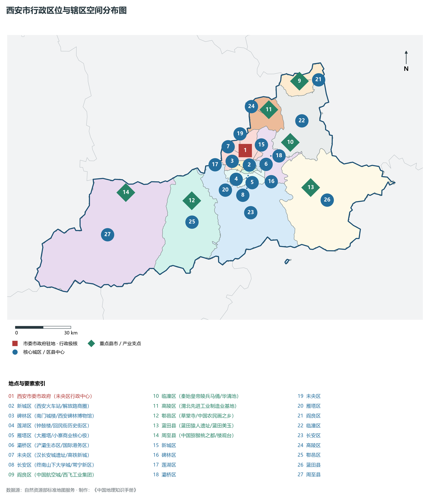
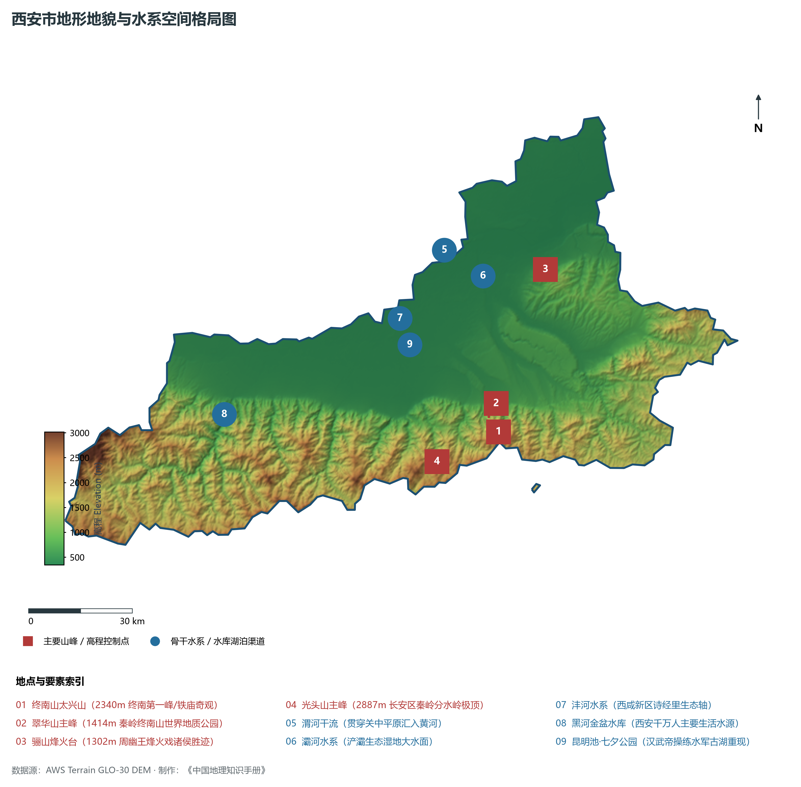
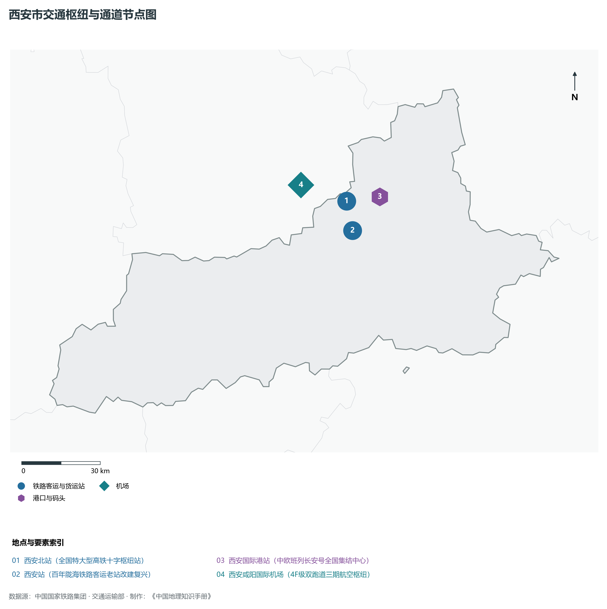
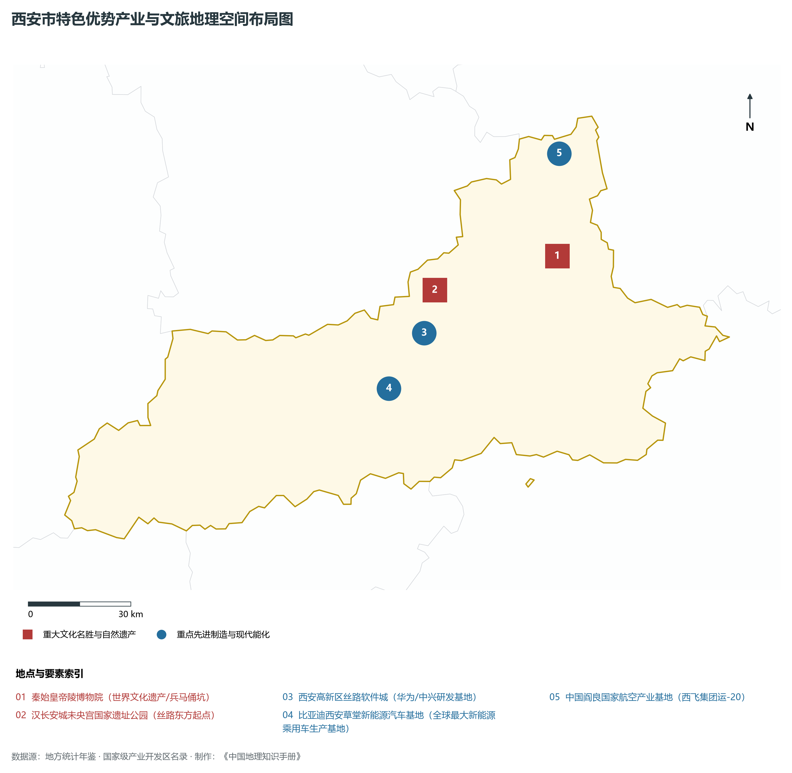
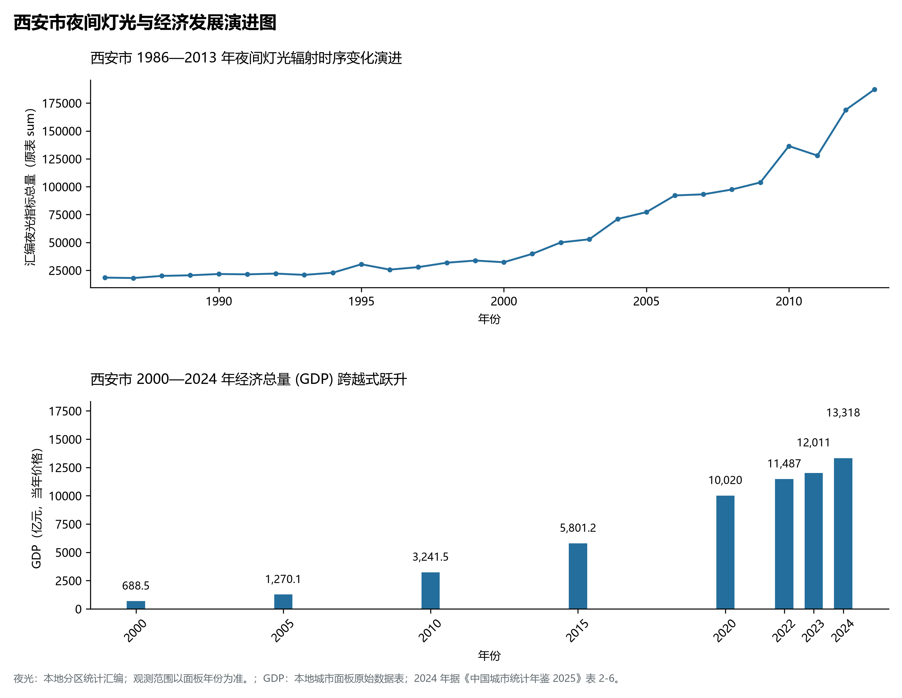

# 25.1 西安市

## 一、自然地理底盘与生态格局

西安市地处陕西省陕西省会·国家中心城市·世界历史文化名城·综合性国家科学中心与科创中心·亚欧大陆桥国际枢纽核心板块，位于东经 108.07° ～ 109.47°、北纬 33.96° ～ 34.81° 之间。2024 年常住人口 **1,317 万人**，常住人口城镇化率 **80.43%**，地区生产总值 **13,318 亿元**（当年价格），人均地区生产总值 **101,485 元**，三次产业构成为 **2.4 : 29.09 : 68.51**。

辖区内各层级重点行政极核、区县中心及战略功能节点布局如下：

- **西安市委市政府 (未央区行政中心)**：坐标 (108.94°E, 34.34°N)，功能定位：gov；
- **新城区 (西安火车站/解放路商圈)**：坐标 (108.96°E, 34.27°N)，功能定位：subdistrict；
- **碑林区 (南门城楼/西安碑林博物馆)**：坐标 (108.94°E, 34.25°N)，功能定位：subdistrict；
- **莲湖区 (钟鼓楼/回民街历史街区)**：坐标 (108.93°E, 34.27°N)，功能定位：subdistrict；
- **雁塔区 (大雁塔/小寨商业核心极)**：坐标 (108.95°E, 34.22°N)，功能定位：subdistrict；
- **灞桥区 (浐灞生态区/国际港务区)**：坐标 (109.06°E, 34.27°N)，功能定位：subdistrict；
- **未央区 (汉长安城遗址/高铁新城)**：坐标 (108.92°E, 34.32°N)，功能定位：subdistrict；
- **阎良区 (中国航空城/西飞工业集团)**：坐标 (109.28°E, 34.66°N)，功能定位：town；
- **临潼区 (秦始皇帝陵兵马俑/华清池)**：坐标 (109.21°E, 34.37°N)，功能定位：town；
- **长安区 (终南山下大学城/常宁新区)**：坐标 (108.94°E, 34.16°N)，功能定位：subdistrict；
- **高陵区 (渭北先进工业制造业基地)**：坐标 (109.09°E, 34.53°N)，功能定位：town；
- **鄠邑区 (草堂寺/中国农民画之乡)**：坐标 (108.61°E, 34.11°N)，功能定位：town；
- **蓝田县 (蓝田猿人遗址/蓝田美玉)**：坐标 (109.32°E, 34.15°N)，功能定位：town；
- **周至县 (中国猕猴桃之都/楼观台)**：坐标 (108.22°E, 34.16°N)，功能定位：town；

辖区地势格局呈现出独特的起伏演化特征，高程极值范围在 **345 m ～ 3015.0 m** 之间，全域最大相对高差达 **2670.0 m**：

辖区重点山脉峰峦与控制性地理高程节点如下：

- **终南山太兴山 (2340m 终南第一峰/铁庙奇观)**：海拔标高 **2340.0 m**，空间坐标 (109.05°E, 33.95°N)；
- **翠华山主峰 (1414m 秦岭终南山世界地质公园)**：海拔标高 **1414.0 m**，空间坐标 (109.02°E, 33.99°N)；
- **骊山烽火台 (1302m 周幽王烽火戏诸侯胜迹)**：海拔标高 **1302.0 m**，空间坐标 (109.22°E, 34.36°N)；
- **光头山主峰 (2887m 长安区秦岭分水岭极顶)**：海拔标高 **2887.0 m**，空间坐标 (108.85°E, 33.88°N)；

辖区骨干水系脉络与关键控制地标：

- **渭河干流 (贯穿关中平原汇入黄河)**：标定坐标 (108.9°E, 34.42°N)；
- **灞河水系 (浐灞生态湿地大水面)**：标定坐标 (109.02°E, 34.35°N)；
- **沣河水系 (西咸新区诗经里生态轴)**：标定坐标 (108.75°E, 34.25°N)；
- **黑河金盆水库 (西安千万人主要生活水源)**：标定坐标 (108.18°E, 34.02°N)；
- **昆明池·七夕公园 (汉武帝操练水军古湖重现)**：标定坐标 (108.78°E, 34.22°N)；

独特的自然地理底盘塑造了辖区深厚的气候、水土与生态本底。辖区积极践行“绿水青山就是金山银山”理念，坚决当好秦岭生态卫士，统筹山水林田湖草沙一体化保护和系统治理，严格落实黄河流域生态保护和高质量发展重大国家战略与长江十年禁渔，筑牢国家生态安全屏障。

---

## 二、综合立体交通网络与区位优势

作为陕西省综合立体交通网与丝绸之路经济带上的重要战略枢纽，西安市区位优势得天独厚、内联外通网络日臻完备。近年来，辖区全方位抢抓高质量共建“一带一路”、亚欧陆海贸易大通道与内陆开放型经济新体制机遇，客货综合保障能级实现历史性跨越：

骨干交通基础设施与重要立体物流枢纽节点包括：

- **西安北站 (全国特大型高铁十字枢纽站)**：空间标定 (108.94°E, 34.38°N)，设施类型：rail；
- **西安站 (百年陇海铁路客运老站改建复兴)**：空间标定 (108.96°E, 34.28°N)，设施类型：station；
- **西安国际港站 (中欧班列长安号全国集结中心)**：空间标定 (109.08°E, 34.39°N)，设施类型：port；
- **西安咸阳国际机场 (4F级双跑道三期航空枢纽)**：空间标定 (108.75°E, 34.44°N)，设施类型：airport；

通过高速铁路、高速公路枢纽环线与现代化空港、陆港无缝衔接，西安市全面融入关中平原城市群“1小时交通圈”与成渝双城经济圈、京津冀、长三角高铁通达网，深度嵌入全国统一大市场与向西开放前沿走廊。

---

## 三、特色优势产业集群、重点园区与现代经济版图

2024 年西安市全市地区生产总值为 13,318 亿元（当年价格）。

辖区核心产业平台、重大战略工程与重点开发区展示如下：

- **秦始皇帝陵博物院 (世界文化遗产/兵马俑坑)**：空间坐标 (109.28°E, 34.385°N)，核心功能：世界第八大奇迹与大一统象征；
- **西安高新区丝路软件城 (华为/中兴研发基地)**：空间坐标 (108.84°E, 34.2°N)，核心功能：万亿级高新数字经济高地；
- **比亚迪西安草堂新能源汽车基地**：空间坐标 (108.72°E, 34.06°N)，核心功能：全球最大新能源乘用车生产基地；
- **中国阎良国家航空产业基地 (西飞集团运-20)**：空间坐标 (109.3°E, 34.65°N)，核心功能：大国重器大飞机研发总装基地；
- **汉长安城未央宫国家遗址公园 (丝路东方起点)**：空间坐标 (108.88°E, 34.31°N)，核心功能：汉并天下两千年前政权核心；

在现代化产业布局与建圈强链战略中，辖区因地制宜打造特色优势产业生态圈：

1. **战略性新兴产业与先进制造业**：聚焦高端装备制造、新材料、电子信息、新能源汽车及关键零部件，培育高新技术企业与专精特新“小巨人”企业；
2. **现代特色农业与优质食品工业**：持续做优做精地理标志特色农产品，推进农产品精深加工全产业链升级，擦亮农业金色招牌；
3. **现代服务业、物流与数字经济赋能**：加快布局现代物流枢纽、算力中心、数字文旅与康养产业新业态，激发新质生产力澎湃动能。

---

## 四、历史文化胜迹、世界遗产与生态文旅名胜

西安市历史厚重，人文荟萃，是中华民族和华夏文明的重要发祥地之一，壮丽山川与厚重文脉交相辉映，是世界级文旅胜地：

- **世界文化遗产与国家级重点文保**：拥有享誉中外的世界文化遗产、国家历史文化名城与全国重点文物保护单位，古遗址、古墓葬、摩崖石刻与革命旧址完好保存，生动记录了周秦汉唐盛世文明与中国革命的光辉史诗；
- **国家级风景名胜区与生态地质奇观**：大自然造化赐予辖区雄奇险秀的山川胜景、湿地湖泊、国家森林公园与世界地质公园，空气清冽、风景如画，是绝佳的休闲避暑与生态康养度假胜地；
- **非物质文化遗产与红色基因传承**：秦腔、皮影、剪纸等非遗瑰宝代代相传，红色精神历久弥新，共同构筑起新时代三秦儿女昂扬奋进的精神家园。

---

## 五、夜间灯光遥感时序演变与新时代现代化发展变化

本节夜光图的观测年份为 1986—2013 年，指标为行政区汇总值（原表 sum）。

### 1. 1986—2013 年夜间灯光遥感演化分析

- **1996年演化特征**：明城墙环内与南郊高教区微弱星火；
- **2006年演化特征**：高新区一期二期与经开区两翼铺展；
- **2014年演化特征**：曲江新区·浐灞生态区·西安北站崛起；
- **2023年演化特征**：万亿级强省会·双中心启动·国际港璀璨；

### 2. 2000—2024 年经济跨越式发展时序汇总
下表记录了 西安市 自 2000 年以来核心年份地区生产总值（GDP）的翻番跨越历程：

| 年份 | 地区生产总值（亿元，当年价格） |
|:---|---:|
| 2000 年 | 688.5 |
| 2005 年 | 1,270.1 |
| 2010 年 | 3,241.5 |
| 2015 年 | 5,801.2 |
| 2020 年 | 10,020 |
| 2022 年 | 11,487 |
| 2023 年 | 12,011 |
| 2024 年 | 13,318 |

### 3. 新征程高质量跨越式发展愿景
迈向中国式现代化新征程，西安市将全面贯彻新发展理念，主动融入和服务国家重大发展战略：

1. 深入推进新型工业化与新型城镇化，做强做优做大优势实体经济，培育壮大战略性新兴产业和未来产业；
2. 协同推进高水平生态环境保护与绿色低碳转型，筑牢国家生态安全屏障；
3. 统筹城乡融合发展与民生保障，奋力谱写中国式现代化建设的陕西新篇章。

2024 年统计来源：《中国城市统计年鉴 2025》表 2-1、2-6、2-7（2024 年，全市）。其他年份 GDP 据本地城市面板“原始数据”表，单位为亿元、当年价格。
