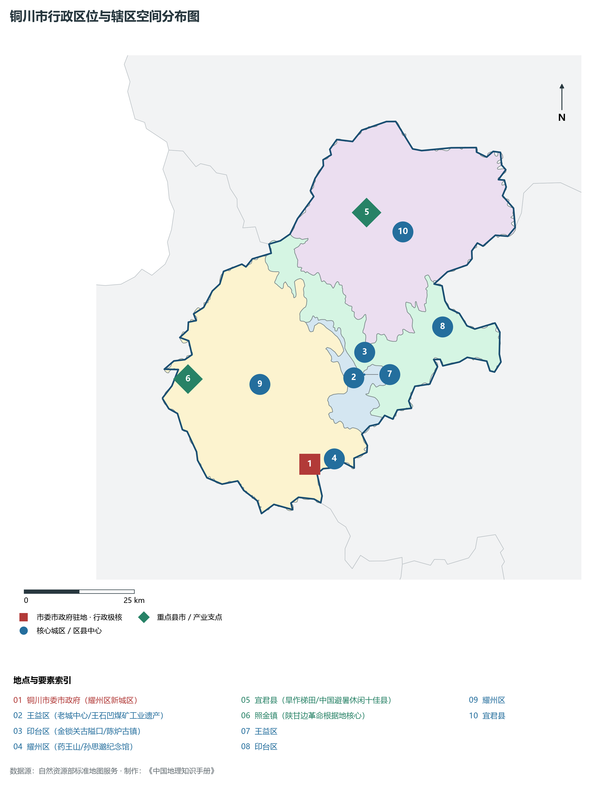
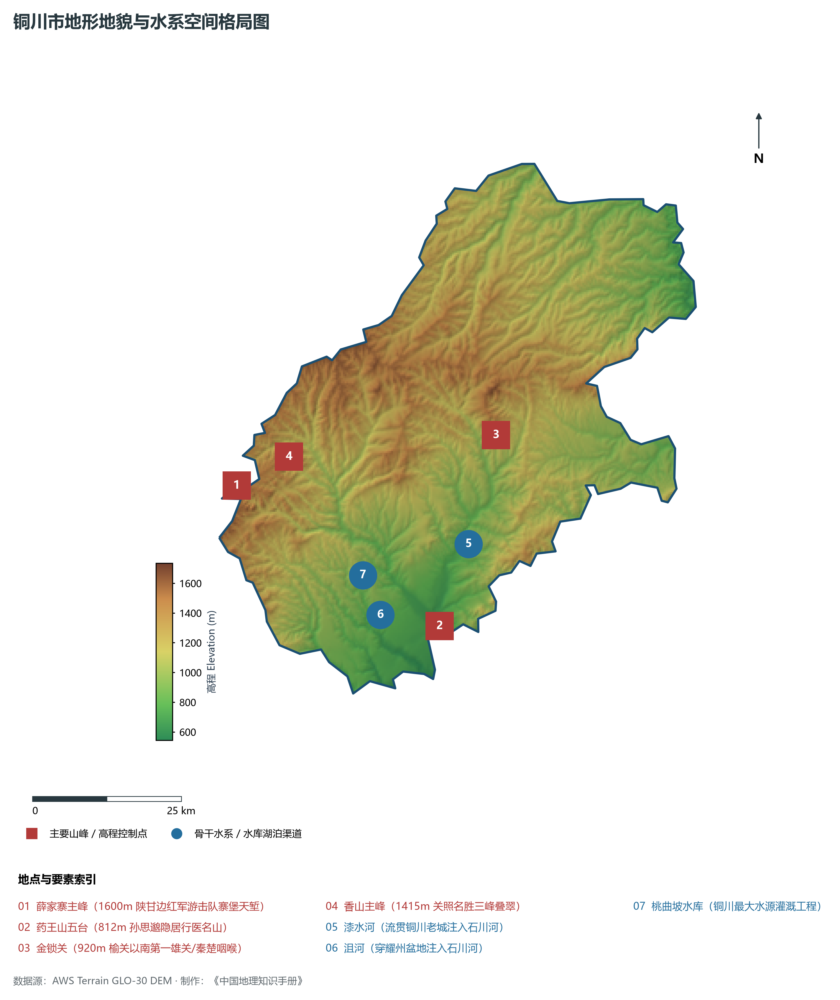
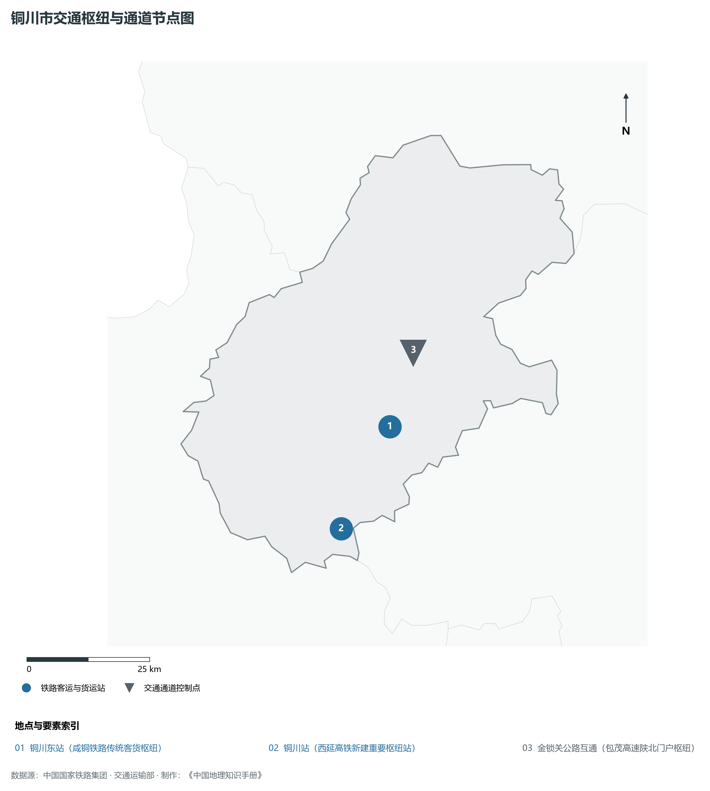
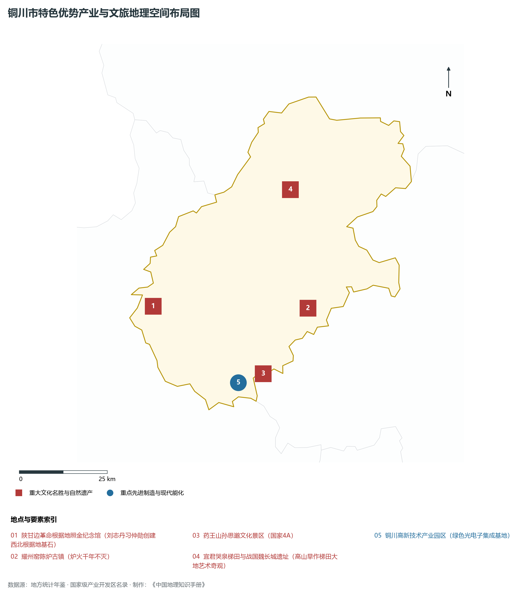
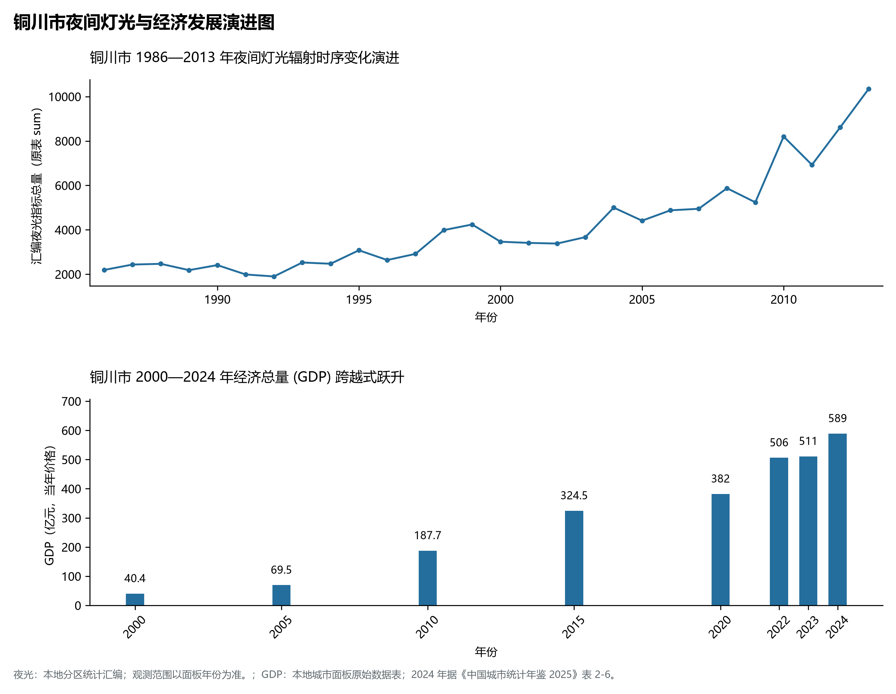

# 25.2 铜川市

## 一、自然地理底盘与生态格局

铜川市地处陕西省关中北部战略屏障·中国药王故里·红色照金革命圣地·千年耀州瓷都·老工业基地转型样板核心板块，位于东经 108.50° ～ 109.27°、北纬 34.75° ～ 35.55° 之间。2024 年常住人口 **70 万人**，常住人口城镇化率 **65.34%**，地区生产总值 **589 亿元**（当年价格），人均地区生产总值 **83,586 元**，三次产业构成为 **6.38 : 36.11 : 57.51**。

辖区内各层级重点行政极核、区县中心及战略功能节点布局如下：

- **铜川市委市政府 (耀州区新城区)**：坐标 (108.95°E, 34.9°N)，功能定位：gov；
- **王益区 (老城中心/王石凹煤矿工业遗产)**：坐标 (109.07°E, 35.07°N)，功能定位：subdistrict；
- **印台区 (金锁关古隘口/陈炉古镇)**：坐标 (109.1°E, 35.12°N)，功能定位：subdistrict；
- **耀州区 (药王山/孙思邈纪念馆)**：坐标 (108.98°E, 34.91°N)，功能定位：subdistrict；
- **宜君县 (旱作梯田/中国避暑休闲十佳县)**：坐标 (109.12°E, 35.4°N)，功能定位：town；
- **照金镇 (陕甘边革命根据地核心)**：坐标 (108.65°E, 35.08°N)，功能定位：town；

辖区地势格局呈现出独特的起伏演化特征，高程极值范围在 **543 m ～ 1734.0 m** 之间，全域最大相对高差达 **1191.0 m**：

辖区重点山脉峰峦与控制性地理高程节点如下：

- **薛家寨主峰 (1600m 陕甘边红军游击队寨堡天堑)**：海拔标高 **1600.0 m**，空间坐标 (108.62°E, 35.12°N)；
- **药王山五台 (812m 孙思邈隐居行医名山)**：海拔标高 **812.0 m**，空间坐标 (108.99°E, 34.9°N)；
- **金锁关 (920m 榆关以南第一雄关/秦楚咽喉)**：海拔标高 **920.0 m**，空间坐标 (109.11°E, 35.18°N)；
- **香山主峰 (1415m 关照名胜三峰叠翠)**：海拔标高 **1415.0 m**，空间坐标 (108.72°E, 35.16°N)；

辖区骨干水系脉络与关键控制地标：

- **漆水河 (流贯铜川老城注入石川河)**：标定坐标 (109.05°E, 35.02°N)；
- **沮河 (穿耀州盆地注入石川河)**：标定坐标 (108.88°E, 34.92°N)；
- **桃曲坡水库 (铜川最大水源灌溉工程)**：标定坐标 (108.85°E, 34.98°N)；

独特的自然地理底盘塑造了辖区深厚的气候、水土与生态本底。辖区积极践行“绿水青山就是金山银山”理念，坚决当好秦岭生态卫士，统筹山水林田湖草沙一体化保护和系统治理，严格落实黄河流域生态保护和高质量发展重大国家战略与长江十年禁渔，筑牢国家生态安全屏障。

---

## 二、综合立体交通网络与区位优势

作为陕西省综合立体交通网与丝绸之路经济带上的重要战略枢纽，铜川市区位优势得天独厚、内联外通网络日臻完备。近年来，辖区全方位抢抓高质量共建“一带一路”、亚欧陆海贸易大通道与内陆开放型经济新体制机遇，客货综合保障能级实现历史性跨越：

骨干交通基础设施与重要立体物流枢纽节点包括：

- **铜川东站 (咸铜铁路传统客货枢纽)**：空间标定 (109.06°E, 35.06°N)，设施类型：station；
- **铜川站 (西延高铁新建重要枢纽站)**：空间标定 (108.94°E, 34.88°N)，设施类型：rail；
- **金锁关公路互通 (包茂高速陕北门户枢纽)**：空间标定 (109.12°E, 35.19°N)，设施类型：bridge；

通过高速铁路、高速公路枢纽环线与现代化空港、陆港无缝衔接，铜川市全面融入关中平原城市群“1小时交通圈”与成渝双城经济圈、京津冀、长三角高铁通达网，深度嵌入全国统一大市场与向西开放前沿走廊。

---

## 三、特色优势产业集群、重点园区与现代经济版图

2024 年铜川市全市地区生产总值为 589 亿元（当年价格）。

辖区核心产业平台、重大战略工程与重点开发区展示如下：

- **陕甘边革命根据地照金纪念馆**：空间坐标 (108.66°E, 35.07°N)，核心功能：刘志丹习仲勋创建西北根据地基石；
- **耀州窑陈炉古镇 (炉火千年不灭)**：空间坐标 (109.15°E, 35.05°N)，核心功能：中国北方刻花青瓷活化石；
- **药王山孙思邈文化景区 (国家4A)**：空间坐标 (109.0°E, 34.89°N)，核心功能：千金要方诞生地与石刻摩崖大观；
- **铜川高新技术产业园区 (绿色光电子集成基地)**：空间坐标 (108.92°E, 34.87°N)，核心功能：资源枯竭型城市转型先进高新标杆；
- **宜君哭泉梯田与战国魏长城遗址**：空间坐标 (109.11°E, 35.35°N)，核心功能：高山旱作梯田大地艺术奇观；

在现代化产业布局与建圈强链战略中，辖区因地制宜打造特色优势产业生态圈：

1. **战略性新兴产业与先进制造业**：聚焦高端装备制造、新材料、电子信息、新能源汽车及关键零部件，培育高新技术企业与专精特新“小巨人”企业；
2. **现代特色农业与优质食品工业**：持续做优做精地理标志特色农产品，推进农产品精深加工全产业链升级，擦亮农业金色招牌；
3. **现代服务业、物流与数字经济赋能**：加快布局现代物流枢纽、算力中心、数字文旅与康养产业新业态，激发新质生产力澎湃动能。

---

## 四、历史文化胜迹、世界遗产与生态文旅名胜

铜川市历史厚重，人文荟萃，是中华民族和华夏文明的重要发祥地之一，壮丽山川与厚重文脉交相辉映，是世界级文旅胜地：

- **世界文化遗产与国家级重点文保**：拥有享誉中外的世界文化遗产、国家历史文化名城与全国重点文物保护单位，古遗址、古墓葬、摩崖石刻与革命旧址完好保存，生动记录了周秦汉唐盛世文明与中国革命的光辉史诗；
- **国家级风景名胜区与生态地质奇观**：大自然造化赐予辖区雄奇险秀的山川胜景、湿地湖泊、国家森林公园与世界地质公园，空气清冽、风景如画，是绝佳的休闲避暑与生态康养度假胜地；
- **非物质文化遗产与红色基因传承**：秦腔、皮影、剪纸等非遗瑰宝代代相传，红色精神历久弥新，共同构筑起新时代三秦儿女昂扬奋进的精神家园。

---

## 五、夜间灯光遥感时序演变与新时代现代化发展变化

本节夜光图的观测年份为 1986—2013 年，指标为行政区汇总值（原表 sum）。

### 1. 1986—2013 年夜间灯光遥感演化分析

- **1996年演化特征**：王益印台老煤矿与水泥厂微光；
- **2006年演化特征**：铜川新区整体南迁·西铜高速通达；
- **2014年演化特征**：药王山与照金红色旅游集群崛起；
- **2023年演化特征**：铝电子高端制造·资源型城市华丽转型；

### 2. 2000—2024 年经济跨越式发展时序汇总
下表记录了 铜川市 自 2000 年以来核心年份地区生产总值（GDP）的翻番跨越历程：

| 年份 | 地区生产总值（亿元，当年价格） |
|:---|---:|
| 2000 年 | 40.4 |
| 2005 年 | 69.5 |
| 2010 年 | 187.7 |
| 2015 年 | 324.5 |
| 2020 年 | 382 |
| 2022 年 | 506 |
| 2023 年 | 511 |
| 2024 年 | 589 |

### 3. 新征程高质量跨越式发展愿景
迈向中国式现代化新征程，铜川市将全面贯彻新发展理念，主动融入和服务国家重大发展战略：

1. 深入推进新型工业化与新型城镇化，做强做优做大优势实体经济，培育壮大战略性新兴产业和未来产业；
2. 协同推进高水平生态环境保护与绿色低碳转型，筑牢国家生态安全屏障；
3. 统筹城乡融合发展与民生保障，奋力谱写中国式现代化建设的陕西新篇章。

2024 年统计来源：《中国城市统计年鉴 2025》表 2-1、2-6、2-7（2024 年，全市）。其他年份 GDP 据本地城市面板“原始数据”表，单位为亿元、当年价格。
