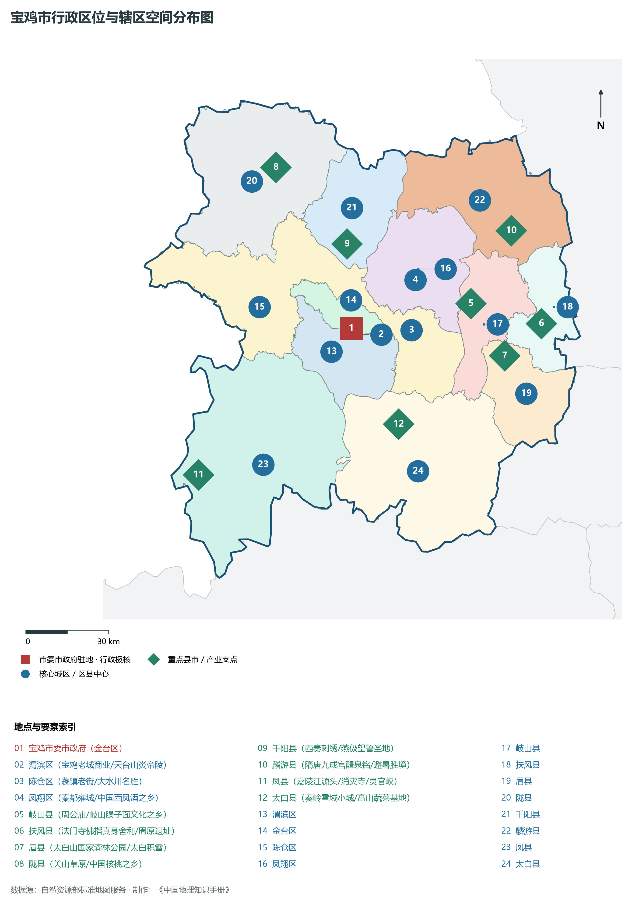
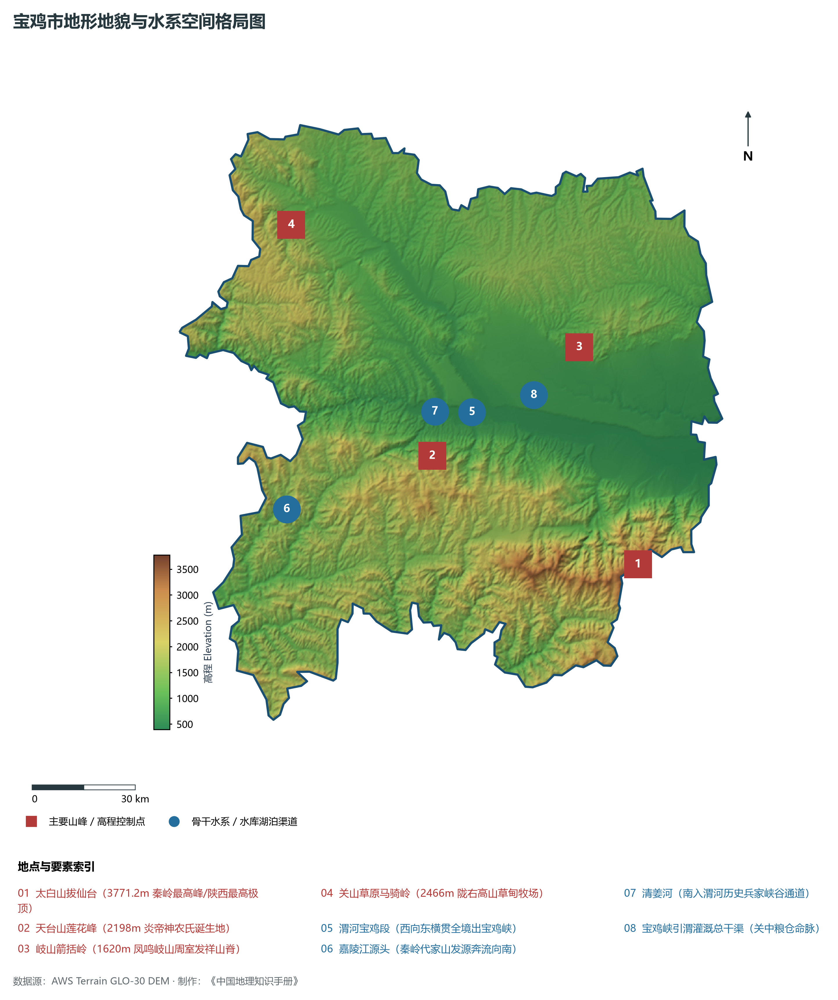
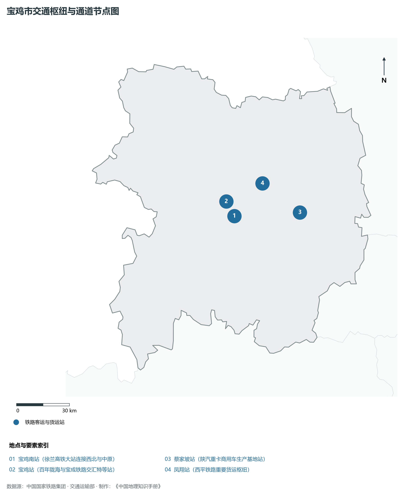
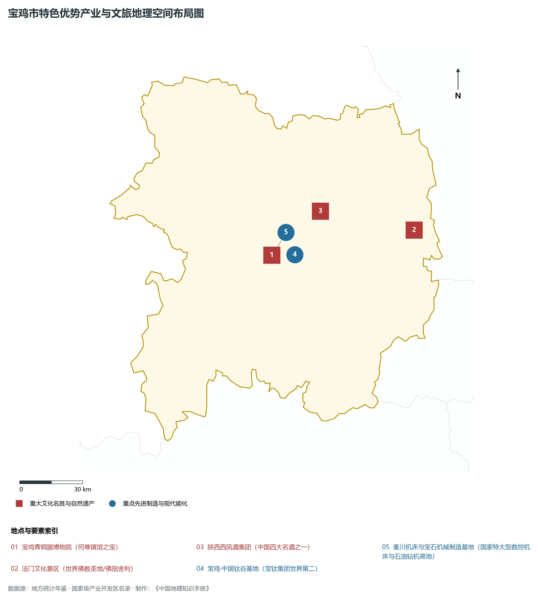
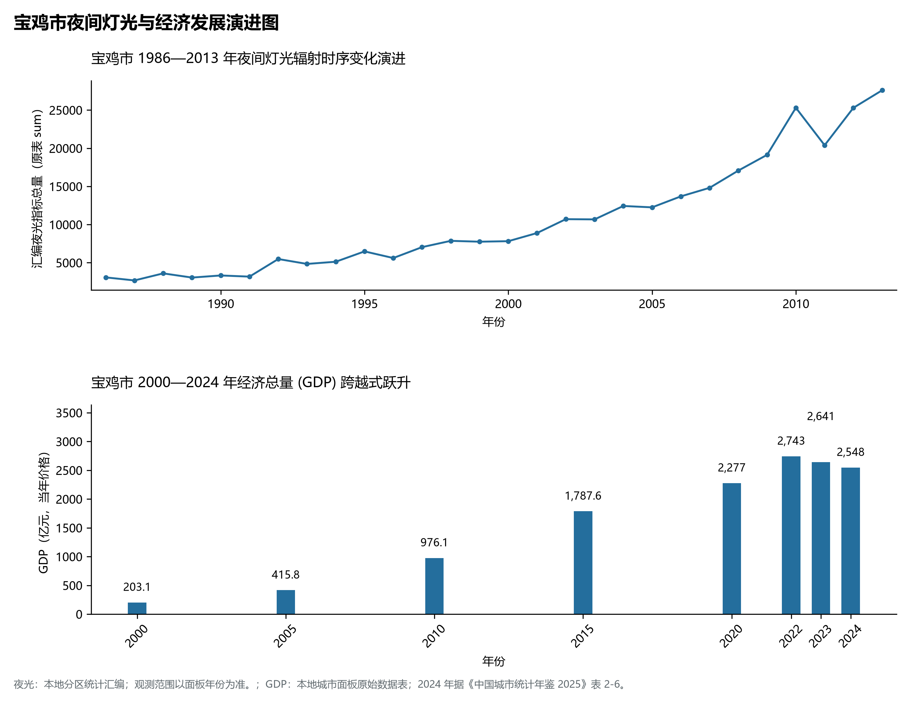

# 25.3 宝鸡市

## 一、自然地理底盘与生态格局

宝鸡市地处陕西省关中副中心·炎帝故里·中国青铜器之乡·西周文化发祥地·现代先进装备制造业重镇核心板块，位于东经 106.37° ～ 108.05°、北纬 33.76° ～ 35.04° 之间。2024 年常住人口 **325 万人**，常住人口城镇化率 **62.16%**，地区生产总值 **2,548 亿元**（当年价格），人均地区生产总值 **78,267 元**，三次产业构成为 **9.11 : 41.85 : 49.05**。

辖区内各层级重点行政极核、区县中心及战略功能节点布局如下：

- **宝鸡市委市政府 (金台区)**：坐标 (107.14°E, 34.37°N)，功能定位：gov；
- **渭滨区 (宝鸡老城商业/天台山炎帝陵)**：坐标 (107.15°E, 34.35°N)，功能定位：subdistrict；
- **陈仓区 (虢镇老街/大水川名胜)**：坐标 (107.38°E, 34.36°N)，功能定位：subdistrict；
- **凤翔区 (秦都雍城/中国西凤酒之乡)**：坐标 (107.4°E, 34.52°N)，功能定位：subdistrict；
- **岐山县 (周公庙/岐山臊子面文化之乡)**：坐标 (107.62°E, 34.44°N)，功能定位：town；
- **扶风县 (法门寺佛指真身舍利/周原遗址)**：坐标 (107.9°E, 34.37°N)，功能定位：town；
- **眉县 (太白山国家森林公园/太白积雪)**：坐标 (107.75°E, 34.27°N)，功能定位：town；
- **陇县 (关山草原/中国核桃之乡)**：坐标 (106.85°E, 34.89°N)，功能定位：town；
- **千阳县 (西秦刺绣/燕伋望鲁圣地)**：坐标 (107.13°E, 34.64°N)，功能定位：town；
- **麟游县 (隋唐九成宫醴泉铭/避暑胜境)**：坐标 (107.79°E, 34.67°N)，功能定位：town；
- **凤县 (嘉陵江源头/消灾寺/灵官峡)**：坐标 (106.52°E, 33.91°N)，功能定位：town；
- **太白县 (秦岭雪域小城/高山蔬菜基地)**：坐标 (107.32°E, 34.06°N)，功能定位：town；

辖区地势格局呈现出独特的起伏演化特征，高程极值范围在 **392 m ～ 3771.2 m** 之间，全域最大相对高差达 **3379.2 m**：

辖区重点山脉峰峦与控制性地理高程节点如下：

- **太白山拔仙台 (3771.2m 秦岭最高峰/陕西最高极顶)**：海拔标高 **3771.2 m**，空间坐标 (107.77°E, 33.958°N)；
- **天台山莲花峰 (2198m 炎帝神农氏诞生地)**：海拔标高 **2198.0 m**，空间坐标 (107.12°E, 34.25°N)；
- **岐山箭括岭 (1620m 凤鸣岐山周室发祥山脊)**：海拔标高 **1620.0 m**，空间坐标 (107.6°E, 34.52°N)；
- **关山草原马骑岭 (2466m 陇右高山草甸牧场)**：海拔标高 **2466.0 m**，空间坐标 (106.68°E, 34.85°N)；

辖区骨干水系脉络与关键控制地标：

- **渭河宝鸡段 (西向东横贯全境出宝鸡峡)**：标定坐标 (107.25°E, 34.36°N)；
- **嘉陵江源头 (秦岭代家山发源奔流向南)**：标定坐标 (106.65°E, 34.12°N)；
- **清姜河 (南入渭河历史兵家峡谷通道)**：标定坐标 (107.13°E, 34.32°N)；
- **宝鸡峡引渭灌溉总干渠 (关中粮仓命脉)**：标定坐标 (107.45°E, 34.4°N)；

独特的自然地理底盘塑造了辖区深厚的气候、水土与生态本底。辖区积极践行“绿水青山就是金山银山”理念，坚决当好秦岭生态卫士，统筹山水林田湖草沙一体化保护和系统治理，严格落实黄河流域生态保护和高质量发展重大国家战略与长江十年禁渔，筑牢国家生态安全屏障。

---

## 二、综合立体交通网络与区位优势

作为陕西省综合立体交通网与丝绸之路经济带上的重要战略枢纽，宝鸡市区位优势得天独厚、内联外通网络日臻完备。近年来，辖区全方位抢抓高质量共建“一带一路”、亚欧陆海贸易大通道与内陆开放型经济新体制机遇，客货综合保障能级实现历史性跨越：

骨干交通基础设施与重要立体物流枢纽节点包括：

- **宝鸡南站 (徐兰高铁大站连接西北与中原)**：空间标定 (107.2°E, 34.34°N)，设施类型：rail；
- **宝鸡站 (百年陇海与宝成铁路交汇特等站)**：空间标定 (107.15°E, 34.37°N)，设施类型：station；
- **蔡家坡站 (陕汽重卡商用车生产基地站)**：空间标定 (107.61°E, 34.35°N)，设施类型：station；
- **凤翔站 (西平铁路重要货运枢纽)**：空间标定 (107.38°E, 34.5°N)，设施类型：station；

通过高速铁路、高速公路枢纽环线与现代化空港、陆港无缝衔接，宝鸡市全面融入关中平原城市群“1小时交通圈”与成渝双城经济圈、京津冀、长三角高铁通达网，深度嵌入全国统一大市场与向西开放前沿走廊。

---

## 三、特色优势产业集群、重点园区与现代经济版图

2024 年宝鸡市全市地区生产总值为 2,548 亿元（当年价格）。

辖区核心产业平台、重大战略工程与重点开发区展示如下：

- **宝鸡青铜器博物院 (何尊镇馆之宝)**：空间坐标 (107.16°E, 34.35°N)，核心功能：国家一级博物馆与周秦文明圣殿；
- **法门文化景区 (世界佛教圣地/佛指舍利)**：空间坐标 (107.91°E, 34.44°N)，核心功能：唐代地宫千件稀世珍宝出土地；
- **宝鸡·中国钛谷基地 (宝钛集团世界第二)**：空间坐标 (107.28°E, 34.35°N)，核心功能：国家先进结构材料产业集群核心；
- **陕西西凤酒集团 (中国四大名酒之一)**：空间坐标 (107.42°E, 34.53°N)，核心功能：三千年无断代酿造凤香型白酒宗师；
- **秦川机床与宝石机械制造基地**：空间坐标 (107.18°E, 34.37°N)，核心功能：国家特大型数控机床与石油钻机高地；

在现代化产业布局与建圈强链战略中，辖区因地制宜打造特色优势产业生态圈：

1. **战略性新兴产业与先进制造业**：聚焦高端装备制造、新材料、电子信息、新能源汽车及关键零部件，培育高新技术企业与专精特新“小巨人”企业；
2. **现代特色农业与优质食品工业**：持续做优做精地理标志特色农产品，推进农产品精深加工全产业链升级，擦亮农业金色招牌；
3. **现代服务业、物流与数字经济赋能**：加快布局现代物流枢纽、算力中心、数字文旅与康养产业新业态，激发新质生产力澎湃动能。

---

## 四、历史文化胜迹、世界遗产与生态文旅名胜

宝鸡市历史厚重，人文荟萃，是中华民族和华夏文明的重要发祥地之一，壮丽山川与厚重文脉交相辉映，是世界级文旅胜地：

- **世界文化遗产与国家级重点文保**：拥有享誉中外的世界文化遗产、国家历史文化名城与全国重点文物保护单位，古遗址、古墓葬、摩崖石刻与革命旧址完好保存，生动记录了周秦汉唐盛世文明与中国革命的光辉史诗；
- **国家级风景名胜区与生态地质奇观**：大自然造化赐予辖区雄奇险秀的山川胜景、湿地湖泊、国家森林公园与世界地质公园，空气清冽、风景如画，是绝佳的休闲避暑与生态康养度假胜地；
- **非物质文化遗产与红色基因传承**：秦腔、皮影、剪纸等非遗瑰宝代代相传，红色精神历久弥新，共同构筑起新时代三秦儿女昂扬奋进的精神家园。

---

## 五、夜间灯光遥感时序演变与新时代现代化发展变化

本节夜光图的观测年份为 1986—2013 年，指标为行政区汇总值（原表 sum）。

### 1. 1986—2013 年夜间灯光遥感演化分析

- **1996年演化特征**：金台陈仓渭水狭长工业走廊微火；
- **2006年演化特征**：宝鸡高新区向东拓展·西宝高速贯通；
- **2014年演化特征**：徐兰高铁宝鸡南站启用·工业装备高地；
- **2023年演化特征**：钛谷与智能机床崛起·秦岭北麓生态明珠；

### 2. 2000—2024 年经济跨越式发展时序汇总
下表记录了 宝鸡市 自 2000 年以来核心年份地区生产总值（GDP）的翻番跨越历程：

| 年份 | 地区生产总值（亿元，当年价格） |
|:---|---:|
| 2000 年 | 203.1 |
| 2005 年 | 415.8 |
| 2010 年 | 976.1 |
| 2015 年 | 1,787.6 |
| 2020 年 | 2,277 |
| 2022 年 | 2,743 |
| 2023 年 | 2,641 |
| 2024 年 | 2,548 |

### 3. 新征程高质量跨越式发展愿景
迈向中国式现代化新征程，宝鸡市将全面贯彻新发展理念，主动融入和服务国家重大发展战略：

1. 深入推进新型工业化与新型城镇化，做强做优做大优势实体经济，培育壮大战略性新兴产业和未来产业；
2. 协同推进高水平生态环境保护与绿色低碳转型，筑牢国家生态安全屏障；
3. 统筹城乡融合发展与民生保障，奋力谱写中国式现代化建设的陕西新篇章。

2024 年统计来源：《中国城市统计年鉴 2025》表 2-1、2-6、2-7（2024 年，全市）。其他年份 GDP 据本地城市面板“原始数据”表，单位为亿元、当年价格。
